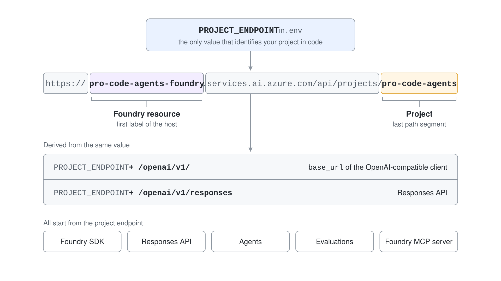
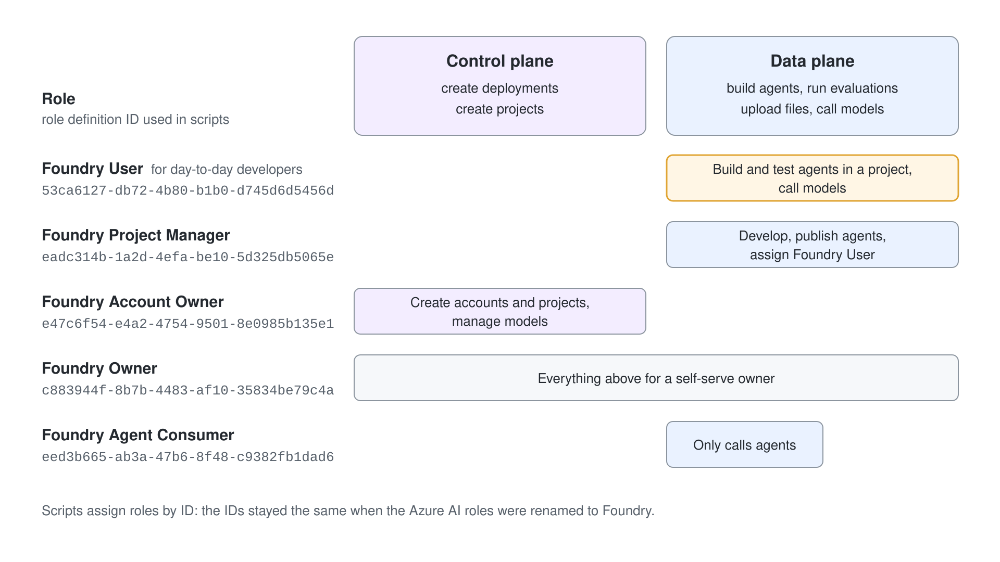

# Inspect a Foundry Project from the CLI and SDK

You are handed a project endpoint and a model name, and everything else about the project is a guess: which resource owns it, which models it can call, which identity your code runs as, and what that identity may do. In this demo you answer all four questions with the Azure CLI and a few small Python scripts, and finish with a first call that proves your access works.

What you practice here: reading a Foundry resource, project, deployment and role assignment from the outside before you write any agent code.

Duration: about 40 minutes.

## Prerequisites

- Azure CLI 2.80.0 or later, signed in with `az login`, and Python 3.10 or later or the .NET 10 SDK.
- The Foundry User role on the `pro-code-agents` project (granted at the project, the Foundry resource or a higher scope).
- A model deployment named `gpt-5.4` in the project.

## Run it

Work in `project-inspector-py/` for Python or `project-inspector-cs/` for C#. Both read `PROJECT_ENDPOINT` and `MODEL_DEPLOYMENT_NAME` from `.env`, and every step shows the Python script and the C# command side by side.

```bash
cd demos/01-foundry-essentials/01-foundry-projects/project-inspector-py
python -m venv .venv
.venv/Scripts/pip install -r requirements.txt
cp .env.example .env
```

Edit `.env` so it holds the endpoint of your project.

```text
PROJECT_ENDPOINT=https://pro-code-agents-foundry.services.ai.azure.com/api/projects/pro-code-agents
MODEL_DEPLOYMENT_NAME=gpt-5.4
```

The C# commands in the steps run from this same folder with `--project ../project-inspector-cs`, and .NET reads the `.env` of the folder you run from. Restore the C# project once:

```bash
dotnet restore ../project-inspector-cs
```

## Step 1: Map the resource hierarchy with the CLI

The project endpoint hides which Azure resource owns the project. Resolve it from the Azure side first, so you know where deployments and role assignments are managed.

```bash
az cognitiveservices account show \
    --name pro-code-agents-foundry --resource-group rg-pro-code-agents \
    --query "{name:name, type:type, kind:kind, location:location, sku:sku.name}" -o json

az cognitiveservices account project list \
    --name pro-code-agents-foundry --resource-group rg-pro-code-agents \
    --query "[].{name:name, type:type, endpoint:properties.endpoints.\"AI Foundry API\"}" -o json
```

Expected output:

```json
{
  "kind": "AIServices",
  "location": "swedencentral",
  "name": "pro-code-agents-foundry",
  "sku": "S0",
  "type": "Microsoft.CognitiveServices/accounts"
}
[
  {
    "endpoint": "https://pro-code-agents-foundry.services.ai.azure.com/api/projects/pro-code-agents",
    "name": "pro-code-agents-foundry/pro-code-agents",
    "type": "Microsoft.CognitiveServices/accounts/projects"
  }
]
```

The Foundry resource is an `AIServices` account and the project is its child resource. The `endpoint` value of the project is the string you put in `PROJECT_ENDPOINT`.

## Step 2: Read the endpoint apart

The endpoint encodes both the resource and the project. `endpoint.py` splits it so you can see which part names which resource.



```python
url = urlparse(os.environ["PROJECT_ENDPOINT"])
resource = url.hostname.split(".")[0]
project = url.path.rstrip("/").split("/")[-1]

print(f"Foundry resource : {resource}")
print(f"Project          : {project}")
print(f"Responses API    : {url.geturl().rstrip('/')}/openai/v1/responses")
```

```csharp
var url = new Uri(Environment.GetEnvironmentVariable("PROJECT_ENDPOINT")!);
var resource = url.Host.Split('.')[0];
var project = url.AbsolutePath.TrimEnd('/').Split('/')[^1];

Console.WriteLine($"Foundry resource : {resource}");
Console.WriteLine($"Project          : {project}");
Console.WriteLine($"Responses API    : {url.AbsoluteUri.TrimEnd('/')}/openai/v1/responses");
```

```bash
.venv/Scripts/python endpoint.py
dotnet run --project ../project-inspector-cs -- endpoint
```

Expected output:

```text
Foundry resource : pro-code-agents-foundry
Project          : pro-code-agents
Host             : pro-code-agents-foundry.services.ai.azure.com
Path             : /api/projects/pro-code-agents
Responses API    : https://pro-code-agents-foundry.services.ai.azure.com/api/projects/pro-code-agents/openai/v1/responses
```

The last line is the URL the Responses API lives at. It is derived from the same project endpoint, which is why one value is enough.

## Step 3: List what the project inherits

Deployments and connections belong to the resource, yet the project sees them. `deployments.py` asks the project through the Foundry SDK.

```python
project = AIProjectClient(
    endpoint=os.environ["PROJECT_ENDPOINT"],
    credential=DefaultAzureCredential(),
)

for deployment in project.deployments.list():
    print(f"{deployment.name:<28} {deployment.model_name:<28} {deployment.model_version:<12} {deployment.sku.name}")
```

```csharp
AIProjectClient project = new(
    new Uri(Environment.GetEnvironmentVariable("PROJECT_ENDPOINT")!),
    new DefaultAzureCredential());

foreach (ModelDeployment deployment in project.Deployments.GetDeployments().OfType<ModelDeployment>())
{
    Console.WriteLine($"{deployment.Name,-28} {deployment.ModelName,-28} {deployment.ModelVersion,-12} {deployment.Sku.Name}");
}
```

```bash
.venv/Scripts/python deployments.py
dotnet run --project ../project-inspector-cs -- deployments
```

Expected output:

```text
gpt-5.4                      gpt-5.4                      2026-03-05   GlobalStandard
gpt-5-mini                   gpt-5-mini                   2025-08-07   GlobalStandard
text-embedding-3-small       text-embedding-3-small       1            GlobalStandard
m1-router-balanced           model-router                 2025-11-18   GlobalStandard
...

Connections on the project: 2
m7-appinsights               ConnectionType.APPLICATION_INSIGHTS
...
```

Your list differs by what your resource holds; other class modules add the router deployments and connections you see here. The point is that the project lists resource-level deployments without any project-level setup.

The C# command prints the same deployments. It names the connection types without the Python enum prefix, and `GetDeployments()` returns every deployment kind, so the loop keeps the `ModelDeployment` ones.

```text
Connections on the project: 5
m7-appinsights               AppInsights
m3-browser-mcp               PlaywrightWorkspace
m3-playwright-mcp            RemoteTool
...
```

## Step 4: Inspect the identity and the roles behind it

A call succeeds or fails because of the token it carries. `identity.py` decodes your token locally (no signature check, read only) to show its audience and who it identifies.

```csharp
var token = new DefaultAzureCredential()
    .GetToken(new TokenRequestContext(["https://ai.azure.com/.default"]))
    .Token;
using var claims = JsonDocument.Parse(Convert.FromBase64String(payload));
```

```bash
.venv/Scripts/python identity.py
dotnet run --project ../project-inspector-cs -- identity
```

Expected output:

```text
audience : https://ai.azure.com
identity : alexander.kastil@integrations.at
type     : user
tenant   : d92b247e...
```

Now list the Foundry roles by their definition IDs, then list what is assigned to you on the project. The IDs are the stable part of the rename from the Azure AI role names.



```bash
az role definition list --query "[?contains(roleName,'Foundry')].[roleName,name]" -o tsv

ACCOUNT_ID=$(az cognitiveservices account show --name pro-code-agents-foundry --resource-group rg-pro-code-agents --query id -o tsv)
PROJECT_ID="$ACCOUNT_ID/projects/pro-code-agents"
OBJECT_ID=$(az ad signed-in-user show --query id -o tsv)
az role assignment list --assignee $OBJECT_ID --scope $PROJECT_ID --include-inherited \
    --query "[].{role:roleDefinitionName, scope:scope}" -o table
```

Expected output:

```text
Foundry Project Manager	eadc314b-1a2d-4efa-be10-5d325db5065e
Foundry Account Owner	e47c6f54-e4a2-4754-9501-8e0985b135e1
Foundry User	53ca6127-db72-4b80-b1b0-d745d6d5456d
Foundry Owner	c883944f-8b7b-4483-af10-35834be79c4a
Foundry Agent Consumer	eed3b665-ab3a-47b6-8f48-c9382fb1dad6
Foundry Project Runtime User	142bfaed-a13f-4c2d-bed2-6db62c4a1009

Role                     Scope
-----------------------  ----------------------------------------------------------------------------------
Foundry User             /subscriptions/cd091145-.../providers/Microsoft.CognitiveServices/accounts/pro-code-agents-foundry
Foundry Project Manager  /subscriptions/cd091145-.../providers/Microsoft.CognitiveServices/accounts/pro-code-agents-foundry
...
```

The assignments appear at the resource, resource group or subscription scope and flow down to the project. Any row for Foundry User, Foundry Project Manager or Foundry Owner lets your code call the project.



## Step 5: Prove the data plane works with a first call

`smoke.py` creates the Foundry project client, asks it for an OpenAI-compatible client and sends one Responses request. If steps 1 to 4 are right, this succeeds without any key.

```python
openai = project.get_openai_client()

response = openai.responses.create(
    model=os.environ["MODEL_DEPLOYMENT_NAME"],
    input="Reply with the single word: ready",
)
print(f"base_url : {openai.base_url}")
```

```csharp
ProjectResponsesClient responses = project.ProjectOpenAIClient
    .GetProjectResponsesClientForModel(Environment.GetEnvironmentVariable("MODEL_DEPLOYMENT_NAME")!);

ResponseResult response = await responses.CreateResponseAsync("Reply with the single word: ready");
Console.WriteLine($"base_url : {responses.Endpoint}");
```

```bash
.venv/Scripts/python smoke.py
dotnet run --project ../project-inspector-cs -- smoke
```

Expected output:

```text
base_url : https://pro-code-agents-foundry.services.ai.azure.com/api/projects/pro-code-agents/openai/v1/
model    : gpt-5.4
output   : ready
```

The `base_url` is the project endpoint plus `/openai/v1/`. The model call went to the project, not to a separate Azure OpenAI endpoint.

The C# command prints the same three lines; its `base_url` has no trailing slash.

## Verify

You have verified the setup when all of these hold:

- Step 1 shows `kind` `AIServices` and a project whose endpoint matches your `.env`.
- Step 4 lists at least one of Foundry User, Foundry Project Manager or Foundry Owner for you.
- Step 5 prints `output   : ready`.

If step 5 returns a 401 or 403, the assignment from step 4 is missing at the project or an inherited scope.

## Cleanup

The demo only reads and sends one model call, so there is nothing to delete. The C# `bin/` and `obj/` folders are git-ignored build output.
