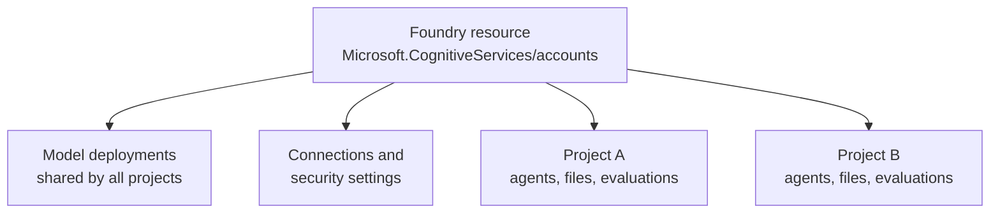

# Microsoft Foundry: Projects & Resources

Every agent you build in this class runs inside one Microsoft Foundry project. Before writing code it pays to know what a project is, what it inherits from the Foundry resource above it, and which single URL your code talks to. This topic gives you that map and the access model behind it.

## The Foundry resource and its projects

A Foundry resource is an Azure resource of type `Microsoft.CognitiveServices/accounts` with kind `AIServices`. It is the governance boundary: networking, model deployments, connections and Azure RBAC are configured here once. A project is a child of that resource (`Microsoft.CognitiveServices/accounts/projects`) and is the development boundary where agents, conversations, files and evaluations live.



Projects reuse the deployments and connections of the resource, so a team starts building without asking IT to set anything up again. Data such as files and agents is scoped to the project. A Foundry resource with one project is the recommended default for a single developer.

You create both with the Azure CLI. The `--allow-project-management` flag must be set when the resource is created because it cannot be changed afterwards.

```bash
az cognitiveservices account create \
    --name my-foundry-resource \
    --resource-group my-foundry-rg \
    --kind AIServices \
    --sku S0 \
    --location swedencentral \
    --custom-domain my-foundry-resource \
    --assign-identity \
    --allow-project-management true

az cognitiveservices account project create \
    --name my-foundry-resource \
    --resource-group my-foundry-rg \
    --project-name my-foundry-project \
    --location swedencentral
```

## One project endpoint

The new platform exposes a single endpoint per project. The Foundry SDK, the Responses API, agents, evaluations and the Foundry MCP server all start from it.

```text
https://<resource-name>.services.ai.azure.com/api/projects/<project-name>
```

You read it back from the project, so you never assemble it by hand.

```bash
az cognitiveservices account project show \
    --name my-foundry-resource \
    --resource-group my-foundry-rg \
    --project-name my-foundry-project \
    --query 'properties.endpoints."AI Foundry API"' --output tsv
```

The endpoint is the only configuration value that identifies your project in code. The class projects keep it in `PROJECT_ENDPOINT` inside a `.env` file next to the script.

## Foundry (new) and Foundry (classic)

Microsoft Foundry has two documentation sets and two project types. The current platform is Foundry (new), documented under `/azure/foundry/`, and it uses Foundry projects with the single project endpoint. Foundry (classic) is documented under `/azure/foundry-classic/` and covers hub-based projects, which are not visible in the new portal.

This class teaches only Foundry (new). If a search result lands on a `foundry-classic` page, or on a page that talks about hubs, prompt flow or the old multi-endpoint URLs, it describes the previous model. Use the **New Foundry** toggle in the portal banner to be sure you are on the current experience.

## Access control with the renamed Foundry roles

Azure RBAC separates control plane actions (create deployments and projects) from data plane actions (build agents, run evaluations, upload files). The Foundry roles were renamed from the Azure AI names, and the role definition IDs did not change.

| Current name | Former name | Role definition ID | What it is for |
| --- | --- | --- | --- |
| Foundry User | Azure AI User | `53ca6127-db72-4b80-b1b0-d745d6d5456d` | Build and test agents in a project, call models |
| Foundry Project Manager | Azure AI Project Manager | `eadc314b-1a2d-4efa-be10-5d325db5065e` | Develop, publish agents, assign Foundry User |
| Foundry Account Owner | Azure AI Account Owner | `e47c6f54-e4a2-4754-9501-8e0985b135e1` | Create accounts and projects, manage models |
| Foundry Owner | Azure AI Owner | `c883944f-8b7b-4483-af10-35834be79c4a` | Everything above for a self-serve owner |

The portal and some tools still show the former names while the rename rolls out. Use the GUID, not the name, in scripts so they keep working through the rollout.

```bash
az role assignment create \
    --role "53ca6127-db72-4b80-b1b0-d745d6d5456d" \
    --assignee "user@contoso.com" \
    --assignee-principal-type User \
    --scope "$PROJECT_ID"
```

A principal that only calls agents can use the narrower Foundry Agent Consumer role (`eed3b665-ab3a-47b6-8f48-c9382fb1dad6`). Day-to-day developers need Foundry User at the project scope and nothing more. The project's managed identity needs Foundry User on the Foundry resource as well, and the portal assigns both automatically when you create the project there.

## Authenticate with Microsoft Entra ID

All samples in this class use `DefaultAzureCredential`, which picks up your `az login` session locally and a managed identity in Azure. The access token it requests has the audience `https://ai.azure.com`, and the role assignments above decide what it may do. Keys also work on some endpoints, but they bypass RBAC, so the class does not use them.

## Hands-On Demo

[Inspect a Foundry Project from the CLI and SDK](./demo-project-inspector.md) walks the hierarchy with the Azure CLI, reads the project endpoint, lists what the project inherits, shows the identity and roles behind a token, and ends with a first data plane call. Every step runs in Python from `project-inspector-py/` and in C# from `project-inspector-cs/`. `foundry-project-py/` and `foundry-project-cs/` run the same tour in one script: endpoint, deployments, connections and a first call.

## Key Topics

- [What is Microsoft Foundry](https://learn.microsoft.com/en-us/azure/foundry/what-is-foundry)
- [Microsoft Foundry architecture](https://learn.microsoft.com/en-us/azure/foundry/concepts/architecture)
- [Create a project for Microsoft Foundry](https://learn.microsoft.com/en-us/azure/foundry/how-to/create-projects)
- [Role-based access control for Microsoft Foundry](https://learn.microsoft.com/en-us/azure/foundry/concepts/rbac-foundry)
- [Authentication and authorization in Microsoft Foundry](https://learn.microsoft.com/en-us/azure/foundry/concepts/authentication-authorization-foundry)
