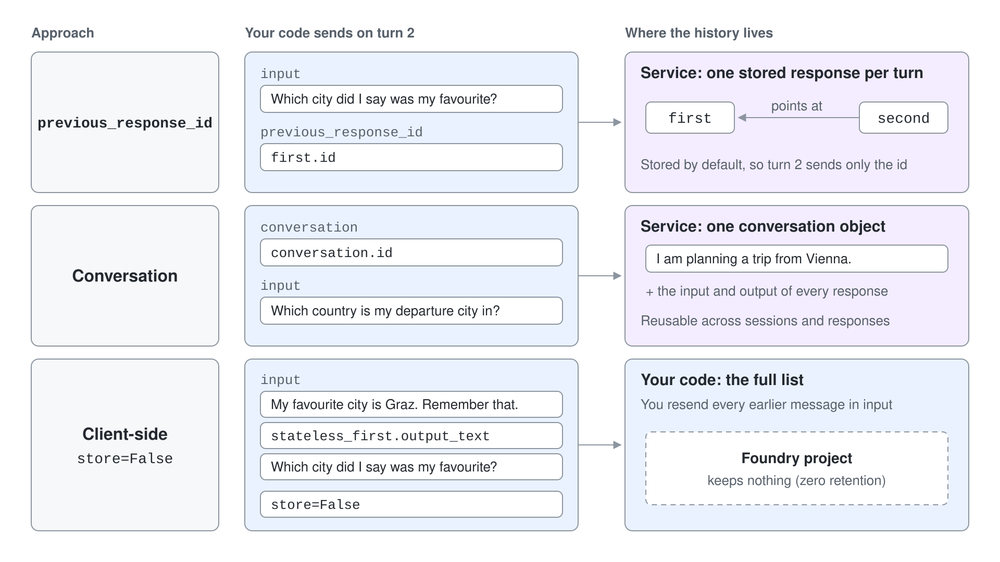

# Responses API: Conversations & Streaming

The Responses API is the single entry point for models and tools on a Foundry project. A response is one unit of work: the model or agent processes input and produces output items. Everything else in this topic is about where the history of a multi-turn exchange lives and how the output reaches your user.

## One request, typed output

You send a model, optional `instructions` and an `input`. The service returns a response object with an id, a status and a list of output items rather than a single string.

```python
response = openai.responses.create(
    model="gpt-5.4",
    instructions="You are a concise travel assistant.",
    input="Name one must-see place in Salzburg.",
)

print(response.id)
print(response.status)
print([item.type for item in response.output])
print(response.output_text)
```

The output list holds `message` items for text and `function_call` items when the model wants a tool. `output_text` is a convenience that joins the text of the message items.

## Using Responses without an agent resource

Nothing in the call above refers to an agent. You do not create, version or delete anything in Foundry; the instructions, model and tools live in your code and travel with each request.

This is the pattern for applications that ship their agent definition with their own code. The call still runs on the project endpoint, so it inherits the project's tracing, content filters and identity.

When you need a reusable, versioned definition, you create a prompt agent and reference it from the same call. That is the subject of Module 3. The request shape, conversations and streaming described here stay the same.

## Three ways to carry history

A model call is stateless. To make the second turn aware of the first, you choose where the history lives.



| Approach | Where state lives | Request shape |
| --- | --- | --- |
| `previous_response_id` | Service, stored per response | `input` plus the id of the last response |
| Conversation | Service, one durable object | `conversation` id plus the new `input` |
| Client-side | Your code | Full list of items in `input`, with `store=False` |

Responses are stored by default, so you can chain them by id.

```python
first = openai.responses.create(model=model, input="My favourite city is Graz. Remember that.")
second = openai.responses.create(
    model=model,
    input="Which city did I say was my favourite?",
    previous_response_id=first.id,
)
```

Set `store=False` for zero-retention scenarios. The service then keeps nothing, and you resend the earlier messages yourself in `input`.

## Conversations hold items

A conversation is a durable object with its own id. It stores items: messages, tool calls, tool outputs and the output the model produced. You can reuse it across sessions, inspect it for debugging, and let several responses append to it.

```python
conversation = openai.conversations.create(
    items=[{"type": "message", "role": "user", "content": "I am planning a trip from Vienna."}],
)

response = openai.responses.create(
    model=model,
    conversation=conversation.id,
    input="Which country is my departure city in?",
)

openai.conversations.items.create(
    conversation_id=conversation.id,
    items=[{"type": "message", "role": "user", "content": "Add Linz as a second stop."}],
)

for item in openai.conversations.items.list(conversation.id, order="asc"):
    print(item.type, getattr(item, "role", "-"), item.id)
```

When you pass a conversation to a response, the service prepends its items to the input, and after the response completes it appends the new input and output items to the conversation. If the history grows beyond the model's context size, the model truncates what it reads, but the conversation itself is not truncated. You can add up to 20 items per `items.create` call, and `openai.conversations.delete(conversation.id)` removes the whole object.



## Streaming

With `stream=True` the call returns server-sent events instead of a finished response. You react to the event types you care about and ignore the rest.

```python
stream = openai.responses.create(model=model, input="Explain streaming in three sentences.", stream=True)

for event in stream:
    if event.type == "response.output_text.delta":
        print(event.delta, end="", flush=True)
    if event.type == "response.completed":
        usage = event.response.usage
```

A text response emits a fixed sequence of events: `response.created`, `response.in_progress`, `response.output_item.added`, `response.content_part.added`, a run of `response.output_text.delta`, then the matching `done` events and `response.completed`. Streaming improves perceived latency because the first token arrives long before the last. It combines with conversations, so a streamed answer is still appended to the conversation when it completes.



Long-running work can also use background mode, where the response runs asynchronously and you poll for it. That mode matters for agents with slow tools and is covered where those agents appear.

## Hands-On Demo

[Build a Streaming Chat with Conversations](./demo-responses-conversations.md) sends a response, chains turns three ways, inspects the items of a conversation, prints the streaming event types and ends with a chat that streams answers into a server-side conversation. Each step runs in Python from `responses-conversations-py/` and in C# from `responses-conversations-cs/`.

## Key Topics

- [Quickstart: Build agents using the Responses API](https://learn.microsoft.com/en-us/azure/foundry/agents/quickstarts/responses-api)
- [Build with agents, conversations, and responses](https://learn.microsoft.com/en-us/azure/foundry/agents/concepts/runtime-components)
- [Microsoft Foundry SDKs and endpoints](https://learn.microsoft.com/en-us/azure/foundry/how-to/develop/sdk-overview)
- [Create a prompt agent](https://learn.microsoft.com/en-us/azure/foundry/agents/quickstarts/prompt-agent)
