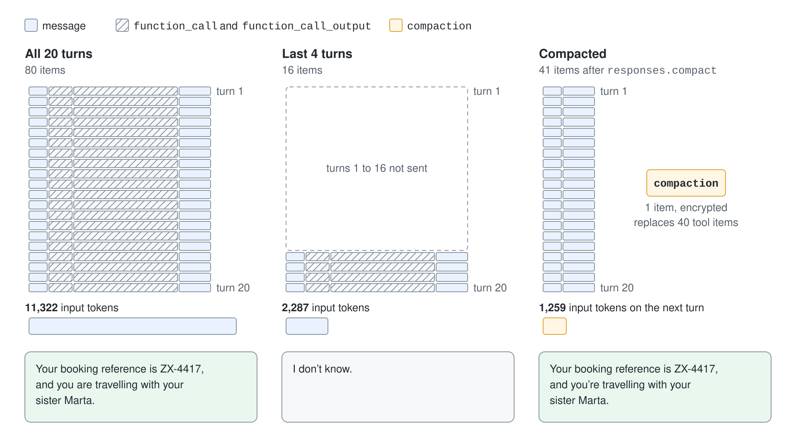
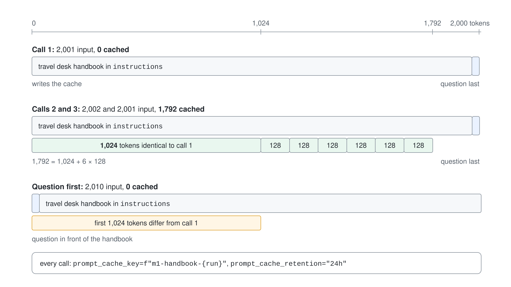

# Context Engineering: Budgets, Compaction & Caching

A model call is stateless, so every request carries everything the model needs to know: instructions, the conversation, tool calls, tool results and, for reasoning models, earlier reasoning. That bundle is the context, and you pay for all of it on every call. Context engineering is the habit of deciding what goes into it, what leaves it and what the service may reuse.

This topic stays at the Responses API level from the previous topic. It teaches four tools in the order you reach for them: measure the budget, trim by turn, compact, and cache the stable prefix.

## The context window is a budget

Every response reports what it consumed in `usage`. `input_tokens` is the size of the context you sent, `output_tokens` is what the model produced and includes reasoning tokens.

```python
response = openai.responses.create(model=model, input=history, store=False)

print(response.usage.input_tokens)
print(response.usage.input_tokens_details.cached_tokens)
print(response.usage.output_tokens_details.reasoning_tokens)
```

The window itself is rarely the first limit you hit. `gpt-5.4` has a 1,050,000 token context window, split into at most 922,000 input and 128,000 output tokens. Cost and latency grow with `input_tokens` long before the window fills, because a conversation that adds 570 tokens per turn costs more on every turn than on the one before.

Reasoning tokens share the window with your input and the visible answer. They are billed as output tokens, so set `max_output_tokens` high enough for reasoning plus the answer, and check `status` for `incomplete` so a truncated reasoning run does not look like an empty answer.

## What fills the window

Four kinds of items accumulate in a long conversation, and they do not grow at the same speed.

| Item | Typical size | Can be dropped safely |
| --- | --- | --- |
| `instructions` | Fixed per request | No, but it is the best candidate for caching |
| `message` items from user and assistant | Small, a few dozen tokens | Only if the facts in them are not needed later |
| `function_call` and `function_call_output` | Large, tool results often dominate | Mostly, once the assistant has used them |
| Reasoning items | Large | Per the `reasoning.context` setting and compaction |

Agents that call tools spend most of their tokens on tool results. That is why the first lever below targets the shape of the history and not the text of the messages.

## Trim by turn, never by item

The simplest control is client-side: keep the last N turns and send only those. It works with `store=False`, with a list you own, and it needs no service feature.

```python
turns = build_turns(20)
kept = turns[-4:]
window = [*flatten(kept), {"role": "user", "content": question}]
```

Cut on turn boundaries. A `function_call` item and its `function_call_output` must stay together, and the API rejects a `function_call_output` whose call was removed. The price of trimming is memory: a fact stated in a dropped turn is gone, and the model will say it does not know.

## Compact instead of forgetting

Compaction replaces the bulk of a history with one opaque item that carries the essential state forward. Foundry supports it in two forms for the Responses API.

The standalone endpoint compacts a window you hand it and returns the new window. In Python the OpenAI client exposes it as `responses.compact`.

```python
compacted = openai.responses.compact(model=model, input=history)

follow_up = openai.responses.create(
    model=model,
    input=[*compacted.output, {"role": "user", "content": question}],
    store=False,
)
```

You can also pass `previous_response_id` to `compact` instead of `input`. Do not try to read the compaction item: it is encrypted and not meant to be human-readable.

Server-side compaction needs no extra call. You add `context_management` with a `compact_threshold` to a normal `responses.create`, and the service compacts when the context crosses the threshold.

```python
response = openai.responses.create(
    model=model,
    input=conversation,
    store=False,
    context_management=[{"type": "compaction", "compact_threshold": 6000}],
)
```

The output then contains a `compaction` item next to the message, and it works with `store=False`.

With stateless input-array chaining you append every output item as usual and may drop the items that came before the most recent compaction item. With `previous_response_id` chaining you send only the new user message and must not prune by hand.



### What compaction keeps

Observed on the `gpt-5.4` deployment of this class: user and assistant messages stay in the window verbatim, and the `function_call` and `function_call_output` items collapse into the single `compaction` item. A 20-turn weather conversation of 11,300 input tokens became a window of about 1,300 tokens, and the model still answered a question about the first turn.



The size of the item varies from run to run, and a history with nothing to drop, such as plain chat messages, does not shrink. Measure `input_tokens` on your own workload before you rely on a ratio.

The standalone endpoint is not supported when multi-agent orchestration is enabled on the request, which uses automatic server-side compaction instead.

### The C# gap

The .NET SDK has no strongly typed surface for compaction. `ResponsesClient` exposes the protocol method `CompactResponseAsync(string contentType, BinaryContent content, RequestOptions options)`, and `context_management` and `prompt_cache_key` are not properties of `CreateResponseOptions` either. The C# project in this topic therefore posts JSON through the protocol methods for every step and reads the result with `System.Text.Json.Nodes`.

```csharp
var body = new JsonObject { ["model"] = Session.Model, ["input"] = input };
ClientResult result = await Session.Responses().CompactResponseAsync(
    "application/json",
    BinaryContent.Create(BinaryData.FromString(body.ToJsonString())),
    new RequestOptions());
```

## Cache the stable prefix

Prompt caching lets the service reuse the computation for a prompt prefix it has seen. It is on by default for supported models, it does not change the answer, and cache reads are billed at a discount on input tokens.

A request can hit the cache when it is at least 1,024 tokens long and its first 1,024 tokens are identical to an earlier request. A single changed character in that range is a miss and `cached_tokens` is 0. On GPT-5.5 and earlier models, hits beyond the first 1,024 tokens come in 128-token steps.



```python
response = openai.responses.create(
    model=model,
    instructions=handbook,
    input=question,
    prompt_cache_key="travel-desk-v1",
    prompt_cache_retention="24h",
)

print(response.usage.input_tokens_details.cached_tokens)
```

Three controls shape the hit rate:

- Put stable content first and variable content last. Instructions, tool definitions and reference text belong before the user turn, and the conversation should be append-only.
- `prompt_cache_key` groups requests that share a prefix. Reuse one key for one prefix, and spread very busy prefixes over several keys because roughly 15 requests per minute for one prefix and key can start to miss.
- `prompt_cache_retention` is `in_memory` by default for `gpt-5.4` and older models, which clears a cache after 5 to 10 minutes of inactivity and always within one hour. `24h` selects extended retention on the models that support it. Pricing is the same for both.

GPT-5.6 and later model families change the controls. They use `prompt_cache_options` with a `mode`, a `ttl` of `30m` and explicit `prompt_cache_breakpoint` markers, report writes in `cache_write_tokens`, deprecate `prompt_cache_retention`, and can charge for cache writes. Earlier models return a 400 error when you send those parameters, so check the model before you copy a request.

A model router deployment does not guarantee cache hits, because consecutive requests can land on different underlying models.

## Which lever when

| Symptom | Lever | Cost of the lever |
| --- | --- | --- |
| Same long instructions or reference text on every call | Prompt caching | None to the answer, needs a stable prefix |
| Tool results dominate a long agent loop | Compaction | An opaque item and one extra model pass |
| Old turns carry nothing you need | Trim by turn | Facts in dropped turns are lost |
| You must prove what the model saw | Client-side history with `store=False` | You own the list and its size |

Compaction in Agent Framework is a different mechanism for agents that keep their own in-memory history, and it does not apply when the Responses API stores the conversation for you. That is covered in [Harness Agent: Plan, Execute & Compaction](../../04-agent-framework/07-harness-agent/readme.md), and the context an agent assembles before each call is the subject of [Context Providers & Long-Term Memory](../../04-agent-framework/03-context-providers/readme.md). Budgets, caches and quality guards across a whole system are covered in [Performance & Cost: Routing & Caching](../../07-evaluation/06-performance-cost/readme.md).

## Hands-On Demo

[Measure, Trim, Compact and Cache a Long Context](./demo-context-engineering.md) grows a tool-heavy history and reads the token budget, trims it and watches a fact disappear, compacts it with the standalone endpoint, lets the service compact during a loop, and shows `cached_tokens` for a stable prefix. Each step runs in Python from `context-engineering-py/` and in C# from `context-engineering-cs/`.

## Key Topics

- [Use the Azure OpenAI Responses API](https://learn.microsoft.com/en-us/azure/foundry/openai/how-to/responses)
- [Prompt caching](https://learn.microsoft.com/en-us/azure/foundry/openai/how-to/prompt-caching)
- [Azure OpenAI reasoning models](https://learn.microsoft.com/en-us/azure/foundry/openai/how-to/reasoning)
- [Foundry Models sold by Azure](https://learn.microsoft.com/en-us/azure/foundry/foundry-models/concepts/models-sold-directly-by-azure)
- [Compaction in Microsoft Agent Framework](https://learn.microsoft.com/en-us/agent-framework/concepts/agents/conversations/compaction)
