# Module 1: Foundry Essentials for Agent Developers

Every later module in this class builds on the same few Microsoft Foundry basics: one project with one endpoint, a model to call, a Python or C# SDK that reaches it, the Responses API that carries a conversation, the context you send with every call, and the tooling that lets you operate all of it quickly. This module covers exactly those basics and nothing more, so the agent modules can start with agent code instead of setup questions.

You work on the current Foundry (new) platform throughout. The stack is the Foundry SDK (`azure-ai-projects` 2.x for Python, `Azure.AI.Projects` 2.0.x for .NET), the OpenAI-compatible Responses API, Microsoft.Extensions.AI for .NET, model router for model selection, and the Foundry Toolkit, `azd ai` extensions and Foundry MCP server for day-to-day operation.

| Topic | Description |
| --- | --- |
| [Microsoft Foundry: Projects & Resources](./01-foundry-projects/readme.md) | The Foundry resource, its projects, the single project endpoint, the Foundry (new) versus classic split and the renamed Foundry RBAC roles |
| [Model Deployments & Model Router](./02-model-router/readme.md) | Model deployments, model router version 2025-11-18, routing modes, model subsets, failover and Claude models in the pool |
| [Foundry SDK & Microsoft.Extensions.AI](./03-foundry-sdk/readme.md) | The Foundry project client, inference through the OpenAI-compatible client, and `IChatClient` in .NET |
| [Responses API: Conversations & Streaming](./04-responses-api/readme.md) | Responses without an agent resource, `previous_response_id`, conversations and their items, and the streaming event sequence |
| [Foundry Toolkit & Foundry MCP Server](./05-foundry-toolkit/readme.md) | Foundry Toolkit for VS Code, the `azd ai` extensions, Agent Inspector and the hosted Foundry MCP server (preview) |
| [Context Engineering: Budgets, Compaction & Caching](./06-context-engineering/readme.md) | Reading the token budget, trimming by turn, Responses compaction (`/responses/compact` and `compact_threshold`) and prompt caching with `prompt_cache_key` and `cached_tokens` |

## Hands-On Demos

| Topic | Description |
| --- | --- |
| [Inspect a Foundry Project from the CLI and SDK](./01-foundry-projects/demo-project-inspector.md) | Resolve the resource, project, deployments and roles behind a project endpoint and prove access with a first call, in Python and C# |
| [Compare Model Router Modes and Subsets](./02-model-router/demo-model-router.md) | Deploy four routers, send identical prompts and compare which models serve Balanced, Quality, Cost and a subset, in Python and C# |
| [Call Models with the Foundry SDK and IChatClient](./03-foundry-sdk/demo-foundry-sdk.md) | Call a model through Responses and Chat Completions in Python, add function calling and repeat it in C# with `IChatClient` |
| [Build a Streaming Chat with Conversations](./04-responses-api/demo-responses-conversations.md) | Chain responses, store history in a conversation and stream answers into it from a chat loop, in Python and C# |
| [Operate Foundry with the MCP Server and Agent Inspector](./05-foundry-toolkit/demo-foundry-mcp.md) | Manage deployments and a prompt agent through MCP tools and debug a local agent with Agent Inspector, in Python and C# |
| [Measure, Trim, Compact and Cache a Long Context](./06-context-engineering/demo-context-engineering.md) | Grow a tool-heavy history, trim it, compact it by endpoint and by `context_management`, and prove a prompt cache hit, in Python and C# |

## Helpful Claude Slash Commands

| Command | Usage |
| --- | --- |
| `/mcp` | List, connect and reconnect MCP servers, for example a Foundry or Microsoft Learn MCP server used while you write Foundry code |
| `/permissions` | Review and set allow, ask and deny rules so write tools that change Foundry resources always ask first |
| `/model` | Switch the model Claude Code uses while you compare it with the models your Foundry deployments serve |
| `/usage` | Show session cost and token usage, a useful habit before you compare router modes by cost |

## Key Topics covered in this module

- [What is Microsoft Foundry](https://learn.microsoft.com/en-us/azure/foundry/what-is-foundry)
- [Microsoft Foundry architecture](https://learn.microsoft.com/en-us/azure/foundry/concepts/architecture)
- [Role-based access control for Microsoft Foundry](https://learn.microsoft.com/en-us/azure/foundry/concepts/rbac-foundry)
- [Model router for Microsoft Foundry](https://learn.microsoft.com/en-us/azure/foundry/openai/concepts/model-router)
- [Microsoft Foundry SDKs and endpoints](https://learn.microsoft.com/en-us/azure/foundry/how-to/develop/sdk-overview)
- [Microsoft.Extensions.AI libraries](https://learn.microsoft.com/en-us/dotnet/ai/microsoft-extensions-ai)
- [Quickstart: Build agents using the Responses API](https://learn.microsoft.com/en-us/azure/foundry/agents/quickstarts/responses-api)
- [Foundry Toolkit for Visual Studio Code overview](https://learn.microsoft.com/en-us/azure/foundry/how-to/develop/get-started-projects-visual-studio-code)
- [Get started with Foundry MCP Server](https://learn.microsoft.com/en-us/azure/foundry/mcp/get-started)
- [Use the Azure OpenAI Responses API](https://learn.microsoft.com/en-us/azure/foundry/openai/how-to/responses)
- [Prompt caching](https://learn.microsoft.com/en-us/azure/foundry/openai/how-to/prompt-caching)
