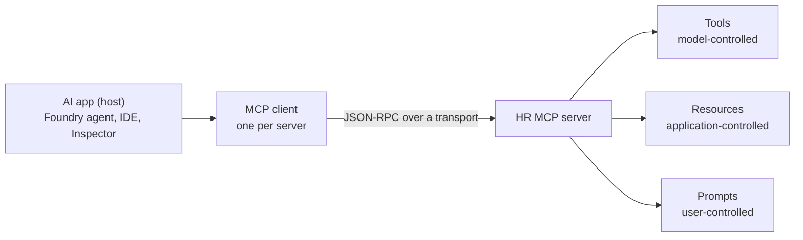
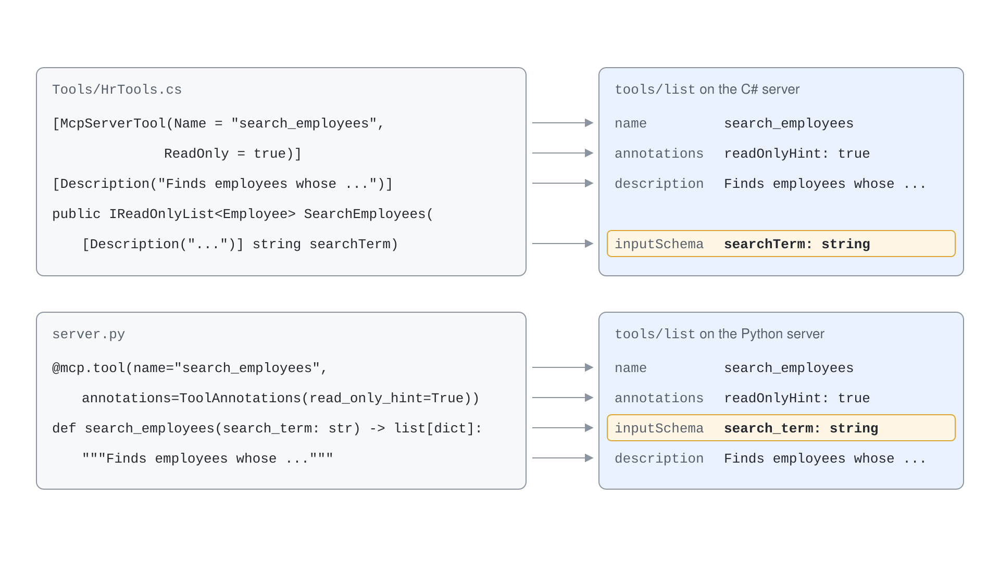

# MCP Servers: Tools, Resources & Prompts

An agent that only knows what the model learned in training cannot read your HR directory, file a ticket, or check a policy. The Model Context Protocol (MCP) closes that gap with one contract: a server describes what it can do, and any MCP client can discover and call it. You write the server once and every host (an agent in Microsoft Foundry, Agent Framework, an IDE, the MCP Inspector) can use it.

This topic builds one HR directory server twice, in C# on the official `ModelContextProtocol` 2.2.0 SDK and in Python on the official `mcp` 2.3.0 SDK. Both servers expose the same three primitives, and you will see how a model, an application and a user each get a different kind of control.

## What an MCP Server Exposes

A server offers three kinds of capability. They differ in who decides when they are used, and that decision shapes how you design each one.

| Primitive | Controlled by | Purpose | Discovery and use |
| --- | --- | --- | --- |
| Tools | The model | Actions and queries with side effects or computed results | `tools/list`, `tools/call` |
| Resources | The application | Read-only context identified by a URI | `resources/list`, `resources/templates/list`, `resources/read` |
| Prompts | The user | Reusable, parameterized instruction templates | `prompts/list`, `prompts/get` |

A client never hard-codes this surface. It asks the server what exists, receives names, descriptions and JSON Schemas, and presents those to the model or the user.



## Tools on the Wire

A tool call is a JSON-RPC request. The server answers with content blocks, and `isError` tells the model whether the call failed.

```json
{
  "jsonrpc": "2.0",
  "id": 3,
  "method": "tools/call",
  "params": {
    "name": "search_employees",
    "arguments": { "searchTerm": "baking" }
  }
}
```

The `inputSchema` the client received from `tools/list` is generated from your method signature. The description you write is the only thing the model sees when it decides which tool to call, so it is part of your API surface.

## Tools in C#

The C# SDK discovers tools through attributes. A class marked `[McpServerToolType]` is scanned, and every method marked `[McpServerTool]` becomes a tool. Dependency injection works through the constructor.

```csharp
[McpServerToolType]
public class HrTools(EmployeeStore store)
{
    [McpServerTool(Name = "search_employees", ReadOnly = true)]
    [Description("Finds employees whose name, email, role or skills contain the search term.")]
    public IReadOnlyList<Employee> SearchEmployees(
        [Description("Text to look for, for example a skill such as baking")] string searchTerm) => store.Search(searchTerm);

    [McpServerTool(Name = "remove_employee", Destructive = true)]
    [Description("Removes the employee with the given email.")]
    public string RemoveEmployee([Description("Email of the employee to remove")] string email) =>
        store.Remove(email) ? $"Removed {email}" : $"Employee {email} not found";
}
```

`ReadOnly` and `Destructive` become the `readOnlyHint` and `destructiveHint` annotations. Hosts use them to decide which calls need a confirmation. Every parameter carries a `[Description]`, and tools that sit close together tell the model how they differ in their own descriptions.

## Resources and Prompts in C#

A resource is addressed by a URI. A fixed URI is a resource, and a URI with a placeholder is a resource template that the client fills in.

```csharp
[McpServerResourceType]
public class HrResources(EmployeeStore store)
{
    [McpServerResource(UriTemplate = "hr://policy/remote-work", Name = "remote_work_policy", MimeType = "text/markdown")]
    [Description("The company remote work policy.")]
    public string RemoteWorkPolicy() => "# Remote work policy\n\n- Up to 3 remote days per week.";

    [McpServerResource(UriTemplate = "hr://employees/{email}", Name = "employee_profile", MimeType = "application/json")]
    [Description("The profile of one employee, addressed by email.")]
    public string EmployeeProfile(string email) =>
        JsonSerializer.Serialize(store.Find(email) ?? throw new McpException($"Employee {email} not found"));
}
```

A prompt returns the text a user would otherwise have to type. It can point at tools and resources by name, which keeps the instruction and the data source in one place.

```csharp
[McpServerPromptType]
public class HrPrompts
{
    [McpServerPrompt(Name = "onboarding_plan")]
    [Description("Drafts a first-week onboarding plan for a new employee.")]
    public static string OnboardingPlan(string role, string buddy) =>
        $"Draft a first-week onboarding plan for a new {role}. Pair them with {buddy}. Use list_employees and read hr://policy/remote-work.";
}
```

The registration is three calls on the builder, and `Program.cs` picks the transport at startup.

```csharp
builder.Services.AddMcpServer()
    .WithHttpTransport()
    .WithToolsFromAssembly()
    .WithResourcesFromAssembly()
    .WithPromptsFromAssembly();

app.MapMcp("/mcp");
```

## The Same Server in Python

The Python SDK uses decorators on plain functions. In `mcp` 2.x the high-level class `FastMCP` was renamed to `MCPServer`, and importing `mcp.server.fastmcp` now raises `ModuleNotFoundError`. Code written for `mcp` 1.x needs the new import.

```python
from mcp.server.mcpserver import MCPServer
from mcp.types import ToolAnnotations

mcp = MCPServer("hr-mcp-server-py", instructions="HR directory for a restaurant team.")


@mcp.tool(name="search_employees", annotations=ToolAnnotations(read_only_hint=True))
def search_employees(search_term: str) -> list[dict]:
    """Finds employees whose name, email, role or skills contain the search term."""
    return [e.to_dict() for e in store.search(search_term)]


@mcp.resource("hr://employees/{email}", name="employee_profile", mime_type="application/json")
def employee_profile(email: str) -> dict:
    """The profile of one employee, addressed by email."""
    return store.find(email).to_dict()


@mcp.prompt(name="onboarding_plan")
def onboarding_plan(role: str, buddy: str) -> str:
    """Drafts a first-week onboarding plan for a new employee."""
    return f"Draft a first-week onboarding plan for a new {role}. Pair them with {buddy}."
```

The docstring becomes the description and the type hints become the JSON Schema. A parameter named `search_term` in Python is `searchTerm` in the C# server, because each SDK follows its own naming convention. A client must read the schema from `tools/list` instead of guessing the argument names.



## Choosing the Transport at Startup

One server project can speak two transports. Standard input and output suit a server that a host launches as a child process, and HTTP suits a server that runs on its own and serves many clients. The next topic compares them in detail.

```python
if "--http" in sys.argv:
    mcp.run("streamable-http", host="127.0.0.1", port=47003)
else:
    mcp.run("stdio")
```

## Designing Tools a Model Can Use

Tool design is prompt design. A few rules keep a server usable as it grows.

- Keep the set small and give each tool one job. A model chooses worse as the list gets longer.
- Name tools with a verb and a noun, and make near neighbors differ in their descriptions, for example "Lists every employee. Use search_employees to narrow the list down."
- Describe every parameter, including example values.
- Mark read-only and destructive tools with annotations so hosts can gate them.
- Return data the model can reason over, and return a short, readable error message instead of a stack trace.

## Using the Server from an Agent

Microsoft Agent Framework connects to a Streamable HTTP server with `MCPStreamableHTTPTool`. The agent lists the tools, passes their schemas to the model, and runs the calls the model requests.



```python
hr = MCPStreamableHTTPTool(name="hr", url="http://127.0.0.1:47003/mcp", approval_mode="never_require")
async with Agent(client=client, instructions="Use the hr tools for every question about staff.", tools=[hr]) as agent:
    result = await agent.run("Who on the team has baking skills, and which languages do they speak?")
```

`agent-framework-core` 1.22.0 cannot read the initialize result of `mcp` 2.x and fails with `AttributeError: 'InitializeResult' object has no attribute 'protocolVersion'`. The agent project therefore pins `mcp==1.30.0` while the server project uses `mcp==2.3.0`, and the two live in separate virtual environments.

## Hands-On Demo

- [Build and Test an HR MCP Server in C# and Python](./demo-mcp-servers.md)

## Key Topics

- [Get started with .NET AI and the Model Context Protocol](https://learn.microsoft.com/dotnet/ai/get-started-mcp)
- [Using MCP tools with agents (Agent Framework)](https://learn.microsoft.com/agent-framework/agents/tools/local-mcp-tools)
- [Use the Model Context Protocol tool in Foundry Agent Service](https://learn.microsoft.com/azure/foundry/agents/how-to/tools/model-context-protocol)
- [Choose an Azure service for your MCP server](https://learn.microsoft.com/azure/container-apps/mcp-choosing-azure-service)
