# Transports & MCP Inspector Debugging

A transport is how MCP messages travel between a client and a server. The messages mean the same thing on every transport, but the transport decides who starts the server, how many clients it serves, how it authenticates them and what you can debug with a plain `curl`. Choosing the wrong one is the most common reason a working local server cannot be reused in production.

This topic compares the two standard transports, shows the wire format of the current and the previous protocol era, and uses the MCP Inspector to debug a server without writing a client.

## The Standard Transports

The current MCP specification (revision 2026-07-28) defines two standard transports. A third, HTTP with Server-Sent Events (SSE), is deprecated.

| Transport | Who starts the server | Clients | Typical use |
| --- | --- | --- | --- |
| stdio | The client launches it as a subprocess | One client per process | Local tools, IDE extensions, a command a developer installs |
| Streamable HTTP | The server runs on its own | Many clients | Shared and remote servers, anything behind authentication |
| HTTP+SSE (2024-11-05) | The server runs on its own | Many clients | Deprecated since 2025-03-26, kept only for old clients |

The specification states that new implementations should not adopt HTTP+SSE and should migrate to Streamable HTTP. Treat any tutorial that starts a server with `sse` as outdated.



## stdio

The client starts the server process and talks over its standard streams. Each message is one line of JSON, and messages must not contain embedded newlines.

```text
client stdin  -> {"jsonrpc":"2.0","id":1,"method":"tools/list", ...}
server stdout <- {"jsonrpc":"2.0","id":1,"result":{"tools":[...]}}
server stderr <- free-form log lines
```

Two rules follow from this. The server must never print anything else to standard output, because the client would try to parse it as a message, so it logs to standard error instead.

Authentication does not apply to stdio, so the server reads credentials from its environment.

```python
params = StdioServerParameters(command=sys.executable, args=["server.py", "--transport", "stdio"])
async with Client(params) as client:
    info = await client.call_tool("server_info", {})
```

## Streamable HTTP

The server exposes one endpoint, for example `https://host/mcp`. The client sends every JSON-RPC message as its own `POST` with an `Accept` header that lists both `application/json` and `text/event-stream`. The server answers each request with either one JSON object or an SSE stream scoped to that request.

```python
mcp.run("streamable-http", host="127.0.0.1", port=47004)
```

```csharp
builder.Services.AddMcpServer().WithHttpTransport().WithToolsFromAssembly();
app.MapMcp("/mcp");
```

The specification adds security rules for this transport. A local server should bind to `127.0.0.1` instead of all interfaces, and it must validate the `Origin` header to stop DNS rebinding attacks.

A server should also authenticate every connection, which the next topic covers.

## Two Protocol Eras on One Transport

Streamable HTTP changed shape between revisions. Revision 2025-11-25 and earlier use a connection session: the client sends `initialize`, the server returns an `Mcp-Session-Id` header, and every later request repeats that header. Revision 2026-07-28 removed the handshake and the session.



```http
POST /mcp HTTP/1.1
Accept: application/json, text/event-stream
Content-Type: application/json
MCP-Protocol-Version: 2026-07-28
Mcp-Method: tools/call
Mcp-Name: add

{"jsonrpc":"2.0","id":3,"method":"tools/call","params":{"name":"add","arguments":{"a":2,"b":3},
 "_meta":{"io.modelcontextprotocol/protocolVersion":"2026-07-28","io.modelcontextprotocol/clientCapabilities":{}}}}
```

In the new era every request carries its protocol version and client capabilities in `_meta`. The `MCP-Protocol-Version`, `Mcp-Method` and `Mcp-Name` headers mirror body fields so gateways and load balancers can route without parsing JSON. A client that wants to choose a version first calls `server/discover`.

The change also removed the standalone GET stream, resumable streams and server-initiated requests. Because no request depends on an earlier one, a load balancer can send each request to any instance.

Both SDKs used in this module speak both eras. The C# `ModelContextProtocol` 2.2.0 and the Python `mcp` 2.3.0 answer a legacy `initialize` and a modern per-request call on the same endpoint. The Python `Client` defaults to `mode="auto"`, which probes `server/discover` and falls back to the `initialize` handshake.

## Choosing a Transport

| Question | stdio | Streamable HTTP |
| --- | --- | --- |
| Does a developer run it on their own machine? | Yes | Possible |
| Do many users or agents share one instance? | No | Yes |
| Does it need OAuth or an API key? | No, uses the process environment | Yes |
| Can Foundry Agent Service reach it? | No | Yes, if the endpoint is public or on a reachable network |
| Can you test it with `curl`? | No | Yes |

Foundry Agent Service accepts only a remote MCP endpoint. A stdio server that you built for a local IDE has to be hosted over HTTP before an agent in Foundry can use it. Azure Container Apps and Azure Functions are the two hosting options that Microsoft documents for this.

## Debugging with the MCP Inspector

The Inspector connects to any server over stdio, Streamable HTTP or SSE and shows the raw requests and results. It starts without installation through `npx`.

```powershell
npx @modelcontextprotocol/inspector --web --transport http --server-url http://127.0.0.1:47004/mcp
```

The web mode prints a local URL with a session token and serves the interface on port 6274. The CLI mode runs a single method and prints JSON, which suits scripts and quick checks.

```powershell
npx @modelcontextprotocol/inspector --cli http://127.0.0.1:47004/mcp --transport http --method tools/call --tool-name add --tool-arg a=2 --tool-arg b=3
npx @modelcontextprotocol/inspector --cli http://127.0.0.1:47004/mcp --transport http --protocol-era modern --method tools/list
```

The `--protocol-era` option takes `legacy`, `auto` or `modern`, so you can check that a server answers both eras. When a server returns an error, the Inspector shows the JSON-RPC error object, which is usually enough to tell a schema problem from a transport problem.

## Hands-On Demo

- [Compare stdio and Streamable HTTP with the MCP Inspector](./demo-transports.md)

## Key Topics

- [Get started with .NET AI and the Model Context Protocol](https://learn.microsoft.com/dotnet/ai/get-started-mcp)
- [Model Context Protocol bindings for Azure Functions: connect to your MCP server](https://learn.microsoft.com/azure/azure-functions/functions-bindings-mcp#connect-to-your-mcp-server)
- [Set up authentication for MCP tools in Foundry Agent Service: host a local MCP server](https://learn.microsoft.com/azure/foundry/agents/how-to/mcp-authentication#host-a-local-mcp-server)
- [Choose an Azure service for your MCP server](https://learn.microsoft.com/azure/container-apps/mcp-choosing-azure-service)
