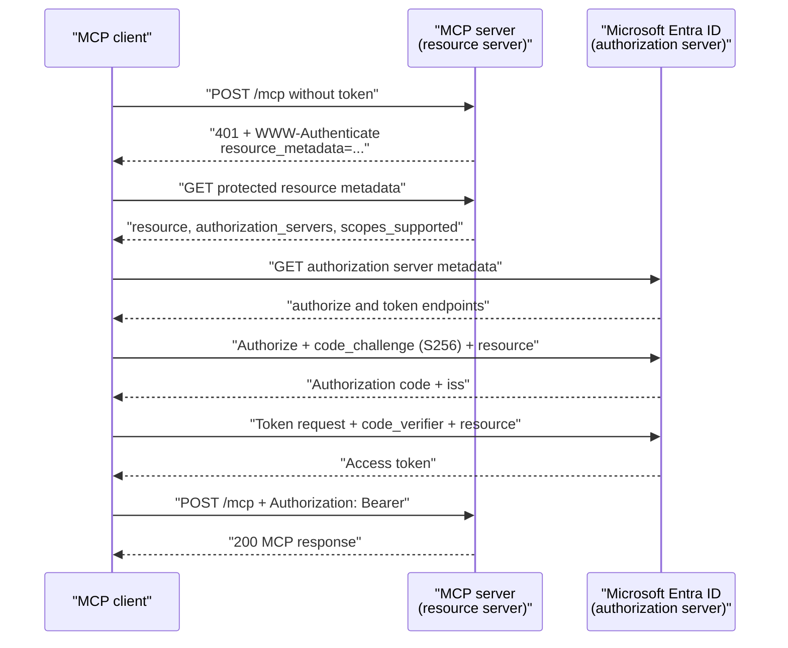

# MCP Authorization: OAuth 2.1 & PRM

A remote MCP server can read data and trigger actions on behalf of a person, so it needs the same protection as any API. MCP does not invent a new scheme for this. It defines a profile of OAuth 2.1 that lets a client that has never seen your server discover how to sign in, obtain a token that is valid for that server only, and ask for more permission when a call needs it.

This topic follows the current specification revision, 2026-07-28, and the Microsoft Entra ID setup that Microsoft documents for it. You will protect an ASP.NET Core MCP server and a Python MCP server with Entra tokens, and then look at how a Foundry agent authenticates to a remote MCP server.

## Who Plays Which Role

An HTTP MCP server is an OAuth 2.1 resource server. The MCP client is an OAuth client that acts for a user, and the authorization server issues the tokens. The specification does not prescribe the authorization server, so Microsoft Entra ID fits that role.

| Role | In this topic | Responsibility |
| --- | --- | --- |
| Resource server | The ASP.NET Core and Python MCP servers | Validate every token, publish metadata, challenge with `WWW-Authenticate` |
| Client | An agent, an IDE, a script | Discover the server's requirements, run the sign-in, send `Authorization: Bearer` on every request |
| Authorization server | Microsoft Entra ID | Authenticate the user, issue access tokens for the server |

Authorization is optional in the protocol. A server on the stdio transport should not follow this flow and reads credentials from its environment instead.

## The Requirements in Revision 2026-07-28

Revision 2026-07-28 is the current MCP revision and carries the authorization profile that revision 2025-11-25 introduced. These are its requirements for an HTTP server and its clients.

| Topic | Requirement |
| --- | --- |
| Protected Resource Metadata (RFC 9728) | Servers must publish it, and clients must use it to find the authorization server |
| Resource indicator (RFC 8707) | Clients must send `resource` in the authorization request and in the token request |
| PKCE | Clients must use `S256` and must refuse to continue if the server metadata does not show PKCE support |
| Client ID Metadata Documents | Servers and clients should support them; the preferred way to identify a client with no prior relationship |
| Dynamic client registration (RFC 7591) | Deprecated in favor of Client ID Metadata Documents, still allowed for compatibility |
| Token audience | Servers must accept only tokens issued for them and must not pass a received token to an upstream API |
| Insufficient scope | A server answers `403` with `error="insufficient_scope"`, and the client runs a step-up authorization |

The changelog of revision 2026-07-28 lists four authorization changes against 2025-11-25. Authorization servers should send the `iss` parameter (RFC 9207), and clients must validate a present `iss` before they redeem the code. Dynamic client registration is deprecated, clients must send an `application_type` when they still use it, and client credentials are bound to the issuer that created them.

## Discovery: From 401 to Tokens

A client starts with an unauthenticated request. The server answers `401` and points to its metadata in the `WWW-Authenticate` header.

```http
HTTP/1.1 401 Unauthorized
WWW-Authenticate: Bearer resource_metadata="http://localhost:47010/.well-known/oauth-protected-resource/mcp"
```

The client fetches that document. The well-known path puts the endpoint path after the suffix, so the resource `http://localhost:47010/mcp` publishes at `/.well-known/oauth-protected-resource/mcp`. If the header carries no URL, the client tries that path and then the root path.

```json
{
  "resource": "http://localhost:47010/mcp",
  "authorization_servers": ["https://login.microsoftonline.com/<tenant-id>/v2.0"],
  "bearer_methods_supported": ["header"],
  "scopes_supported": ["api://<api-client-id>/hr.read", "api://<api-client-id>/hr.write"]
}
```

The client then reads the authorization server metadata. The specification requires it to try the OAuth 2.0 metadata endpoint and the OpenID Connect discovery endpoint, in a fixed order for issuers with and without a path.



## What Entra Publishes

Entra serves OpenID Connect metadata for the v2.0 issuer. Reading it from Python shows which MCP features Entra supports today.

```text
authorization_endpoint: https://login.microsoftonline.com/<tenant-id>/oauth2/v2.0/authorize
token_endpoint: https://login.microsoftonline.com/<tenant-id>/oauth2/v2.0/token
code_challenge_methods_supported: None
registration_endpoint: not published (no dynamic client registration)
client_id_metadata_document_supported: not published
```

Entra publishes no registration endpoint and no Client ID Metadata Document flag, so the client must be pre-registered with a client ID. Microsoft's documentation says the same: many clients cannot rely on dynamic registration with Entra and need a preconfigured client ID.

The `code_challenge_methods_supported` field is also absent from the response, so a client that follows the security considerations to the letter has to be configured to continue anyway. Check how your client handles this before you promise a user that it works.

## The Resource Parameter and Entra

The `resource` parameter binds a token to one server. Entra compares it to the Application ID URI of the API's app registration and issues a token whose `aud` is that app. This requires v2 access tokens, which you enable with `requestedAccessTokenVersion: 2` in the manifest.

```json
{
  "identifierUris": ["https://mcp.contoso.com"],
  "api": { "requestedAccessTokenVersion": 2 }
}
```

Microsoft's guidance is to set the Application ID URI to the canonical HTTPS URL of the server and to expose scopes such as `tools.read`. A client that sends a different string, for example a trailing slash, receives `AADSTS9010010`. The demo server runs on `http://localhost`, which cannot be an Application ID URI, so it keeps the default `api://<client-id>` URI and requests the scope explicitly.

The token is just as strict about audience: `aud` is the API's client ID.

## Validating the Token in the Server

Validation is the part you must not improvise. Microsoft's guidance is to use a maintained library and to check signature, issuer, tenant, audience, expiry and scope on every request. A server must reject a token that was issued for another resource, and it must never forward the token it received to an upstream API.

The ASP.NET Core server uses the JWT bearer handler for the checks and `AddMcp` for the metadata and the challenge.

```csharp
builder.Services.AddAuthentication(options =>
{
    options.DefaultAuthenticateScheme = JwtBearerDefaults.AuthenticationScheme;
    options.DefaultChallengeScheme = McpAuthenticationDefaults.AuthenticationScheme;
})
.AddJwtBearer(options =>
{
    options.Authority = entra.Authority;
    options.MapInboundClaims = false;
    options.TokenValidationParameters = new TokenValidationParameters
    {
        ValidAudience = entra.ClientId,
        ValidIssuer = entra.Authority,
        ValidateAudience = true,
        ValidateIssuer = true,
        ValidateLifetime = true
    };
})
.AddMcp(options =>
{
    options.ResourceMetadata = new ProtectedResourceMetadata
    {
        AuthorizationServers = { entra.Authority },
        ScopesSupported = [$"api://{entra.ClientId}/hr.read", $"api://{entra.ClientId}/hr.write"]
    };
});

app.MapMcp("/mcp").RequireAuthorization();
```

`MapInboundClaims = false` keeps the claim named `scp`. With the default mapping the handler renames it to a long URI, a scope check on `scp` finds nothing, and every write call fails with `403` even for a token that has the scope.

The Python SDK takes a `TokenVerifier` and `AuthSettings`, and serves the metadata route and the `401` challenge itself. The verifier is where the Entra checks live.

```python
class EntraTokenVerifier:
    async def verify_token(self, token: str) -> AccessToken | None:
        try:
            key = JWKS.get_signing_key_from_jwt(token).key
            claims = jwt.decode(token, key, algorithms=["RS256"], audience=API_CLIENT_ID, issuer=ISSUER)
        except jwt.PyJWTError:
            return None
        return AccessToken(token=token, client_id=claims.get("azp", ""), scopes=claims.get("scp", "").split(), expires_at=claims["exp"])


mcp = MCPServer(
    "hr-mcp-server-auth-py",
    token_verifier=EntraTokenVerifier(),
    auth=AuthSettings(issuer_url=ISSUER, resource_server_url="http://localhost:47011/mcp", required_scopes=["hr.read"], validate_token_resource=False),
)
```

`PyJWT` verifies the signature, issuer, audience and expiry. The SDK derives `scopes_supported` in the metadata from `required_scopes`, so the Python server advertises the short name `hr.read`, while Entra clients need the qualified `api://<client-id>/hr.read`.

## Scopes and Step-Up Authorization

Least privilege applies per operation. A client first asks for the scope the `401` challenge or `scopes_supported` names, which is `hr.read` here. A call to a write tool then fails with a `403` that names the missing scope.

```http
HTTP/1.1 403 Forbidden
WWW-Authenticate: Bearer error="insufficient_scope", scope="api://<api-client-id>/hr.write", resource_metadata="http://localhost:47010/.well-known/oauth-protected-resource/mcp", error_description="The add_employee tool needs the hr.write scope"
```

The client reads the challenge, requests the union of its previous scopes and the new one, and retries the original request. It must limit the number of retries and treat repeated failure as final. The ASP.NET Core server implements the check as a small middleware that reads the tool name from the `tools/call` body and compares the token's `scp` claim with the scope that tool needs.

```csharp
if (tool is not null && WriteTools.Contains(tool) && !HasScope(context.User, options.Value.WriteScope))
{
    context.Response.StatusCode = StatusCodes.Status403Forbidden;
    context.Response.Headers.WWWAuthenticate =
        $"Bearer error=\"insufficient_scope\", scope=\"api://{options.Value.ClientId}/{options.Value.WriteScope}\", resource_metadata=\"{metadata}\"";
    return;
}
```

## How Foundry Agents Authenticate to an MCP Server

The server side is only half of the picture. When a Foundry agent is the client, Agent Service holds the credentials in a project connection and attaches them. The method you choose decides whose identity reaches your server.

| Method | Identity the server sees | User context persists |
| --- | --- | --- |
| Key-based | A shared key or token stored in the connection | No |
| Microsoft Entra, agent identity | The agent's own identity | No |
| Microsoft Entra, project managed identity | The Foundry project's managed identity | No |
| OAuth identity passthrough | The signed-in user | Yes |
| Unauthenticated | None | No |

Microsoft Entra authentication needs no stored secret. You create the connection with an audience, and Agent Service requests a token for it.

```bash
azd ai connection create my-mcp-connection \
  --kind remote-tool \
  --target https://<mcp-server-endpoint> \
  --auth-type agentic-identity \
  --audience "<entra-audience>"
```

Use `--auth-type project-managed-identity` for the shared project identity. OAuth identity passthrough returns an `oauth_consent_request` item with a `consent_link` the first time a user needs the tool, and the app sends a second response after the user consents. Managed OAuth with a Microsoft audience refuses to send the token to a third-party server with the error `Cannot pass Microsoft token to untrusted MCP endpoint`, so a custom MCP server needs custom OAuth with its own app registration.

Agent Service accepts only a remote endpoint. Key-based authentication against an Azure Functions host is the subject of the next topic.

## Hands-On Demo

- [Secure an MCP Server with Microsoft Entra ID](./demo-mcp-authorization.md)

## Key Topics

- [Secure a Model Context Protocol (MCP) server with Microsoft Entra ID](https://learn.microsoft.com/entra/agent-id/secure-mcp-server-with-entra-id)
- [Set up authentication for MCP tools in Foundry Agent Service](https://learn.microsoft.com/azure/foundry/agents/how-to/mcp-authentication)
- [Configure built-in MCP server authorization on Azure App Service (preview)](https://learn.microsoft.com/azure/app-service/configure-authentication-mcp)
- [Protected web API: overview](https://learn.microsoft.com/entra/identity-platform/scenario-protected-web-api-overview)
- [Toolbox authentication](https://learn.microsoft.com/azure/foundry/agents/how-to/tools/tool-authentication)
