# Host an MCP Server on Azure Functions and Call It from a Foundry Agent

A Foundry agent cannot reach `localhost`, so a tool server needs a hosted endpoint before an agent can use it. You will run an MCP server built from Azure Functions locally, deploy it to a Flex Consumption function app, protect it with the system key and let a Foundry prompt agent save and read snippets through it.

## Prerequisites

- Azure Functions Core Tools 4.0.7030 or later, Python 3.12, .NET 10 SDK, Node.js 20 or later (for Azurite and the Inspector).
- `az login` with permission to create a storage account and a function app in the resource group `rg-pro-code-agents`, and to write connections in the Foundry project.
- Ports 7071, 7072 and 10000 to 10002 free for the local run.

## Run it

Start the storage emulator in one terminal. The functions use blob storage for snippets.

```powershell
npx azurite --silent --location $env:TEMP\azurite
```

Run the Python function app in a second terminal.

```powershell
cd demos/02-mcp/04-azure-functions/functions-mcp-py
python -m venv .venv
.venv\Scripts\Activate.ps1
pip install -r requirements.txt
copy local.settings.example.json local.settings.json
func start
```

## Step 1: Run the Functions MCP server locally

The host indexes the three functions and prints both MCP endpoints.

```text
MCP server endpoint: http://localhost:7071/runtime/webhooks/mcp
MCP server legacy SSE endpoint: http://localhost:7071/runtime/webhooks/mcp/sse

Functions:

	get_snippet: mcpToolTrigger

	hello_mcp: mcpToolTrigger

	save_snippet: mcpToolTrigger
```

`local.settings.json` carries `PYTHON_ISOLATE_WORKER_DEPENDENCIES=1`. Without it Core Tools 4.5.0 loads a bundled `azure.functions` that has no `mcp_tool` decorator, and indexing fails.

## Step 2: Read the tool definitions

`function_app.py` has no MCP server code. The `mcp_tool` decorator turns a function into a tool, and the blob binding pulls the snippet in by tool argument.

```python
BLOB_PATH = "snippets/{mcptoolargs.snippetname}.json"


@app.mcp_tool()
@app.mcp_tool_property(arg_name="snippetname", description="The name of the snippet.")
@app.mcp_tool_property(arg_name="snippet", description="The content of the snippet.")
@app.blob_output(arg_name="file", connection="AzureWebJobsStorage", path=BLOB_PATH)
def save_snippet(file: func.Out[str], snippetname: str, snippet: str) -> str:
    """Saves a snippet under a name into blob storage."""
    file.set(snippet)
    return f"Snippet '{snippetname}' saved successfully"
```

Save a snippet and read it back with the Inspector.

```powershell
npx @modelcontextprotocol/inspector --cli http://localhost:7071/runtime/webhooks/mcp --transport http --method tools/call --tool-name save_snippet --tool-arg snippetname=greeting --tool-arg snippet="print(1)"
npx @modelcontextprotocol/inspector --cli http://localhost:7071/runtime/webhooks/mcp --transport http --method tools/call --tool-name get_snippet --tool-arg snippetname=greeting
```

Expected result:

```text
{
  "content": [
    {
      "type": "text",
      "text": "Snippet 'greeting' saved successfully"
    }
  ]
}
{
  "content": [
    {
      "type": "text",
      "text": "print(1)"
    }
  ]
}
```



The C# project `functions-mcp-cs` exposes the same three tools with `McpToolTrigger`. Stop the Python host, or start the C# host on another port, and call it the same way.

```powershell
cd ../functions-mcp-cs
copy local.settings.example.json local.settings.json
func start --port 7072
```

Its tools use the attribute form, and the local result matches the Python app.

```csharp
[Function(nameof(GetSnippet))]
public string? GetSnippet(
    [McpToolTrigger("get_snippet", "Retrieves a snippet by name from blob storage.")] ToolInvocationContext context,
    [McpToolProperty("snippetname", "The name of the snippet.", isRequired: true)] string name,
    [BlobInput(BlobPath)] string? snippetContent) => snippetContent;
```

## Step 3: Provision the function app and deploy

`provision.azcli` creates a storage account, a Flex Consumption function app with the Python 3.12 runtime, and an Application Insights component in `rg-pro-code-agents`.

```bash
cd ..
bash provision.azcli
```

Expected result (the suffix differs on every run):

```text
FUNCTION_APP=m2-mcp-func-0b4x7
```

Publish the Python project. Flex Consumption builds the package remotely.

```bash
cd functions-mcp-py
func azure functionapp publish <function-app-name>
```

Expected result (trimmed):

```text
[Kudu-UploadPackageStep] completed. Uploaded package to storage successfully.
...
[2026-10-18T06:33:02.829Z] The deployment was successful!
Functions in m2-mcp-func-0b4x7:
    get_snippet - [mcpToolTrigger]

    hello_mcp - [mcpToolTrigger]

    save_snippet - [mcpToolTrigger]
```

## Step 4: Call the deployed server with the system key

The host requires the system key `mcp_extension`. Without it the request is rejected, and with it the Inspector can call the tool.

```bash
HOST=<function-app-name>.azurewebsites.net
KEY=$(az functionapp keys list --name <function-app-name> --resource-group rg-pro-code-agents --query systemKeys.mcp_extension -o tsv)
curl -s -o /dev/null -w "%{http_code}\n" -X POST https://$HOST/runtime/webhooks/mcp -H "Content-Type: application/json" -H "Accept: application/json, text/event-stream" -d '{"jsonrpc":"2.0","id":1,"method":"tools/list"}'
npx @modelcontextprotocol/inspector --cli https://$HOST/runtime/webhooks/mcp --transport http --header "x-functions-key: $KEY" --method tools/call --tool-name hello_mcp
```

Expected result:

```text
401
{
  "content": [
    {
      "type": "text",
      "text": "Hello I am MCPTool!"
    }
  ]
}
```

## Step 5: Store the key in a Foundry project connection

An agent should never receive the key in its instructions or code. `create-connection.azcli` reads the key and writes a `RemoteTool` connection with the custom key `x-functions-key` to your Foundry project. Set `FUNCTION_APP` and the Foundry names at the top of the script first.

```bash
bash create-connection.azcli
```

Expected result:

```text
{
  "authType": "CustomKeys",
  "category": "RemoteTool",
  "name": "m2-func-mcp-key",
  "target": "https://m2-mcp-func-0b4x7.azurewebsites.net/runtime/webhooks/mcp"
}
```

Every user with access to the project can read this key, so this is the key-based option from the previous topic. Microsoft Entra authentication removes the stored secret.

## Step 6: Let a Foundry agent use the tools

`functions-mcp-agent-py/agent.py` creates a prompt agent version whose `mcp` tool points at the function app and names the connection. It runs two requests in one conversation, prints each MCP call, and deletes the agent version at the end.

```python
functions_tool = MCPTool(
    server_label="snippets",
    server_url=os.environ["MCP_SERVER_URL"],
    project_connection_id=os.environ["MCP_CONNECTION_NAME"],
    require_approval="never",
)

agent = project.agents.create_version(
    agent_name=AGENT_NAME,
    definition=PromptAgentDefinition(
        model=os.environ["MODEL_DEPLOYMENT_NAME"],
        instructions="You manage code snippets. Use the snippets tools to save and read them.",
        tools=[functions_tool],
    ),
)
```

```powershell
cd ../../functions-mcp-agent-py
python -m venv .venv
.venv\Scripts\Activate.ps1
pip install -r requirements.txt
copy .env.example .env
python agent.py
```

Set `PROJECT_ENDPOINT`, `MODEL_DEPLOYMENT_NAME`, `MCP_SERVER_URL` and `MCP_CONNECTION_NAME` in `.env` first. Expected result (the wording of the model answers varies):

```text
agent m2-functions-mcp-agent version 1
mcp_call save_snippet {"snippetname":"fizz","snippet":"for i in range(3): print(i)"}
Saved snippet `fizz`.
mcp_call get_snippet {"snippetname":"fizz"}
`for i in range(3): print(i)`
cleaned up
```



## Verify

You are done when all of these hold:

- The unauthenticated request to the deployed endpoint returns `401` and the keyed request returns the tool result.
- The connection `m2-func-mcp-key` exists in the project.
- The agent output shows two `mcp_call` lines, one for `save_snippet` and one for `get_snippet`, and the second answer contains the saved code, which only the function app can supply.

## Cleanup

The script deleted the agent version and the conversation. The toolbox demo reuses the connection and the function app, so run these commands after that demo, or now if you skip it.

```bash
az rest --method DELETE --uri "https://management.azure.com/subscriptions/<subscription-id>/resourceGroups/rg-pro-code-agents/providers/Microsoft.CognitiveServices/accounts/pro-code-agents-foundry/projects/pro-code-agents/connections/m2-func-mcp-key?api-version=2025-06-01"
az functionapp delete --name <function-app-name> --resource-group rg-pro-code-agents
az functionapp plan delete --name <plan-name> --resource-group rg-pro-code-agents --yes
az storage account delete --name <storage-account-name> --resource-group rg-pro-code-agents --yes
az resource delete --resource-group rg-pro-code-agents --resource-type microsoft.insights/components --name <function-app-name>
```

Stop Azurite and the local function hosts with Ctrl+C.
