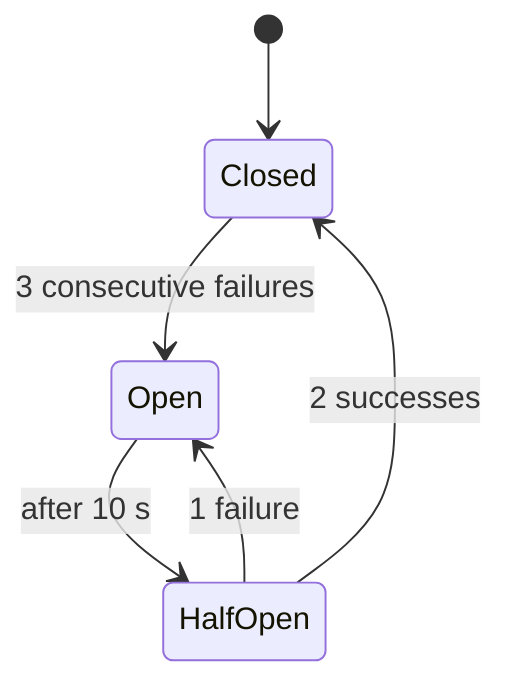
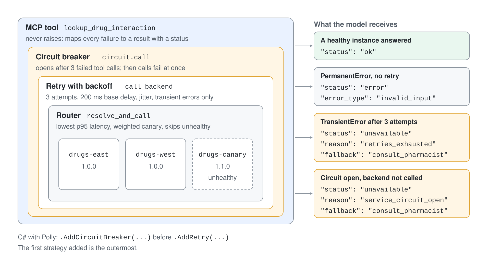

# MCP Resilience: Retry & Circuit Breaker

A tool call leaves the model's control the moment the agent sends it. If the backend behind the tool times out, returns a 503 or goes down for ten minutes, the model still has to answer. A server that returns a stack trace, or worse an empty result, invites the model to improvise, and in a clinical or financial setting an improvised "no interaction found" is a defect.

This topic puts the standard resilience patterns inside an MCP server: retry with backoff for transient faults, a circuit breaker for sustained faults, and a structured fallback result that tells the model what it may and may not conclude. The running example is a drug interaction lookup behind three backend instances.

## Classify the Failure First

The right response depends on the kind of failure. Retrying a bad request wastes time, and not retrying a network blip loses a good answer.

| Failure | Example | Response |
| --- | --- | --- |
| Transient | HTTP 503, timeout, connection reset | Retry with exponential backoff and jitter |
| Permanent | Unknown medication code, validation error | Do not retry; return a clear error the model can relay |
| Sustained | Backend down for minutes | Open a circuit breaker and answer fast with a fallback |
| Degraded | One instance slow | Route around it by latency or weight |

The server expresses this with two exception types. `TransientError` triggers retries and counts toward the breaker, and `PermanentError` goes straight back to the caller.

```python
class TransientError(Exception):
    pass


class PermanentError(Exception):
    pass
```

## Retry with Backoff and Jitter

Python uses `tenacity`. The decorator retries only the transient type, waits longer after each attempt, adds jitter so that many callers do not retry in lockstep, and re-raises the last error when attempts run out.

```python
from tenacity import retry, retry_if_exception_type, stop_after_attempt, wait_exponential_jitter


def mcp_retry_with_backoff(max_attempts=3, base_delay_seconds=0.2, max_delay_seconds=2):
    return retry(
        stop=stop_after_attempt(max_attempts),
        wait=wait_exponential_jitter(initial=base_delay_seconds, max=max_delay_seconds, jitter=0.1),
        retry=retry_if_exception_type(TransientError),
        reraise=True,
    )
```

A tool call has a human or a model waiting, so keep the total retry time short. In the demo, three attempts with a 200 ms base delay make a failing call take about 0.8 seconds.

## The Circuit Breaker

Retries protect one call. A circuit breaker protects the backend and the caller from many failing calls at once. It has three states.



While the circuit is closed, calls pass through. When failures reach the threshold the circuit opens, and every call fails immediately without touching the backend. After the recovery timeout it lets trial calls through, and a run of successes closes it again.

```python
@dataclass
class CircuitBreakerConfig:
    failure_threshold: int = 3
    recovery_timeout: float = 10.0
    success_threshold: int = 2


class CircuitBreaker:
    def call(self, func, *args, **kwargs):
        if self.state == CircuitState.OPEN:
            if time.time() - self.last_failure_time >= self.config.recovery_timeout:
                self.state = CircuitState.HALF_OPEN
                self.success_count = 0
            else:
                raise CircuitBreakerOpenError(f"Circuit open, next attempt in {self.time_until_recovery():.1f}s")
        try:
            result = func(*args, **kwargs)
        except TransientError:
            self._on_failure()
            raise
        self._on_success()
        return result
```

The breaker wraps the retrying function, so it counts one failure per tool call after the retries have been used up. Only transient errors count, so a stream of bad medication codes cannot open it.



## A Fallback the Model Can Reason About

When the breaker is open or the retries are exhausted, the tool returns a normal result with a status instead of raising. The fields give the model a decision, not just an apology.

```python
@mcp.tool()
def lookup_drug_interaction(drug_a: str, drug_b: str) -> dict:
    """Check for interactions between two medications."""
    try:
        return circuit.call(call_backend, drug_a, drug_b)
    except CircuitBreakerOpenError as error:
        return {
            "status": "unavailable",
            "reason": "service_circuit_open",
            "fallback": "consult_pharmacist",
            "retry_after_seconds": round(circuit.time_until_recovery(), 1),
            "message": str(error),
        }
    except TransientError as error:
        return {"status": "unavailable", "reason": "retries_exhausted", "fallback": "consult_pharmacist", "message": str(error)}
    except PermanentError as error:
        return {"status": "error", "error_type": "invalid_input", "message": str(error)}
```

The agent instructions complete the contract: "If the tool reports status unavailable, say the check could not be completed, never state that no interaction exists, and follow the fallback it names." The tool and the instructions have to agree, or the model fills the gap.

## Routing Across Instances

The example registers three backend instances and a router that picks one per call. It prefers the lowest 95th percentile latency, can shift a weighted share of traffic to a canary version, and skips instances that the registry marks unhealthy.

```python
registry.register_instance("lookup_drug_interaction", "drugs-west", "1.0.0", west)
registry.register_instance("lookup_drug_interaction", "drugs-canary", "1.1.0", canary, health_status="unhealthy")
router.set_weights("lookup_drug_interaction", {"drugs-east": 0, "drugs-west": 100 - percent, "drugs-canary": percent})
```

Health and metrics endpoints on the same server make the behavior observable, and an API key check protects them together with the MCP endpoint. The check uses `hmac.compare_digest`, which compares in constant time.

## The Same Pattern in C#

.NET has the same building blocks in Polly. A `ResiliencePipeline` composes a circuit breaker and a retry strategy, and the order matters: the first strategy added is the outermost. The breaker goes first so that it sees the final outcome of each call, after the retries.

```csharp
pipeline = new ResiliencePipelineBuilder<object>()
    .AddCircuitBreaker(new CircuitBreakerStrategyOptions<object>
    {
        ShouldHandle = new PredicateBuilder<object>().Handle<TransientBackendException>(),
        FailureRatio = 0.5,
        MinimumThroughput = 3,
        SamplingDuration = TimeSpan.FromSeconds(30),
        BreakDuration = TimeSpan.FromSeconds(10)
    })
    .AddRetry(new RetryStrategyOptions<object>
    {
        ShouldHandle = new PredicateBuilder<object>().Handle<TransientBackendException>(),
        MaxRetryAttempts = 2,
        Delay = TimeSpan.FromMilliseconds(200),
        BackoffType = DelayBackoffType.Exponential,
        UseJitter = true
    })
    .Build();
```

Polly measures a failure ratio over a sampling window and not a consecutive count. With `FailureRatio = 1.0` the breaker stays closed after a single successful call, because four failures against one success is a ratio of 0.8. Choose the ratio and the minimum throughput together.

## Agent Framework and the mcp Version

The Python demo connects Microsoft Agent Framework to the server with `MCPStreamableHTTPTool`. An earlier version of this demo pinned `mcp` below 2.0 because Agent Framework 1.19 could not read the 2.x initialize result. That is still true for `agent-framework-core` 1.22.0, which fails with `AttributeError: 'InitializeResult' object has no attribute 'protocolVersion'` against `mcp` 2.3.0.

The project therefore pins `mcp==1.30.0` for the server and the agent, and the server uses the `FastMCP` class of the 1.x line.

## Hands-On Demo

- [Make an MCP Server Survive a Backend Outage](./demo-mcp-resilience.md)

## Key Topics

- [Using MCP tools with agents (Agent Framework)](https://learn.microsoft.com/agent-framework/agents/tools/local-mcp-tools)
- [Use the Model Context Protocol tool in Foundry Agent Service](https://learn.microsoft.com/azure/foundry/agents/how-to/tools/model-context-protocol)
- [Set up authentication for MCP tools in Foundry Agent Service](https://learn.microsoft.com/azure/foundry/agents/how-to/mcp-authentication)
- [Choose an Azure service for your MCP server](https://learn.microsoft.com/azure/container-apps/mcp-choosing-azure-service)
