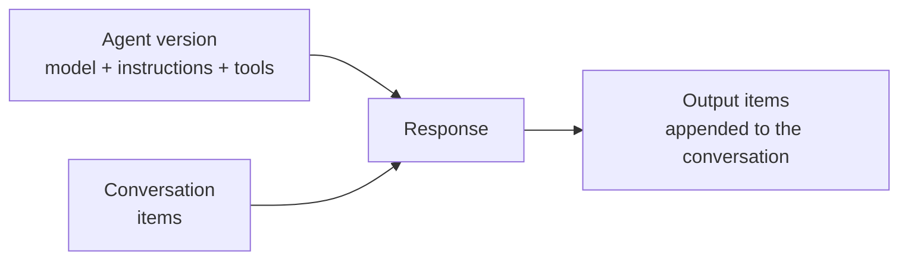
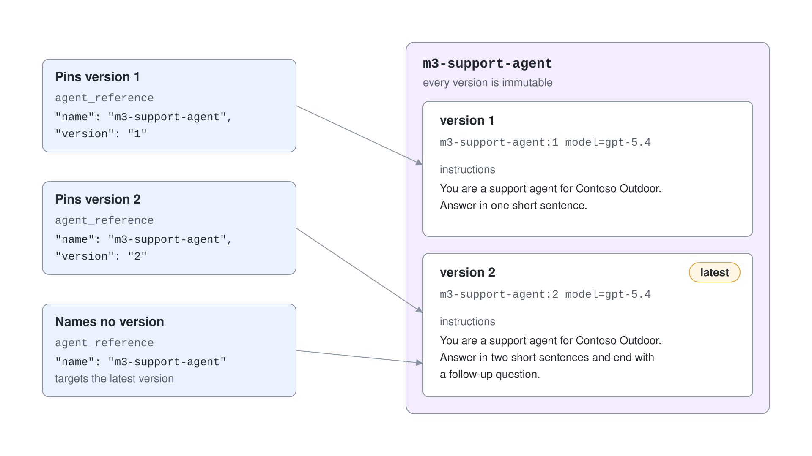
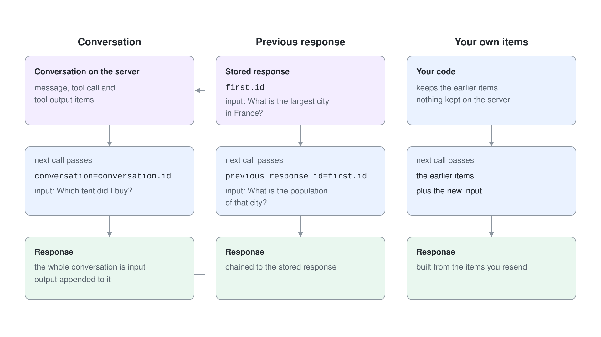

# Prompt Agents: Versions & Conversations

A prompt agent is the quickest way to put a model behind a name in Microsoft Foundry. You supply a model deployment, instructions and optionally tools, and Foundry Agent Service hosts the definition for you. There is no container to build and no code to deploy.

This topic covers the three runtime components every later topic in this module builds on: agents, conversations and responses. It also shows how they replace the classic threads and runs model.

## Agents, conversations and responses

Foundry Agent Service uses three components to run stateful, multi-turn interactions.

| Component | What it holds | Use it when |
| --- | --- | --- |
| Agent | Model, instructions and tools, stored as numbered versions | Several requests need the same behavior |
| Conversation | Persisted items (messages, tool calls, tool outputs) | Later turns need server-side history |
| Response | One run of a model or agent against input, producing output items | Every interaction; it is the unit of execution |

A response can run with or without an agent, and with or without a conversation. Start with a response, then add an agent for reusable behavior, a conversation for history, or both.



## Create a prompt agent version

`create_version` stores a definition under an agent name. Calling it again with the same name does not overwrite the agent, it creates the next version.

```python
from azure.identity import DefaultAzureCredential
from azure.ai.projects import AIProjectClient
from azure.ai.projects.models import PromptAgentDefinition

project = AIProjectClient(endpoint=PROJECT_ENDPOINT, credential=DefaultAzureCredential())

agent = project.agents.create_version(
    agent_name="support-agent",
    definition=PromptAgentDefinition(
        model="gpt-5.4",
        instructions="You are a support agent. Answer in one short sentence.",
    ),
)
print(f"{agent.name}:{agent.version}")
```

The C# equivalent uses `Azure.AI.Projects` 2.0.x for the project client, `Azure.AI.Projects.Agents` for the agent definition types and `Azure.AI.Extensions.OpenAI` for the response and conversation clients.

```csharp
using Azure.AI.Projects;
using Azure.AI.Projects.Agents;
using Azure.Identity;

AIProjectClient project = new(new Uri(projectEndpoint), new DefaultAzureCredential());

ProjectsAgentVersion agent = await project.AgentAdministrationClient.CreateAgentVersionAsync(
    agentName: "support-agent",
    options: new(new DeclarativeAgentDefinition("gpt-5.4")
    {
        Instructions = "You are a support agent. Answer in one short sentence.",
    }));
```

## Reference an agent as name:version

Versions are immutable, so a version number is a stable contract. A caller that pins `support-agent:1` keeps getting version 1 behavior while you publish and test version 2. A reference without a version targets the latest version.



```python
openai = project.get_openai_client()

response = openai.responses.create(
    input="My tent zipper is stuck. What should I do?",
    extra_body={"agent_reference": {"name": "support-agent", "version": "1", "type": "agent_reference"}},
)
print(response.output_text)
```

`project.get_openai_client()` returns an OpenAI client bound to your project endpoint and authenticated with the same credential. The agent travels in `extra_body` because the OpenAI Responses API itself has no agent field.

In C#, `GetProjectResponsesClientForAgent` takes an `AgentReference` that carries the same two values.

```csharp
using Azure.AI.Extensions.OpenAI;

ProjectResponsesClient responses = project.ProjectOpenAIClient
    .GetProjectResponsesClientForAgent(new AgentReference("support-agent", "1"));
ResponseResult result = await responses.CreateResponseAsync("My tent zipper is stuck.");
Console.WriteLine(result.GetOutputText());
```

## Persist history with conversations

A conversation stores items on the server. When you pass `conversation=<id>` to a response, the whole conversation becomes model input and the output is appended to the same conversation.

```python
conversation = openai.conversations.create(
    items=[{"type": "message", "role": "user", "content": "I bought the Trailhead 2 tent last week."}]
)

turn = openai.responses.create(
    conversation=conversation.id,
    input="Which tent did I buy?",
    extra_body={"agent_reference": {"name": "support-agent", "version": "1", "type": "agent_reference"}},
)
```

Conversations store items, not only chat messages. Common item types are message items, tool call items, tool output items and output items. Read them back with `openai.conversations.items.list(conversation.id)` and append your own with `openai.conversations.items.create(...)`.

Because the conversation and the agent are separate objects, you can continue one conversation on a newer agent version. History belongs to the conversation; behavior belongs to the version.



If a conversation grows past the model context size, the service truncates the input it sends to the model. The stored conversation itself is not truncated.

## Responses without a conversation

A conversation is optional. Chain turns by passing the id of a previous stored response, or resend earlier items yourself and keep nothing on the server.



```python
first = openai.responses.create(
    input="What is the largest city in France?",
    extra_body={"agent_reference": {"name": "support-agent", "type": "agent_reference"}},
)
follow_up = openai.responses.create(
    input="What is the population of that city?",
    previous_response_id=first.id,
    extra_body={"agent_reference": {"name": "support-agent", "type": "agent_reference"}},
)
```

## Parameterize instructions with structured inputs

Instructions can contain Handlebars placeholders that you fill per request, so one version serves many users. Declare each placeholder with `StructuredInputDefinition` and pass the values in `extra_body["structured_inputs"]`.

```python
from azure.ai.projects.models import PromptAgentDefinition, StructuredInputDefinition

definition = PromptAgentDefinition(
    model="gpt-5.4",
    instructions="The user's name is {{userName}}. Greet them by name.",
    structured_inputs={
        "userName": StructuredInputDefinition(description="The user's name", required=True, schema={"type": "string"}),
    },
)
```

```python
response = openai.responses.create(
    input="Hello!",
    extra_body={
        "agent_reference": {"name": "support-agent", "type": "agent_reference"},
        "structured_inputs": {"userName": "Alice Smith"},
    },
)
```

## Classic threads and runs are retiring

The classic Agent Service model used assistants, threads, messages and runs. Agents (classic) are deprecated and retire on March 31, 2027, so new work uses versions, conversations, items and responses.

| Classic | Current |
| --- | --- |
| Agent (`create_agent`) | Agent version (`agents.create_version`) |
| Thread | Conversation (`conversations.create`) |
| Message | Conversation item |
| Run (create, poll, read) | Response (`responses.create`) |

Two practical differences matter. A response is one call instead of a create-and-poll loop, and state is no longer welded to a thread object.

## Hands-On Demo

[Version and Converse with a Prompt Agent](demo-prompt-agents.md) creates two versions of a support agent, pins calls to each version, holds a conversation, reads its items back and continues the same conversation on the newer version. It ships a Python project and a C# project.

## Key Topics

- [Build with agents, conversations, and responses](https://learn.microsoft.com/azure/foundry/agents/concepts/runtime-components)
- [Quickstart: create a prompt agent](https://learn.microsoft.com/azure/foundry/agents/quickstarts/prompt-agent)
- [Use structured inputs with agents](https://learn.microsoft.com/azure/foundry/agents/how-to/structured-inputs)
- [Migrate to the Agents SDK](https://learn.microsoft.com/azure/foundry/agents/how-to/migrate)
- [Navigate from Foundry classic](https://learn.microsoft.com/azure/foundry/how-to/navigate-from-classic)
