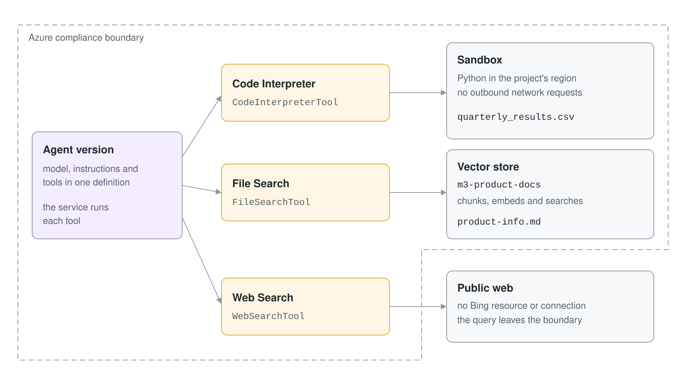
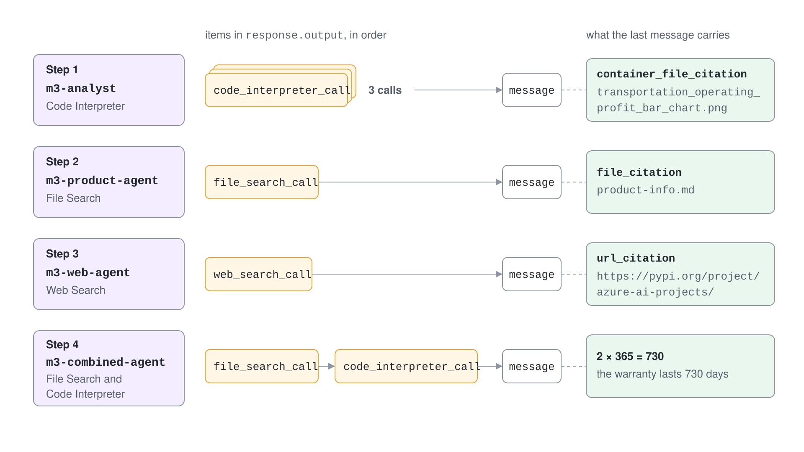

# Code Interpreter, File & Web Search

Built-in tools let a prompt agent do work the model cannot do alone: run code, read your documents and look up current facts. You attach them to an agent version, and Foundry Agent Service runs them for you. There is no tool server to host and no function loop to write.



Code Interpreter, File Search and Web Search are generally available in the current Agent Service. This topic shows what each one does, how to attach it and how to read its evidence in the response.

## How built-in tools work

A tool is part of the agent definition, so it is versioned with the instructions. When the model decides to use a tool, the service runs it and adds a tool call item to the response output. The final `message` item then carries the answer and its citations.

```python
from azure.ai.projects.models import PromptAgentDefinition, WebSearchTool

agent = project.agents.create_version(
    agent_name="web-agent",
    definition=PromptAgentDefinition(
        model="gpt-5.4",
        instructions="Use web search for current facts and cite your sources.",
        tools=[WebSearchTool()],
    ),
)
```

Every item in `response.output` has a `type`. A tool run shows up as `code_interpreter_call`, `file_search_call` or `web_search_call` before the `message` item. Printing the types is the quickest way to prove which tool ran.



| Tool | Status | Python class | Evidence in the response |
| --- | --- | --- | --- |
| Code Interpreter | GA | `CodeInterpreterTool` | `code_interpreter_call` item, `container_file_citation` annotations |
| File Search | GA | `FileSearchTool` | `file_search_call` item, `file_citation` annotations |
| Web Search | GA | `WebSearchTool` | `web_search_call` item, `url_citation` annotations |

## Code Interpreter

Code Interpreter lets the model write and run Python in a sandbox. Use it for data analysis, calculations and charts. The sandbox runs in the same region as your project, and sessions cannot make outbound network requests.

Upload the input file with the OpenAI files API and pass its id in an automatic container.

```python
from azure.ai.projects.models import CodeInterpreterTool, AutoCodeInterpreterToolParam

openai = project.get_openai_client()
with open("quarterly_results.csv", "rb") as f:
    csv_file = openai.files.create(purpose="assistants", file=f)

tool = CodeInterpreterTool(container=AutoCodeInterpreterToolParam(file_ids=[csv_file.id]))
```

Generated files come back as `container_file_citation` annotations on the last message. Use the container id and file id from the annotation to download the file.

```python
citation = response.output[-1].content[-1].annotations[-1]
data = openai.containers.files.content.retrieve(file_id=citation.file_id, container_id=citation.container_id)
open(citation.filename, "wb").write(data.read())
```

Code Interpreter has charges beyond token fees. Each conversation that calls it opens its own session, active for one hour with a 30 minute idle timeout.

## File Search

File Search grounds an agent in your own documents. You create a vector store, upload files to it and attach the store to the agent. The service chunks each file, embeds the chunks and searches them when the model asks.

```python
from azure.ai.projects.models import FileSearchTool

store = openai.vector_stores.create(name="product-docs")
with open("product-info.md", "rb") as f:
    openai.vector_stores.files.upload_and_poll(vector_store_id=store.id, file=f)

tool = FileSearchTool(vector_store_ids=[store.id])
```

Upload is asynchronous, so use `upload_and_poll` to wait until indexing finishes. An agent can use at most one vector store, and a vector store holds up to 10,000 files. If an answer shows no citation, set `tool_choice="required"` to force a search.

File Search uses a vector store managed by the service. When you need hybrid search, reranking or your own index, use Azure AI Search, covered in the Foundry IQ and Advanced RAG topics.

## Web Search

Web Search gives an agent current information from the public web with citations. It is the recommended web grounding tool because it needs no Bing resource and no project connection. You can set `user_location` for geo-relevant results and `search_context_size` to `low`, `medium` or `high`.

```python
from azure.ai.projects.models import WebSearchTool

tool = WebSearchTool()
```

Web Search sends data outside the Azure compliance boundary. Review that before you use it with regulated data. Grounding with Bing Search remains a GA alternative when you need Bing parameters such as `freshness` or `market`, or non-OpenAI models.

The classic Deep Research tool is deprecated. For deep research, use the `o3-deep-research` model with the Web Search tool or an MCP tool instead.

## Combining tools

An agent version can carry several tools. The model picks the tools per question, and the output items show the order it used them.

```python
tools=[
    FileSearchTool(vector_store_ids=[store.id]),
    CodeInterpreterTool(container=AutoCodeInterpreterToolParam()),
]
```

Keep tool descriptions in the instructions short and specific. A model that has three tools and vague instructions picks the wrong one more often.

## Hands-On Demo

[Build a Data Analyst, Product Expert and Web Scout](demo-builtin-tools.md) creates one agent per tool, downloads a generated chart, retrieves a cited answer from a document and finally combines two tools in a single agent.

## Key Topics

- [Code Interpreter tool](https://learn.microsoft.com/azure/foundry/agents/how-to/tools/code-interpreter)
- [File search tool](https://learn.microsoft.com/azure/foundry/agents/how-to/tools/file-search)
- [Vector stores for file search](https://learn.microsoft.com/azure/foundry/agents/concepts/vector-stores)
- [Web search tool](https://learn.microsoft.com/azure/foundry/agents/how-to/tools/web-search)
- [Web grounding tools overview](https://learn.microsoft.com/azure/foundry/agents/how-to/tools/web-overview)
- [Migrate to the new agents developer experience](https://learn.microsoft.com/azure/foundry/agents/how-to/migrate)
