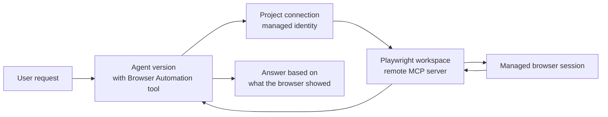
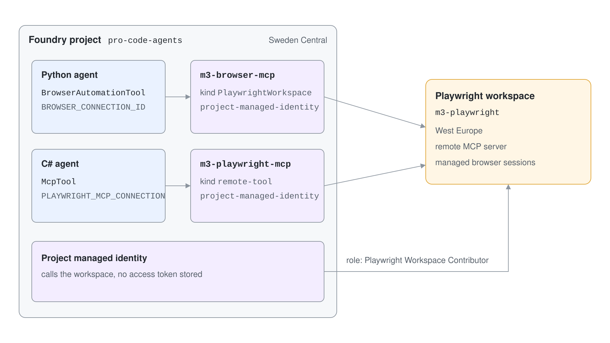

# Browser Automation & Computer Use

Some systems offer no API: a vendor portal, a legacy web application, a form that only a person can submit. Foundry Agent Service gives an agent two ways to operate such a system through its user interface. Browser Automation drives a managed browser through page structure, and Computer Use steers a virtual keyboard and mouse from screenshots.

This topic explains how each works, which one to pick and how to wire Browser Automation to an agent. It also covers the access gate that stands in front of Computer Use.

## Browser Automation or Computer Use

| | Browser Automation | Computer Use |
| --- | --- | --- |
| Status | Generally available | Preview |
| Model | Any GPT model | `computer-use-preview` only (access request required) |
| How it sees the screen | Page structure (accessibility snapshot of the DOM) | Raw pixels from screenshots |
| How it acts | Named browser tools such as navigate, click, type | Virtual mouse and keyboard actions |
| Interfaces | Browser | Browser and desktop |
| Extra resource | A Playwright workspace and a project connection | None, but you must run your own sandbox |
| Who runs the actions | The service, in a managed remote browser | Your application code, in your environment |

Choose Browser Automation for web-only workflows. Choose Computer Use when the target is a desktop application or a screen that has no usable page structure.

## How Browser Automation works

Browser Automation is an MCP tool backed by Playwright Workspaces, a managed service that hosts headless browsers. The agent needs no local browser and no Playwright installation. It calls browser tools, reads the result and decides the next step.



A session has a fixed lifecycle. The agent calls `create_browser_session`, receives an opaque `browserSessionId`, passes it to every browser tool and finishes with `close_browser_session`. An inactive session is cleaned up after 15 minutes, so the instructions should require explicit cleanup.



| Tool | Purpose |
| --- | --- |
| `create_browser_session` | Start a session and return the Live View link |
| `browser_navigate` | Open a URL |
| `browser_snapshot` | Read the current page as structured text with element references |
| `browser_click`, `browser_type` | Act on an element reference from the snapshot |
| `browser_wait_for` | Wait for time or text |
| `close_browser_session` | Release the browser |

Enable only the tools a scenario needs. The remote MCP server documentation lists the full tool reference.

## Set up the Playwright workspace

Three things must exist before an agent can browse: a Playwright workspace, a role for the Foundry project identity on that workspace, and a project connection that points at the workspace. Creating the workspace needs the Contributor role on the resource group, and creating the connection needs Foundry Project Manager on the project.



```bash
az resource create --id /subscriptions/<sub>/resourceGroups/<rg>/providers/Microsoft.LoadTestService/playwrightWorkspaces/<name> --api-version 2025-09-01 --location westeurope --properties '{"regionalAffinity":"Enabled","localAuth":"Enabled"}'
```

The workspace region must be one that Browser Automation supports: `australiaeast`, `eastasia`, `eastus`, `japaneast`, `switzerlandnorth`, `westeurope` or `westus3`. The workspace can sit in a different region than the Foundry project.

The Foundry project managed identity calls the workspace, so it needs a role on it. Assign the built-in Playwright Workspace Contributor role at the workspace scope, or a custom role with only the permissions the tool needs.

```bash
az role assignment create --assignee-object-id <project-principal-id> --assignee-principal-type ServicePrincipal --role "Playwright Workspace Contributor" --scope <workspace-resource-id>
```

The connection records the endpoint and how to authenticate. Three authentication types exist: API key (a workspace access token stored in the connection), project managed identity and agent identity for hosted agents. Project managed identity is the enterprise default, and it avoids storing a token.

```bash
azd ai connection create m3-browser-mcp --kind PlaywrightWorkspace --target https://westeurope.mcp.playwright.microsoft.com/playwrightworkspaces/<workspace-id>/mcp --auth-type project-managed-identity --audience https://mcp.playwright.microsoft.com
```

`--kind PlaywrightWorkspace` requires exact PascalCase. The audience is the resource identifier of the Playwright remote MCP server.

## Attach the tool to an agent

The tool takes the full resource ID of the project connection. The agent instructions carry the session discipline.

```python
from azure.ai.projects.models import (
    BrowserAutomationTool,
    BrowserAutomationToolConnectionParameters,
    BrowserAutomationToolParameters,
    PromptAgentDefinition,
)

tool = BrowserAutomationTool(
    browser_automation=BrowserAutomationToolParameters(
        connection=BrowserAutomationToolConnectionParameters(project_connection_id=CONNECTION_ID)
    )
)

agent = project.agents.create_version(
    agent_name="browser-agent",
    definition=PromptAgentDefinition(
        model="gpt-5.4",
        instructions="Create one browser session, reuse it, close it when done. Base answers on what the browser shows.",
        tools=[tool],
    ),
)
```

Each browser action arrives in the response stream as a `remote_function_call` item, so an application can log exactly what the agent did. The `Azure.AI.Projects` 2.0.x C# packages expose only the preview tool type. The C# project in this topic therefore attaches the same Playwright endpoint as an MCP tool, which is the documented alternative.

```csharp
McpTool browser = ResponseTool.CreateMcpTool(
    serverLabel: "playwrightWorkspace",
    serverUri: new Uri(playwrightMcpUrl),
    toolCallApprovalPolicy: new McpToolCallApprovalPolicy(GlobalMcpToolCallApprovalPolicy.NeverRequireApproval));
browser.ProjectConnectionId = "m3-playwright-mcp";
```

## Keep a browsing agent safe

A browsing agent acts on your behalf and can take unintended actions. Treat web pages as untrusted input, because a page can contain instructions aimed at the model (prompt injection).

- Give the connection least privilege and restrict who can use the project.
- Prefer approval for every call while you evaluate an integration, and allow only the tools the flow needs.
- Never enable `browser_evaluate` or `browser_run_code` by default.
- The Live View URL grants a view into the session. Treat it as sensitive and do not log or share it.
- Test against your own pages first and review the action trail.

## Computer Use

Computer Use proposes actions from screenshots, and your code carries them out. The model is `computer-use-preview`, and it is gated: you register through an access form, and Microsoft grants access on eligibility before you can create a deployment.

The model is available in `eastus2`, `swedencentral` and `southindia`.

```python
from azure.ai.projects.models import ComputerUsePreviewTool, PromptAgentDefinition

agent = project.agents.create_version(
    agent_name="computer-agent",
    definition=PromptAgentDefinition(
        model="computer-use-preview",
        instructions="Operate the screen to complete the task. Ask before any purchase.",
        tools=[ComputerUsePreviewTool(environment="browser", display_width=1024, display_height=768)],
    ),
)
```

The integration is a loop that your application owns.



1. Send the task and an initial screenshot to the agent.
2. Read `computer_call` items in the output; each holds one action such as `click`, `type`, `scroll` or `screenshot`.
3. Execute the action in a sandbox such as Playwright running in a virtual machine with no access to sensitive data.
4. Capture a new screenshot and send it back as a `computer_call_output`, linked with `previous_response_id`.
5. Repeat until the model stops asking for actions or your iteration limit is reached.

```python
output = {
    "type": "computer_call_output",
    "call_id": call.call_id,
    "output": {"type": "input_image", "image_url": f"data:image/png;base64,{screenshot_b64}"},
}
if call.pending_safety_checks:
    output["acknowledged_safety_checks"] = call.pending_safety_checks
```

When the service returns `pending_safety_checks`, it detected a risk such as prompt injection or a sensitive domain. Pause the loop, let a person review the request, and send `acknowledged_safety_checks` with the next output only after approval.

## Hands-On Demo

[Drive a Managed Browser from an Agent](demo-browser-automation.md) provisions a Playwright workspace and a project connection with `provision.azcli`, runs a three-task browsing session in Python and C#, and then probes the Computer Use access gate. The Computer Use loop is not run because the model is gated for the demo subscription.

## Key Topics

- [Browser Automation tool](https://learn.microsoft.com/azure/foundry/agents/how-to/tools/browser-automation)
- [Computer use tool (preview)](https://learn.microsoft.com/azure/foundry/agents/how-to/tools/computer-use)
- [Playwright Workspaces remote MCP server](https://learn.microsoft.com/azure/app-testing/playwright-cloud-browsers/how-to-playwright-workspaces-remote-mcp)
- [Manage workspace access tokens](https://learn.microsoft.com/azure/app-testing/playwright-workspaces/how-to-manage-access-tokens)
- [Transparency note for Foundry Agent Service](https://learn.microsoft.com/azure/foundry/responsible-ai/agents/transparency-note)
- [Tool support by region and model](https://learn.microsoft.com/azure/foundry/agents/concepts/limits-quotas-regions#tool-support-by-region-and-model)
