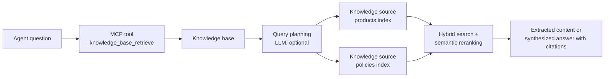

# Foundry IQ: Knowledge Bases & Retrieval

File search works for a handful of documents a user hands over. An organization has product catalogs, policies and manuals spread across indexes, and a question like "which tent survives winter and what happens if it arrives damaged" needs facts from two of them. Foundry IQ is the managed knowledge layer that answers such questions: a reusable knowledge base on Azure AI Search that plans the retrieval, searches several sources and returns grounded, cited content.

An agent reaches a knowledge base through the Model Context Protocol (MCP), so the same knowledge base can serve many agents. Foundry IQ is in preview, and the preview API versions below can change.

## The building blocks

A knowledge base sits on top of an Azure AI Search service and is built from three objects.

| Object | What it is | Example |
| --- | --- | --- |
| Search index | Searchable content with keyword, vector and semantic configuration | `m3-products`, `m3-policies` |
| Knowledge source | A pointer that makes content available to retrieval (search index, blob storage, OneLake, SharePoint, web) | `m3-products-ks` |
| Knowledge base | The orchestrator: which sources to query, which model plans and writes, how much reasoning to spend | `m3-outdoor-kb` |



Depending on its configuration, a knowledge base uses an LLM to decompose the question into subqueries, runs them in parallel with keyword, vector or hybrid search, reranks semantically and can synthesize an answer that cites its sources.

## Reasoning effort

The reasoning effort controls how much model work a retrieval spends. Higher effort plans more and answers richer questions, and it costs more tokens and time.

| Effort | Model involved | Behavior |
| --- | --- | --- |
| `minimal` | None | Searches every source with the question as written and returns the extracted content |
| `low` | Query planning and answer synthesis | Decomposes the question and synthesizes a cited answer |
| `medium` | Query planning and answer synthesis | Spends more reasoning on planning and iteration for harder questions |

There is also an `auto` setting that lets the service choose. The generally available `2026-04-01` API supports minimal, extractive retrieval only. Query planning, answer synthesis and configurable effort need the `2026-08-01-preview` API, which the Python SDK exposes in the `12.1.0b2` pre-release of `azure-search-documents`.

## Create sources and a knowledge base

Each index needs a semantic configuration, and a vector field with an Azure OpenAI vectorizer makes hybrid search possible. A knowledge source wraps the index.

```python
from azure.search.documents.indexes.models import SearchIndexKnowledgeSource, SearchIndexKnowledgeSourceParameters

index_client.create_or_update_knowledge_source(
    SearchIndexKnowledgeSource(
        name="m3-products-ks",
        description="Contoso Outdoor products",
        search_index_parameters=SearchIndexKnowledgeSourceParameters(search_index_name="m3-products"),
    )
)
```

The knowledge base lists its sources, names the model that plans and writes, and carries instructions for source selection.

```python
from azure.search.documents.indexes.models import (
    AzureOpenAIVectorizerParameters, KnowledgeBase, KnowledgeBaseAzureOpenAIModel, KnowledgeSourceReference,
)
from azure.search.documents.knowledgebases.models import KnowledgeRetrievalLowReasoningEffort, KnowledgeRetrievalOutputMode

index_client.create_or_update_knowledge_base(
    KnowledgeBase(
        name="m3-outdoor-kb",
        retrieval_instructions="Use the products source for gear and prices. Use the policies source for returns and warranty.",
        output_mode=KnowledgeRetrievalOutputMode.ANSWER_SYNTHESIS,
        knowledge_sources=[KnowledgeSourceReference(name="m3-products-ks"), KnowledgeSourceReference(name="m3-policies-ks")],
        models=[KnowledgeBaseAzureOpenAIModel(azure_open_ai_parameters=AzureOpenAIVectorizerParameters(
            resource_url=FOUNDRY_ENDPOINT, deployment_name="gpt-5.4", model_name="gpt-5.4"))],
        retrieval_reasoning_effort=KnowledgeRetrievalLowReasoningEffort(),
    )
)
```

The search service calls the model with its own managed identity. That identity needs the Cognitive Services User role on the Foundry resource, and the search service must be on the Basic tier or higher to use a managed identity.

## Retrieve directly

The retrieve action runs the whole pipeline without an agent. Each request can override the effort, and the response carries the content, the references and an activity log that records every search and model call.

```python
from azure.search.documents.knowledgebases import KnowledgeBaseRetrievalClient
from azure.search.documents.knowledgebases.models import KnowledgeBaseRetrievalRequest, KnowledgeRetrievalMediumReasoningEffort

client = KnowledgeBaseRetrievalClient(endpoint=SEARCH_ENDPOINT, knowledge_base_name="m3-outdoor-kb", credential=credential, api_version="2026-08-01-preview")
response = client.retrieve(KnowledgeBaseRetrievalRequest(messages=messages, retrieval_reasoning_effort=KnowledgeRetrievalMediumReasoningEffort(), include_activity=True))
```

With minimal effort there is no model to plan, so you supply `intents` (a semantic intent with the search text) instead of `messages`. The activity log then shows only index searches, which makes minimal the cheap baseline.

## Connect the knowledge base to an agent

The agent calls the knowledge base through its MCP endpoint, and a project connection supplies the credential. The connection is a `RemoteTool` connection that uses the project managed identity with the Azure AI Search audience.

```json
{
  "name": "m3-outdoor-kb-mcp",
  "type": "Microsoft.MachineLearningServices/workspaces/connections",
  "properties": {
    "authType": "ProjectManagedIdentity",
    "category": "RemoteTool",
    "target": "https://<search>.search.windows.net/knowledgebases/m3-outdoor-kb/mcp?api-version=2026-08-01-preview",
    "isSharedToAll": true,
    "audience": "https://search.azure.com/",
    "metadata": { "ApiType": "Azure" }
  }
}
```

Create it with an ARM `PUT` on `.../projects/<project>/connections/<name>?api-version=2025-10-01-preview`. The project identity also needs Search Index Data Reader on the search service. The knowledge base exposes one MCP tool, `knowledge_base_retrieve`, and that is the only tool Foundry Agent Service supports for it.

```python
from azure.ai.projects.models import MCPTool

tool = MCPTool(
    server_label="knowledge-base",
    server_url=MCP_ENDPOINT,
    require_approval="never",
    allowed_tools=["knowledge_base_retrieve"],
    project_connection_id="m3-outdoor-kb-mcp",
)
```

Explicit instructions raise the rate of tool calls. Tell the agent to use the knowledge base for every question, to cite sources and to answer "I don't know" when retrieval finds nothing.

## Keep permissions in the loop

When a knowledge source holds permission-protected content, the retrieval engine can filter results per user. Forward the signed-in user's token in the `x-ms-query-source-authorization` header of the MCP tool, and declare it as a structured input so each request supplies its own value. Without the token, permission-enabled sources return results unfiltered.

## Hands-On Demo

[Build a Knowledge Base and Connect an Agent to It](demo-foundry-iq.md) indexes two document sets, builds a two-source knowledge base, compares minimal, low and medium reasoning effort on a two-hop question and connects the knowledge base to a Python agent and a C# agent over MCP.

## Key Topics

- [What is Foundry IQ?](https://learn.microsoft.com/azure/foundry/agents/concepts/what-is-foundry-iq)
- [Connect a Foundry IQ knowledge base to Foundry Agent Service](https://learn.microsoft.com/azure/foundry/agents/how-to/foundry-iq-connect)
- [Agentic retrieval overview](https://learn.microsoft.com/azure/search/agentic-retrieval-overview)
- [Create a knowledge base in Azure AI Search](https://learn.microsoft.com/azure/search/agentic-retrieval-how-to-create-knowledge-base)
- [Knowledge sources overview](https://learn.microsoft.com/azure/search/agentic-knowledge-source-overview)
- [Retrieve data from a knowledge base](https://learn.microsoft.com/azure/search/agentic-retrieval-how-to-retrieve)
