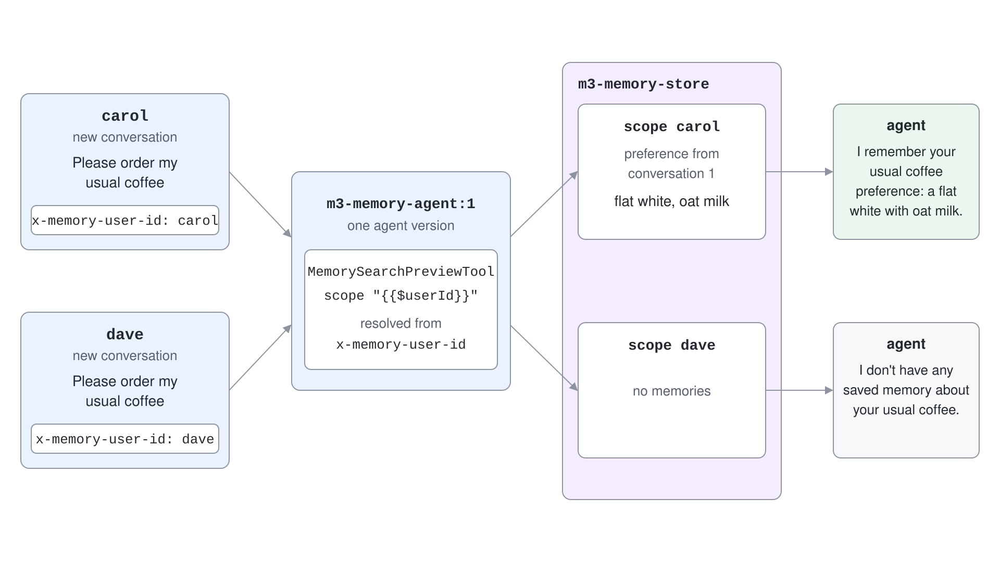

# Agent Memory: User & Procedural Memory

A conversation ends and the agent forgets. The next session starts with a stranger who has no idea about the coffee order, the allergy or the reporting routine you explained last week. Memory in Foundry Agent Service is a managed, long-term store that extracts what matters from conversations and brings it back in later ones.

Memory is in preview. Preview features carry no service-level agreement and the API can change, so pin your SDK version and recheck the documentation before you depend on it.

## Three kinds of long-term memory

A memory store extracts and keeps three types of memory. Each has its own retrieval pattern.

| Memory type | What it holds | When to retrieve it |
| --- | --- | --- |
| User profile | Durable preferences and personal context, such as language, defaults, dietary needs | Near the start of each conversation, as stable personalization |
| Chat summary | Distilled summaries of earlier conversation topics | Per turn, using the current messages, to restore continuity |
| Procedural | Reusable how-to routines and operating patterns inferred from earlier interactions | When the user asks for a recurring task the agent has handled before |

Memory works in three phases. Extraction pulls candidate facts out of the conversation, consolidation merges duplicates and resolves conflicts (a new allergy replaces the old note), and retrieval searches the store when the agent needs context.


Choose the right store for the job. Use memory for what the agent learns about a user over time, a Foundry IQ knowledge base for curated organizational content and file search for documents a user provides during an interaction.

## Create a memory store

A memory store is a project-scoped resource that names the chat model and the embedding model that process memory content. Create one per agent so access and tuning stay separate.

```python
from datetime import timedelta
from azure.ai.projects.models import MemoryStoreDefaultDefinition, MemoryStoreDefaultOptions

options = MemoryStoreDefaultOptions(
    user_profile_enabled=True,
    chat_summary_enabled=True,
    procedural_memory_enabled=True,
    default_ttl_seconds=timedelta(days=30),
    user_profile_details="Avoid irrelevant or sensitive data, such as age, financials, precise location and credentials",
)

memory_store = project.beta.memory_stores.create(
    name="support-memory",
    definition=MemoryStoreDefaultDefinition(
        chat_model="gpt-5.4",
        embedding_model="text-embedding-3-small",
        options=options,
    ),
    description="Support agent memory",
)
```

`user_profile_details` steers what the extractor keeps and what it ignores, which makes it the first privacy control. `default_ttl_seconds` sets the expiry for new memories; a value of `0` means no expiration, and TTL applies to every memory, including ones added by a remember command. The options can only be set when the store is created.

The store calls your model deployments with the project managed identity, so that identity needs the Foundry User role. Without it, the first update fails with an authentication error from the model resource.

## Scope: whose memory is it

Every operation names a `scope`, and each scope is an isolated collection inside the store. Use a user id, a team id or any stable key you control.

| Access path | How scope is set |
| --- | --- |
| Memory search tool | A static string, or `{{$userId}}` to resolve the end user per request |
| Low-level memory APIs | An explicit `scope` argument on every call |

With `{{$userId}}`, the service takes the id from the `x-memory-user-id` request header. Without the header it falls back to the caller's Microsoft Entra tenant and object id. Use the header in a backend that calls the API on behalf of many users.



## Attach memory to an agent

The memory search tool lets the agent read from and write to the store during a conversation. At the start of a conversation the service injects static memories, and per turn it retrieves contextual ones.

```python
from azure.ai.projects.models import MemorySearchPreviewTool, PromptAgentDefinition

tool = MemorySearchPreviewTool(
    memory_store_name="support-memory",
    scope="{{$userId}}",
    update_delay=300,
)

agent = project.agents.create_version(
    agent_name="support-agent",
    definition=PromptAgentDefinition(
        model="gpt-5.4",
        instructions="You are a helpful assistant. Use what you remember about the user.",
        tools=[tool],
    ),
)
```

```python
response = openai.responses.create(
    input="I prefer dark roast coffee",
    conversation=conversation.id,
    extra_headers={"x-memory-user-id": "alice"},
    extra_body={"agent_reference": {"name": agent.name, "type": "agent_reference"}},
)
```

`update_delay` is a debounce in seconds. The service writes to long-term memory only after that much inactivity, and the default is 300 seconds. Demos set it to a few seconds so they finish quickly.

## Use the memory APIs directly

When you need control, skip the agent and call the store. `begin_update_memories` turns conversation items into memories, and `search_memories` retrieves them.

```python
poller = project.beta.memory_stores.begin_update_memories(
    name="support-memory",
    scope="alice",
    items=[{"type": "message", "role": "user", "content": "I prefer dark roast coffee."}],
    update_delay=0,
)
result = poller.result()
```

Search has two modes. A call with only a `scope` returns the static user profile memories, and a call with `items` set to the latest messages returns the contextual memories, profile and chat summary, most relevant to them.

```python
static = project.beta.memory_stores.search_memories(name="support-memory", scope="alice")
contextual = project.beta.memory_stores.search_memories(
    name="support-memory",
    scope="alice",
    items=[{"type": "message", "role": "user", "content": "What are my coffee preferences?"}],
    options=MemorySearchOptions(max_memories=5),
)
```

## Commands, items and deletion

Users can ask the agent to remember or forget something, and the memory search tool applies it immediately and returns a `memory_command_call` item. Individual records can be created, read, updated and deleted, and a whole scope can be erased to answer a deletion request.

```python
project.beta.memory_stores.create_memory(
    name="support-memory", scope="alice", content="Prefers concise changelogs.", kind="user_profile"
)
project.beta.memory_stores.delete_scope(name="support-memory", scope="alice")
```

Treat `delete_scope` as the building block for a right-to-erasure workflow. Deleting a memory store removes all scopes at once, and agents that still reference it lose that context.

## Hands-On Demo

[Give an Agent a Memory and Teach It a Routine](demo-agent-memory.md) creates a memory store, writes and searches memories for two users, attaches the store to an agent through the memory search tool, proves scope isolation and removes everything it created. The runnable projects are `agent-memory-py/` (Python) and `agent-memory-cs/` (C#).

## Key Topics

- [Memory in Foundry Agent Service (preview)](https://learn.microsoft.com/azure/foundry/agents/concepts/what-is-memory)
- [Create and use memory in Foundry Agent Service (preview)](https://learn.microsoft.com/azure/foundry/agents/how-to/memory-usage)
- [Build with agents, conversations, and responses](https://learn.microsoft.com/azure/foundry/agents/concepts/runtime-components)
- [Role-based access control for Foundry](https://learn.microsoft.com/azure/foundry/concepts/rbac-foundry)
