# Plan, Reflect, Fork and Resume an Analyst Agent

An agent that answers once and forgets cannot do real research: it cannot show its plan, check its own work, explore alternatives or continue tomorrow. In this demo an investment analyst agent does all four against a market-data tool. You finish with a saved session that a second process picks up from the server.

## Prerequisites

- A Microsoft Foundry project with a `gpt-5.4` deployment and `az login` completed.
- The `Foundry User` role on the project.
- Python 3.12 or later, or the .NET 10 SDK for the C# project.

## Run it

```bash
cd demos/03-agent-service/07-agentic-loops/agentic-loops-py
python -m venv .venv
.venv/Scripts/pip install -r requirements.txt
cp .env.example .env
.venv/Scripts/python loops.py
.venv/Scripts/python resume.py
```

The C# project in `agentic-loops-cs/` runs the same steps. `dotnet run` is `loops.py`, and `dotnet run -- resume` is `resume.py`:

```bash
cd demos/03-agent-service/07-agentic-loops/agentic-loops-cs
cp .env.example .env
dotnet run
dotnet run -- resume
```

Set `PROJECT_ENDPOINT` in `.env` first. `loops.py` runs steps 1 to 5 and leaves the agent version and the conversation in place; `resume.py` is step 6 and cleans up.

## Step 1: Publish the analyst and its tool

The agent is a prompt agent with one function tool. The service decides when to call `get_market_data`, and the application executes the call. Prices come from the local dictionary in `market_data.py`, so results are deterministic.

```python
agent = project_client.agents.create_version(
    agent_name=AGENT_NAME,
    definition=PromptAgentDefinition(
        model=os.environ["MODEL_DEPLOYMENT_NAME"],
        instructions=INSTRUCTIONS,
        tools=[MARKET_DATA_TOOL],
    ),
)
```

```csharp
ProjectsAgentVersion agent = (await project.AgentAdministrationClient.CreateAgentVersionAsync(
    agentName: LoopCore.AgentName,
    options: new(new DeclarativeAgentDefinition(Environment.GetEnvironmentVariable("MODEL_DEPLOYMENT_NAME")!)
    {
        Instructions = LoopCore.Instructions,
        Tools = { LoopCore.MarketDataTool },
    }))).Value;
```

Expected output:

```text
Agent m3-investment-analyst version 1
```

## Step 2: Read the inner tool loop

`run_turn` in `loop_core.py` is the loop every later step calls. It sends the input, executes every `function_call` item locally, returns the `function_call_output` items and repeats until a response has no function call.



```python
outputs = [
    FunctionCallOutput(
        type="function_call_output",
        call_id=item.call_id,
        output=get_market_data(**json.loads(item.arguments)),
    )
    for item in response.output
    if item.type == "function_call"
]
if not outputs:
    return response
```

```csharp
List<ResponseItem> outputs = response.OutputItems.OfType<FunctionCallResponseItem>()
    .Select(call => ResponseItem.CreateFunctionCallOutputItem(
        call.CallId,
        MarketData.Get(JsonNode.Parse(call.FunctionArguments)!["ticker"]!.GetValue<string>())))
    .Cast<ResponseItem>().ToList();
if (outputs.Count == 0)
    return response;
```

There is no separate output to check for this step; the next steps depend on it, and each one prints what its tool calls produced.

## Step 3: Plan, then act

The first turn asks for a JSON plan and nothing else. The second turn is chained to the first with `previous_response_id`, so the agent executes a plan it can see.



```python
plan_response = run_turn(openai_client, 'Decompose this task into research steps. Reply as JSON: {"steps": [...]}. Task: ' + task)
plan = json.loads(plan_response.output_text)
print(f"Plan has {len(plan['steps'])} steps")
```

Expected output (the step count varies):

```text
Plan then act
Plan has 6 steps
```

## Step 4: Act, then reflect with a confidence gate

Each cycle asks the agent to critique and revise its analysis and to return a `confidence` from 1 to 10. The loop stops at a confidence of 8 or after three cycles, whichever comes first.

```python
for cycle in range(1, MAX_REFLECTION_CYCLES + 1):
    response = run_turn(openai_client, CRITIQUE_PROMPT, previous_response_id=response.id)
    trace = json.loads(response.output_text)
    print(f"Reflection cycle {cycle}: confidence {trace['confidence']}")
    if trace["confidence"] >= CONFIDENCE_THRESHOLD:
        break
```

```csharp
for (int cycle = 1; cycle <= MaxReflectionCycles; cycle++)
{
    response = await RunTurn(CritiquePrompt, previousResponseId: response.Id);
    trace = JsonNode.Parse(response.GetOutputText())!;
    int confidence = trace["confidence"]!.GetValue<int>();
    Console.WriteLine($"Reflection cycle {cycle}: confidence {confidence}");
    if (confidence >= ConfidenceThreshold)
        break;
}
```

Expected output (values vary):

```text
Act then reflect
Reflection cycle 1: confidence 6
Reflection cycle 2: confidence 5
Reflection cycle 3: confidence 4
Recommendation: Hold
```

The confidence fell on every cycle here, so the cycle cap ended the loop, not the threshold. That is why the loop needs both conditions.

## Step 5: Fork the finished analysis into scenarios

Two background responses branch from the same reflected response id. Each is polled until it leaves `queued` and `in_progress`, and neither sees the other.

```python
job = openai_client.responses.create(
    input=prompt,
    previous_response_id=previous_response_id,
    background=True,
    extra_body=AGENT_REF,
)
while job.status in ("queued", "in_progress"):
    time.sleep(2)
    job = openai_client.responses.retrieve(job.id)
```

```csharp
ResponseResult job = (await client.CreateResponseAsync(new CreateResponseOptions
{
    InputItems = { ResponseItem.CreateUserMessageItem(prompt) },
    PreviousResponseId = previousResponseId,
    BackgroundModeEnabled = true,
})).Value;
while (job.Status is ResponseStatus.Queued or ResponseStatus.InProgress)
{
    await Task.Delay(2000);
    job = (await client.GetResponseAsync(job.Id)).Value;
}
```

The C# project starts both branches as tasks and awaits them with `Task.WhenAll`; the Python project uses a thread pool for the same effect.

Expected output:

```text
Fork into scenarios
[bull] If Microsoft can compound at 20% annually, today's 35.2 P/E could prove reasonable because earnings growth would catch up quickly ...
[bear] If Microsoft's earnings or revenue were to decline by 5% annually, its current 35.2 P/E would likely prove too high ...
```

Both scenarios quote the 35.2 P/E from the first research pass. They reuse the data already in the base state instead of calling the tool again.

## Step 6: Persist the session and resume it in a new process

The end of `loops.py` opens a conversation, asks about GOOG and writes the conversation id, the last response id and the agent version to `sessions.json`. Then the process exits.



```python
save_session("analyst-session-1", conversation.id, first.id, {"ticker": "GOOG", "workflow": "research", "agent_version": agent.version})
```

```csharp
SessionStore.Save("analyst-session-1", conversation.Id, first.Id, new() { ["ticker"] = "GOOG", ["workflow"] = "research", ["agent_version"] = agent.Version });
```

Expected output of `loops.py`:

```text
Persist the session
Saved analyst-session-1 -> conv_0fc874cb0590976a00jd8t3KSIvNrEinqIRaGl491uWkgNPQVY
```

`resume.py` is a separate process. It loads the entry and asks a question that names no ticker, so only the server-side history can answer it.

```python
saved = load_session("analyst-session-1")
resumed = run_turn(openai_client, "Which ticker did we just discuss, and what was its P/E ratio?", conversation_id=saved["conversation_id"])
```

```csharp
Session saved = SessionStore.Get("analyst-session-1");
ResponseResult resumed = await resumeLoop.RunTurn("Which ticker did we just discuss, and what was its P/E ratio?", conversationId: saved.ConversationId);
```

Expected output of `resume.py`:

```text
Loaded session: conversation conv_0fc874cb0590976a00jd8t3KSIvNrEinqIRaGl491uWkgNPQVY, metadata {'ticker': 'GOOG', 'workflow': 'research', 'agent_version': '1'}
Resumed: GOOG, with a P/E ratio of 24.8.
Deleted conversation and agent version
```

The C# run prints the same sections. A trimmed run of `dotnet run` followed by `dotnet run -- resume`:

```text
Agent m3-investment-analyst version 1
Plan has 6 steps
Reflection cycle 1: confidence 6
Reflection cycle 2: confidence 7
Reflection cycle 3: confidence 7
Recommendation: Hold
[bull] If Microsoft can grow earnings at 20% annually, its current 35.2 P/E could prove reasonable or even attractive as rapid compounding closes the valu ...
[bear] In a bear case, Microsoft's premium 35.2 P/E could compress if investors begin to expect about a 5% annual earnings decline rather than cont ...
Saved analyst-session-1 -> conv_01c97b275436b2dd00PtR7rioABSpWiLEEZql3hjqmmKrYy2dP
Loaded session: conversation conv_01c97b275436b2dd00PtR7rioABSpWiLEEZql3hjqmmKrYy2dP, metadata ticker=GOOG, workflow=research, agent_version=1
Resumed: GOOG, 24.8.
Deleted conversation and agent version
```

## Verify

The resumed answer names GOOG and its 24.8 P/E although the question mentions neither, and the process that asked it never ran the original turn. Open `sessions.json` (next to `loops.py`, or in the build output folder for C#) to see how little the application stores: two ids and a metadata object.

## Cleanup

`resume.py` deletes the conversation and the agent version. If you stopped after `loops.py`, run `resume.py` once, or delete by hand:

```python
openai_client.conversations.delete("<conversation-id>")
project_client.agents.delete_version(agent_name="m3-investment-analyst", agent_version="1")
```
