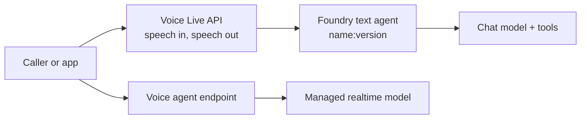

# Voice Agents: Voice Live API

People often cannot type: they are driving, standing at a counter or on a call. A voice agent listens, thinks and answers in speech, and it has to do so with the timing of a conversation. Microsoft Foundry offers two ways to build one: the Voice Live API in front of a text agent, and voice-based prompt agents that run the whole speech pipeline for you.

This topic explains how each works and runs both without a microphone. The demos type the user's turn and save the agent's spoken reply as audio, so they work on any machine.

## Two paths to a voice agent

| | Voice Live with a Foundry agent | Voice-based prompt agent (preview) |
| --- | --- | --- |
| What you build | A normal text agent plus Voice Live settings | An agent of kind `voice` |
| Who runs the speech pipeline | The Voice Live service, in front of your agent | Foundry Agent Service |
| Model | Your text agent's chat model | A managed real-time model such as `gpt-realtime`, or your own deployment |
| Client SDK | `azure-ai-voicelive`, `Azure.AI.VoiceLive` | `azure-ai-projects` with `beta.voice_agents` |
| Authentication | Microsoft Entra ID only in agent mode | Microsoft Entra ID |
| Status | Current Voice Live API version; check the quickstart | Preview |

Choose Voice Live when you already have a text agent that you want to talk to, or when you need its audio settings (voice, noise suppression, turn detection) under your control. Choose a voice-based prompt agent when you start from scratch and want speech-to-speech with the least plumbing.



## The realtime session

Both paths use a long-lived WebSocket session. The client sends events and receives events, and audio travels as base64 chunks inside them. The conversation is the same loop every time.

1. Connect, and wait for the session-ready event.
2. Send a user turn, either as input audio or as a `conversation.item.create` message item.
3. Send `response.create` to ask for a reply.
4. Collect `response.audio.delta` chunks and the `response.audio_transcript.done` text until `response.done`.

Audio is PCM16, mono, 24 kHz in both directions in these demos. Real use streams microphone audio into the session and relies on server-side turn detection to decide when the user finished speaking. Semantic voice activity detection waits for a finished thought instead of the first pause.

## Voice Live with a Foundry agent

In agent mode you do not set instructions in the session code. You connect to an agent by name and project, and the service runs the agent for every turn.

Agent mode requires Microsoft Entra ID: key authentication is not supported for invoking an agent. The signed-in identity needs the Cognitive Services User and Foundry User roles.

```python
from azure.ai.voicelive.aio import connect

async with connect(
    endpoint=VOICELIVE_ENDPOINT,
    credential=credential,
    agent_name="support-agent",
    project_name="my-project",
    agent_version="3",
    conversation_id=None,
) as connection:
    await connection.session.update(session=RequestSession(modalities=[Modality.TEXT, Modality.AUDIO]))
```

`agent_version` pins the version and `conversation_id` continues an earlier conversation. In C#, the same values live on `AgentSessionConfig`.

```csharp
AgentSessionConfig agentConfig = new("support-agent", "my-project") { AgentVersion = "3" };
using VoiceLiveSession session = await client.StartSessionAsync(SessionTarget.FromAgent(agentConfig));
```

## Store the voice settings with the agent

Voice, turn detection and audio processing settings can live in the agent's metadata under `microsoft.voice-live.configuration`. A metadata value holds at most 512 characters, so longer JSON is split across numbered keys.

```json
{
  "session": {
    "voice": { "name": "en-US-Ava:DragonHDLatestNeural", "type": "azure-standard", "temperature": 0.8 },
    "input_audio_transcription": { "model": "azure-speech" },
    "turn_detection": { "type": "azure_semantic_vad", "end_of_utterance_detection": { "model": "semantic_detection_v1_multilingual" } },
    "input_audio_noise_reduction": { "type": "azure_deep_noise_suppression" },
    "input_audio_echo_cancellation": { "type": "server_echo_cancellation" }
  }
}
```

```python
def chunk_config(config_json, limit=512):
    metadata = {"microsoft.voice-live.configuration": config_json[:limit]}
    remaining, number = config_json[limit:], 1
    while remaining:
        metadata[f"microsoft.voice-live.configuration.{number}"] = remaining[:limit]
        remaining, number = remaining[limit:], number + 1
    return metadata

project.agents.create_version(agent_name="support-agent", definition=definition, metadata=chunk_config(json.dumps(CONFIG)))
```

When the settings travel with the agent, any client that connects to it gets the same voice. A new agent version changes both the behavior and the voice together.

## Voice-based prompt agents

A voice-based prompt agent is an agent whose kind is `voice`. Its definition holds the model, instructions and voice, and the service owns turn detection and noise suppression. Every create or update produces an immutable version, and the endpoint is live as soon as the first version exists.

```python
from azure.ai.projects.models import (
    VoiceAgentAudioConfig, VoiceAgentAudioOutputConfig, VoiceAgentDefinition,
    VoiceModelType, VoiceOutputModality, VoiceType,
)

definition = VoiceAgentDefinition(
    model_type=VoiceModelType.MANAGED,
    model="gpt-realtime",
    instructions="You are a friendly voice assistant. Keep replies to one or two sentences.",
    audio=VoiceAgentAudioConfig(
        output=VoiceAgentAudioOutputConfig(voice="en-US-AvaNeural", voice_type=VoiceType.AZURE_STANDARD),
    ),
    output_modalities=[VoiceOutputModality.AUDIO],
    store=True,
)
project.agents.create_version(agent_name="voice-agent", definition=definition)
```

Creating voice definitions through `.agents` needs `allow_preview=True` on `AIProjectClient`. With `model_type=VoiceModelType.SELF_DEPLOYED` and a deployment name, the agent uses a deployment you already own instead of the managed model. Setting `store=True` keeps the transcript and audio so you can read the conversation back later.

Open a session with `project.beta.voice_agents.realtime.connect(agent_name=...)`. The persisted conversation id arrives on the `session.created` event.

## Write instructions for ears

A voice reply is heard once, in order, with no scrolling back. Good voice instructions state who the agent is, the tasks it can do and who calls. They also name the speaking style, what to confirm before changing anything, what never to disclose and what to say when a tool fails.

```text
You are a concise appointment assistant.
- Speak in short sentences and ask one question at a time.
- Confirm the caller's name and appointment time before making a change.
- Never read a full account identifier aloud.
- If a tool fails, apologize, do not claim the change succeeded, and give the approved next step.
```

## Hands-On Demo

[Talk to Two Kinds of Voice Agent](demo-voice-agents.md) creates a voice-based prompt agent and a Voice Live agent, holds a typed conversation with each, saves the spoken replies as WAV files and reads the stored voice conversation back. It ships Python and C# projects for the Voice Live path.

## Key Topics

- [Quickstart: Voice Live with Foundry Agent Service](https://learn.microsoft.com/azure/ai-services/speech-service/voice-live-agents-quickstart)
- [Quickstart: Create a voice-based prompt agent](https://learn.microsoft.com/azure/foundry/agents/quickstarts/prompt-voice-agent)
- [Voice Live API overview](https://learn.microsoft.com/azure/ai-services/speech-service/voice-live)
- [Configure a voice agent](https://learn.microsoft.com/azure/foundry/agents/how-to/configure-voice-agent)
- [Compare and migrate to Microsoft Foundry voice agents](https://learn.microsoft.com/azure/foundry/agents/how-to/migrate-from-voice-live)
