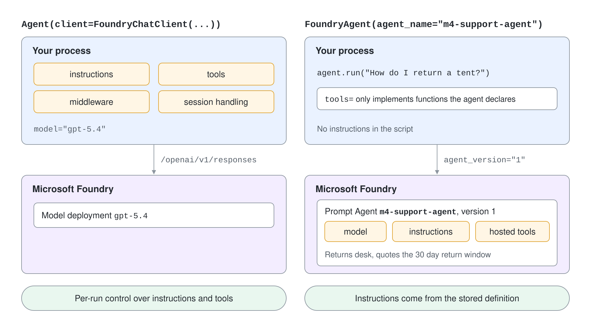

# Chat Clients: Foundry, OpenAI & Claude

An Agent Framework agent is two things glued together: an `Agent` that owns instructions, tools, sessions and middleware, and a chat client that talks to a model. Swapping the client changes where the model runs; the agent code around it stays the same. This topic covers the clients you will meet most often and the one decision that separates them: does your code own the agent definition, or does Microsoft Foundry own it?



## Agent and chat client

Agent Framework is generally available (Python 1.22.0, .NET 1.25.0 at the time of writing). In Python the agent class is `Agent`; the older `ChatAgent` name is gone. The client is passed in through `client=` and the model name is always the `model` argument.

```python
from agent_framework import Agent
from agent_framework.foundry import FoundryChatClient
from azure.identity import DefaultAzureCredential

agent = Agent(
    client=FoundryChatClient(
        project_endpoint="https://<resource>.services.ai.azure.com/api/projects/<project>",
        model="gpt-5.4",
        credential=DefaultAzureCredential(),
    ),
    name="OutdoorGuide",
    instructions="You are a trail guide. Answer in two sentences.",
)

result = await agent.run("What should I pack for a day hike?")
print(result.text)
```

Agent Framework does not load `.env` files on its own. Call `load_dotenv(override=True)` from `python-dotenv` before you build a client.

## FoundryChatClient: your code owns the agent

`FoundryChatClient` calls a model deployed in a Foundry project through the project's Responses endpoint (`{project_endpoint}/openai/v1/responses`). Instructions, tools, middleware and session handling all live in your process. It supports function tools, structured output and streaming, and it exposes the Foundry hosted tools as static factories.

```python
from agent_framework import Agent
from agent_framework.foundry import FoundryChatClient

agent = Agent(
    client=FoundryChatClient(credential=DefaultAzureCredential()),
    instructions="You can search the web and run code.",
    tools=[
        FoundryChatClient.get_web_search_tool(),
        FoundryChatClient.get_code_interpreter_tool(),
    ],
)
```

When the endpoint and model are not passed, the client reads `FOUNDRY_PROJECT_ENDPOINT` and `FOUNDRY_MODEL`. The package that ships it is `agent-framework-foundry`; install it with `pip install agent-framework-foundry`, not the `agent-framework` metapackage, which also pulls every optional integration.

## FoundryAgent: Foundry owns the agent

`FoundryAgent` connects to an agent that already exists in the Foundry Agent Service. It covers Prompt Agents (named, versioned definitions) and Hosted Agents (deployed agent applications). The model, instructions and hosted tools come from the stored definition, so the client cannot replace them at run time.

```python
from agent_framework.foundry import FoundryAgent

agent = FoundryAgent(
    project_endpoint="https://<resource>.services.ai.azure.com/api/projects/<project>",
    agent_name="m4-support-agent",
    agent_version="1",
    credential=DefaultAzureCredential(),
)
result = await agent.run("How do I return a tent?")
```

Hosted Agents omit `agent_version`. A local Python callable passed through `tools=` only supplies the implementation of a function the Foundry agent already declares; it never adds a new tool to the definition. Use `Agent(client=FoundryChatClient(...))` whenever you need per-run control over instructions or tools.



## OpenAI clients: Responses and Chat Completions

The `agent-framework-openai` package ships two clients under `agent_framework.openai`. `OpenAIChatClient` uses the Responses API and is the recommended one because it supports hosted tools. `OpenAIChatCompletionClient` uses the Chat Completions API and fits OpenAI-compatible endpoints or existing integrations.

```python
from agent_framework.openai import OpenAIChatClient, OpenAIChatCompletionClient

responses = OpenAIChatClient(
    model="gpt-5.4",
    azure_endpoint="https://<resource>.openai.azure.com",
    credential=DefaultAzureCredential(),
)

completions = OpenAIChatCompletionClient(
    model="gpt-5.4",
    azure_endpoint="https://<resource>.openai.azure.com",
    credential=DefaultAzureCredential(),
)
```

The same classes serve Azure OpenAI. Passing `azure_endpoint` or `credential` selects Azure routing; with only an `OPENAI_API_KEY` in the environment they talk to OpenAI. Both clients accept hosted tool factories such as `client.get_web_search_tool()`, but only the Responses client adds code interpreter, file search, image generation, hosted shell and hosted MCP.

## Claude through AnthropicClient

Claude models run behind `AnthropicClient` from the separate `agent-framework-anthropic` package, which is published as a beta (`1.0.0b261015` at the time of writing). It reads `ANTHROPIC_API_KEY` and `ANTHROPIC_CHAT_MODEL` from the environment. Anthropic SDK 1.x does not support `temperature`, `top_p` or `top_k`; Agent Framework ignores them and logs a warning.

```python
from agent_framework import Agent
from agent_framework.anthropic import AnthropicClient

agent = Agent(
    client=AnthropicClient(model="claude-sonnet-4-5-20250929"),
    name="OutdoorGuide",
    instructions="You are a trail guide. Answer in two sentences.",
)
```

For Claude deployed in a Foundry resource use `AnthropicFoundryClient`, which reads `ANTHROPIC_FOUNDRY_API_KEY` and `ANTHROPIC_FOUNDRY_RESOURCE`. `AnthropicClient` also has hosted tool factories (`get_code_interpreter_tool`, `get_web_search_tool`, `get_mcp_tool`) and works with local MCP tools and function tools.

## Choosing a client

| You want | Use | Package |
|---|---|---|
| Foundry model, your code owns instructions and tools | `FoundryChatClient` | `agent-framework-foundry` |
| A Prompt Agent or Hosted Agent that Foundry owns | `FoundryAgent` | `agent-framework-foundry` |
| OpenAI or Azure OpenAI with full hosted tools | `OpenAIChatClient` | `agent-framework-openai` |
| OpenAI-compatible endpoint or Chat Completions only | `OpenAIChatCompletionClient` | `agent-framework-openai` |
| Claude through the Anthropic API or Foundry | `AnthropicClient`, `AnthropicFoundryClient` | `agent-framework-anthropic` (beta) |

One client instance can serve concurrent calls on the same event loop. Create a separate `Agent` and `AgentSession` for each concurrent run.

## The same idea in C#

In .NET every provider ends in an `AIAgent`. `AsAIAgent` wraps a client into a `ChatClientAgent`, and the call that creates it is the only line that changes between providers. Package `Microsoft.Agents.AI.Foundry` holds the Foundry extensions; the Chat Completions path goes through `AsIChatClient()` from `Microsoft.Extensions.AI`.

```csharp
AIProjectClient projectClient = new(new Uri(projectEndpoint), new DefaultAzureCredential());

AIAgent agent = projectClient.AsAIAgent(
    model: "gpt-5.4",
    instructions: "You are a trail guide. Answer in two sentences.",
    name: "OutdoorGuide");

FoundryAgent promptAgent = projectClient.AsAIAgent(new AgentReference("m4-support-agent", "1"));
Console.WriteLine(await agent.RunAsync("What should I pack for a day hike?"));
```

Renames from earlier Agent Framework code: `ChatAgent` to `Agent`, `run_stream` to `run(stream=True)`, `AzureAIAgentClient` to `FoundryChatClient`, `OpenAIResponsesClient` to `OpenAIChatClient`, `model_id` and `deployment_name` to `model`, `CreateAIAgent` to `AsAIAgent` and the `Microsoft.Agents.AI.AzureAI` package to `Microsoft.Agents.AI.Foundry`.

## Hands-On Demo

- [Swap chat clients under one agent](./demo-chat-clients.md)

## Key Topics

- [Microsoft Foundry model provider](https://learn.microsoft.com/en-us/agent-framework/integrations/by-component/model-providers/microsoft-foundry)
- [Microsoft Foundry Agent Service provider](https://learn.microsoft.com/en-us/agent-framework/integrations/by-component/agent-services/foundry)
- [OpenAI and Azure OpenAI provider](https://learn.microsoft.com/en-us/agent-framework/integrations/by-component/model-providers/openai)
- [Anthropic provider](https://learn.microsoft.com/en-us/agent-framework/integrations/by-component/model-providers/anthropic)
- [Python 2026 significant changes](https://learn.microsoft.com/en-us/agent-framework/support/upgrade/python-2026-significant-changes)
- [Microsoft Agent Framework overview](https://learn.microsoft.com/en-us/agent-framework/overview/)
