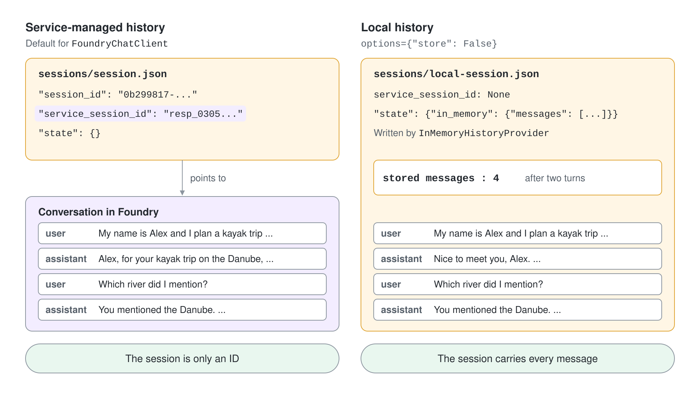

# AgentSession: State & Persistence

An agent without a session answers every message as if it were the first. `AgentSession` is the container that carries a conversation from one `run` call to the next, and it is the unit you save when a conversation must survive a restart, a deployment or a different server. This topic explains what the session holds, where the history lives, and how to serialize and restore it.

## What an AgentSession holds

A session is a small state object. In Python it has three fields; in C# the abstract `AgentSession` exposes a `StateBag` and concrete sessions add what their provider needs.

| Field | Purpose |
|---|---|
| `session_id` | Local unique identifier of this session |
| `service_session_id` | Identifier of the conversation on the service, for example a Responses `resp_*` ID |
| `state` | Mutable dictionary shared with context and history providers |

You create a session from the agent and pass it to every call that belongs to the same conversation.

```python
session = agent.create_session()

first = await agent.run("My name is Alice.", session=session)
second = await agent.run("What is my name?", session=session)
```

Without `session=`, each run is independent. A session is also specific to the agent configuration that created it, so do not hand it to an agent with a different provider.

## Where the history lives

Agent Framework supports two storage modes, and the session looks different in each.

| Mode | What is stored | In the session |
|---|---|---|
| Service-managed | Conversation state on the service | `service_session_id` points to it, `state` stays empty |
| Local | Full chat history in the session | Messages sit under `state`, written by `InMemoryHistoryProvider` |

`FoundryChatClient` and the OpenAI Responses client store history on the service by default, so the session is only an ID. Passing `options={"store": False}` keeps history local instead, and the serialized session then carries every message.



```python
result = await agent.run("My name is Alex.", session=session, options={"store": False})
print(session.to_dict()["state"]["in_memory"]["messages"])
```

Local history grows with every turn. History reduction and long-term memory are the job of history and context providers, covered in the next topic.

## Serialize and restore

`to_dict()` turns the session into plain JSON-compatible data and `AgentSession.from_dict()` rebuilds it. Persist the whole object, never only the message text, because provider state travels inside it.



```python
import json
from agent_framework import AgentSession

Path("session.json").write_text(json.dumps(session.to_dict()))

resumed = AgentSession.from_dict(json.loads(Path("session.json").read_text()))
await agent.run("Continue.", session=resumed)
```

Restore a session with the same agent and provider configuration that created it. Upgrade core, providers and hosts together; a newer runtime can read older records, but older runtimes reject records written by the newer one.

## Resume from a service conversation ID

When the service already holds the conversation, a session can be rebuilt from its ID alone.

```python
session = agent.get_session(service_session_id="<service-conversation-id>")
response = await agent.run("Continue this conversation.", session=session)
```

Treat `service_session_id`, `previous_response_id` and conversation IDs as opaque. In an app that serves several users from one project, keep the service ID in your own storage keyed by the authenticated user or tenant, and check ownership before resuming. A service ID is not an authorization boundary.

## The same lifecycle in C#

In .NET the agent creates, serializes and restores sessions, and `SerializeSessionAsync` returns a `JsonElement`. A `ChatClientAgent` can also create a session directly from an existing conversation ID.

```csharp
AgentSession session = await agent.CreateSessionAsync();
await agent.RunAsync("My name is Alice.", session);

JsonElement serialized = await agent.SerializeSessionAsync(session);
AgentSession resumed = await agent.DeserializeSessionAsync(serialized);

AgentSession byId = await chatClientAgent.CreateSessionAsync(conversationId);
```

The renames from earlier releases are `AgentThread` to `AgentSession`, `get_new_thread` to `create_session`, and `GetNewThread` to `CreateSessionAsync`.

## Sessions in harness agents

A harness agent uses the same session. Reuse one session across turns so todos, operating mode, file memory and tool approvals stay connected, and serialize it when that state must outlive the process. Topic 7 builds one.

## Hands-On Demo

- [Resume a conversation after the process exits](./demo-agent-session.md)

## Key Topics

- [Session](https://learn.microsoft.com/en-us/agent-framework/agents/conversations/session)
- [Storage](https://learn.microsoft.com/en-us/agent-framework/concepts/agents/conversations/storage)
- [Context providers](https://learn.microsoft.com/en-us/agent-framework/concepts/agents/conversations/context-providers)
- [Python 2026 significant changes](https://learn.microsoft.com/en-us/agent-framework/support/upgrade/python-2026-significant-changes)
