# Middleware: Agent, Function & Chat

Logging, guardrails, redaction and metering do not belong inside agent instructions or tool bodies. Middleware wraps the agent from the outside, so one function can watch or change every run, every tool call or every model request without touching the code it wraps. This topic shows the three interception points, how they chain, and how to stop a run early.

## Three interception points

Agent Framework has one middleware type per layer of an agent run.

| Type | Wraps | Context object | Runs |
|---|---|---|---|
| Agent middleware | One `agent.run` call | `AgentContext` | Once per run |
| Function middleware | One tool invocation | `FunctionInvocationContext` | Once per tool call |
| Chat middleware | One request to the model | `ChatContext` | Once per model call, including the calls that send tool results back |

A run that calls one tool therefore passes through agent middleware once, function middleware once, and chat middleware twice: the first call asks the model, the second returns the tool result.



## The middleware shape

In Python a middleware is an async function that takes the context and a `call_next` callback. Everything before `await call_next()` runs on the way in; everything after runs on the way out. `call_next()` takes no argument, because middleware changes the shared context object in place.

```python
from agent_framework import AgentContext

async def timing_middleware(context: AgentContext, call_next) -> None:
    started = time.perf_counter()
    await call_next()
    print(f"done in {time.perf_counter() - started:.1f}s")
```

The framework picks the type from the annotation on the first parameter. When you have no annotation, use the decorators `@agent_middleware`, `@function_middleware` or `@chat_middleware`. Class-based middleware subclasses `AgentMiddleware`, `FunctionMiddleware` or `ChatMiddleware` and implements `process(self, context, call_next)`; use it when the middleware keeps state.

## Reading and changing the context

Each context exposes the data for its layer, and `result` is writable after `call_next()` returns.

| Context | Useful fields |
|---|---|
| `AgentContext` | `agent`, `messages`, `session`, `options`, `stream`, `metadata`, `result` |
| `FunctionInvocationContext` | `function`, `arguments`, `session`, `metadata`, `result`, `kwargs` |
| `ChatContext` | `client`, `messages`, `options`, `stream`, `metadata`, `result` |

A function middleware that rewrites a tool result changes what the model reads next.

```python
async def tool_audit(context: FunctionInvocationContext, call_next) -> None:
    await call_next()
    status = context.result[0].text
    if status.startswith("closed"):
        context.result = f"{status}; recommend an alternative route"
```

For streaming runs `context.result` is an async generator of `AgentResponseUpdate` chunks, so check `context.stream` before you replace it.

## Stopping a run early

To refuse a request, set `context.result` and raise `MiddlewareTermination`. The rest of the chain and the model call are skipped, and the caller receives your result.



```python
from agent_framework import AgentResponse, Message, MiddlewareTermination

async def guardrail(context: AgentContext, call_next) -> None:
    if "password" in (context.messages[-1].text or "").lower():
        context.result = AgentResponse(
            messages=[Message(role="assistant", contents=["I can't help with credentials."])]
        )
        raise MiddlewareTermination(result=context.result)
    await call_next()
```

The same pattern works for function and chat middleware. Terminating a tool loop can leave history with a tool call that has no result, so prefer terminating at the agent layer.

## Registration scope and order

Middleware registers on the agent or on a single run. Agent-level middleware wraps run-level middleware.

```python
agent = Agent(client=client, tools=get_trail_status, middleware=[A1, A2])
result = await agent.run("Is the loop open?", middleware=[R1, R2])
```

The execution order is A1, A2, R1, R2, the agent, then back out through R2, R1, A2, A1. Function and chat middleware follow the same wrapping when the tool or model call happens.



## Middleware in C#

.NET has the same three layers, wired differently. Agent run and function-calling middleware attach with the agent builder; `IChatClient` middleware attaches to the chat client, here through the `clientFactory` argument of `AsAIAgent`.

```csharp
AIAgent agent = baseAgent
    .AsBuilder()
    .Use(runFunc: Guardrail, runStreamingFunc: null)
    .Use(ToolAudit)
    .Build();
```

Provide both `runFunc` and `runStreamingFunc` when you need to see streaming output; with only the non-streaming function, streaming runs execute in non-streaming mode. Setting `FunctionInvocationContext.Terminate` to true ends the function-calling loop. Function-calling middleware needs an agent built on `FunctionInvokingChatClient`, such as `ChatClientAgent`.

## Hands-On Demo

- [Add guardrails, audit and metering with middleware](./demo-middleware.md)

## Key Topics

- [Agent middleware](https://learn.microsoft.com/en-us/agent-framework/agents/middleware/)
- [Agent hooks](https://learn.microsoft.com/en-us/agent-framework/agents/agent-hooks)
- [Function tools](https://learn.microsoft.com/en-us/agent-framework/agents/tools/function-tools)
- [Custom IChatClient middleware](https://learn.microsoft.com/en-us/dotnet/ai/microsoft-extensions-ai#custom-ichatclient-middleware)
