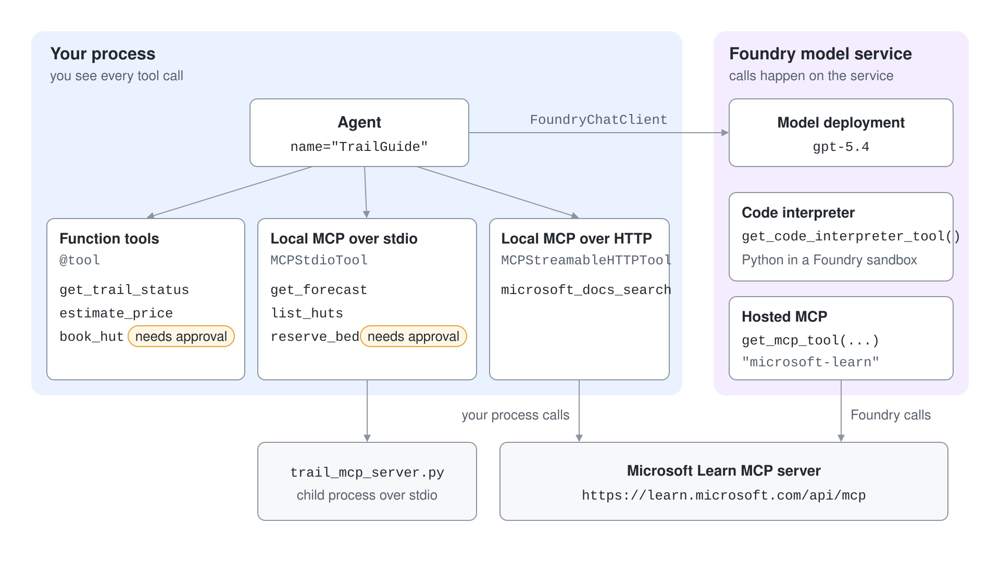

# Equip an Agent with Tools, MCP Servers and an Approval Gate

An agent that only talks cannot check a trail, read live documentation or book a hut. In this demo you give a trail-guide agent your own functions, a local MCP server, a remote MCP server and two hosted tools, and you put a human approval in front of every action that costs money. You finish with one agent that acts through four kinds of tools and cannot book anything without a yes.



What you practice here: choosing where a tool runs and gating it with approval_mode.

Duration: about 50 minutes.

## Prerequisites

- Python 3.12 or later, the Azure CLI signed in with `az login`, and a Foundry project with a `gpt-5.4` deployment that allows the code interpreter tool.
- Outbound HTTPS access to `learn.microsoft.com` for the remote MCP steps.
- For the C# step: .NET 10 SDK.

## Run it

```powershell
cd tools-approvals-py
python -m venv .venv
.venv\Scripts\Activate.ps1
pip install -r requirements.txt
Copy-Item .env.example .env
```

On macOS or Linux, activate with `source .venv/bin/activate` and copy with `cp .env.example .env`. Fill in `PROJECT_ENDPOINT` and `MODEL_DEPLOYMENT_NAME` in `.env`. The finished projects are `tools-approvals-py/` and `tools-approvals-cs/`.

## Step 1: Give the agent function tools

`trail_tools.py` defines two read-only tools with `@tool`. The type hints and docstrings become the schema the model sees; `tool_calls` in `agent_factory.py` lists the calls the model made.

```python
@tool(approval_mode="never_require")
def get_trail_status(
    trail: Annotated[str, Field(description="Trail name, for example 'Wachau valley loop'.")],
) -> str:
    """Return the current status of a hiking trail."""
    return TRAILS.get(trail.lower(), "unknown trail")

agent = build_agent([get_trail_status, estimate_price])
result = await agent.run("Is the Wachau valley loop open, and what do 2 nights for 3 hikers cost?")
```

```powershell
python run_function_tools.py
```

Expected output:

```text
tool call: get_trail_status({"trail":"Wachau valley loop"})
tool call: estimate_price({"nights":2,"persons":3})
The Wachau valley loop is open and dry. Two nights for 3 hikers cost 228 euro.
```

One question produced two tool calls. The model chose both, and the price (2 nights x 3 hikers x 38 euro) came from your function, not from the model.

## Step 2: Require approval for an action

`book_hut` charges a customer, so it uses `approval_mode="always_require"`. The agent stops before the call and returns it in `user_input_requests`; the script answers on the same session.



```python
@tool(approval_mode="always_require")
def book_hut(hut: str, nights: int, persons: int) -> str:
    """Book a mountain hut. This charges the customer and cannot be undone."""

result = await agent.run(PROMPT, session=session)
while result.user_input_requests:
    responses = []
    for request in result.user_input_requests:
        call = request.function_call
        print(f"approval requested: {call.name}({call.arguments})")
        responses.append(Message(role="user", contents=[request.to_function_approval_response(decision)]))
    result = await agent.run(responses, session=session)
```

```powershell
python run_approvals.py approve
python run_approvals.py reject
```

Expected output:

```text
approval requested: book_hut({"hut":"Erzherzog Johann Hut","nights":1,"persons":2})
decision: approve
Booked Erzherzog Johann Hut for 2 hikers for 1 night.
Your confirmation is HB-2935.
```

```text
approval requested: book_hut({"hut":"Erzherzog Johann Hut","nights":1,"persons":2})
decision: reject
I can book the Erzherzog Johann Hut for 2 hikers for 1 night, but the booking was not completed because the charge was rejected. If you want, I can try the booking again.
```

The confirmation number exists only on the approve path, which proves the function body ran only after the yes.

## Step 3: Connect a local MCP server and gate one of its tools

`trail_mcp_server.py` is a small MCP server with three tools. `MCPStdioTool` starts it as a child process and lists its tools; the dictionary form of `approval_mode` puts only the write tool behind approval.

```python
trail_data = MCPStdioTool(
    name="trail-data",
    command=sys.executable,
    args=[str(Path(__file__).with_name("trail_mcp_server.py"))],
    approval_mode={
        "never_require_approval": ["get_forecast", "list_huts"],
        "always_require_approval": ["reserve_bed"],
    },
)

async with build_agent(trail_data) as agent:
    ...
```

```powershell
python run_mcp_stdio.py
```

Expected output:

```text
tool call: list_huts({"region":"Tyrol"})
tool call: get_forecast({"region":"Tyrol"})
tool call: reserve_bed({"hut":"Similaun Hut","persons":2})
approval requested: reserve_bed({"hut":"Similaun Hut","persons":2})
In Tyrol, the huts are Hochjoch Hospiz and Similaun Hut, and the forecast is clear morning with thunderstorms after 15:00 and 9 C at 2000 m. I reserved 2 beds at Similaun Hut.
```

The two read tools ran at once. The write tool was held until the script approved it, exactly like the function tool in Step 2.

## Step 4: Connect a remote MCP server over HTTP

The Microsoft Learn MCP server needs no key. `MCPStreamableHTTPTool` connects from your process, so you see the tool calls like any local tool.

```python
learn = MCPStreamableHTTPTool(
    name="microsoft-learn",
    url="https://learn.microsoft.com/api/mcp",
)

async with build_agent(learn, instructions="Search Microsoft Learn before you answer. Answer in two sentences without dashes.") as agent:
    result = await agent.run("What does the approval_mode parameter of the Agent Framework tool decorator do?")
```

```powershell
python run_mcp_http.py
```

Expected output:

```text
tool call: microsoft_docs_search({"query":"Agent Framework tool decorator approval_mode parameter Microsoft Learn"})
The `approval_mode` parameter on the Agent Framework `@tool` decorator controls whether a tool call requires human approval before the framework executes it. ...
```

The search query is written by the model, and the answer is grounded in what the server returned. Treat a remote server like any third party: it sees every query you send it.

## Step 5: Add hosted tools that Foundry runs

Hosted tools run on the model service. The code interpreter executes Python in a Foundry sandbox, and the hosted MCP tool lets Foundry itself call the Learn server. `FoundryChatClient` creates both through static factories.

```python
code_interpreter = FoundryChatClient.get_code_interpreter_tool()
learn = FoundryChatClient.get_mcp_tool(
    name="microsoft-learn",
    url="https://learn.microsoft.com/api/mcp",
    approval_mode="never_require",
)

agent = build_agent([code_interpreter, learn])
```

```powershell
python run_hosted_tools.py
```

Expected output:

```text
I checked the trail math with code and the total is 456 euro.
For 3 nights and 4 hikers at 38 euro per person and night, the number is 456.
Microsoft Learn shows `FoundryChatClient` in the Agent Framework `foundry` package, for example imported as `from agent_framework.foundry import FoundryChatClient`. ...
```

No tool call lines are printed here because the calls happen on the service. That is also why Step 4 and Step 5 are different designs: Step 4 keeps the connection in your process, Step 5 hands it to Foundry.

## Step 6: Build the same agent in C#

The C# project uses `AIFunctionFactory.Create`, wraps the booking function in `ApprovalRequiredAIFunction`, answers each `ToolApprovalRequestContent`, and then gives a second agent the tools of the Learn MCP server through the `ModelContextProtocol` package.

```csharp
AIAgent hutAgent = projectClient.AsAIAgent(
    model: model,
    instructions: instructions,
    name: "TrailGuide",
    tools:
    [
        AIFunctionFactory.Create(GetTrailStatus, "GetTrailStatus"),
        AIFunctionFactory.Create(EstimatePrice, "EstimatePrice"),
        new ApprovalRequiredAIFunction(AIFunctionFactory.Create(BookHut, "BookHut"))
    ]);

await using McpClient learn = await McpClient.CreateAsync(new HttpClientTransport(new HttpClientTransportOptions
{
    Endpoint = new Uri("https://learn.microsoft.com/api/mcp"),
    Name = "microsoft-learn"
}));
IList<McpClientTool> mcpTools = await learn.ListToolsAsync();
```

```powershell
cd ../tools-approvals-cs
Copy-Item .env.example .env
dotnet run -- approve
```

Expected output:

```text
approval requested: BookHut(hut=Erzherzog Johann Hut, nights=1, persons=2)
decision: approve
The Wachau valley loop is open and dry. I booked the Erzherzog Johann Hut for 2 hikers for 1 night, and your confirmation is HB-2935.
mcp tools: microsoft_docs_search, microsoft_code_sample_search, microsoft_docs_fetch
The C# `AsAIAgent` extension for Microsoft Foundry is provided by the NuGet package `Microsoft.Agents.AI.Foundry` ...
```

Run it with `reject` to see the other path. After a rejection the model may ask once more, so the C# loop keeps going until no request is left; one run printed the approval request twice before the final answer.

## Verify

The confirmation number `HB-2935` appears only after an approve decision, in Python and in C#. Confirm that no booking happens on reject.

```powershell
python run_approvals.py reject | Select-String "HB-"
```

Expected output: no lines. The command prints nothing and returns without a match.

## Cleanup

Nothing was created in Azure. The stdio MCP server exits with the script, and the Learn server keeps no state.

```powershell
deactivate
Remove-Item -Recurse -Force .venv
```
