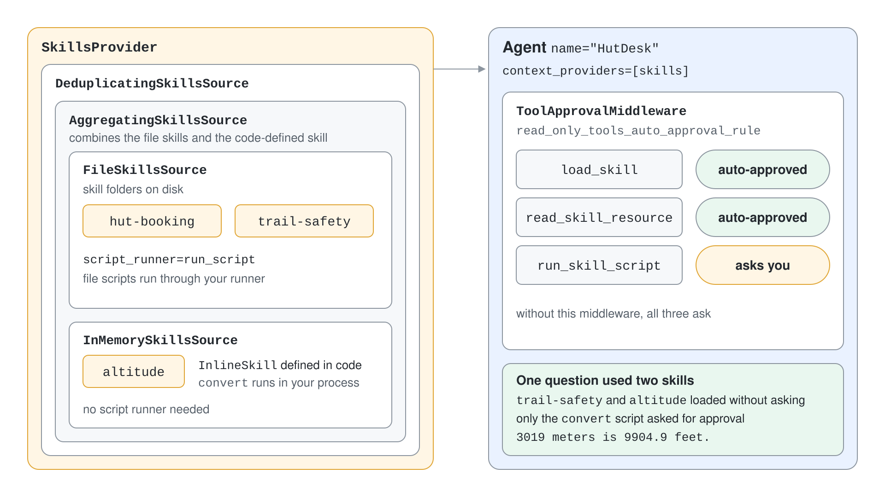

# Agent Skills: SKILL.md & Progressive Disclosure

A long system prompt that contains every procedure your company has costs tokens on every call and drowns the instructions that matter. Agent Skills solve this with a folder per capability: the agent sees only a one-line description until the task needs the rest, and then loads the details in steps. Skills follow an open specification, so the same folder works in other agent products.

## What a skill is

A skill is a directory with a required `SKILL.md` file and optional folders for resources.

```text
hut-booking/
├── SKILL.md
├── references/CANCELLATION_POLICY.md
├── assets/confirmation-template.md
└── scripts/price_quote.py
```

`SKILL.md` starts with YAML frontmatter, followed by the instructions in Markdown.

```yaml
---
name: hut-booking
description: Quote, book and cancel mountain hut stays for Contoso Outdoor. Use when a customer asks for a hut price, a booking confirmation or the cancellation rules.
license: Proprietary
compatibility: Requires python3
metadata:
  owner: contoso-outdoor-bookings
  version: "1.0"
---
```

| Field | Rule |
|---|---|
| `name` | Required. Up to 64 characters, lowercase letters, digits and hyphens, no leading, trailing or doubled hyphen. Must match the folder name |
| `description` | Required. Up to 1024 characters. Say what the skill does and when to use it |
| `license`, `compatibility`, `metadata` | Optional. `compatibility` is up to 500 characters |
| `allowed-tools` | Optional and experimental |

Invalid YAML, duplicate recognized fields or a wrong casing prevent the skill from loading. Keep `SKILL.md` under 500 lines and move reference material into separate files.

## Progressive disclosure

The agent works through four stages, and each stage costs tokens only when the task needs it.

| Stage | What happens | Tool |
|---|---|---|
| Advertise | Names and descriptions go into the prompt on every run, roughly 100 tokens per skill | none |
| Load | The agent retrieves the full `SKILL.md` body, ideally under 5000 tokens | `load_skill` |
| Read resources | The agent fetches a reference or asset file only when it needs it | `read_skill_resource` |
| Run scripts | The agent executes a script bundled with the skill | `run_skill_script` |

`load_skill` is always advertised. `read_skill_resource` appears only when at least one skill has resources, and `run_skill_script` only when at least one skill has scripts. Write the `description` as a trigger: it is the only text the agent sees before it decides to load the skill.



## Provide skills to an agent

`SkillsProvider` is a context provider, so it goes into `context_providers`. `from_paths` discovers every subfolder that contains a `SKILL.md`, up to two levels deep.

```python
from pathlib import Path
from agent_framework import Agent, SkillsProvider

skills = SkillsProvider.from_paths(
    skill_paths=Path(__file__).parent / "skills",
    script_runner=run_script,
)

agent = Agent(
    client=client,
    instructions="You are the hut desk of Contoso Outdoor. Use skills when they match the request.",
    context_providers=[skills],
)
```

Without a `script_runner`, file-based scripts fail when the agent asks to run one. A runner is any callable that receives the `FileSkill`, the `FileSkillScript` and the arguments (a list of strings becomes positional command-line arguments) and returns the output. The runner in the Learn sample is a demonstration; production runners need sandboxing, resource limits and an allow-list of scripts.

## Skill sources

File-based skills are one of four source types, and one provider can mix them.

| Source | Python | C# |
|---|---|---|
| Files on disk | `FileSkillsSource` or `SkillsProvider.from_paths` | `AgentFileSkillsSource` |
| Defined in code | `InlineSkill` | `AgentInlineSkill` |
| Class-based | `ClassSkill` | `AgentClassSkill<T>` |
| From an MCP server | `MCPSkillsSource` | `UseMcpSkills` on the builder |

```python
from agent_framework import InlineSkill, SkillFrontmatter

altitude_skill = InlineSkill(
    frontmatter=SkillFrontmatter(name="altitude", description="Convert mountain altitudes between meters and feet."),
    instructions="Use the convert script.",
)

@altitude_skill.script(name="convert", description="Convert a value: result = value x factor")
def convert(value: float, factor: float) -> str:
    return json.dumps({"result": round(value * factor, 1)})
```

Code-defined scripts run in your process and need no runner. Compose sources with `AggregatingSkillsSource`, `DeduplicatingSkillsSource` and `FilteringSkillsSource`; the provider caches the result. In C# the `AgentSkillsProviderBuilder` assembles the same pipeline.

## Approvals are on by default

All three skill tools, `load_skill`, `read_skill_resource` and `run_skill_script`, require approval by default. The agent pauses and returns the pending calls in `result.user_input_requests`; you answer with `to_function_approval_response(approved=True)` on the same session. This matters because skill instructions enter the agent's context and scripts execute code.

To skip the prompts for the harmless tools, install `ToolApprovalMiddleware` with a rule that the provider exposes.

```python
from agent_framework import ToolApprovalMiddleware, SkillsProvider

agent = Agent(
    client=client,
    context_providers=[skills],
    middleware=[ToolApprovalMiddleware(auto_approval_rules=[SkillsProvider.read_only_tools_auto_approval_rule])],
)
```

`read_only_tools_auto_approval_rule` approves `load_skill` and `read_skill_resource` and still asks for `run_skill_script`; `all_tools_auto_approval_rule` approves everything. The `disable_load_skill_approval`, `disable_read_skill_resource_approval` and `disable_run_skill_script_approval` arguments opt single tools out entirely, so use them only for sources you trust.



## Skills in C#

The same folders load with `AgentSkillsProvider`, which is an `AIContextProvider`. The builder combines file and code sources and the script runner.

```csharp
var skillsProvider = new AgentSkillsProviderBuilder()
    .UseFileSkill(Path.Combine(AppContext.BaseDirectory, "skills"))
    .UseSkill(altitudeSkill)
    .UseFileScriptRunner(ScriptRunner.RunAsync)
    .Build();

AIAgent agent = projectClient.AsAIAgent(new ChatClientAgentOptions
{
    Name = "HutDesk",
    ChatOptions = new() { ModelId = model, Instructions = "Use skills when they match." },
    AIContextProviders = [skillsProvider]
});
```

The three tools require approval here as well, and the answers come back as `ToolApprovalRequestContent`. A harness agent includes the skills provider by default in C# and opts in with `skills_paths` in Python, which the next topic uses.

## Skills or workflows

A skill lets the model decide how to carry out instructions inside one turn. A workflow fixes the steps and supports checkpoints, so prefer a workflow when steps have side effects that must not repeat on retry. Treat skills as third-party code: review `SKILL.md`, scripts and resources before use, run scripts in isolation and keep an audit log of what was loaded and executed.

## Hands-On Demo

- [Teach an agent a company procedure with skills](./demo-agent-skills.md)

## Key Topics

- [Agent Skills](https://learn.microsoft.com/en-us/agent-framework/agents/skills)
- [Agent Skills specification](https://agentskills.io/specification)
- [Tool approval](https://learn.microsoft.com/en-us/agent-framework/agents/tools/tool-approval)
- [Context providers](https://learn.microsoft.com/en-us/agent-framework/agents/conversations/context-providers)
