# Harness Agent: Plan, Execute & Compaction

A plain agent answers one request at a time. Work such as planning a multi-day trek, migrating a codebase or researching a topic runs over many steps, many tool calls and a growing history, and every long-running agent ends up needing the same scaffolding: a plan, a todo list, a way to ask permission, memory and a limit on context size. The harness agent bundles that scaffolding so you supply a chat client and the tools only.

## What a harness adds

A harness wraps a chat client with a chat pipeline and a set of context providers. The result is still a normal Agent Framework agent: an `Agent` from `create_harness_agent` in Python and a `HarnessAgent` that derives from `AIAgent` in .NET.

| Capability | Default | Where it lives |
|---|---|---|
| Function invocation loop | On, with an iteration limit | Chat pipeline |
| History saved after every model call | On | History provider |
| Compaction | Off until you set token limits or a strategy | Chat pipeline |
| Todo list | On | `TodoProvider` |
| Plan and execute modes | On | `AgentModeProvider` |
| File memory | On | `FileMemoryProvider` |
| Tool approval with standing rules | On | Approval middleware |
| Web search | On where the client supports it | Hosted tool |
| OpenTelemetry | On | Agent telemetry |
| Agent Skills | Opt-in in Python, on in .NET | `SkillsProvider` |
| File access, background agents, shell, looping | Opt-in | Optional providers |

## Create a harness agent

Pass a chat client and turn off what you do not need. The factory is released; only a few features it can wire in are experimental or pre-release.

```python
from agent_framework import create_harness_agent

agent = create_harness_agent(
    client=client,
    name="TrekPlanner",
    agent_instructions="You plan multi-day treks for Contoso Outdoor.",
    tools=[get_stage_status, reserve_hut],
    disable_web_search=True,
    disable_file_memory=True,
    default_options={"store": False},
)

session = agent.create_session()
response = await agent.run("Plan a 4 stage trek.", session=session)
```

`harness_instructions` sets the operating guidance and defaults to `DEFAULT_HARNESS_INSTRUCTIONS`; `agent_instructions` carries your domain. Reuse one `AgentSession` for the whole conversation, because todos, mode, approvals and history all live in it. Passing `default_options={"store": False}` keeps history local, which compaction needs.

In C# the same agent comes from `AsHarnessAgent`, in the `Microsoft.Agents.AI.Harness` package.

```csharp
AIAgent agent = chatClient.AsHarnessAgent(new HarnessAgentOptions
{
    Name = "TrekPlanner",
    ChatOptions = new ChatOptions { Instructions = "You plan multi-day treks.", Tools = [...] },
    MaxContextWindowTokens = 128_000,
    MaxOutputTokens = 16_384,
});
```

## Plan, then execute

The mode provider offers two modes. In `plan` the agent analyzes the request, writes todos, asks clarifying questions and presents a plan before it changes anything. In `execute` it works through the plan on its own and marks todos complete.



```python
from agent_framework import get_agent_mode, set_agent_mode

result = await agent.run("Plan a 4 stage Grossglockner trek for 3 hikers.", session=session)
print(get_agent_mode(session))
set_agent_mode(session, "execute")
result = await agent.run("The plan is approved. Execute it.", session=session)
```

The model can switch modes through its `mode_set` tool, and its instructions tell it to do so only when the user explicitly allows it. An application can switch directly with `set_agent_mode`, which queues a one-time notification for the next run. The plan-to-execute confirmation is instruction-level behavior, not a tool approval.

The todo tools are `todos_add`, `todos_complete`, `todos_remove`, `todos_get_remaining` and `todos_get_all`. The provider injects the current list before each run, so the agent can resume unfinished work.

## Approvals with standing rules

Tools marked `approval_mode="always_require"` still pause the run. The harness adds middleware that queues requests and records standing rules, so a user can answer once with "always approve".

```python
from agent_framework import create_always_approve_tool_response

responses.append(Message(role="user", contents=[create_always_approve_tool_response(request)]))
```

`create_always_approve_tool_with_arguments_response` limits the rule to the exact arguments. Standing rules are stored in the session and are not bound to a tool instance, so a replacement tool with the same name inherits them.

Scope sessions to a stable trust boundary and start a new session when approvals should not carry forward. The middleware needs the same session on every run.

## Todo-driven looping

Recording progress does not re-invoke the agent. For tasks where the model stops after each step, the optional loop re-runs it while todos remain open.



```python
agent = create_harness_agent(
    client=client,
    loop_should_continue=todos_remaining(looping_modes=["execute"]),
    loop_next_message=todos_remaining_message,
    loop_max_iterations=10,
)
```

Looping is experimental in the harness, as are background agents and file access; they emit an `ExperimentalWarning`. `FileSystemAgentFileStore` also emits an experimental warning in the installed package.

## Compaction

Every model call carries the whole history, so long tool loops hit the context window and raise cost. Compaction shrinks the history while keeping what matters. In the harness it is off until both `max_context_window_tokens` and `max_output_tokens` are set, or you pass a custom strategy.

```python
agent = create_harness_agent(
    client,
    max_context_window_tokens=128_000,
    max_output_tokens=16_384,
)
```

With the token settings the harness reuses one `ContextWindowCompactionStrategy`: the before phase compacts ahead of every model call inside the tool loop, and the after phase compacts persisted history after the run. Override a phase with `before_compaction_strategy` or `after_compaction_strategy`, or turn it off with `disable_compaction=True`. The compaction framework is experimental in Python and needs `#pragma warning disable MAAI001` in C#.

| Strategy | Aggressiveness | Needs an LLM | Best for |
|---|---|---|---|
| `ToolResultCompactionStrategy` | Low | No | Verbose tool output |
| `SelectiveToolCallCompactionStrategy` | Low to medium | No | Old tool-call groups you no longer need |
| `SummarizationStrategy` | Medium | Yes | Long conversations where context matters |
| `SlidingWindowStrategy` | High | No | Hard group-count limits |
| `TruncationStrategy` | High | No | Emergency message or token backstop |
| `TokenBudgetComposedStrategy` | Configurable | Depends | Layered compaction with fallbacks |

## File memory

`FileMemoryProvider` gives the agent tools to write and recall notes in a file store. By default memory is scoped to the session ID, so a restarted process that reuses the session ID finds the notes again while a different session does not. File access to a shared workspace is separate, opt-in through `file_access_store`.

```python
from agent_framework import AgentSession, FileSystemAgentFileStore

agent = create_harness_agent(
    client=client,
    disable_file_memory=False,
    file_memory_store=FileSystemAgentFileStore("agent-file-memory"),
)
result = await agent.run("Remember our group avoids exposed ridges.", session=AgentSession(session_id="grossglockner-group"))
```

## Hands-On Demo

- [Build a plan-then-execute trek planner with a harness agent](./demo-harness-agent.md)

## Key Topics

- [Agent Harness](https://learn.microsoft.com/en-us/agent-framework/concepts/harness)
- [Planning and todos](https://learn.microsoft.com/en-us/agent-framework/agents/planning-and-todos)
- [Compaction](https://learn.microsoft.com/en-us/agent-framework/concepts/agents/conversations/compaction)
- [Tool approval](https://learn.microsoft.com/en-us/agent-framework/agents/tools/tool-approval)
- [Step 6: Agent Harness](https://learn.microsoft.com/en-us/agent-framework/get-started/harness)
