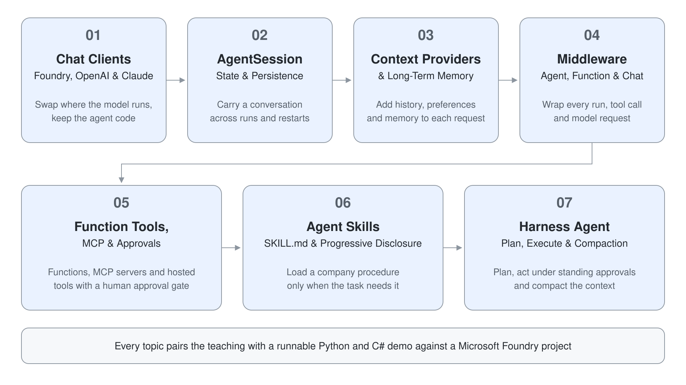

# Module 4: Agent Framework: Agents, Tools & Skills

Microsoft Agent Framework is the open-source SDK for building agents in Python and C#, generally available since 2026-04-02 (Python 1.22.0 and .NET 1.25.0 at the time of writing). One `Agent` class owns instructions, tools, sessions and middleware, and a chat client decides where the model runs, whether that is a Foundry deployment, an agent that Foundry owns, OpenAI, Azure OpenAI or Claude. This module builds that agent layer one concern at a time, from the client up to a harness agent that plans, acts and compacts its own context.

Every topic pairs learning prose with a runnable demo against a Microsoft Foundry project. The Python projects use `agent-framework-core` 1.22.0 with `agent-framework-foundry` 1.15.0, and the C# projects use `Microsoft.Agents.AI` 1.25.0 with `Microsoft.Agents.AI.Foundry` 1.5.0. Each project folder holds the finished code, a pinned `requirements.txt` or `.csproj`, and an `.env.example` that you copy to `.env`.

| Topic | Description |
|---|---|
| [Chat Clients: Foundry, OpenAI & Claude](./01-chat-clients/readme.md) | `FoundryChatClient`, `FoundryAgent`, the two OpenAI clients and `AnthropicClient`, and the rule for choosing between an agent your code owns and one Foundry owns |
| [AgentSession: State & Persistence](./02-agent-session/readme.md) | What a session holds, service-managed versus local history, `to_dict` and `from_dict`, and resuming from a service conversation ID |
| [Context Providers & Long-Term Memory](./03-context-providers/readme.md) | `context_providers`, history providers, custom providers, file, Redis and Cosmos stores, and Foundry managed memory |
| [Middleware: Agent, Function & Chat](./04-middleware/readme.md) | The three interception layers, `call_next`, early termination with `MiddlewareTermination`, and registration order |
| [Function Tools, MCP & Approvals](./05-tools-approvals/readme.md) | `@tool`, `MCPStdioTool`, `MCPStreamableHTTPTool`, hosted tool factories and the human approval loop |
| [Agent Skills: SKILL.md & Progressive Disclosure](./06-agent-skills/readme.md) | File and code-defined skills, the advertise, load, read and run stages, and approval defaults |
| [Harness Agent: Plan, Execute & Compaction](./07-harness-agent/readme.md) | `create_harness_agent` and `AsHarnessAgent`, plan and execute modes, todo loops, standing approvals, compaction and file memory |

| Topic | Description |
|---|---|
| [Swap chat clients under one agent](./01-chat-clients/demo-chat-clients.md) | Run one trail-guide agent on four clients, connect to a Foundry prompt agent and see who owns the instructions |
| [Resume a conversation after the process exits](./02-agent-session/demo-agent-session.md) | Save sessions to files, rebuild one from a service ID, keep history local and give each user their own session |
| [Give an agent history and memory with context providers](./03-context-providers/demo-context-providers.md) | Combine history providers, write a preference provider, persist a transcript to files and add Foundry memory |
| [Add guardrails, audit and metering with middleware](./04-middleware/demo-middleware.md) | Wrap one agent in a timer, a credential guardrail, a tool auditor and a model-call meter |
| [Equip an agent with tools, MCP servers and an approval gate](./05-tools-approvals/demo-tools-approvals.md) | Use function tools, a local and a remote MCP server and hosted tools, with approval in front of every booking |
| [Teach an agent a company procedure with skills](./06-agent-skills/demo-agent-skills.md) | Package a hut-booking procedure as a skill, measure its loading stages and mix in a code-defined skill |
| [Build a plan-then-execute trek planner with a harness agent](./07-harness-agent/demo-harness-agent.md) | Plan first, execute under one standing approval, loop on todos, compact history and keep file memory |

## Helpful Claude Slash Commands

| Command | Usage |
|---|---|
| `/microsoft-agent-framework` | Load the Agent Framework and Foundry skill before you scaffold, fix or deploy agent code |
| `/find-skills` | Search for installable skills that match an agent task, for example MCP or evaluation helpers |
| `/model` | Switch the Claude model while you iterate on agent instructions and tool descriptions |
| `/cost` | Check the token cost of a session, useful next to the compaction and progressive disclosure demos |
| `/doctor` | Check the installation and MCP server connections that your agent project relies on |

## Key Topics covered in this module

- [Microsoft Agent Framework overview](https://learn.microsoft.com/en-us/agent-framework/overview/)
- [Your first agent](https://learn.microsoft.com/en-us/agent-framework/get-started/your-first-agent)
- [Microsoft Foundry model provider](https://learn.microsoft.com/en-us/agent-framework/integrations/by-component/model-providers/microsoft-foundry)
- [Microsoft Foundry Agent Service provider](https://learn.microsoft.com/en-us/agent-framework/integrations/by-component/agent-services/foundry)
- [Session](https://learn.microsoft.com/en-us/agent-framework/agents/conversations/session)
- [Context providers](https://learn.microsoft.com/en-us/agent-framework/agents/conversations/context-providers)
- [Agent middleware](https://learn.microsoft.com/en-us/agent-framework/agents/middleware/)
- [Tool approval](https://learn.microsoft.com/en-us/agent-framework/agents/tools/tool-approval)
- [Agent Skills](https://learn.microsoft.com/en-us/agent-framework/agents/skills)
- [Agent Harness](https://learn.microsoft.com/en-us/agent-framework/concepts/harness)
- [Python 2026 significant changes](https://learn.microsoft.com/en-us/agent-framework/support/upgrade/python-2026-significant-changes)
