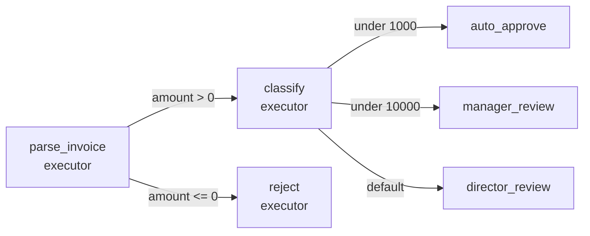
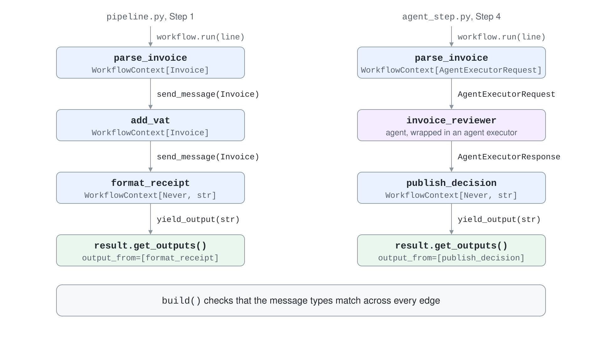

# Workflows: Executors, Edges & Supersteps

A single agent with tools is the right start, but it stops being enough when a process has fixed steps, branches, parallel checks or a human approval in the middle. A workflow makes that structure explicit: you declare the units of work, the connections between them and the rules for moving data along, and the framework runs the graph.

Agent Framework workflows are typed directed graphs. Nodes are executors, edges carry messages between them, and a superstep scheduler decides what runs when. Agents are just one more kind of node, so deterministic code and model calls live in the same graph.



## Executors Are the Nodes

An executor receives typed messages, does work and either forwards a result to the next node or yields a workflow output. In Python an executor is a class with an `@handler` method, or a plain async function wrapped by `@executor`. The type annotations on the handler define which messages the executor accepts and what it may send.

```python
from agent_framework import Executor, WorkflowContext, executor, handler
from typing_extensions import Never


class ParseInvoice(Executor):
    @handler
    async def parse(self, line: str, ctx: WorkflowContext[Invoice]) -> None:
        number, vendor, description, amount = line.split(",")
        await ctx.send_message(Invoice(number, vendor, description, float(amount)))


@executor(id="format_receipt")
async def format_receipt(invoice: Invoice, ctx: WorkflowContext[Never, str]) -> None:
    await ctx.yield_output(f"{invoice.number} | {invoice.amount:.2f} EUR")
```

`WorkflowContext[Invoice]` says the executor sends `Invoice` messages. `WorkflowContext[Never, str]` says it sends nothing downstream and yields `str` outputs. `ctx.send_message` feeds the next executor, `ctx.yield_output` surfaces a result to whoever called `workflow.run`.

## Edges Decide Where Messages Go

`WorkflowBuilder(start_executor=...)` starts a graph and the `add_*` methods wire it. The builder validates the graph on `build()`: it checks that message types match across each edge and that every executor is reachable from the start.

| Edge | Builder call | Use it for |
| --- | --- | --- |
| Direct | `add_edge(source, target)` | Linear pipelines |
| Conditional | `add_edge(source, target, condition=lambda m: ...)` | If/else routing on the message |
| Switch-case | `add_switch_case_edge_group(source, [Case(...), Default(...)])` | First matching branch wins, `Default` catches the rest |
| Fan-out | `add_fan_out_edges(source, [a, b, c])` | Send the same message to several targets |
| Fan-in | `add_fan_in_edges([a, b, c], target)` | Collect one message per source into a `list` for one handler call |
| Multi-selection | `add_multi_selection_edge_group(source, targets, selection_func=...)` | Pick a subset of targets per message |

```python
workflow = (
    WorkflowBuilder(start_executor=parse_invoice, output_from=[auto_approve, manager_review, director_review])
    .add_edge(parse_invoice, classify, condition=lambda invoice: invoice.amount > 0)
    .add_switch_case_edge_group(
        classify,
        [
            Case(condition=lambda invoice: invoice.amount < 1000, target=auto_approve),
            Case(condition=lambda invoice: invoice.amount < 10000, target=manager_review),
            Default(target=director_review),
        ],
    )
    .build()
)
```

A fan-in handler declares its input as a list, for example `async def aggregate(self, checks: list[Check], ctx: WorkflowContext[Never, str])`. The default branch of a switch-case runs only when every case predicate returns `False`; a predicate that raises fails the workflow instead of falling through.

## Output Designation Happens at Build Time

Which executors produce the workflow result is decided on the builder, not per call. `output_from=[...]` makes those executors' `yield_output` calls emit `output` events and appear in `result.get_outputs()`. `intermediate_output_from=[...]` marks progress that you want to observe but that is not the final answer.

```python
result = await workflow.run("INV-003,Northwind Traders,Security audit,18400.00")
print(result.get_outputs())
```

## Supersteps Make Execution Predictable

The runtime follows a bulk synchronous model. In each superstep every pending message is routed, all target executors run concurrently, and the workflow waits at a barrier until all of them finish before the next superstep starts. This is why a fan-out of three one-second checks costs one second, and why the fan-in handler runs in the superstep after the last check.



The barrier also means a slow branch holds back a fast, longer branch that runs alongside it. If two paths must progress independently, fold each path's steps into a single executor. Checkpoints are written at superstep boundaries, which is the foundation of the next topic.

## Agents Are Nodes Too

Pass an agent straight to `add_edge` and the framework wraps it in an agent executor. The upstream executor then sends an `AgentExecutorRequest`, and the downstream executor receives an `AgentExecutorResponse` with the agent's reply in `response.agent_response.text`.



```python
await ctx.send_message(AgentExecutorRequest(messages=[Message("user", [text])], should_respond=True))
```

Sending a plain `str` also works but logs a warning that the conversation context is lost. Use the request object when the agent should see a proper user message.

## Visualize the Graph

`WorkflowViz(workflow).to_mermaid()` returns a Mermaid flowchart of the built graph, and `to_digraph()` returns Graphviz DOT. Conditional edges render as dotted lines labelled `conditional`, which makes a review of branching logic possible without running anything.

## The Same Model in .NET

C# executors derive from `Executor`, are `partial` classes and mark handlers with `[MessageHandler]`. A source generator registers the handlers, so the `Microsoft.Agents.AI.Workflows.Generators` package must be referenced next to `Microsoft.Agents.AI.Workflows`.

```csharp
internal sealed partial class ParseInvoice() : Executor("parse_invoice")
{
    [MessageHandler]
    private ValueTask<Invoice> HandleAsync(string line, IWorkflowContext context)
    {
        var parts = line.Split(',');
        return ValueTask.FromResult(new Invoice(parts[0], parts[1], parts[2], decimal.Parse(parts[3])));
    }
}

var workflow = new WorkflowBuilder(parse)
    .AddEdge<Invoice>(parse, classify, condition: invoice => invoice is { Amount: > 0 })
    .AddSwitch(classify, switchBuilder => switchBuilder
        .AddCase<Invoice>(invoice => invoice!.Amount < 1000, autoApprove)
        .WithDefault(directorReview))
    .WithOutputFrom(autoApprove, directorReview)
    .Build();
```

An executor that yields output must declare the type with `[YieldsOutput(typeof(string))]`, otherwise `YieldOutputAsync` throws `Cannot output object of type String. Expecting one of []`. Fan-out uses `AddFanOutEdge` and `AddFanInBarrierEdge`, and `workflow.ToMermaidString()` renders the graph.

## Hands-On Demo

[Route Invoices with a Workflow Graph](demo-workflows.md) builds the invoice graph step by step in Python, runs the fan-out to observe supersteps, puts a Foundry agent in the graph and renders it. The C# project rebuilds the same routing and fan-out with `[MessageHandler]` executors.

## Key Topics

- [Workflows overview](https://learn.microsoft.com/en-us/agent-framework/workflows/workflows)
- [Executors](https://learn.microsoft.com/en-us/agent-framework/workflows/executors)
- [Edges: direct, conditional, switch-case, fan-out and fan-in](https://learn.microsoft.com/en-us/agent-framework/workflows/edges)
- [Agents in workflows](https://learn.microsoft.com/en-us/agent-framework/workflows/agents-in-workflows)
- [Workflow visualization](https://learn.microsoft.com/en-us/agent-framework/workflows/visualization)
- [Workflow events](https://learn.microsoft.com/en-us/agent-framework/workflows/events)
