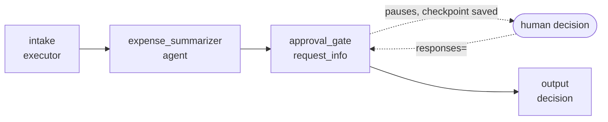
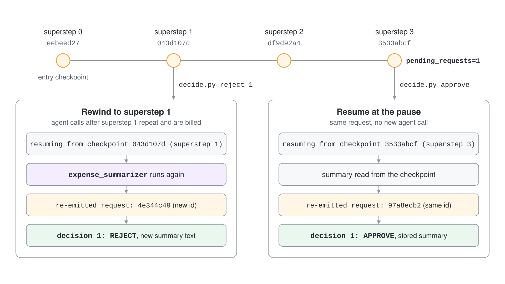

# Checkpointing & Human-in-the-Loop Requests

An expense report that waits for a manager can wait for hours. A workflow that holds that wait in process memory loses it when the process restarts, and a workflow that cannot pause for a person cannot automate approvals at all. Two features solve this together: requests let an executor ask the outside world a question and wait, and checkpoints let the whole run survive the wait.



## Requests Pause a Workflow for Outside Input

An executor asks a question with `ctx.request_info(request_data=..., response_type=...)`. The workflow emits a `request_info` event, goes idle and waits. The answer arrives in a method decorated with `@response_handler`, which the framework matches by the request and response types.

```python
class ApprovalGate(Executor):
    @handler
    async def ask(self, response: AgentExecutorResponse, ctx: WorkflowContext) -> None:
        await ctx.request_info(
            request_data=ApprovalRequest(summary=response.agent_response.text),
            response_type=str,
        )

    @response_handler
    async def decide(self, original_request: ApprovalRequest, decision: str, ctx: WorkflowContext[Never, str]) -> None:
        await ctx.yield_output(f"{decision.upper()} for: {original_request.summary}")
```

The caller watches the stream for `event.type == "request_info"`, reads `event.request_id` and `event.data`, and later calls `workflow.run(responses={request_id: "approve"})`. Runs on the same workflow object are not isolated, so the second call continues the paused run.

## Checkpoints Save the Run at Superstep Boundaries

A checkpoint is written at the end of every superstep and captures executor state, the messages queued for the next superstep, pending requests and shared state. Since 1.13 the runtime also writes entry checkpoints before the first superstep and when responses are delivered, so the whole run can be replayed.

Give the builder a `CheckpointStorage` and every run is checkpointed. Three implementations share one protocol, so you can swap them without touching executors.

| Storage | Package | Durability |
| --- | --- | --- |
| `InMemoryCheckpointStorage` | `agent-framework-core` | Process only, for tests and demos |
| `FileCheckpointStorage(path)` | `agent-framework-core` | Local disk, survives restarts |
| `CosmosCheckpointStorage` | `agent-framework-azure-cosmos` | Azure Cosmos DB, shared across processes |

```python
storage = FileCheckpointStorage("checkpoints", allowed_checkpoint_types=["expense:ApprovalRequest"])
workflow = WorkflowBuilder(name="expense_approval", start_executor=intake, checkpoint_storage=storage).build()
checkpoints = await storage.list_checkpoints(workflow_name=workflow.name)
```

The `name` groups the checkpoints of one workflow. Orchestration builders such as `SequentialBuilder` accept the same `checkpoint_storage` and `name` arguments.

## Resume from a Checkpoint

Pass `checkpoint_id` to `workflow.run` to continue from a saved superstep. A pending request in that checkpoint is re-emitted as a `request_info` event, so a fresh process can pick up an approval that started in another one. You can pass `checkpoint_id` and `responses` together to resume and answer in one call.



```python
latest = await storage.get_latest(workflow_name="expense_approval")
async for event in workflow.run(checkpoint_id=latest.checkpoint_id, stream=True):
    if event.type == "request_info":
        print(event.request_id)
```

Resuming from an earlier superstep replays everything after it. If an agent ran after that point it runs again, so its answer and the request id can change. A new workflow instance can resume too, as long as it keeps the same topology and executor ids.



## Executors Carry Their Own State

Checkpoints capture the state of built-in executors. A custom executor with fields must save and restore them itself by overriding two methods.

```python
async def on_checkpoint_save(self) -> dict[str, Any]:
    return {"decisions": self.decisions}

async def on_checkpoint_restore(self, state: dict[str, Any]) -> None:
    self.decisions = state.get("decisions", 0)
```

## Checkpoint Storage Is a Trust Boundary

`FileCheckpointStorage` and `CosmosCheckpointStorage` serialize non-JSON state with `pickle` and read it back through a restricted unpickler. Only framework types and primitives are allowed by default, so a custom request dataclass must be listed in `allowed_checkpoint_types` as `"module:QualName"`. Without that entry the checkpoint that holds the request cannot be decoded, and listing or resuming silently skips it.

Treat the checkpoint directory like a credential store. Never load checkpoints from a location that untrusted parties can write to.

## The Same Model in .NET

.NET uses a `RequestPort` as the request channel and a `CheckpointManager` for persistence. `RequestPort.Create<TRequest, TResponse>("id")` is a graph node, so you wire it with ordinary edges. `CheckpointManager.CreateJson` with a `FileSystemJsonCheckpointStore` writes checkpoints to disk.

```csharp
var checkpointManager = CheckpointManager.CreateJson(new FileSystemJsonCheckpointStore(new DirectoryInfo("checkpoints")));
var approvalPort = RequestPort.Create<ApprovalRequest, string>("approval");
var workflow = new WorkflowBuilder(intake)
    .AddEdge(intake, approvalPort)
    .AddEdge(approvalPort, finalize)
    .WithOutputFrom(finalize)
    .Build();

await using StreamingRun run = await InProcessExecution.RunStreamingAsync(workflow, input, checkpointManager);
await foreach (WorkflowEvent evt in run.WatchStreamAsync(blockOnPendingRequest: false))
{
    if (evt is RequestInfoEvent request)
    {
        Console.WriteLine(request.Request.RequestId);
    }
}

await using StreamingRun resumed = await InProcessExecution.ResumeStreamingAsync(newWorkflow, checkpoint, checkpointManager);
await resumed.SendResponseAsync(request.Request.CreateResponse("approve"));
```

`RequestInfoEvent` carries the request, and `SuperStepCompletedEvent.CompletionInfo.Checkpoint` carries the checkpoint. By default `WatchStreamAsync` blocks at a pending request; pass `blockOnPendingRequest: false` when the run should end so a later process can resume it. Custom executors save state by overriding `OnCheckpointingAsync` and `OnCheckpointRestoredAsync`.

## Hands-On Demo

[Pause an Expense Approval and Resume It in Another Process](demo-checkpoints-hitl.md) runs an agent-backed approval workflow that pauses for a person, ends the process, and resumes from the file checkpoint, then rewinds to an earlier superstep. The C# project does the same with a `RequestPort`.

## Key Topics

- [Checkpoints](https://learn.microsoft.com/en-us/agent-framework/workflows/checkpoints)
- [Human-in-the-loop](https://learn.microsoft.com/en-us/agent-framework/workflows/human-in-the-loop)
- [Workflow state](https://learn.microsoft.com/en-us/agent-framework/workflows/state)
- [Workflow events](https://learn.microsoft.com/en-us/agent-framework/workflows/events)
- [Workflows as agents](https://learn.microsoft.com/en-us/agent-framework/workflows/as-agents)
