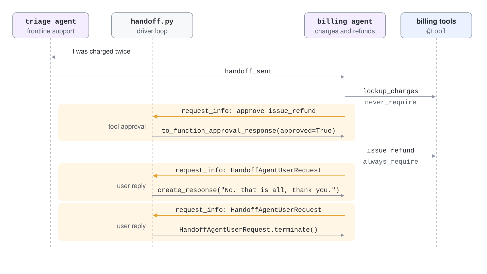

# Run Three Agent Patterns with One Builder Each

Developers who start with multi-agent ideas often hand-wire every edge, then discover they rebuilt the same three shapes: a pipeline, a panel and a front desk. This demo builds each shape with its builder, prints what every agent contributed and ends with a refund that only runs after a person approves it. The same three patterns are then built in C#.



What you practice here: picking the builder that matches the control flow and configuring it through constructor parameters.

Duration: about 35 minutes.

## Prerequisites

- Python 3.12 and the .NET 10 SDK (for the C# step)
- Signed in with `az login` and the **Azure AI User** role on the Foundry project
- A chat model deployment, for example `gpt-5.4`, in the Foundry project

## Run it

```bash
cd demos/05-orchestration/03-orchestration-patterns/orchestration-patterns-py
python -m venv .venv
.venv/Scripts/python -m pip install -r requirements.txt
cp .env.example .env
.venv/Scripts/python sequential.py
```

On macOS and Linux use `.venv/bin/python`. Set `PROJECT_ENDPOINT` and `MODEL_DEPLOYMENT_NAME` in `.env` first.

## Step 1: Create agents through one helper

Every script builds its agents with `make_agent`. Each call creates a new `FoundryChatClient`, because one chat client per agent keeps tool calls from leaking across agents. The `handoff` flag sets `require_per_service_call_history_persistence`, which the handoff builder demands later.

```python
def make_agent(name: str, instructions: str, tools=None, description: str | None = None, handoff: bool = False):
    client = FoundryChatClient(
        project_endpoint=os.environ["PROJECT_ENDPOINT"],
        model=os.environ["MODEL_DEPLOYMENT_NAME"],
        credential=_credential,
    )
    return client.as_agent(
        name=name,
        instructions=instructions,
        tools=tools or [],
        description=description,
        require_per_service_call_history_persistence=handoff,
    )
```

Do not name a script `concurrent.py`: it shadows the standard library package of the same name and `import asyncio` fails with `No module named 'concurrent.futures'`. The concurrent script here is called `fanout_review.py`.

## Step 2: Chain agents with SequentialBuilder

A writer drafts an announcement, a reviewer lists improvements and a polisher applies them. The participant order is the execution order. `intermediate_output_from` lists the agents whose replies you want to inspect before the final answer.

```python
workflow = SequentialBuilder(
    name="announcement_pipeline",
    participants=[writer, reviewer, polisher],
    intermediate_output_from=[writer, reviewer],
).build()

result = await workflow.run(BRIEF)
for event in result:
    if event.type == "intermediate":
        print(f"[intermediate] {event.executor_id}: {event.data.text}\n")
print(f"[final] {result.get_outputs()[0].text}")
```

Run `.venv/Scripts/python sequential.py`.

Expected output (agent wording varies):

```text
[intermediate] writer: Our expense app now supports receipt scanning right from your phone camera. Snap a photo, and the app automatically captures the details to save you time on manual entry. It’s a faster, easier way to track expenses wherever you are.

[intermediate] reviewer: Two concrete improvements:

1. Add a clearer user benefit.
   ...

[final] Our expense app now supports receipt scanning from your phone camera. Snap a photo to capture receipt details automatically, reduce manual entry, and submit expenses faster. Open the app and try your first receipt scan today.
```

The final text contains the reviewer's call to action, which only exists because the polisher saw the whole conversation.

## Step 3: Fan out to experts with ConcurrentBuilder and a custom aggregator

Finance, security and compliance review the same proposal independently. The default aggregator returns one assistant message per expert. The second run replaces it with an async callback that asks a summarizer agent to merge the opinions.

```python
result = await ConcurrentBuilder(name="proposal_review", participants=participants).build().run(PROPOSAL)
for message in result.get_outputs()[0].messages:
    print(f"[{message.author_name}] {message.text}")
```

```python
async def summarize(results: list[AgentExecutorResponse]) -> str:
    opinions = "\n".join(f"{r.executor_id}: {r.agent_response.text}" for r in results)
    return (await summarizer.run(opinions)).text


workflow = ConcurrentBuilder(name="proposal_review_summary", participants=participants).with_aggregator(summarize).build()
```

Run `.venv/Scripts/python fanout_review.py`.

Expected output (trimmed):

```text
default aggregator, 5.2s
[finance] Estimated cost: low to moderate, primarily a mobile receipt-capture feature, OCR/document-processing, ...
[security] This creates elevated fraud risk because employees could submit altered, duplicate, split, or non-business receipts ...
[compliance] Tax: Auto-approving expense claims under 50 EUR can be acceptable only if each claim still captures the legally required receipt data ...

custom aggregator
Proceed only with a controlled rollout using an established OCR/expense platform. The business case is positive, but auto-approval under €50 should still require full substantiation and audit trails. Mitigate fraud with duplicate/split-transaction detection, ...
```

Three expert replies arrived in about five seconds, close to the slowest single agent. The aggregator receives a `list[AgentExecutorResponse]`, so you choose how the experts are combined.

## Step 4: Route a customer with HandoffBuilder

A triage agent receives the message and hands the conversation to billing. The billing agent has two tools: `lookup_charges` runs freely, and `issue_refund` is marked `always_require`, so the workflow pauses for approval before the refund executes.

```python
@tool(approval_mode="never_require")
def lookup_charges(customer: Annotated[str, "Customer name"]) -> str:
    """Returns the last charges for a customer."""
    return f"{customer}: 2 charges of 29.00 EUR on 2026-10-01, one is a duplicate."


@tool(approval_mode="always_require")
def issue_refund(customer: Annotated[str, "Customer name"], amount: Annotated[float, "Refund amount in EUR"]) -> str:
    """Refunds an amount to a customer."""
    return f"Refunded {amount:.2f} EUR to {customer}."
```

```python
workflow = (
    HandoffBuilder(name="support_handoff", participants=[triage, billing, technical])
    .with_start_agent(triage)
    .add_handoff(triage, [billing, technical])
    .add_handoff(billing, [triage])
    .add_handoff(technical, [triage])
    .build()
)
```

The driver loop answers whatever the workflow asks. A `HandoffAgentUserRequest` means an agent wants a user reply, any other request is the tool approval.



```python
for request in pending:
    if isinstance(request.data, HandoffAgentUserRequest):
        last = request.data.agent_response.messages[-1]
        reply = next(replies, None)
        if reply is None:
            responses[request.request_id] = HandoffAgentUserRequest.terminate()
        else:
            responses[request.request_id] = HandoffAgentUserRequest.create_response(reply)
    else:
        call = request.data.function_call
        responses[request.request_id] = request.data.to_function_approval_response(approved=APPROVE_REFUNDS)
```

Run `.venv/Scripts/python handoff.py`.

Expected output (agent wording varies):

```text
[handoff] triage_agent -> billing_agent
[approval] issue_refund({'customer': 'Dana Reyes', 'amount': 29}) approved
[billing_agent] I found two 29.00 EUR subscription charges on your account this month, and one was a duplicate. I’ve refunded 29.00 EUR for the duplicate charge to your original payment method.
[user] No, that is all, thank you.
[billing_agent] You’re welcome.
```

Set `APPROVE_REFUNDS = False` at the top of `handoff.py` and rerun: the `[approval]` line says `rejected`, the refund tool does not execute and the agent reports that no refund was completed. The conversation ends when the script answers the last request with `terminate()`.

## Step 5: Build the same three in C#

`AgentWorkflowBuilder` offers the same three shapes. Agents come from `AIProjectClient.AsAIAgent`, and one helper drives every workflow: send the messages, send a `TurnToken` so agents start, and return the final `List<ChatMessage>`.

```csharp
var sequential = AgentWorkflowBuilder.BuildSequential([writer, reviewer, polisher]);
var concurrent = AgentWorkflowBuilder.BuildConcurrent([finance, security, compliance]);
var handoff = AgentWorkflowBuilder.CreateHandoffBuilderWith(triage)
    .WithHandoffs(triage, [billing, technical])
    .WithHandoffs([billing, technical], triage)
    .Build();
```

```csharp
await using StreamingRun run = await InProcessExecution.RunStreamingAsync(workflow, new List<ChatMessage> { new(ChatRole.User, prompt) });
await run.TrySendMessageAsync(new TurnToken(emitEvents: true));
await foreach (WorkflowEvent evt in run.WatchStreamAsync())
{
    if (evt is WorkflowOutputEvent output and not AgentResponseUpdateEvent)
    {
        return output.As<List<ChatMessage>>()!;
    }
}
```

```bash
cd ../orchestration-patterns-cs
cp .env.example .env
dotnet run
```

Expected output (trimmed):

```text
Sequential
[user] Announce that our expense app now supports receipt scanning from the phone camera.
[writer] Our expense app now supports receipt scanning directly from your phone camera. ...
[reviewer] 1. Add a stronger user benefit upfront, such as time saved or reduced manual entry, ...
[polisher] Save time and skip manual entry with receipt scanning, now available in our expense app. ...

Concurrent
[compliance] Tax: Auto-approving employee expenses under 50 EUR can be acceptable only if ...
[finance] Costs are relatively low to moderate: ...
[security] This creates meaningful fraud risk because employees can split a larger purchase ...

Handoff
[user] I was charged twice for my subscription this month.
[billing_agent] I’m sorry you were charged twice. Please share the charge dates, amounts, and the last 4 digits of the card used, ...
```

The C# handoff run ends after the billing agent's first answer because it returns control to the user. The Python script above shows the multi-turn loop with an approval.

## Verify

- `sequential.py` prints two intermediate blocks and a final text that includes the reviewer's call to action.
- `fanout_review.py` prints three expert lines tagged `finance`, `security` and `compliance`, and a single merged paragraph after `custom aggregator`.
- `handoff.py` prints a `[handoff] triage_agent -> billing_agent` line and an `[approval]` line before the refund confirmation.
- `dotnet run` prints the three headings `Sequential`, `Concurrent` and `Handoff`.

## Troubleshooting

| Symptom | Likely cause | Fix |
| --- | --- | --- |
| `ModuleNotFoundError: No module named 'concurrent.futures'; 'concurrent' is not a package` | A local `concurrent.py` shadows the standard library | Rename the script |
| `ValueError: Handoff workflows require all participant agents to have 'require_per_service_call_history_persistence=True'` | Participants were created without the flag | Create handoff agents with `handoff=True` |
| C# `System.MissingMethodException` on `ResponsesClient` | `Microsoft.Extensions.AI.OpenAI` and `Azure.AI.Projects` 2.0.x resolved different `OpenAI` versions | Use `AIProjectClient.AsAIAgent` from `Microsoft.Agents.AI.Foundry` as the project does |
| C# `NullReferenceException` after `WorkflowOutputEvent` | A streaming update matched the output pattern | Exclude `AgentResponseUpdateEvent` as in the helper above |

## Cleanup

Nothing is created in Azure. Agents are in-memory objects and the scripts only send model requests.

## Next

Let a manager plan and delegate with [Group Chat & Magentic Orchestration](../04-magentic/readme.md).
