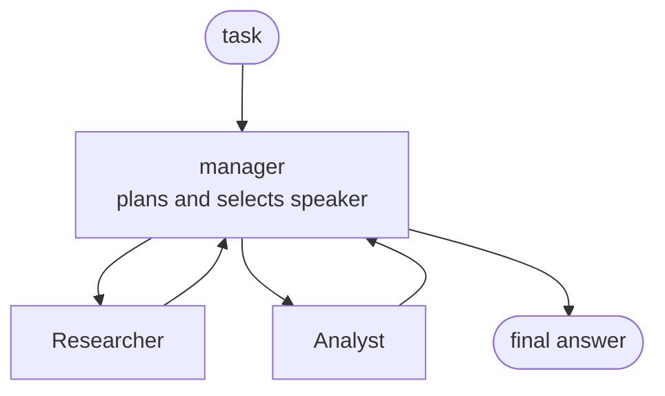

# Group Chat & Magentic Orchestration

Sequential, concurrent and handoff fix the control flow in advance. Some work does not fit: the next step depends on what the last agent produced, several agents should iterate on one draft, or nobody knows the plan up front. Group chat and Magentic put a manager in the middle of a star topology, and the manager decides who speaks next.



## Group Chat: Agents Talk, an Orchestrator Picks the Speaker

All participants see one shared conversation. After each turn the orchestrator broadcasts the reply to everyone and chooses the next speaker. You choose the selection strategy through the builder constructor.

| Strategy | Parameter | Behaviour |
| --- | --- | --- |
| Selection function | `selection_func=fn(state) -> name` | Plain Python decides, for example round robin |
| Agent orchestrator | `orchestrator_agent=agent` | A model reads the conversation and picks the speaker or ends it |
| Custom orchestrator | `orchestrator=...` | Your own `BaseGroupChatOrchestrator` subclass |

```python
def round_robin(state: GroupChatState) -> str:
    names = list(state.participants.keys())
    return names[state.current_round % len(names)]


workflow = GroupChatBuilder(
    name="slogan_round_robin",
    participants=[writer, reviewer],
    selection_func=round_robin,
    termination_condition=lambda conversation: sum(1 for m in conversation if m.role == "assistant") >= 4,
    intermediate_output_from=[writer, reviewer],
).build()
```

`termination_condition` receives the conversation and returns `True` to stop, and `max_rounds` is a hard cap. With a selection function you own the stopping rule; with an agent orchestrator the model can end early, for example when the reviewer says the draft is approved. The terminal output is an `AgentResponse` from the orchestrator, and participant turns arrive as `intermediate` events.

## Magentic: A Manager That Plans, Tracks and Replans

Magentic follows the Magentic-One design. The manager first builds a task ledger from the request: the known facts, the facts to look up and a plan for the team. In every round it fills a progress ledger that answers five questions: is the request satisfied, is the team in a loop, is progress being made, who speaks next and what should they do.

```python
workflow = MagenticBuilder(
    name="offsite_planning",
    participants=[researcher, analyst],
    manager_agent=manager,
    enable_plan_review=True,
    max_round_count=8,
    max_stall_count=2,
    max_reset_count=1,
).build()
```

Rounds without progress increment a stall counter. When it passes `max_stall_count` the manager resets and replans, and `max_reset_count` and `max_round_count` bound the whole loop. Without these limits a confused team keeps spending tokens.

## Orchestrator Events Show the Manager's Thinking

The workflow emits events of type `magentic_orchestrator`. Their `data.event_type` is one of three values and `data.content` carries the payload.

| `event_type` | Content | Meaning |
| --- | --- | --- |
| `PLAN_CREATED` | `Message` with the task ledger | Initial facts and plan |
| `REPLANNED` | `Message` with the new ledger | Stall detection or human feedback produced a new plan |
| `PROGRESS_LEDGER_UPDATED` | `MagenticProgressLedger` | One per round, with `is_request_satisfied` and `next_speaker` |

```python
async for event in stream:
    if event.type == "magentic_orchestrator":
        content = event.data.content
        if isinstance(content, MagenticProgressLedger):
            print(content.is_request_satisfied.answer, content.next_speaker.answer)
```

## Plan Review Puts a Human Before Execution

With `enable_plan_review=True` the workflow pauses after planning and emits a `request_info` event whose data is a `MagenticPlanReviewRequest`. It holds the proposed `plan`, the `current_progress` ledger (empty on the first review) and an `is_stalled` flag. Answer with `request.approve()` to proceed or `request.revise("feedback")` to make the manager replan.

```python
if event.type == "request_info" and event.request_type is MagenticPlanReviewRequest:
    review = event

responses = {review.request_id: review.data.revise("Keep the venue under 400 EUR.")}
stream = workflow.run(stream=True, responses=responses)
```

## Magentic on Foundry Needs a Chat Completions Client

The manager selects participants through internal function calls. With agents built on `FoundryChatClient`, which uses the Responses API, the progress ledger call fails against a Foundry project with `400 No tool call found for function call output`. Build the manager and every participant on `OpenAIChatCompletionClient` pointed at the project's OpenAI v1 endpoint instead.

```python
host = urlparse(os.environ["PROJECT_ENDPOINT"]).netloc
client = OpenAIChatCompletionClient(
    model=os.environ["MODEL_DEPLOYMENT_NAME"],
    base_url=f"https://{host}/openai/v1/",
    credential=DefaultAzureCredential(),
)
```

A Magentic workflow also accepts exactly one starting task message, so bridge a longer conversation with an executor that passes a single string. Microsoft documents that Magentic is untested outside the original Magentic-One design, so treat results on your own agent set as something to evaluate.

## Group Chat and Magentic in .NET

.NET offers `AgentWorkflowBuilder.CreateGroupChatBuilderWith(agents => new RoundRobinGroupChatManager(agents) { MaximumIterationCount = 5 })` for group chat. Magentic is `MagenticWorkflowBuilder(managerAgent).AddParticipants([...]).RequirePlanSignoff(true).WithMaxRounds(10)`, raised as three event types: `MagenticPlanCreatedEvent`, `MagenticReplannedEvent` and `MagenticProgressLedgerUpdatedEvent`. The Magentic types are marked experimental and require `#pragma warning disable MAAIW001`; the demo project for this topic is Python.

## Hands-On Demo

[Coordinate a Team with Group Chat and a Magentic Manager](demo-magentic.md) runs a writer and reviewer chat with two selection strategies, then an offsite planning team under a Magentic manager with plan review, a revision and the three orchestrator events. The runnable projects are `magentic-py/` (Python) and `magentic-cs/` (C#).

## Key Topics

- [Group chat orchestration](https://learn.microsoft.com/en-us/agent-framework/workflows/orchestrations/group-chat)
- [Magentic orchestration](https://learn.microsoft.com/en-us/agent-framework/workflows/orchestrations/magentic)
- [Human-in-the-loop](https://learn.microsoft.com/en-us/agent-framework/workflows/human-in-the-loop)
- [Handoff orchestration](https://learn.microsoft.com/en-us/agent-framework/workflows/orchestrations/handoff)
- [Workflow events](https://learn.microsoft.com/en-us/agent-framework/workflows/events)
