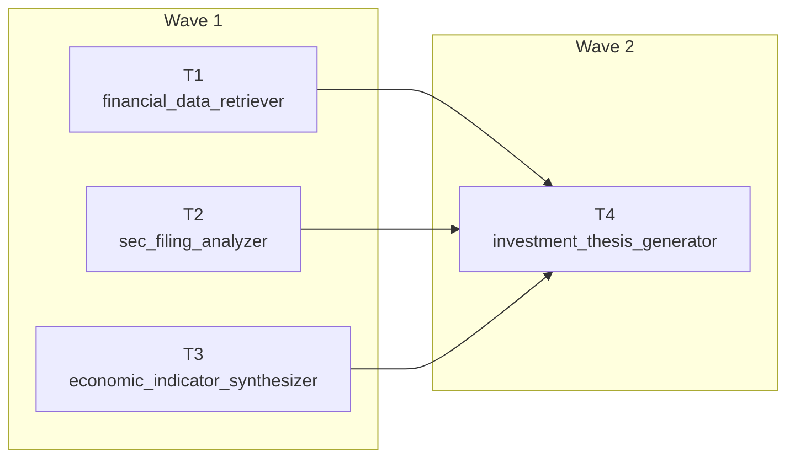

# Task Decomposition: Planner & Waves

A prompt that asks one agent to research a company, analyse its filings, weigh the macro picture and write a recommendation produces a long, shallow answer. Task decomposition splits the job into smaller tasks that each fit one agent and one context window, then recombines the results. The open design question is who draws the split: your code, a planner agent at run time, or the agents themselves through handoffs.

This topic compares three strategies on one financial research scenario and shows where each one fits.

| Strategy | Who decides the steps | Strength | Risk |
| --- | --- | --- | --- |
| Prompt chain | You, in code | Deterministic, easy to validate between steps | Rigid when the query changes |
| Planner and waves | A planner agent at run time | Adapts the number of tasks to the query | The plan itself needs validation |
| Handoff collaboration | The agents, through handoff tools | Specialists pull each other in when the data demands it | Open-ended unless you set turn limits |

## Prompt Chain with Validation and Branching

A chain runs agents in a fixed order, and ordinary Python sits between the calls. Because each agent returns JSON, code can check the numbers before the next step runs, and a label from one agent can choose the prompt for the next. This is the cheapest and most predictable form of decomposition.

```python
metrics = validate_metrics(await ask_json(extractor, f"Return JSON with ... from: {FILING_TEXT}"))
profile = await ask_json(classifier, f"Classify as GROWTH_DRIVEN, MATURE_EARNINGS or ASSET_HEAVY. Metrics: {json.dumps(metrics)}")
valuation = await ask_json(valuer, f"{BRANCHES[profile['classification']]} Metrics: {json.dumps(metrics)}")
```

`validate_metrics` is a gate: an out-of-range operating margin stops the chain before a model spends tokens on bad input. `BRANCHES` maps the classifier's label to a valuation prompt, so the branch is a dictionary lookup instead of another model call.

## A Planner Builds the Dependency Graph

Here a planner agent receives the query and a registry of available specialists with their capabilities, and returns a JSON plan. Each subtask names its agent and lists `depends_on`, so the plan is a directed acyclic graph that your code can run.

```json
{
  "complexity_assessment": "complex",
  "subtasks": [
    {"task_id": "T1", "description": "...", "assigned_agent": "financial_data_retriever", "depends_on": []},
    {"task_id": "T4", "description": "...", "assigned_agent": "investment_thesis_generator", "depends_on": ["T1", "T2", "T3"]}
  ]
}
```

A simple query yields one subtask and a complex one yields several, because the prompt tells the planner to include only the necessary subtasks. The registry also carries a latency estimate per agent, which the planner sees in its prompt.



## Waves Run the Graph

A wave is the set of tasks whose dependencies are all complete. The executor repeats a short loop: find the ready tasks, run them in parallel with `asyncio.gather`, store their results and pass those results as context to the next wave. This is the same barrier idea as workflow supersteps, written by hand for a graph that did not exist until the planner produced it.

```python
ready = [task for task in pending.values() if all(dep in completed for dep in task["depends_on"])]
if not ready:
    raise ValueError(f"Plan has a dependency cycle or an unknown dependency among {list(pending)}")
results = await asyncio.gather(
    *(execute_task(task, {dep: completed[dep] for dep in task["depends_on"]}, query) for task in ready)
)
```

Never trust a generated plan. The empty `ready` check turns a cyclic or dangling plan into an error instead of an endless loop, and a production planner should also verify that every `assigned_agent` is in the registry.

## Handoff Collaboration with Turn Limits

In the third strategy no plan exists. A filing analyst extracts metrics and, when foreign revenue is above a threshold written into its instructions, hands off to an international risk assessor that sees the earlier conversation. `with_autonomous_mode(turn_limits=...)` lets agents continue without waiting for a user message, and the limits stop the loop.

```python
workflow = (
    HandoffBuilder(name="financial_analysis_handoff", participants=[sec_analyzer, international_risk, credit_analyst])
    .with_start_agent(sec_analyzer)
    .add_handoff(sec_analyzer, [international_risk])
    .add_handoff(credit_analyst, [international_risk])
    .with_autonomous_mode(turn_limits={"sec_filing_analyzer": 2, "international_risk_assessor": 2})
    .build()
)
```

Handoff agents must be created with `require_per_service_call_history_persistence=True`. An agent with no outgoing handoff, here the risk assessor, is a terminal specialist, and the builder logs a warning that it cannot hand off further.

## Choosing a Strategy

Use a chain when the steps are known and each output can be checked mechanically. Use a planner when the number and order of steps depend on the request. Use handoffs when the next specialist is decided by what an agent just found, and cap the turns.

## Hands-On Demo

[Decompose a Research Question with a Planner](demo-task-decomposition.md) runs all three strategies on the financial scenario, prints the planner's graph and waves for a simple and a complex query, and shows the validation guard. The runnable projects are `task-decomposition-py/` (Python) and `task-decomposition-cs/` (C#).

## Key Topics

- [Workflows overview](https://learn.microsoft.com/en-us/agent-framework/workflows/workflows)
- [Handoff orchestration and autonomous mode](https://learn.microsoft.com/en-us/agent-framework/workflows/orchestrations/handoff)
- [Concurrent orchestration](https://learn.microsoft.com/en-us/agent-framework/workflows/orchestrations/concurrent)
- [Sequential orchestration](https://learn.microsoft.com/en-us/agent-framework/workflows/orchestrations/sequential)
- [Agents in workflows](https://learn.microsoft.com/en-us/agent-framework/workflows/agents-in-workflows)
