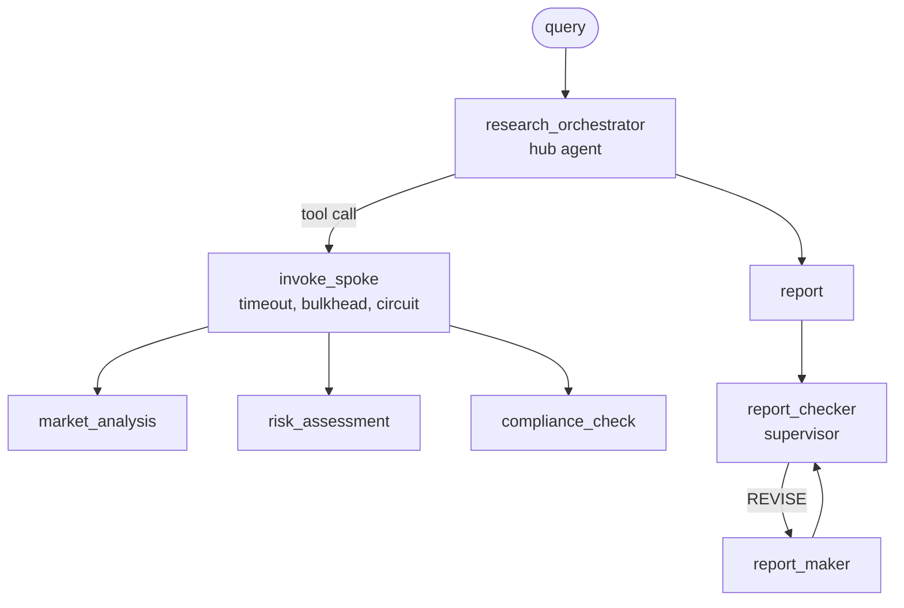
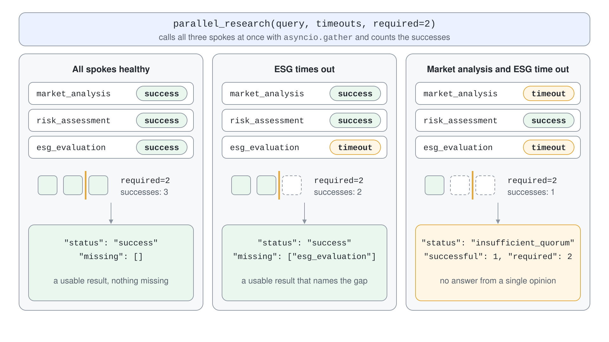

# Resilient Orchestration: Quorum & Supervisors

A multi-agent system fails more often than a single agent, because every added agent is another model call that can time out, throttle or return something unusable. A pipeline that treats each call as certain fails whole when one spoke fails. Resilient orchestration assumes failure and decides in advance what the system does when a spoke is slow, broken or wrong.

This topic applies four patterns from distributed systems to an investment research hub: a result envelope, a circuit breaker with a concurrency limit, a quorum over parallel spokes and a supervisor that checks quality.



## Hub and Spoke: Specialists as Tools

The hub is one agent whose tools are the spokes. Each tool wraps a specialist agent, so the hub decides which spoke to call and in what order, while the specialist stays small and focused. The hub instructions fix the order that matters: market analysis before risk, compliance last.

```python
@tool(approval_mode="never_require")
async def invoke_risk_assessment_agent(
    market_data: Annotated[str, Field(description="Market analysis text the risk assessment is based on")],
) -> str:
    """Assesses investment risk based on a market analysis result."""
    return json.dumps(await invoke_spoke("risk_assessment", f"Assess risk based on: {market_data}"))
```

Tool descriptions and parameter descriptions are the interface the hub model reads, so they are the place to be precise.

## Return a Status Instead of Raising

`invoke_spoke` never throws into the hub. It returns an envelope with `spoke`, `status` and `result`, where status is `success`, `timeout`, `error` or `circuit_open`. The hub instructions say what to do with a non-success status: name what is missing and continue with what it has.

```python
async def invoke_spoke(spoke_name: str, request: str, timeout: float = SPOKE_TIMEOUT) -> dict:
    if circuit_open(spoke_name):
        return {"spoke": spoke_name, "status": "circuit_open", "result": None}
    async with SEMAPHORE:
        try:
            result = await asyncio.wait_for(SPOKES[spoke_name].run(request), timeout=timeout)
        except asyncio.TimeoutError:
            record_outcome(spoke_name, False)
            return {"spoke": spoke_name, "status": "timeout", "result": None}
```

Three mechanisms live in that function. `asyncio.wait_for` bounds each call, the semaphore caps concurrent spoke calls so one burst cannot exhaust capacity, and the circuit check skips a spoke that is known to be failing.



## Circuit Breaker

The breaker counts consecutive failures per spoke, and a success resets the counter. At `FAILURE_THRESHOLD` it opens, and for `COOLDOWN_SECONDS` every call returns `circuit_open` immediately without touching the model. This protects a degraded dependency from retry storms and protects your latency, because failing fast is cheaper than waiting for another timeout.



```python
def record_outcome(spoke_name: str, success: bool) -> None:
    state = CIRCUITS.setdefault(spoke_name, {"failures": 0, "opened_at": None})
    if success:
        state["failures"] = 0
        state["opened_at"] = None
        return
    state["failures"] += 1
    if state["failures"] >= FAILURE_THRESHOLD:
        state["opened_at"] = time.time()
```

The state lives in a dictionary in the process. That is enough to teach the pattern, but several workers need a shared store such as a cache so that they agree on which spokes are open.

## Quorum over Parallel Spokes

When spokes are independent, call them all at once and decide how many answers are enough. `asyncio.gather(..., return_exceptions=True)` collects every outcome, the code counts successes, and `required` sets the quorum. Below the quorum the function reports `insufficient_quorum` instead of inventing a result from too little data.



```python
successes = {r["spoke"]: r["result"] for r in results if isinstance(r, dict) and r["status"] == "success"}
if len(successes) < required:
    return {"status": "insufficient_quorum", "successful": len(successes), "required": required}
return {"status": "success", "completed": sorted(successes), "missing": [name for name in SPOKE_NAMES if name not in successes]}
```

Per-spoke timeouts make the trade-off explicit: a slow optional spoke such as an ESG view can be cut off early while the required ones get the full budget.

## Supervisor: A Checker and a Maker

A supervisor loop separates producing from judging. A checker agent returns a JSON verdict, `APPROVE` or `REVISE` with a list of issues, and a maker agent rewrites the report using those issues. The loop is bounded by `max_retries`, and after the last attempt the caller receives `approved: False` rather than an endless loop.

```python
verdict = json.loads((await checker.run(report)).text)
if verdict["verdict"] == "APPROVE":
    return {"report": report, "approved": True, "attempts": attempt + 1}
if attempt < max_retries:
    report = (await maker.run(f"Report:\n{report}\n\nIssues:\n{json.dumps(verdict['issues'])}")).text
```

## Hands-On Demo

[Keep a Research Hub Running When Spokes Fail](demo-resilient-orchestration.md) runs the hub, trips a circuit breaker with forced timeouts, compares a healthy quorum with degraded ones, shows the hub reporting a missing spoke, and runs the supervisor on a weak report. The runnable projects are `resilient-orchestration-py/` (Python) and `resilient-orchestration-cs/` (C#).

## Key Topics

- [AI agent orchestration patterns](https://learn.microsoft.com/en-us/azure/architecture/ai-ml/guide/ai-agent-design-patterns)
- [Circuit Breaker pattern](https://learn.microsoft.com/en-us/azure/architecture/patterns/circuit-breaker)
- [Bulkhead pattern](https://learn.microsoft.com/en-us/azure/architecture/patterns/bulkhead)
- [Retry pattern](https://learn.microsoft.com/en-us/azure/architecture/patterns/retry)
- [Concurrent orchestration](https://learn.microsoft.com/en-us/agent-framework/workflows/orchestrations/concurrent)
