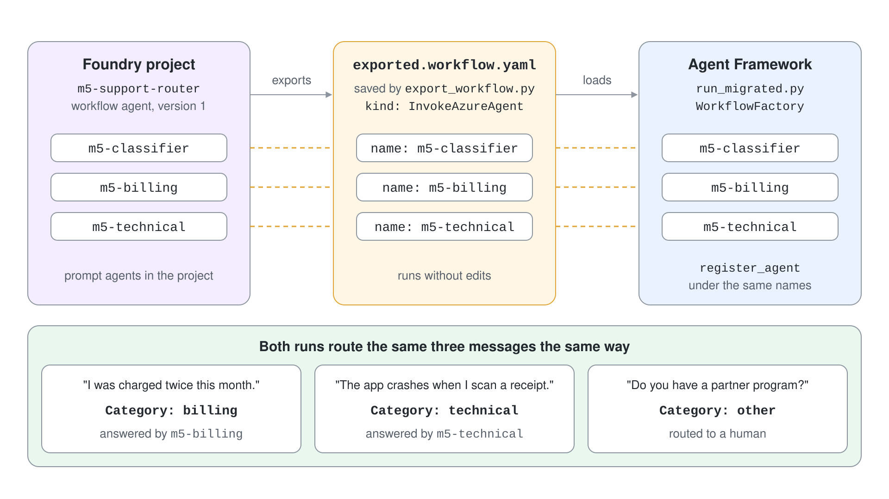

# Run Declarative and Functional Workflows and Migrate a Portal Workflow

Workflows built in the Foundry portal designer are a preview feature that retires on December 1, 2026, and many teams still have business logic locked inside them. The way out is not a rewrite: export the YAML and run it in Agent Framework. In this demo you learn the YAML dialect on a model-free workflow, route support messages to agents from YAML, write the same idea as a functional workflow that pauses for a person, and then migrate a published Foundry workflow by running its exported YAML locally.

What you practice here: authoring and running workflow YAML with `WorkflowFactory`, and verifying a migrated workflow against the original.

Duration: about 45 minutes.

## Prerequisites

- Python 3.12 (Power Fx expressions in YAML need Python 3.13 or earlier)
- Signed in with `az login`, the **Azure AI User** role on the Foundry project and permission to create agent versions in it
- A chat model deployment, for example `gpt-5.4`, in the Foundry project
- The .NET runtime that the `powerfx` package uses; the .NET 10 SDK satisfies it, and it is also what the C# project needs

## Run it

```bash
cd demos/05-orchestration/07-declarative-workflows/declarative-workflows-py
python -m venv .venv
.venv/Scripts/python -m pip install -r requirements.txt
cp .env.example .env
.venv/Scripts/python run_expense_triage.py
```

The C# project in `declarative-workflows-cs/` has one command per stage. Because .NET workflows call agents that already exist in the Foundry project, publish first (it creates `m35h-classifier`, `m35h-billing`, `m35h-technical` and the workflow agent `m35h-support-router`):

```bash
cd demos/05-orchestration/07-declarative-workflows/declarative-workflows-cs
cp .env.example .env
dotnet run -- expense
dotnet run -- publish
dotnet run -- router
dotnet run -- foundry
dotnet run -- export
dotnet run -- migrated
dotnet run -- cleanup
```

The C# project references `Microsoft.Agents.AI.Workflows` 1.25.0, `Microsoft.Agents.AI.Workflows.Declarative` 1.25.0 and the preview package `Microsoft.Agents.AI.Workflows.Declarative.Foundry` 1.25.0-preview.261014.1, which brings in `Azure.AI.Projects` 3.0.0-beta.3.

On macOS and Linux use `.venv/bin/python`. Set `PROJECT_ENDPOINT` and `MODEL_DEPLOYMENT_NAME` in `.env` first. Importing `agent_framework.declarative` also prints a few lines from the Power Fx loader, such as `Applied clr_loader patch`; they are not errors and are omitted from the outputs below.

## Step 1: Run a YAML workflow without a model

`workflows/expense-triage.yaml` uses the control-flow actions: `SetVariable`, `If`, `ConditionGroup`, `Foreach` and `SendActivity`. The amount is compared with a limit, the category picks a team, and a loop reports three checks.

```yaml
- kind: If
  id: check_limit
  condition: =Workflow.Inputs.amount > Local.limit
  then:
    - kind: SetVariable
      variable: Local.route
      value: director
  else:
    - kind: SetVariable
      variable: Local.route
      value: auto

- kind: Foreach
  id: run_checks
  source: =Local.checks
  itemName: check
  actions:
    - kind: SendActivity
      activity:
        text: '=Concat("check ", Local.check, " passed")'
```

The loader turns the file into a normal workflow, and you run it with a dictionary that matches `inputs`.

```python
workflow = WorkflowFactory().create_workflow_from_yaml_path("workflows/expense-triage.yaml")
result = await workflow.run({"amount": 420, "category": "travel"})
print(result.get_outputs())
```

Expected output:

```text
loaded expense-triage
{'amount': 420, 'category': 'travel'} -> ['check duplicate passed', 'check vendor passed', 'check budget passed', 'Route auto handled by Travel desk']
{'amount': 5000, 'category': 'office'} -> ['check duplicate passed', 'check vendor passed', 'check budget passed', 'Route director handled by General finance']
```

The .NET YAML dialect differs from the Python one in five ways, and `workflows/expense-triage.yaml` in the C# project shows each. The file starts with `kind: Workflow` and a `trigger`, the input is the message text (`System.LastMessage.Text`, here `420,travel`), and `Foreach` takes `items` and `value` instead of `source` and `itemName`. There is no `If` action in the .NET object model, so a one-way branch is a `ConditionGroup` with `elseActions`. `SendActivity` text uses `{Local.x}` interpolation, and `ParseJSON` is not available in the Power Fx engine, so the input is split on a comma.

```yaml
- kind: SetVariable
  id: read_amount
  variable: Local.amount
  value: =Value(First(Split(System.LastMessage.Text, ",")).Value)

- kind: ConditionGroup
  id: check_limit
  conditions:
    - condition: =Local.amount > Local.limit
      id: over_limit
      actions:
        - kind: SetVariable
          id: route_director
          variable: Local.route
          value: director
  elseActions:
    - kind: SetVariable
      id: route_auto
      variable: Local.route
      value: auto

- kind: Foreach
  id: run_checks
  items: =Local.checks
  value: Local.check
  actions:
    - kind: SendActivity
      id: report_check
      activity: 'check {Local.check} passed'
```

```csharp
Workflow workflow = DeclarativeWorkflowBuilder.Build<string>("workflows/expense-triage.yaml", options);
StreamingRun run = await InProcessExecution.RunStreamingAsync(workflow, "420,travel");
await foreach (WorkflowEvent evt in run.WatchStreamAsync())
    if (evt is AgentResponseEvent response)
        outputs.Add(response.Response.Text);
```

Run `dotnet run -- expense` for the C# version. The documentation shows `If` with `then` and `else`; in version 1.25.0 an `If` action is silently dropped, so neither branch ran and `Local.route` stayed empty until it became a `ConditionGroup`.

```text
420,travel -> ['check duplicate passed', 'check vendor passed', 'check budget passed', 'Route auto handled by Travel desk']
5000,office -> ['check duplicate passed', 'check vendor passed', 'check budget passed', 'Route director handled by General finance']
```

Each `SendActivity` became one workflow output. The loop variable is read as `Local.check` because `itemName: check` stores it under `Local`.

## Step 2: Route to agents from YAML

`workflows/support-router.yaml` classifies a customer message with an agent, reads the JSON category and routes to a specialist. The agents are plain Agent Framework agents registered under the names the YAML uses.

```yaml
- kind: InvokeAzureAgent
  id: classify
  agent:
    name: ClassifierAgent
  input:
    messages: =Local.customerMessage
  output:
    responseObject: Local.Classification
    autoSend: false

- kind: ConditionGroup
  id: route
  conditions:
    - condition: =Local.Classification.category = "billing"
      id: billing_route
      actions:
        - kind: InvokeAzureAgent
          id: billing
          agent:
            name: BillingAgent
          input:
            messages: =Local.customerMessage
  elseActions:
    - kind: SendActivity
      id: fallback
      activity:
        text: No specialist matched, routing to a human.
```

```python
factory = WorkflowFactory()
factory.register_agent("ClassifierAgent", make_agent("ClassifierAgent", CLASSIFIER))
factory.register_agent("BillingAgent", make_agent("BillingAgent", "You answer billing questions in two sentences."))
factory.register_agent("TechnicalAgent", make_agent("TechnicalAgent", "You answer technical questions in two sentences."))
workflow = factory.create_workflow_from_yaml_path("workflows/support-router.yaml")
```

In .NET there is no `register_agent`: `InvokeAzureAgent` calls the agent by name in the Foundry project, so `workflows/support-router.yaml` in the C# project names `m35h-classifier`, `m35h-billing` and `m35h-technical`, which Step 4 publishes. Run `dotnet run -- publish` and then `dotnet run -- router`. The C# output also contains the classifier JSON as the first item, because `AgentResponseEvent` fires for that call even with `autoSend: false`.

```text
I was charged twice this month. -> ['{"category":"billing"}', 'Category: billing', 'Please check whether one charge is still pending, as banks can temporarily show an authorization hold and a completed charge separately. ...
The app crashes when I scan a receipt. -> ['{"category":"technical"}', 'Category: technical', 'Please share the exact error message, your device/OS, app version, and ...
Do you have a partner program? -> ['{"category":"other"}', 'Category: other', 'No specialist matched, routing to a human.']
```

The classifier's instructions demand raw JSON: `{"category": "billing" or "technical" or "other"}`. Run `.venv/Scripts/python run_support_router.py`.

Expected output (specialist wording varies):

```text
I was charged twice this month. -> ['Category: billing', 'I’m sorry about that. Please share your account email and the dates/amounts of the two charges, and billing support can review for a duplica...
The app crashes when I scan a receipt. -> ['Category: technical', 'Does it crash immediately when opening the camera, after the image is captured, or during upload/processing, ...
Do you have a partner program? -> ['Category: other', 'No specialist matched, routing to a human.']
```

The classifier's own JSON is hidden by `autoSend: false`, and each message reached exactly one branch.

## Step 3: Write the same idea as a functional workflow

When the logic is easier to read as code, `@workflow` and `@step` express it as one async function. A writer agent drafts an announcement, the workflow asks a human for feedback and a reviser agent applies it. Both agent calls are `@step` functions so that their results are cached.

```python
@step
async def write_draft(topic: str) -> str:
    return (await writer.run(topic)).text


@workflow(name="announcement_review", description="Draft, pause for a human, revise")
async def announcement_review(topic: str, ctx: RunContext) -> str:
    draft = await write_draft(topic)
    feedback = await ctx.request_info({"draft": draft}, response_type=str, request_id="review")
    return await revise_draft(draft, feedback)
```

A definition cannot run until it is built. `announcement_review.run(...)` raises `AttributeError: 'FunctionalWorkflowDefinition' object has no attribute 'run'`; `announcement_review.build()` returns the object that has `run`. The first run stops at the request, and the second continues with the human answer.

```python
pipeline = announcement_review.build()
first = await pipeline.run("Receipt scanning in the expense app")
request = first.get_request_info_events()[0]
async for event in pipeline.run(responses={"review": "Make it a single sentence and mention saving time."}, stream=True):
    ...
```

There is no .NET equivalent of this step. `@workflow` and `@step` belong to the Python functional workflow API, and the .NET package offers the declarative YAML runtime and the graph builders from the earlier topics, with human input through `RequestInfoEvent` (see the checkpoints topic). The C# project therefore skips Step 3.

Run `.venv/Scripts/python functional_pipeline.py`. The API is experimental, so an `ExperimentalWarning` precedes the output.

Expected output (agent wording varies):

```text
state after first run: WorkflowRunState.IDLE_WITH_PENDING_REQUESTS
request review: New: Receipt Scanning is now available in the expense app, making it faster than ever to capture and organize your expenses on the go. ...
resuming with feedback
  executor_bypassed write_draft
  executor_invoked revise_draft
final: New: Receipt Scanning is now available in the expense app, so you can snap a photo of your receipt, automatically extract key details, and save time by reducing manual entry.
```

`write_draft` was bypassed on the resume: the cached draft is reused and only the reviser calls the model.



## Step 4: Publish a portal-style workflow

The designer is a browser tool, so this step creates the same artifact programmatically. `publish_portal_workflow.py` creates three prompt agents (`m5-classifier`, `m5-billing`, `m5-technical`) and one workflow agent, `m5-support-router`, from `migration/portal-workflow.yaml`. The YAML has the portal shape: `kind: workflow`, a `trigger` of `OnConversationStart` and the actions nested under it.

```python
project.agents.create_version(
    "m5-support-router",
    definition=WorkflowAgentDefinition(workflow=workflow_yaml),
)
```

Workflow agents are a preview feature, so the client is created with `allow_preview=True`:

```python
AIProjectClient(endpoint=os.environ["PROJECT_ENDPOINT"], credential=DefaultAzureCredential(), allow_preview=True)
```

```csharp
string workflowYaml = File.ReadAllText("migration/portal-workflow.yaml");
ProjectsAgentVersion version = (await agents.CreateAgentVersionAsync(
    "m35h-support-router",
    new ProjectsAgentVersionCreationOptions(WorkflowAgentDefinition.FromYaml(workflowYaml)))).Value;
```

The C# client needs no preview switch. Run `dotnet run -- publish` and `dotnet run -- foundry` for the C# version, which use the `m35h-` names.

Run `.venv/Scripts/python publish_portal_workflow.py`, then call the published workflow by name with `.venv/Scripts/python run_in_foundry.py`. It creates a conversation, sends the message with an `agent_reference` to `m5-support-router` and deletes the conversation.

Expected output of `publish_portal_workflow.py` and then a Foundry run (answer wording varies):

```text
published m5-support-router version 1
I was charged twice this month. -> {"category":"billing"}Category: billingIf you were charged twice this month, one charge may be a duplicate or a pending authorization. ...
The app crashes when I scan a receipt. -> {"category":"technical"}Category: technicalPlease share the app name/version, device/OS, and the exact error or what happens right after scanning. ...
Do you have a partner program? -> {"category":"other"}Category: otherNo specialist matched, routing to a human.
```

The C# run printed `published m35h-support-router version 1` and the same three answers, for example `I was charged twice this month. -> {"category":"billing"}Category: billingSorry about that...`. This run is the baseline for the migration. Publishing again creates version 2 of the same workflow name, and the classifier JSON is part of the Foundry response text even though the YAML sets `autoSend: false`.

## Step 5: Export the YAML and run it in Agent Framework

Export is the first thing to do before the designer goes away. In the portal you open the YAML view and copy the file. `export_workflow.py` reads the same definition back from the published version and saves it as `migration/exported.workflow.yaml`.

```python
version = project.agents.get_version("m5-support-router", "1")
Path("migration/exported.workflow.yaml").write_text(version.definition.workflow, encoding="utf-8")
```

```csharp
ProjectsAgentVersion version = project.AgentAdministrationClient.GetAgentVersion("m35h-support-router", versionNumber).Value;
string yaml = JsonDocument.Parse(ModelReaderWriter.Write(version.Definition)).RootElement.GetProperty("workflow").GetString()!;
File.WriteAllText("migration/exported.workflow.yaml", yaml);
```

In C# 3.0.0-beta.3 the workflow definition exposes no YAML property, so the export serializes the definition and reads its `workflow` field. Run `dotnet run -- export` and then `dotnet run -- migrated`; the migrated run builds the exported file with `DeclarativeWorkflowBuilder`, which calls the published `m35h-` agents directly, and the export prints `exported m35h-support-router version 1, 57 lines`.

Run `.venv/Scripts/python export_workflow.py`; pass a version number as the first argument to export a later version. Then run the exported file with `WorkflowFactory`. The YAML names Foundry agents (`m5-classifier` and so on), so `run_migrated.py` registers local agents under those exact names.



```python
factory.register_agent("m5-classifier", make_agent("m5-classifier", CLASSIFIER))
factory.register_agent("m5-billing", make_agent("m5-billing", "You answer billing questions in two sentences."))
factory.register_agent("m5-technical", make_agent("m5-technical", "You answer technical questions in two sentences."))
workflow = factory.create_workflow_from_yaml_path("migration/exported.workflow.yaml")
result = await workflow.run(message)
```

Run `.venv/Scripts/python run_migrated.py "I was charged twice this month." "The app crashes when I scan a receipt." "Do you have a partner program?"`.

Expected output:

```text
exported m5-support-router version 1, 56 lines
I was charged twice this month. -> ['Category: billing', 'Please check whether one charge is a temporary authorization and the other is the actual payment, as that’s a common cause of duplicate-looking charges. ...
The app crashes when I scan a receipt. -> ['Category: technical', 'Please share the exact error message, your device/OS, app version, and whether it crashes immediately on opening the scanner or after capturing the receipt. ...
Do you have a partner program? -> ['Category: other', 'No specialist matched, routing to a human.']
```

The C# run of `dotnet run -- migrated` produced the same routing, with the classifier JSON as an extra first item:

```text
Do you have a partner program? -> ['{"category":"other"}', 'Category: other', 'No specialist matched, routing to a human.']
```

The exported file ran without edits: `SetVariable`, `InvokeAzureAgent`, `ConditionGroup` and `SendActivity` mean the same in both runtimes, and `{Local.Classification.category}` interpolation works in both.

## Step 6: Compare the two runs and plan the gaps

Run the same three messages in both places and diff the behaviour, not the wording. This table is what the two runs showed.

| Behaviour | Foundry workflow | Agent Framework run |
| --- | --- | --- |
| Routing per message | billing, technical, other | billing, technical, other |
| Classifier JSON in the response | Present in the response text | Hidden by `autoSend: false` |
| Output shape | One concatenated `output_text` | A list with one item per output |
| Where agents come from | Agents in the Foundry project | Registered in code with `register_agent` |

Two dialect differences matter for larger workflows. Agent Framework `Foreach` requires `source`, and the loader rejects a `Foreach` that has none, so translate loops when you migrate:

```text
agent_framework_declarative._workflows._errors.DeclarativeWorkflowError: Failed to build graph-based workflow: Action 'Foreach' is missing required field 'source'. Action: {'kind': 'Foreach', 'id': 'loop2', 'items': '=Local.items', 'value': 'Local.Cur', ...
```

The `output.messages` binding stores a table of messages, so `Lower(Local.Category)` on it fails with `Invalid argument type (Table)`. Use a JSON `responseObject` field as in Step 2.

For code instead of YAML, Foundry Toolkit for Visual Studio Code offers **Generate Code** on the workflow playground, for Python or C#. It hands the conversion to GitHub Copilot, needs the workflow still deployed in a selected Foundry project, and produces a starting point that you test against the original. That is an interactive editor flow and is not run in this demo.

## Verify

- `run_expense_triage.py` prints route `auto` for 420 and route `director` for 5000.
- `run_support_router.py` prints a category and one specialist answer for the first two messages and the fallback for the third.
- `functional_pipeline.py` shows `executor_bypassed write_draft` after the resume.
- `run_migrated.py` prints the same three categories as the Foundry run.

## Troubleshooting

| Symptom | Likely cause | Fix |
| --- | --- | --- |
| `UnicodeEncodeError: 'charmap' codec can't encode character '✓'` on import | The `powerfx` loader prints a check mark and Windows stdout is not UTF-8 | Call `sys.stdout.reconfigure(encoding="utf-8")` before importing `agent_framework.declarative`, as `agents.py` does |
| `The '.' operator cannot be used on Text values` | `responseObject` holds plain text because the agent did not return JSON | Make the agent return raw JSON, then read the field |
| `AttributeError: 'FunctionalWorkflowDefinition' object has no attribute 'run'` | The definition was run without `build()` | Call `.build()` first |
| `preview_feature_required` when publishing | Workflow agents are a preview feature | Create `AIProjectClient` with `allow_preview=True` |
| YAML values starting with `=` are not evaluated | Python 3.14 or newer has no `powerfx` | Use Python 3.13 or earlier |
| A variable set with `SetMultipleVariables` is blank | The `variables` mapping from the documentation was ignored by version 1.3.0 | Use one `SetVariable` per variable |

## Cleanup

`cleanup.py` deletes everything this demo created in the Foundry project: the workflow agent and the three prompt agents. `dotnet run -- cleanup` does the same for the four `m35h-` agents and prints `deleted m35h-support-router` and the three others.

```bash
.venv/Scripts/python cleanup.py
rm migration/exported.workflow.yaml
```

Expected output:

```text
deleted m5-support-router
deleted m5-classifier
deleted m5-billing
deleted m5-technical
```

## Next

You now have the graph, orchestration, declarative and functional styles. Host them as agents in [Module 6](../../06-hosting/readme.md).
