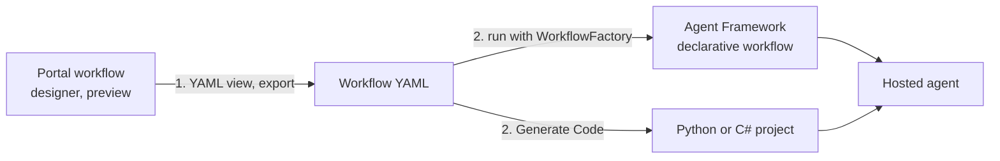

# Declarative YAML & Functional Workflows

A workflow graph in code is precise, but it is also something only a developer edits. Two other ways to express the same orchestration exist in Agent Framework: a YAML file that a loader turns into a workflow, and a plain async Python function that uses ordinary control flow. This topic covers both, and then the practical question many Foundry teams now face: what to do with workflows built in the Foundry portal designer, which is retiring.

| Style | You write | Control flow | Status |
| --- | --- | --- | --- |
| Graph | `WorkflowBuilder`, executors, edges | Edges and conditions | Stable |
| Declarative | A YAML file and `WorkflowFactory` | Actions such as `If`, `ConditionGroup`, `Foreach` | `agent-framework-declarative`, loader marked experimental in logs |
| Functional | `@workflow` and `@step` functions | Python `if`, loops and `asyncio.gather` | Experimental, Python only |

## Declarative Workflows Describe What Happens

A declarative workflow is a YAML document with a `name`, optional typed `inputs` and a list of `actions`. Actions run in order, and each has a `kind`. Values that start with `=` are Power Fx expressions evaluated at run time; other values are literals.

```yaml
name: expense-triage
inputs:
  amount:
    type: number
  category:
    type: string

actions:
  - kind: SetVariable
    variable: Local.limit
    value: 1000
  - kind: If
    condition: =Workflow.Inputs.amount > Local.limit
    then:
      - kind: SetVariable
        variable: Local.route
        value: director
    else:
      - kind: SetVariable
        variable: Local.route
        value: auto
  - kind: SendActivity
    activity:
      text: '=Concat("Route ", Local.route)'
```

State lives in namespaces: `Local.*` for workflow variables, `Workflow.Inputs.*` for the input (read-only), `Workflow.Outputs.*` for results and `System.*` for system values. Quote any expression that contains `: ` or other YAML syntax, as in the `text` line above.

## The Action Catalogue

| Category | Actions |
| --- | --- |
| Variables | `SetVariable`, `SetMultipleVariables`, `ResetVariable` |
| Control flow | `If`, `ConditionGroup`, `Foreach`, `BreakLoop`, `ContinueLoop`, `GotoAction` |
| Output | `SendActivity` |
| Agents | `InvokeAzureAgent` |
| Tools | `InvokeFunctionTool`, `InvokeMcpTool`, `HttpRequestAction` |
| Human in the loop | `Question`, `RequestExternalInput` |
| Workflow control | `EndWorkflow`, `EndConversation`, `CreateConversation` |

`ConditionGroup` is a switch: the first matching `condition` runs its `actions`, and `elseActions` is the default. `Foreach` iterates over `source`, and `itemName` names the loop variable, which you then read as `Local.<itemName>`.

## Calling Agents from YAML

`InvokeAzureAgent` names an agent, and the Python loader resolves that name from agents you register on the factory. The agent reply is sent to the workflow output unless `output.autoSend` is false.

```yaml
- kind: InvokeAzureAgent
  id: classify
  agent:
    name: ClassifierAgent
  input:
    messages: =Local.customerMessage
  output:
    responseObject: Local.Classification
    autoSend: false
```

```python
factory = WorkflowFactory()
factory.register_agent("ClassifierAgent", classifier_agent)
workflow = factory.create_workflow_from_yaml_path("workflows/support-router.yaml")
result = await workflow.run({"message": "I was charged twice this month."})
print(result.get_outputs())
```

`responseObject` parses JSON from the reply, so instruct the agent to answer with raw JSON and read fields such as `=Local.Classification.category`. If the reply is not JSON, the variable holds plain text and a field access fails with `The '.' operator cannot be used on Text values`.

## Requirements and Verified Behaviour

Power Fx evaluation needs the `powerfx` package, which Agent Framework installs only for Python 3.13 and earlier. On Python 3.14 and 3.15 a value that starts with `=` produces a warning and stays unevaluated. Importing the package prints a check mark, so on Windows set UTF-8 output before the import, for example with `sys.stdout.reconfigure(encoding="utf-8")`.

Checked against `agent-framework-declarative` 1.3.0: `SetMultipleVariables` read an `assignments` list of `variable` and `value` pairs, and the `variables` mapping from the documentation left the variables blank. Use `SetVariable` per variable when in doubt. `Foreach` requires `source`; a `Foreach` without it fails at load time.

## Functional Workflows Use Plain Python

The functional API is experimental. `@workflow` turns an async function into a definition, and you call `.build()` to get a runnable workflow, because the definition itself has no `run` method. Inside the function you use normal `await`, `if`, loops and `asyncio.gather`.

```python
@step
async def write_draft(topic: str) -> str:
    return (await writer.run(topic)).text


@workflow(name="announcement_review", description="Draft, pause for a human, revise")
async def announcement_review(topic: str, ctx: RunContext) -> str:
    draft = await write_draft(topic)
    feedback = await ctx.request_info({"draft": draft}, response_type=str, request_id="review")
    return await revise_draft(draft, feedback)


pipeline = announcement_review.build()
first = await pipeline.run("Receipt scanning in the expense app")
resumed = await pipeline.run(responses={"review": "Make it a single sentence."})
```

`@step` caches a function's result by its name and bound arguments, so after a human pause the finished steps are replayed from the cache instead of calling the model again, and they emit `executor_bypassed`. `ctx.request_info` pauses the workflow, and the first run ends with state `IDLE_WITH_PENDING_REQUESTS`. Give the request an explicit `request_id` so the resume call can name it.

## Migrating Foundry Portal Workflows

Workflows in the Foundry portal are a visual designer in preview. Microsoft Foundry retires them on December 1, 2026, and points new work to Microsoft Agent Framework. After that date the visual designer and in-portal execution are not supported, while YAML-based workflow definitions keep running when you deploy them as a hosted agent.



Export the YAML first: open the workflow in the designer, switch to the YAML view and save the file with a name ending in `.workflow.yaml`. Then choose a path.

| Path | Use it when |
| --- | --- |
| Agent Framework declarative YAML | You want the closest match to the designer, and the YAML runs with `WorkflowFactory` |
| Agent Framework code | You want graph or functional code; Foundry Toolkit for Visual Studio Code offers **Generate Code** on the workflow playground, for Python or C#, which hands the conversion to GitHub Copilot |
| Azure Logic Apps | A visual designer is the reason you used portal workflows |
| Agent-to-agent endpoint | One agent only needs to call another without a formal workflow |

Generated code is a starting point. Review branching, variables, agent calls and approval steps against the exported YAML, run both with the same test requests, and keep the original definition until the replacement is confirmed. Hosted agents are not supported inside the designer, so orchestration that a hosted agent needs belongs in Agent Framework code anyway.

## Hands-On Demo

[Run Declarative and Functional Workflows and Migrate a Portal Workflow](demo-declarative-workflows.md) runs a model-free YAML triage, a YAML router with agents, a functional pipeline that pauses and resumes, and then migrates a published Foundry workflow by exporting its YAML and running it unchanged in Agent Framework. The runnable projects are `declarative-workflows-py/` (Python) and `declarative-workflows-cs/` (C#, which has no functional workflow step).

## Key Topics

- [Declarative workflows](https://learn.microsoft.com/en-us/agent-framework/workflows/declarative)
- [Functional workflow API](https://learn.microsoft.com/en-us/agent-framework/concepts/workflows/functional)
- [Build a workflow in Microsoft Foundry (preview) and the migration guide](https://learn.microsoft.com/en-us/azure/foundry/agents/concepts/workflow)
- [Use and migrate declarative agent workflows with Foundry Toolkit](https://learn.microsoft.com/en-us/azure/foundry/how-to/develop/vs-code-agents-workflow-low-code)
- [Agent Inspector in Foundry Toolkit](https://learn.microsoft.com/en-us/azure/foundry/how-to/develop/vs-code-agent-inspector)
- [Hosted agents in Foundry](https://learn.microsoft.com/en-us/azure/foundry/agents/concepts/hosted-agents)
