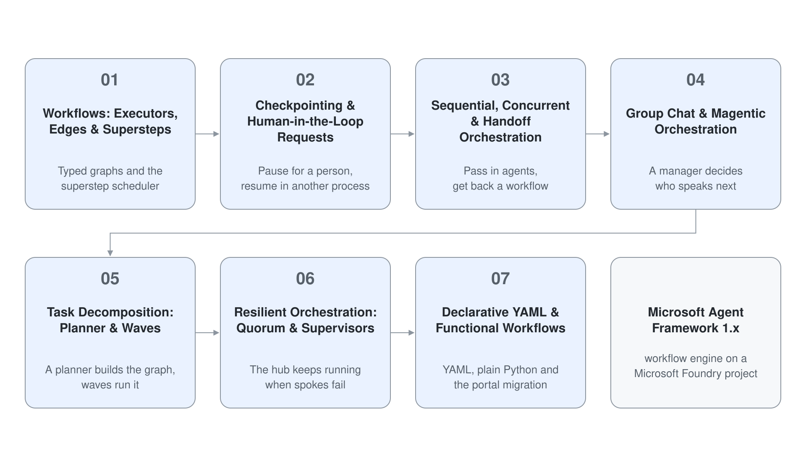

# Module 5: Workflows & Multi-Agent Orchestration

A single agent with tools handles a question; a business process needs more: steps that run in a defined order, checks that run in parallel, an approval that can take a day, specialists that take over a conversation and failures that must not take the whole system down. This module builds those processes with the Microsoft Agent Framework 1.x workflow engine, from the executor and edge primitives up to ready-made orchestrations and declarative definitions, on a Microsoft Foundry project.

You start with typed graphs and the superstep execution model, add checkpoints and human requests so a run can pause and resume in another process, and then use the orchestration builders for sequential, concurrent, handoff, group chat and Magentic patterns. The last three topics apply them: decomposing a task with a planner, keeping an orchestration alive when spokes fail, and expressing workflows as YAML or functional code, including how to migrate Foundry portal workflows before the designer retires on December 1, 2026.

Every topic has a Python project. Topics 1, 2 and 3 also have a C# project, because the .NET workflow API has its own idioms (`[MessageHandler]`, `RequestPort`, `AgentWorkflowBuilder`).



## Topics

| Topic | Description |
| --- | --- |
| [Workflows: Executors, Edges & Supersteps](./01-workflows/readme.md) | Typed graphs: executors, conditional, switch-case, fan-out and fan-in edges, supersteps and `WorkflowViz` |
| [Checkpointing & Human-in-the-Loop Requests](./02-checkpoints-hitl/readme.md) | `FileCheckpointStorage`, resume by checkpoint id, `request_info` with `@response_handler`, .NET `CheckpointManager` and `RequestPort` |
| [Sequential, Concurrent & Handoff Orchestration](./03-orchestration-patterns/readme.md) | `SequentialBuilder`, `ConcurrentBuilder` and `HandoffBuilder` with constructor parameters, .NET `AgentWorkflowBuilder` |
| [Group Chat & Magentic Orchestration](./04-magentic/readme.md) | `GroupChatBuilder` selection strategies, `MagenticBuilder` with plan review and orchestrator events |
| [Task Decomposition: Planner & Waves](./05-task-decomposition/readme.md) | Prompt chains with validation gates, a planner agent that builds a dependency graph, wave execution and handoff collaboration |
| [Resilient Orchestration: Quorum & Supervisors](./06-resilient-orchestration/readme.md) | Result envelopes, timeouts, a circuit breaker, quorum over parallel spokes and a checker and maker supervisor |
| [Declarative YAML & Functional Workflows](./07-declarative-workflows/readme.md) | Workflow YAML with `WorkflowFactory`, `@workflow` and `@step`, and the migration path for Foundry portal workflows |

## Demos

| Topic | Description |
| --- | --- |
| [Route Invoices with a Workflow Graph](./01-workflows/demo-workflows.md) | Build an invoice graph with conditional and switch-case edges, observe supersteps in a fan-out, put an agent in a node and render the graph |
| [Pause an Expense Approval and Resume It in Another Process](./02-checkpoints-hitl/demo-checkpoints-hitl.md) | Pause for a human decision, end the process, resume from a file checkpoint and rewind to an earlier superstep |
| [Run Three Agent Patterns with One Builder Each](./03-orchestration-patterns/demo-orchestration-patterns.md) | A sequential pipeline, a concurrent panel with a custom aggregator and a support handoff with tool approval, in Python and C# |
| [Coordinate a Team with Group Chat and a Magentic Manager](./04-magentic/demo-magentic.md) | Group chat with a selection function and an agent orchestrator, then a Magentic team with plan review and orchestrator events, in Python and C# |
| [Decompose a Research Question with a Planner](./05-task-decomposition/demo-task-decomposition.md) | A validated prompt chain, a planner-built graph executed in waves and a handoff, in Python and C# |
| [Keep a Research Hub Running When Spokes Fail](./06-resilient-orchestration/demo-resilient-orchestration.md) | Timeouts, a tripped circuit breaker, a quorum and a supervisor that rejects a weak report, in Python and C# |
| [Run Declarative and Functional Workflows and Migrate a Portal Workflow](./07-declarative-workflows/demo-declarative-workflows.md) | YAML triage, YAML agent routing, a functional pipeline that pauses and the export and local run of a published Foundry workflow, in Python and C# (without the functional step) |

## Working with the Demo Projects

Each project folder is a finished, runnable project with its own `requirements.txt` or `.csproj` and a `.env.example`. Create a virtual environment inside the project, install the pinned requirements and copy `.env.example` to `.env`. Set `PROJECT_ENDPOINT` to your Foundry project endpoint and `MODEL_DEPLOYMENT_NAME` to a chat model deployment such as `gpt-5.4`, and sign in with `az login`.

```bash
cd demos/05-orchestration/01-workflows/workflows-py
python -m venv .venv
.venv/Scripts/python -m pip install -r requirements.txt
cp .env.example .env
```

Only the declarative workflows demo creates anything in Azure: four project-scoped agents with the prefix `m5-` (`m35h-` in the C# project), removed again by its Cleanup step.

## Helpful Claude Slash Commands

| Command | What it does here |
| --- | --- |
| `/agents` | Lists and manages Claude Code subagents, which mirrors the planner and specialist split you build in this module |
| `/model` | Switches the model while you iterate on orchestration code, for example to a faster model for repeated test runs |
| `/cost` | Shows token usage and session cost, a good reminder of what a Magentic run or a rewind from an earlier checkpoint spends |
| `/review` | Reviews a branch of workflow code for type mismatches across edges and unguarded loops |
| `/find-skills` | Finds installable skills for Agent Framework and Foundry development |

## Key Topics covered in this module

- [Agent Framework workflows](https://learn.microsoft.com/en-us/agent-framework/workflows/workflows)
- [Executors](https://learn.microsoft.com/en-us/agent-framework/workflows/executors) and [edges](https://learn.microsoft.com/en-us/agent-framework/workflows/edges)
- [Checkpoints](https://learn.microsoft.com/en-us/agent-framework/workflows/checkpoints)
- [Human-in-the-loop](https://learn.microsoft.com/en-us/agent-framework/workflows/human-in-the-loop)
- [Sequential](https://learn.microsoft.com/en-us/agent-framework/workflows/orchestrations/sequential), [concurrent](https://learn.microsoft.com/en-us/agent-framework/workflows/orchestrations/concurrent) and [handoff](https://learn.microsoft.com/en-us/agent-framework/workflows/orchestrations/handoff) orchestration
- [Group chat](https://learn.microsoft.com/en-us/agent-framework/workflows/orchestrations/group-chat) and [Magentic](https://learn.microsoft.com/en-us/agent-framework/workflows/orchestrations/magentic) orchestration
- [Declarative workflows](https://learn.microsoft.com/en-us/agent-framework/workflows/declarative) and the [functional workflow API](https://learn.microsoft.com/en-us/agent-framework/concepts/workflows/functional)
- [Foundry workflows and the migration guide](https://learn.microsoft.com/en-us/azure/foundry/agents/concepts/workflow)
- [AI agent orchestration patterns](https://learn.microsoft.com/en-us/azure/architecture/ai-ml/guide/ai-agent-design-patterns)
