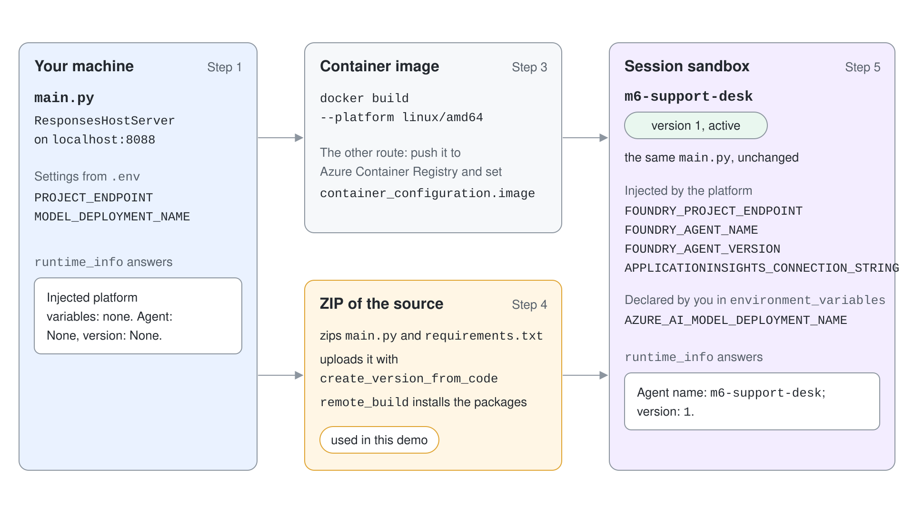
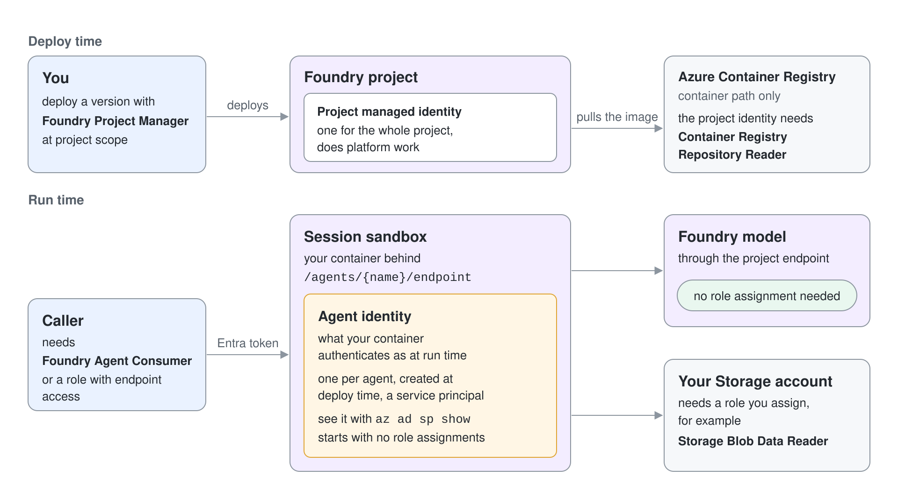

# Deploy a Hosted Agent and Inspect Its Identity

An agent that works on your laptop is not yet a service. It needs a web server, a container or a package, a place to run, a way to scale to zero and an identity that is not yours. In this demo you run one support-desk agent locally, package it, deploy it to Foundry Agent Service as a hosted agent, call its dedicated endpoint and look at the Entra identity the platform created for it.

What you practice here: hosting an Agent Framework agent with `ResponsesHostServer`, deploying it with the ZIP path, and reading the agent identity and injected settings.

Duration: about 50 minutes.



## Prerequisites

- Python 3.12 or later, Docker Desktop for step 3, and Azure CLI signed in with `az login`.
- Foundry Project Manager on the `pro-code-agents` project (needed to deploy) and a `gpt-5.4` deployment.
- A region that supports hosted agents. Sweden Central, where this project lives, does.

## Run it

Work in `hosted-agents-py/`. The C# variant is in `hosted-agents-cs/`.

```bash
cd demos/06-hosting/01-hosted-agents/hosted-agents-py
python -m venv .venv
.venv/Scripts/pip install -r requirements.txt
cp .env.example .env
```

```text
PROJECT_ENDPOINT=https://pro-code-agents-foundry.services.ai.azure.com/api/projects/pro-code-agents
MODEL_DEPLOYMENT_NAME=gpt-5.4
```

## Step 1: Host the agent and call it locally

`main.py` is a normal Agent Framework agent with two function tools. The only hosting code is the last line: `ResponsesHostServer` wraps the agent and serves the Responses protocol on port 8088.

```python
agent = Agent(client=client, name="m6-support-desk", instructions=INSTRUCTIONS, tools=[lookup_ticket, runtime_info])

if __name__ == "__main__":
    ResponsesHostServer(agent).run()
```

Start the host in one terminal and call it from a second one. `ask.py` is the OpenAI SDK pointed at `http://localhost:8088`; any OpenAI-compatible client works because the endpoint speaks the Responses protocol.

```bash
.venv/Scripts/python main.py
```

```bash
.venv/Scripts/python ask.py "What is the status of ticket T-1002?"
.venv/Scripts/python ask.py "Which platform variables are injected into your container?"
```

Expected output:

```text
Ticket T-1002: VPN drops every hour for the sales team; it is assigned to Network and marked high priority.
Injected platform variables: none. Agent: None, version: None.
```

The second answer comes from the `runtime_info` tool, which reports which platform variables exist. Locally none do; you will ask the same question again after the deployment. Stop the host with Ctrl+C.

To see the same host in C#, run `dotnet run` in `hosted-agents-cs/` after exporting `PROJECT_ENDPOINT` and `MODEL_DEPLOYMENT_NAME`; it uses `AgentHost`, `AddFoundryResponses` and `MapFoundryResponses` and answers on the same port with the same request.

## Step 2: Host a native workflow

A workflow can be the hosted unit, not only an agent. `workflow_main.py` builds a two-step graph (triage, then reply) and passes it to the host with `workflow=`; `parse_response` turns the request text into a typed `Ticket`.

```python
ResponsesHostServer(
    workflow=build_workflow,
    parse_response=parse_response,
    checkpoint_store_provider=CheckpointStoreProvider(
        allowed_checkpoint_types=[f"{Ticket.__module__}:{Ticket.__qualname__}"],
    ),
).run()
```

```bash
.venv/Scripts/python workflow_main.py
```

```bash
.venv/Scripts/python ask.py '{"ticket_id":"T-1002","question":"VPN drops every hour for the sales team"}'
```

Expected output (the wording varies):

```text
The Network Team is actively working on this high-priority issue. We understand the urgency and are prioritizing it accordingly.
```

The input is JSON because the workflow's start type is `Ticket`. `build_workflow(request)` returns a fresh graph per request with stable ids, which is what lets the host restore a checkpoint for a paused workflow. Stop this host before the next step.

## Step 3: Package the agent as a container

The container path is a plain Dockerfile. The platform needs linux/amd64 and serves on port 8088, and the protocol library already exposes `/readiness`.

```dockerfile
FROM python:3.14-slim
WORKDIR /app
COPY requirements.txt .
RUN pip install --no-cache-dir -r requirements.txt
COPY main.py workflow_main.py ./
EXPOSE 8088
CMD ["python", "main.py"]
```

```bash
docker build --platform linux/amd64 -t m6-support-desk:v1 .
docker run -d --rm --name m6-support-desk -p 8088:8088 --env-file .env m6-support-desk:v1
curl http://localhost:8088/readiness
docker stop m6-support-desk
```

Expected output:

```text
{"status":"healthy"}
```

Pushing this image to Azure Container Registry and passing it as `container_configuration.image` is the other deployment route. This demo deploys the same code as a ZIP, which needs no registry and no role assignment on one.

## Step 4: Deploy the ZIP as a hosted agent

`deploy.py` zips `main.py` and `requirements.txt`, uploads them with `create_version_from_code`, and polls until the version is active. With `dependency_resolution="remote_build"` the platform installs `requirements.txt` for you.

```python
created = project.agents.create_version_from_code(
    agent_name=AGENT_NAME,
    definition=HostedAgentDefinition(
        cpu="1",
        memory="2Gi",
        code_configuration=CodeConfiguration(
            runtime="python_3_13",
            entry_point=["python", "main.py"],
            dependency_resolution="remote_build",
        ),
        protocol_versions=[ProtocolVersionRecord(protocol="responses", version="2.0.0")],
        environment_variables={"AZURE_AI_MODEL_DEPLOYMENT_NAME": os.environ["MODEL_DEPLOYMENT_NAME"]},
    ),
    code=("agent-code.zip", code, "application/zip"),
    code_zip_sha256=digest,
)
```

```bash
.venv/Scripts/python deploy.py
```

Expected output:

```text
created m6-support-desk version 1
status: creating
status: creating
status: creating
status: creating
status: creating
status: active
```

The model deployment name is the one setting you declare yourself. Everything starting with `FOUNDRY_` is injected by the platform.

## Step 5: Call the dedicated endpoint

`invoke.py` creates an OpenAI client bound to the agent with `get_openai_client(agent_name=...)`, so the request goes to `.../agents/m6-support-desk/endpoint/protocols/openai/responses` with your Entra token.

```python
openai_client = project.get_openai_client(agent_name="m6-support-desk")
response = openai_client.responses.create(input=sys.argv[1])
print(response.output_text)
```

```bash
.venv/Scripts/python invoke.py
.venv/Scripts/python invoke.py "Which platform variables are injected into your container, and what are your agent name and version?"
```

Expected output:

```text
Ticket T-1002: VPN drops every hour for the sales team, assigned to network, priority high.
Injected platform variables: `FOUNDRY_PROJECT_ENDPOINT`, `AZURE_AI_MODEL_DEPLOYMENT_NAME`, `APPLICATIONINSIGHTS_CONNECTION_STRING`, `FOUNDRY_AGENT_NAME`, and `FOUNDRY_AGENT_VERSION`. Agent name: `m6-support-desk`; version: `1`.
```

Compare the second answer with step 1. The same code now sees the project endpoint, the telemetry connection string and its own name and version, none of which you set. The first call after a quiet period is slower because the platform has to provision the session sandbox.



## Step 6: Inspect the agent identity

The platform created a service principal for this agent. `inspect_agent.py` reads it from the agent object, and two Azure CLI calls show what it is and what it may do.

```bash
.venv/Scripts/python inspect_agent.py
```

Expected output (the principal id differs):

```text
version: 1 status: active
runtime: python_3_13
protocols: ['responses']
agent identity: 4cb0c975-d154-4748-a9db-ec00f1ef9ccf
endpoint: https://pro-code-agents-foundry.services.ai.azure.com/api/projects/pro-code-agents/agents/m6-support-desk/endpoint/protocols/openai/responses
```

```bash
az ad sp show --id 4cb0c975-d154-4748-a9db-ec00f1ef9ccf --query "{name:displayName,type:servicePrincipalType}" -o json
az role assignment list --all --assignee 4cb0c975-d154-4748-a9db-ec00f1ef9ccf -o json
```

```text
{
  "name": "pro-code-agents-foundry-pro-code-agents-m6-support-desk-AgentIdentity",
  "type": "ServiceIdentity"
}
[]
```

The identity exists as its own principal, yet it holds no Azure role assignments. Model access through the project endpoint is part of the platform and needs none. To let the agent read your own Storage account you would run `az role assignment create --assignee-object-id <principal id> --assignee-principal-type ServicePrincipal --role "Storage Blob Data Reader" --scope <storage account id>`.



## Verify

You have verified the demo when step 5 prints the five injected variable names with version `1`, and step 6 shows a service principal named `...m6-support-desk-AgentIdentity` with an empty role assignment list.

## Cleanup

`cleanup.py` deletes the agent with `force=True`, which also ends its active sessions. Remove the local image with `docker rmi m6-support-desk:v1` if you built it.

```bash
.venv/Scripts/python cleanup.py
```

```text
deleted agent m6-support-desk
```
