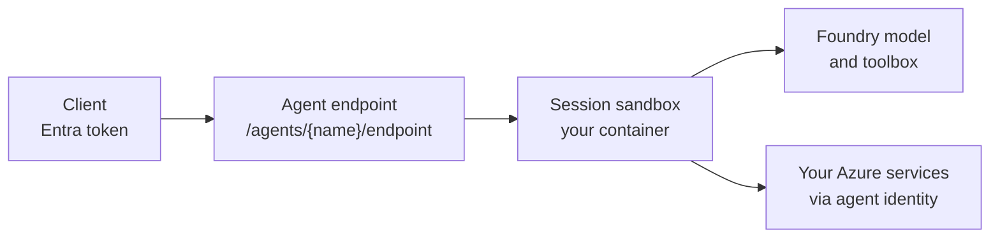

# Hosted Agents: Containers & Agent Identity

A prompt agent is a definition that Foundry runs for you. A hosted agent is your own code, packaged as a container image or a ZIP of source, that Foundry Agent Service runs on managed compute. Use one when the agent needs custom orchestration, a framework such as Agent Framework or LangGraph, local files, or a protocol that a prompt definition cannot express.

Microsoft Foundry Hosted Agents is generally available; the Python hosting library `agent-framework-foundry-hosting` is still a prerelease package.

## How the platform runs your code

When you create a version, Agent Service pulls your image (or builds your ZIP), creates a dedicated Microsoft Entra identity for the agent, and publishes a dedicated endpoint. Compute is not kept warm. Each session gets its own VM-isolated sandbox with a persistent `$HOME` and `/files`, and the platform deprovisions it after an idle timeout of 2 to 60 minutes (15 by default) and restores it when the same session returns.



You own the code inside the sandbox. The platform owns the endpoint, identity, scaling and session state around it.

A sandbox is sized per session with one of three combinations: 0.5 vCPU and 1 GiB, 1 vCPU and 2 GiB, or 2 vCPU and 4 GiB. Each version is immutable and an endpoint serves one version at a time.

## Protocols

A container exposes one or more protocols through lightweight libraries that also provide `/readiness` and OpenTelemetry. Start with Responses; a single agent can add the others later.

| Protocol | Endpoint | Use it for |
|---|---|---|
| Responses | `/responses` | Chat agents. The platform keeps history by conversation id and supports streaming and background mode. |
| Invocations | `/invocations` | Webhooks, batch work and custom payloads. You own the session. |
| Invocations (WebSocket) | `/invocations_ws` | Real-time voice and other full-duplex streams. |
| A2A | `/a2a` | Agent-to-agent delegation, covered in [A2A Protocol](../06-a2a-protocol/readme.md). |

## Host an Agent Framework agent

`ResponsesHostServer` wraps an `Agent` and serves the Responses protocol on port 8088. The same file runs on your machine and in the sandbox, because the platform injects the settings the agent needs.

```python
import os

from agent_framework import Agent
from agent_framework.foundry import FoundryChatClient
from agent_framework_foundry_hosting import ResponsesHostServer
from azure.identity import DefaultAzureCredential

client = FoundryChatClient(
    project_endpoint=os.environ["FOUNDRY_PROJECT_ENDPOINT"],
    model=os.environ["AZURE_AI_MODEL_DEPLOYMENT_NAME"],
    credential=DefaultAzureCredential(),
)

agent = Agent(client=client, instructions="You are a helpful AI assistant.")

ResponsesHostServer(agent).run()
```

```bash
pip install --pre agent-framework-foundry agent-framework-foundry-hosting azure-identity
```

The host owns the agent you give it, so do not reuse it with another host. Pass a zero-argument factory instead of an instance when the agent keeps state outside its `AgentSession` or opens per-request resources such as MCP connections. Session state is stored in Foundry State Store when hosted and in files when you run locally.

## Host a native workflow

Python can host a built `Workflow` directly through `workflow=`. A `parse_response` callback turns the Responses request into a typed start input, and the host manages checkpoints so a paused workflow can continue on a later request.

```python
from agent_framework_foundry_hosting import (
    CheckpointStoreProvider,
    HostedResponseRequest,
    ResponsesHostServer,
    WorkflowTurn,
)

async def parse_response(request: HostedResponseRequest) -> WorkflowTurn[Ticket]:
    return WorkflowTurn(input=Ticket.model_validate_json(await request.get_input_text() or ""))

ResponsesHostServer(
    workflow=build_workflow,
    parse_response=parse_response,
    checkpoint_store_provider=CheckpointStoreProvider(
        allowed_checkpoint_types=[f"{Ticket.__module__}:{Ticket.__qualname__}"],
    ),
).run()
```

The factory `build_workflow(request)` must return a freshly built graph with stable workflow and executor ids. Hosting `workflow.as_agent()` through `agent=` still works but is deprecated, because a `WorkflowAgent` keeps state in memory and must not serve different users.

## Package as a container or a ZIP

The container path gives you full control of the runtime image. The ZIP path uploads `main.py` and `requirements.txt` and lets the platform build the dependencies, so you need neither Docker nor a registry.

| | Container | ZIP (code deploy) |
|---|---|---|
| You provide | Image in Azure Container Registry, linux/amd64 | Flat ZIP with the entry point and `requirements.txt` |
| Definition field | `container_configuration.image` | `code_configuration` with runtime and entry point |
| Runtimes | Any you can put in an image | `python_3_13`, `python_3_14`, `dotnet_10` |
| Registry access | Project managed identity needs Container Registry Repository Reader | None |

```dockerfile
FROM python:3.14-slim
WORKDIR /app
COPY requirements.txt .
RUN pip install --no-cache-dir -r requirements.txt
COPY main.py ./
EXPOSE 8088
CMD ["python", "main.py"]
```

```python
from azure.ai.projects.models import CodeConfiguration, HostedAgentDefinition, ProtocolVersionRecord

project.agents.create_version_from_code(
    agent_name="m6-support-desk",
    definition=HostedAgentDefinition(
        cpu="1",
        memory="2Gi",
        code_configuration=CodeConfiguration(
            runtime="python_3_13",
            entry_point=["python", "main.py"],
            dependency_resolution="remote_build",
        ),
        protocol_versions=[ProtocolVersionRecord(protocol="responses", version="2.0.0")],
    ),
    code=("agent-code.zip", code_zip_bytes, "application/zip"),
    code_zip_sha256=sha256_hex,
)
```

With `dependency_resolution="bundled"` you ship the prebuilt Linux packages in the ZIP instead. Polling `project.agents.get_version` until the status is `active` completes the deployment; `azd` automates the same lifecycle and is covered in [azd AI Agent](../03-azd-ai-agent/readme.md).

## Agent identity and permissions

Every hosted agent gets its own Microsoft Entra identity at deploy time. It is a service principal, so you can see it with `az ad sp show` and give it Azure roles. By default it can call models through the project endpoint and use session storage; for anything else, such as your own Storage account, assign a role to that identity yourself.

| Identity | Scope | Purpose |
|---|---|---|
| Agent identity | One per agent, created at deploy time | What your container authenticates as at run time |
| Project managed identity | Whole Foundry project | Platform work such as pulling the image from the registry |

To deploy you need the Foundry Project Manager role at the project scope. Callers of the endpoint need Foundry Agent Consumer or a role that includes endpoint access. These roles were renamed from the Azure AI roles with the same role ids, so older portals may still show the old names.

## Settings the platform injects

The platform sets these variables in the sandbox, so the code above runs unchanged. Do not declare the `FOUNDRY_*` names yourself; declare your own, such as the model deployment name, in the `environment_variables` of the version or in the `env` of the `azure.ai.agent` service in `azure.yaml`.

| Variable | Meaning |
|---|---|
| `FOUNDRY_PROJECT_ENDPOINT` | Project endpoint URL |
| `FOUNDRY_AGENT_NAME`, `FOUNDRY_AGENT_VERSION` | Name and version of the running agent |
| `FOUNDRY_AGENT_SESSION_ID` | Session id of the current request |
| `APPLICATIONINSIGHTS_CONNECTION_STRING` | Telemetry target, so protocol libraries emit traces by default |
| `AZURE_AI_MODEL_DEPLOYMENT_NAME` | Model deployment name; azd sets it from `azure.yaml`, with the SDK you set it yourself |

## The same host in C#

In .NET the host is `AgentHost` from `Azure.AI.AgentServer.Core`, and the Foundry package maps the Responses protocol onto it. The package is `Microsoft.Agents.AI.Foundry.Hosting` and is prerelease.

```csharp
AIAgent agent = new AIProjectClient(projectEndpoint, new DefaultAzureCredential())
    .AsAIAgent(model: deployment, instructions: "You are a helpful AI assistant.", name: "my-agent");

var builder = AgentHost.CreateBuilder(args);
builder.Services.AddFoundryResponses(agent);
builder.RegisterProtocol("responses", endpoints => endpoints.MapFoundryResponses());

var app = builder.Build();
app.Run();
```

## Hands-On Demo

- [Deploy a hosted agent and inspect its identity](./demo-hosted-agents.md)

## Key Topics

- [What are hosted agents?](https://learn.microsoft.com/en-us/azure/foundry/agents/concepts/hosted-agents)
- [Foundry Hosted Agents with Agent Framework](https://learn.microsoft.com/en-us/agent-framework/hosting/foundry-hosted-agent)
- [Deploy a hosted agent](https://learn.microsoft.com/en-us/azure/foundry/agents/how-to/deploy-hosted-agent)
- [Deploy a hosted agent from source code](https://learn.microsoft.com/en-us/azure/foundry/agents/how-to/deploy-hosted-agent-code)
- [Quickstart: Deploy your first hosted agent](https://learn.microsoft.com/en-us/azure/foundry/agents/quickstarts/quickstart-hosted-agent)
