# Foundry Routines: Schedules & Event Triggers

An agent that only answers when someone asks is half of what teams want. The other half is "run this agent every weekday at seven", "run it once on release day" or "run it when a GitHub issue opens". A routine is the Foundry-native answer: a named rule in your project that pairs one trigger with one action and keeps a run history, so you do not build a scheduler from Logic Apps, queues and custom auth.

## Status and availability

The Learn articles describe routines without a general availability label. The Python and JavaScript SDKs expose them under `client.beta.routines`, the .NET operations (`project.Routines`) need the `Azure.AI.Projects` 3.0 beta packages, and the `azure.ai.routines` azd extension is a beta. Treat the surface as subject to change.

Routines are available in every Foundry region except UK West, Switzerland West, Japan West, UAE North and Norway East. They work in projects secured by a virtual network and do not support customer-managed key encryption.

## One trigger, one action

A routine has exactly one trigger and one action. It also has an input, a lifecycle state (enabled or disabled) and a run history. Anything that needs branching, several agents or approvals belongs in a workflow, which a routine cannot call.

| Trigger type | Fires | Key fields |
|---|---|---|
| `timer` | Once, then the routine becomes inactive | `at`: future ISO 8601 timestamp with an explicit UTC offset |
| `schedule` | Repeatedly on a cron expression, at most every five minutes | `cron_expression` (five fields), `time_zone` (IANA or Windows id) |
| `github_issue` | When an issue is opened or closed in a watched repository | `connection_id`, `owner`, `repository`, `issue_event` (`opened` or `closed`) |
| Manual dispatch | When you call `dispatch` | Not a trigger; a test run of any routine |

Event triggers authenticate to the external system through a project connection that Foundry provisions in the account's connector namespace. When a GitHub event fires, the issue payload replaces `action.input`; the configured input only applies to manual dispatches.



## Create routines with the Python SDK

Routines need `azure-ai-projects` 2.4.0 or later and the Foundry User role on the project. The trigger map has one entry whose key is a name you choose.

```python
from datetime import datetime, timedelta, timezone

schedule = project.beta.routines.create_or_update(
    routine_name="m6-weekday-digest",
    description="Weekday morning support digest.",
    enabled=False,
    triggers={
        "weekday-morning": {
            "type": "schedule",
            "cron_expression": "0 7 * * 1-5",
            "time_zone": "Europe/Vienna",
        }
    },
    action={
        "type": "invoke_agent_responses_api",
        "agent_name": "m6-digest-agent",
        "input": "Write the support digest for the last 24 hours.",
    },
)

timer = project.beta.routines.create_or_update(
    routine_name="m6-one-shot",
    enabled=True,
    triggers={"once": {"type": "timer", "at": datetime.now(timezone.utc) + timedelta(minutes=2)}},
    action={"type": "invoke_agent_responses_api", "agent_name": "m6-digest-agent"},
)
```

The GitHub trigger has the same shape. The SDK creates the routine but not the GitHub connector connection, so create that in the portal, with REST or with azd first and reference it by name.

```python
triggers={
    "on-issue": {
        "type": "github_issue",
        "connection_id": "github-conn",
        "owner": "your-org",
        "repository": "your-repo",
        "issue_event": "opened",
    }
}
```

## Actions

The only action invokes one prompt agent or hosted agent. The action type must match a protocol the agent exposes.

| Action type | Calls | Optional fields |
|---|---|---|
| `invoke_agent_responses_api` | The agent's Responses endpoint | `input`, `conversation` (continue an existing conversation) |
| `invoke_agent_invocations_api` | A hosted agent's Invocations endpoint | `input`, `session_id` (continue a hosted session) |

Identify the agent with `agent_name` (or the legacy `agent_endpoint_id`), never both. By default every routine invokes the agent under the agent identity. If the agent's tools need delegated user access, pass `authorization=RoutineAuthorization(identity="creator")` when you create the routine; the setting is ignored on update, so switching means deleting and recreating the routine.

## Test, observe and operate

`dispatch` queues a one-off run without waiting for the trigger. It acknowledges that the run was enqueued, not that the agent finished, so read the run history for the outcome. A disabled routine can be dispatched with an explicit `payload`; a dispatch without a payload goes through the scheduler path and fails with a message that the routine is disabled.

```python
result = project.beta.routines.dispatch(
    routine_name="m6-weekday-digest",
    payload={"type": "invoke_agent_responses_api", "input": "Run the digest now for a test."},
)

for run in project.beta.routines.list_runs("m6-weekday-digest"):
    print(run.id, run.phase.value, run.attempt_source.value, run.started_at, run.response_id)
    if run.phase.value == "failed":
        print(run.error_type, run.error_message)
```

Each run records the trigger source (`timer_delivery`, `schedule_delivery`, `queued_dispatch`), the dispatch id and the response id, which links to the agent response and trace. REST uses `POST {project}/routines/{name}:dispatch_async?api-version=v1`; the older `:dispatch` route is not part of the public contract.

Delivery makes up to five attempts with exponential backoff from 5 to 60 seconds. HTTP 408, 429 and 5xx are retried and other 4xx responses fail the run at once. Each attempt has a 30 second timeout that covers acceptance of the background request, so a completed run does not guarantee that the agent's own work is finished.



## The azd route

The `azure.ai.routines` extension (part of `microsoft.foundry`) creates routines from a YAML manifest. Learn documents the manifest as the way to create schedules with azd.

```bash
azd ext install microsoft.foundry
azd ai routine create m6-azd-digest --file routine.yaml
azd ai routine enable m6-azd-digest
azd ai routine dispatch m6-azd-digest
azd ai routine disable m6-azd-digest
```

```yaml
name: m6-azd-digest
description: Weekday morning support digest created from a manifest.
enabled: false
triggers:
  weekday-morning:
    type: schedule
    cronExpression: "0 7 * * 1-5"
    timeZone: Europe/Vienna
action:
  type: invoke_agent_responses_api
  agentName: m6-digest-agent
  input: Write the support digest for the last 24 hours.
```

Learn writes the manifest keys in snake_case (`cron`, `time_zone`, `agent_name`). Version 1.0.0-beta.10 of the extension rejects them and asks for `cronExpression`, `timeZone` and `agentName`, so the manifest above uses what the installed extension accepts. Run history is read through the SDK or the portal.

## Routines or workflows

| Question | Routine | Workflow |
|---|---|---|
| What does it answer? | When should my agent run? | How do steps, decisions and agents connect? |
| Agents | Exactly one | Many |
| Best for | Timers, schedules, lightweight automation | Branching, approvals, complex state |

A hosted agent can also schedule itself: a built-in `reminder_preview` tool, exposed through a toolbox, re-invokes the same agent on the same conversation after a delay it chooses. That pattern is for follow-ups the agent decides on mid-run, which a fixed routine cannot express.

## Hands-On Demo

- [Schedule an agent with routines](./demo-routines.md): Python in `routines-py` and C# in `routines-cs`

## Key Topics

- [Routines in Foundry Agent Service](https://learn.microsoft.com/en-us/azure/foundry/agents/concepts/routines)
- [Automate agents with routines](https://learn.microsoft.com/en-us/azure/foundry/agents/how-to/use-routines)
- [Install the Azure Developer CLI Foundry extensions](https://learn.microsoft.com/en-us/azure/foundry/agents/how-to/install-cli-foundry-extensions)
- [Azure role-based access control in Foundry](https://learn.microsoft.com/en-us/azure/foundry/concepts/rbac-foundry)
