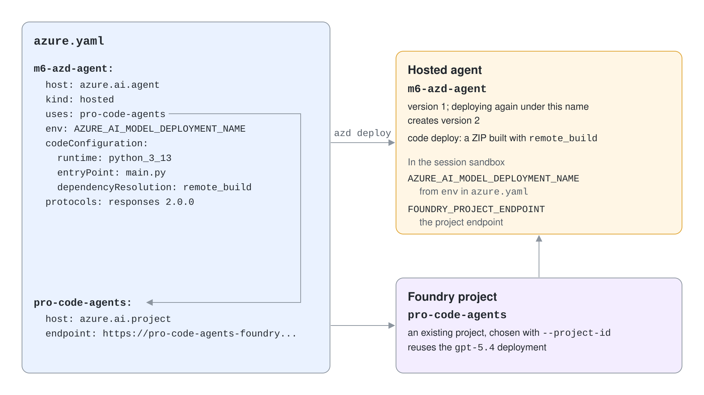

# azd AI Agent: Deploy & Monitor

The Azure Developer CLI (`azd`) has a family of `ai` extensions that take an agent from a source folder to a running hosted agent and then help you operate it. One command scaffolds the project, one runs it locally, one deploys it, and others invoke, monitor and diagnose it. The point is a single, repeatable loop that works the same on a laptop and in CI.



## Install the extensions

You need `azd` 1.25.2 or later and Python 3.10 or later, or .NET 8 or later, depending on the framework. The `microsoft.foundry` extension is a meta-package that installs all the others.

```bash
azd ext install microsoft.foundry
azd ext list
azd auth login
```

| Extension | Command group | Purpose |
|---|---|---|
| `azure.ai.agents` | `azd ai agent` | Ship agents from your terminal |
| `azure.ai.connections` | `azd ai connection` | Manage project connections |
| `azure.ai.inspector` | `azd ai inspector` | Browser inspector for a locally running agent |
| `azure.ai.projects` | `azd ai project` | Set, unset and show the project context |
| `azure.ai.routines` | `azd ai routine` | Timers, schedules and event triggers, see [Foundry Routines](../02-routines/readme.md) |
| `azure.ai.skills` | `azd ai skill` | Reusable behavioral guidelines for agents |
| `azure.ai.toolboxes` | `azd ai toolbox` | Versioned tool collections |

The extensions are beta and independently versioned, so upgrade them with `azd ext upgrade microsoft.foundry`. Your Azure account needs Contributor to provision resources, Foundry Owner only when you create a new Foundry project, and Foundry Project Manager on the project to deploy a hosted agent into it.

## The agent command group

`azd ai agent` is the surface this topic uses. The commands that matter for a hosted agent:

| Command | What it does |
|---|---|
| `init` | Create or adopt an azd project for a hosted, prompt or voice agent |
| `run` | Start the agent locally on port 8088, with Agent Inspector on 8087 |
| `invoke` | Send a message to a deployed agent, or to the local one with `--local` |
| `show` | Show status, version, identity and endpoints |
| `monitor` | Stream console or system logs of a hosted session |
| `doctor` | Check the local project, authentication and remote project |
| `delete` | Delete an agent, or one version with `--version` |
| `sessions`, `files`, `state-stores` | Inspect sessions, files and the durable state store |
| `eval`, `optimize` | Generate quick evaluations and tune the agent |

Run `azd ai agent <command> --help` for flags. Each command accepts `--no-prompt` for CI and `-o json` where output is structured.

## Initialize against an existing project

`init` writes an `azure.yaml` that describes the agent as a service. Pointing it at an existing Foundry project with `--project-id` and an existing model deployment with `--model-deployment` means nothing new is provisioned for the model.

```bash
azd ai agent init --src src/m6-azd-agent --agent-name m6-azd-agent \
  --project-id "<project resource id>" --model-deployment gpt-5.4 \
  --deploy-mode code --runtime python_3_13 --entry-point main.py \
  --protocol responses --no-prompt
```

The result is a service with host `azure.ai.agent` that points at a project service with host `azure.ai.project`:

```yaml
name: m6-azd
services:
    m6-azd-agent:
        project: src/m6-azd-agent
        host: azure.ai.agent
        language: python
        uses:
            - pro-code-agents
        env:
            AZURE_AI_MODEL_DEPLOYMENT_NAME: ${AZURE_AI_MODEL_DEPLOYMENT_NAME}
        codeConfiguration:
            dependencyResolution: remote_build
            entryPoint: main.py
            runtime: python_3_13
        container:
            resources:
                cpu: "0.5"
                memory: 1Gi
        kind: hosted
        name: m6-azd-agent
        protocols:
            - protocol: responses
              version: 2.0.0
    pro-code-agents:
        host: azure.ai.project
        endpoint: https://pro-code-agents-foundry.services.ai.azure.com/api/projects/pro-code-agents
infra:
    provider: microsoft.foundry
```

The agent name is the Foundry agent identity. Foundry agents are unique by name within a project, so deploying under an existing name creates a new version of that agent instead of a second agent. `azd` searches parent folders for `azure.yaml`, so a folder inside a repository that already has one at its root cannot be initialized in place.



## Code deploy or container deploy

`--deploy-mode` chooses how the agent is packaged. `code` uploads a ZIP of the source folder and is the default for Python and .NET projects in `--no-prompt` mode; `container` builds a Docker image.

| | `code` | `container` |
|---|---|---|
| Needs | Runtime and entry point | A Dockerfile |
| Build | Platform installs `requirements.txt` (`remote_build`) or you ship packages (`bundled`) | Remote build in Azure Container Registry, local Docker with `remoteBuild: false` |
| Registry | None | Azure Container Registry |

A generated `.agentignore` uses `.gitignore` syntax to keep files out of the ZIP.

## Run, deploy, monitor

`azd ai agent run` detects the project type, creates a virtual environment, installs the requirements and starts the host, then opens Agent Inspector unless you pass `--no-client`. `azd ai agent invoke --local` sends a message to it.

`azd up` combines `azd provision`, which creates the Foundry project, model deployment, registry, Application Insights and managed identity, with `azd deploy`. When the project already exists, `azd deploy` alone is enough: it packages the agent, creates a new version, waits until it is active and registers the agent environment variables.

```bash
azd ai agent run --no-client
azd ai agent invoke --local "What is the latest portal release?"
azd deploy
azd ai agent show m6-azd-agent
azd ai agent invoke m6-azd-agent "What changed in the mobile app last?"
azd ai agent monitor m6-azd-agent --tail 50
azd ai agent doctor
```

`monitor` streams the container's console output by default and the container events with `--type system`; `--follow` keeps the stream open. Traces go to the Application Insights resource linked to the project, which the platform wires up through `APPLICATIONINSIGHTS_CONNECTION_STRING`. `doctor` runs local checks (extension, `azure.yaml`, environment, agent definition), an authentication check and remote checks (project reachable, your role, hosted agents active), and prints a pass, fail and skip count.

## Hands-On Demo

- [Ship a hosted agent with azd](./demo-azd-ai-agent.md): Python starter `azd-ai-agent-py` with `azd-ai-agent-py-solution`, and C# starter `azd-ai-agent-cs` with `azd-ai-agent-cs-solution` (runtime `dotnet_10`)

## Key Topics

- [Install the Azure Developer CLI Foundry extensions](https://learn.microsoft.com/en-us/azure/foundry/agents/how-to/install-cli-foundry-extensions)
- [Deploy a hosted agent](https://learn.microsoft.com/en-us/azure/foundry/agents/how-to/deploy-hosted-agent)
- [Deploy a hosted agent from source code](https://learn.microsoft.com/en-us/azure/foundry/agents/how-to/deploy-hosted-agent-code)
- [Quickstart: Deploy your first hosted agent](https://learn.microsoft.com/en-us/azure/foundry/agents/quickstarts/quickstart-hosted-agent)
- [What are hosted agents?](https://learn.microsoft.com/en-us/azure/foundry/agents/concepts/hosted-agents)
