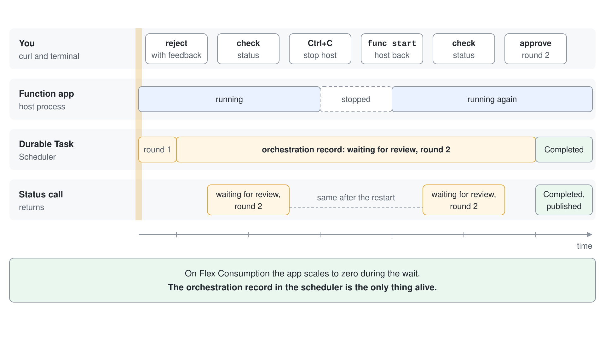

# Durable Agents: Functions & Task Scheduler

A normal agent process holds everything in memory. Restart it, scale it in, or ask it to wait three days for a human and the conversation, the half-finished workflow and the model call you already paid for are gone. Durable agents move that state out of the process and into a store, so the host can stop, move or be deleted while the work stays alive.



This topic hosts an Agent Framework agent in Azure Functions with the Durable extension, backs it with the Durable Task Scheduler, and builds a release announcement workflow that pauses for a reviewer without holding a single process open.

## What a durable agent is

A durable agent is an ordinary Agent Framework agent wrapped so that each conversation lives in a durable entity and each multi-step workflow lives in a durable orchestration. The Durable extension generates the HTTP endpoints, persists every message, and replays an orchestration from its history after a restart.

The agent code stays the same. Only the hosting line changes:

```python
from agent_framework.azure import AgentFunctionApp

app = AgentFunctionApp(agents=[writer])
```

```csharp
using IHost app = FunctionsApplication
    .CreateBuilder(args)
    .ConfigureFunctionsWebApplication()
    .ConfigureDurableAgents(options => options.AddAIAgent(writer))
    .Build();
```

Both lines register the agent and expose `POST /api/agents/<name>/run`. Pass the `x-ms-session-id` header value back as `session_id` to continue the same conversation, even after the host restarted.

## Two building blocks: entities and orchestrations

Each agent session is a durable entity named `dafx-<agent name>`. The entity receives the message, calls the model, appends both sides to its stored history and replies.

An orchestration is a function whose progress is checkpointed. It calls agents, activities and timers in order, and every `yield` or `await` is a checkpoint the framework can replay from.

| Building block | Role | Where it shows up |
|---|---|---|
| Entity (`dafx-<agent>`) | Holds one conversation and its history | Created per session id |
| Orchestration | Sequences agent calls, activities, timers and external events | `@app.orchestration_trigger` / `[OrchestrationTrigger]` |
| Activity | Does side effects such as notifying a reviewer or publishing | `@app.activity_trigger` / `[ActivityTrigger]` |
| Durable Task Scheduler | Stores state and dispatches work to the app | `DURABLE_TASK_SCHEDULER_CONNECTION_STRING` |

An orchestration must be deterministic: no random numbers, no `datetime.now()`, no direct network calls. Everything non-deterministic goes through an agent call or an activity, which the framework records once and replays from history.

## Calling an agent from an orchestration

Inside an orchestration you ask the extension for a handle to the registered agent and call it like any other agent. The call is routed to the entity, and the orchestration is suspended until the answer arrives.

```python
@app.orchestration_trigger(context_name="context")
def announcement_approval(context: DurableOrchestrationContext):
    agent = app.get_agent(context, "AnnouncementWriter")
    session = agent.create_session()

    draft = yield agent.run(
        messages="Write a release announcement about Contoso Portal 2.4.",
        session=session,
        options={"response_format": Announcement},
    )
    announcement = draft.value
```

```csharp
[Function(nameof(RunAnnouncementApproval))]
public static async Task<Announcement> RunAnnouncementApproval([OrchestrationTrigger] TaskOrchestrationContext context)
{
    DurableAIAgent writer = context.GetAgent("AnnouncementWriter");
    AgentSession session = await writer.CreateSessionAsync();

    var draft = await writer.RunAsync<Announcement>("Write a release announcement about Contoso Portal 2.4.", session);
    var announcement = draft.Result;
}
```

Reusing the same session for the rewrite is what lets the agent remember its first draft when a reviewer asks for changes.

## Waiting for a human without paying for it

A human approval step is a durable external event raced against a timer. While the orchestration waits, no code runs and nothing holds the model open.


```python
approval = context.wait_for_external_event("ApprovalDecision")
timeout = context.create_timer(context.current_utc_datetime + timedelta(hours=72))
winner = yield context.task_any([approval, timeout])
```

```csharp
var decision = await context.WaitForExternalEvent<Decision>("ApprovalDecision", TimeSpan.FromHours(72));
```

The reviewer answers with a plain HTTP call that raises the event on the instance:

```python
await client.raise_event(instance_id, "ApprovalDecision", {"approved": True})
```

```csharp
await client.RaiseEventAsync(instanceId, "ApprovalDecision", decision);
```

On the Flex Consumption plan the function app scales to zero during the wait, so a 24 hour approval costs seconds of execution time, not 24 hours.

## Why the Durable Task Scheduler

The Durable Task Scheduler is a managed backend that stores orchestration and entity state and dispatches work to your app. It is the recommended backend for durable agents and gives a dashboard with conversation history and orchestration timelines. It authenticates with managed identity only, so the app identity needs the Durable Task Data Contributor role on the scheduler.

The `host.json` binds the app to it:

```json
{
  "extensions": {
    "durableTask": {
      "hubName": "%TASKHUB_NAME%",
      "storageProvider": {
        "type": "azureManaged",
        "connectionStringName": "DURABLE_TASK_SCHEDULER_CONNECTION_STRING"
      }
    }
  }
}
```

Locally the same setting points at the emulator with `Endpoint=http://localhost:8080;TaskHub=default;Authentication=None`. In Azure it points at the scheduler with `Authentication=ManagedIdentity`.

## Packages and status

The Durable extension for Agent Framework is in preview in both languages.

| Language | Hosting model | Packages |
|---|---|---|
| Python | Azure Functions | `agent-framework-azurefunctions` (prerelease) |
| Python | Bring your own compute | `agent-framework-durabletask` (prerelease) |
| C# | Azure Functions | `Microsoft.Agents.AI.Hosting.AzureFunctions` (preview) |
| C# | Bring your own compute | `Microsoft.Agents.AI.DurableTask` (preview) |

Bring your own compute runs the same agents in a container, Kubernetes pod or console app against the same scheduler, using `ConfigureDurableAgents` on a generic host or a `DurableTaskSchedulerWorker` in Python. This topic uses Azure Functions.

## Hands-On Demo

[Run an Approval Workflow That Survives a Restart](demo-durable-agents.md) hosts a writer agent in Azure Functions, adds a reviewer approval loop, restarts the host in the middle of the wait, and deploys the same app to Flex Consumption with a Durable Task Scheduler. Python and C# versions are included.

## Key Topics

- [Durable extension for Microsoft Agent Framework](https://learn.microsoft.com/en-us/agent-framework/hosting/durable-extension)
- [Durable Task Scheduler](https://learn.microsoft.com/azure/durable-task/scheduler/durable-task-scheduler)
- [Develop with Durable Task Scheduler and the emulator](https://learn.microsoft.com/azure/durable-task/scheduler/develop-with-durable-task-scheduler)
- [Durable Task Scheduler billing](https://learn.microsoft.com/azure/durable-task/scheduler/durable-task-scheduler-billing)
- [Azure Functions Flex Consumption plan](https://learn.microsoft.com/azure/azure-functions/flex-consumption-plan)
