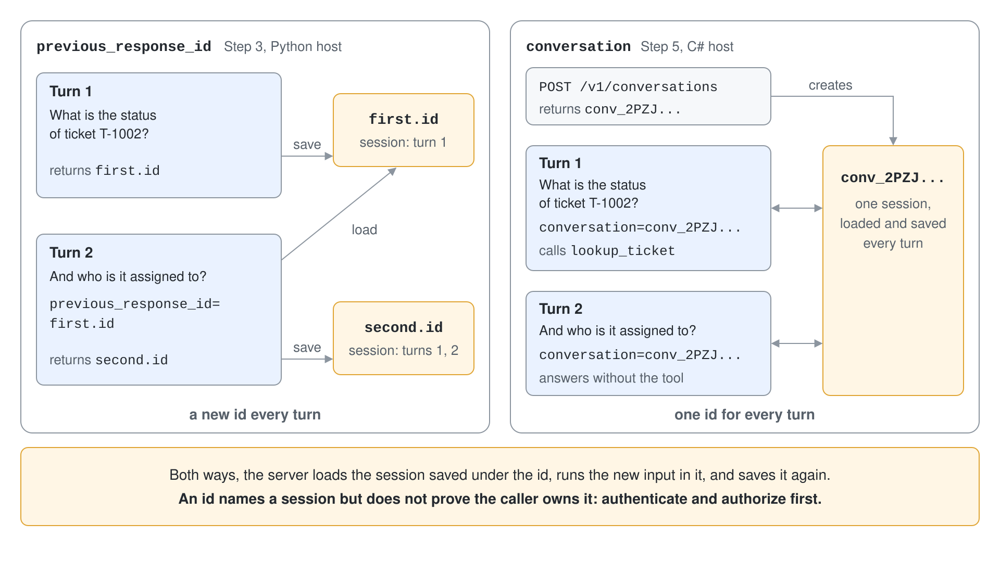

# Self-Hosting: ASP.NET Core & Responses

Foundry hosted agents run your code on managed compute. Sometimes the agent has to live inside an application you already operate: behind your gateway, in your container platform, under your own identity and storage rules. Self-hosting is that option: the agent is a library inside your web server, and the server decides routing, authentication, request policy, storage and scaling.

## What the framework gives you and what it leaves to you

Agent Framework hosting packages do not ship a server. They give you helpers that turn a protocol request into an agent run and the run result back into a protocol response. Everything around that is yours: middleware, authentication, authorization, which request options to honor, and where sessions are stored.

The framework hosts three protocols from the same agent: OpenAI-compatible endpoints (Chat Completions and Responses), A2A and AG-UI. This topic uses the Responses protocol, because any OpenAI SDK can call it. The A2A variant is the next topic.

## Package status

The hosting packages are prerelease on both languages. In .NET, `Microsoft.Agents.AI.Hosting` and `Microsoft.Agents.AI.Hosting.OpenAI` ship as prerelease versions. In Python, `agent-framework-hosting` and `agent-framework-hosting-responses` are alpha packages that you install with `--pre`. Pin exact versions and read release notes before an upgrade.

```bash
pip install --pre agent-framework-hosting agent-framework-hosting-responses
```

```bash
dotnet add package Microsoft.Agents.AI.Hosting.OpenAI --prerelease
```

## ASP.NET Core: register, then map

In .NET the generic host does the wiring. `AddAIAgent` registers a named agent in dependency injection, and `MapOpenAIResponses` maps it to a route. The agent needs an `IChatClient` in the service container; here it comes from the Foundry project.

```csharp
IChatClient chatClient = new AIProjectClient(new Uri(endpoint), new DefaultAzureCredential())
    .GetProjectOpenAIClient()
    .GetProjectResponsesClient()
    .AsIChatClient(deployment);
builder.Services.AddSingleton(chatClient);

builder.AddOpenAIResponses();
builder.AddOpenAIConversations();

var supportDesk = builder.AddAIAgent(
    "support-desk",
    (services, name) => services.GetRequiredService<IChatClient>().AsAIAgent(
        instructions: "You are the Contoso support desk agent.",
        name: name,
        tools: [lookupTicket]));

var app = builder.Build();
app.MapOpenAIResponses(supportDesk);
app.MapOpenAIConversations();
```

The agent is served at `/support-desk/v1/responses`, and the Conversations API at `/v1/conversations`. Pass `responsesPath:` to `MapOpenAIResponses` for a custom route. Registering several agents gives each its own path.

## Python: you write the route

In Python the helpers are functions and you write the route in the web framework you like. `responses_to_run` converts the request body into messages and options, `responses_from_run` converts the result into a Responses payload, and `AgentState` resolves the agent and its sessions.

```python
@app.post("/responses", response_model=None)
async def responses(body: dict[str, Any] = Body(...)) -> JSONResponse:
    run = responses_to_run(body)
    session_id, is_conversation_id = responses_session_id(body)
    response_id = create_response_id()
    options = {key: value for key, value in run["options"].items() if key in ALLOWED_REQUEST_OPTIONS}

    target = await state.get_target()
    session = await state.get_or_create_session(session_id or response_id)
    result = await target.run(run["messages"], session=session, options=options)
    await state.set_session(response_id, session)

    return JSONResponse(responses_from_run(result, response_id=response_id))
```

The allowlist is the point of owning the route. A caller can send `tools`, `temperature` or a different model in the body; only the options your code lists reach the agent run.


## Sessions and continuation

The Responses protocol continues a chat in one of two ways: `previous_response_id` points at the last response, or `conversation` names a stable `conv_` id. They are mutually exclusive. The server looks up the saved session by that id, runs the new input in it, and saves the session again.



```json
{ "model": "support-desk", "input": "And who is it assigned to?", "previous_response_id": "resp_..." }
```

Python keeps sessions in a process-local `SessionStore` without eviction by default, and the framework includes no durable store in either language. For production, subclass `SessionStore` (Python) or implement `AgentSessionStore` (.NET) on top of Redis, a database or blob storage. A history provider can store messages separately from the session object, which is cheaper than rewriting a growing session each turn.

## Securing the endpoint

A response id or conversation id identifies a session; it does not prove the caller owns it. Authenticate the caller, authorize access to the referenced state, and partition stored sessions by tenant or user before you trust either id. In .NET, `UseClaimsBasedAgentIsolation` scopes the session store by a claim of the signed-in user; in Python you pass your own authorized key to `AgentState`.

## Self-hosting compared with Foundry hosting

| Question | Self-hosted | Foundry hosted agent |
| --- | --- | --- |
| Compute and scaling | Yours | Foundry managed |
| Identity | Yours | Platform-assigned agent identity |
| Endpoint | Routes you map | Endpoint served by Foundry |

## Hands-On Demo

[Host an Agent Behind a Responses Endpoint](demo-self-hosting.md) serves a support-desk agent from FastAPI in Python and from ASP.NET Core in C#, calls it with the OpenAI SDK, and continues a conversation across turns.

## Key Topics

- [Self-host Agent Framework applications](https://learn.microsoft.com/en-us/agent-framework/hosting/self-hosting/)
- [Self-host OpenAI Responses endpoints](https://learn.microsoft.com/en-us/agent-framework/hosting/self-hosting/responses)
- [OpenAI-compatible endpoints](https://learn.microsoft.com/en-us/agent-framework/hosting/self-hosting/openai-endpoints)
- [Host agents with A2A](https://learn.microsoft.com/en-us/agent-framework/hosting/self-hosting/a2a/server)
