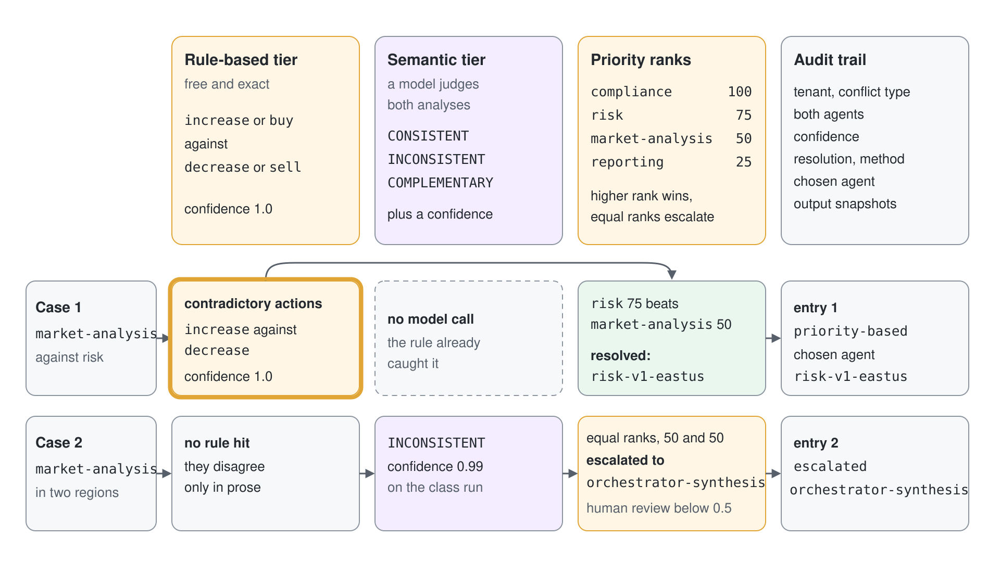

# Build an Enterprise A2A Network

Two agents answer the same question and give opposite advice, a third agent overwrites the result of a fourth, and a client sees a task that belongs to another client. These are the failures of an agent network that only knows how to send one message at a time. You run the four mechanisms that prevent them: a discovery registry, a shared state store with etag concurrency, tenant isolation and a conflict resolver with an audit trail.

What you practice here: guarding every shared resource of an agent network with a rule the code enforces, not a convention the agents follow.

Duration: about 40 minutes.

## Prerequisites

- Python 3.12 or later and the .NET 10 SDK.
- `az login` as a user with access to the Foundry project, and a chat model deployment (`gpt-5.4` in the class project).
- Concepts: [Enterprise A2A: Discovery, Shared State & Conflicts](readme.md).

## Run it

Work in `enterprise-a2a-py/` for Python or `enterprise-a2a-cs/` for C#. Both print the same four sections; only the semantic conflict check calls the model.

```bash
cd enterprise-a2a-py
python -m venv .venv
.venv/Scripts/python -m pip install -r requirements.txt
cp .env.example .env
.venv/Scripts/python a2a_demo.py
```

Set `PROJECT_ENDPOINT` and `MODEL_DEPLOYMENT_NAME` in `.env` first. On Linux and macOS the interpreter is `.venv/bin/python`.

The C# project reads its two settings from environment variables.

```bash
cd enterprise-a2a-cs
export PROJECT_ENDPOINT="https://<resource>.services.ai.azure.com/api/projects/<project>"
export MODEL_DEPLOYMENT_NAME="gpt-5.4"
dotnet run
```

```powershell
cd enterprise-a2a-cs
$env:PROJECT_ENDPOINT = "https://<resource>.services.ai.azure.com/api/projects/<project>"
$env:MODEL_DEPLOYMENT_NAME = "gpt-5.4"
dotnet run
```

## Step 1: Register agents and route by capability

The registry is built from agent cards, so a new agent joins the network by publishing a card and nothing else. Routing then only considers agents that are healthy, have a recent heartbeat and have not expired.



The Python demo builds three cards in the A2A v1 shape and registers them directly.

```python
registry = AgentRegistry()
registry.register(agent_card("market-analysis-v2-eastus", "https://market-eus.contoso.com", ["sector-analysis", "trend-forecasting"]))
registry.register(agent_card("market-analysis-v2-westeurope", "https://market-weu.contoso.com", ["sector-analysis"]))
registry.register(agent_card("risk-v1-eastus", "https://risk-eus.contoso.com", ["portfolio-risk"]))
```

The C# demo goes through the wire. It starts three small hosts, each serving one card with `MapWellKnownAgentCard`, then discovers them with `A2ACardResolver`. A host can advertise only one card at the well-known path, which is why there are three hosts.

```csharp
host.MapWellKnownAgentCard(card);
await host.StartAsync();
AgentCard discovered = await new A2ACardResolver(new Uri($"http://127.0.0.1:{port}")).GetAgentCardAsync();
registry.Register(discovered);
```

Then both versions drive the registry through the same four situations: two candidates, round robin routing, a draining agent, and a heartbeat that goes stale.

```python
registry.heartbeat("market-analysis-v2-westeurope", "draining")
registry.items["market-analysis-v2-eastus"]["lastHeartbeat"] -= 600
```

Expected output (Python):

```text
Discovery registry and capability routing
sector-analysis candidates: ['market-analysis-v2-eastus', 'market-analysis-v2-westeurope']
round robin: ['market-analysis-v2-eastus', 'market-analysis-v2-westeurope', 'market-analysis-v2-eastus', 'market-analysis-v2-westeurope']
after draining westeurope: ['market-analysis-v2-eastus']
after eastus heartbeat goes stale: []
```

The C# output has the same four lines after one extra line, which proves the cards came over HTTP.

```text
Discovery registry and capability routing
cards discovered over /.well-known/agent-card.json: 3
sector-analysis candidates: [market-analysis-v2-eastus, market-analysis-v2-westeurope]
```

## Step 2: Write shared state with an etag guard

Four agents add their findings to one document at the same moment. Each write must carry the etag it read, and a write against a changed document fails and retries instead of overwriting.



```python
document = self.read(tenant_id, task_id, use_cache=False)
document["contributions"][agent_id] = {"data": contribution, "version": len(document["contributions"]) + 1}
self.replace(tenant_id, task_id, document, document["_etag"])
```

```csharp
JsonObject document = Read(tenantId, taskId, useCache: false);
Replace(tenantId, taskId, document, (string)document["_etag"]!);
```

The demo then replays the failure on purpose: it keeps a copy of the document, lets another agent write, and tries to save the old copy.

```python
stale = store.read("acme-retirement", "tech-analysis", use_cache=False)
store.contribute("acme-retirement", "tech-analysis", "esg-v1", {"note": "newer write"})
accepted = store.replace_if_unmodified("acme-retirement", "tech-analysis", stale, stale["_etag"])
```

Expected output (Python):

```text
Shared state with ETag concurrency and cache invalidation
two cached reads cost 1 store read(s)
write with a stale etag accepted: False
attempts per agent: [1, 1, 1, 1], contributions kept: ['compliance-v1', 'market-analysis-v2', 'reporting-v1', 'risk-v1']
invalidation messages published: 5
```

Expected output (C#):

```text
Shared state with ETag concurrency and cache invalidation
two cached reads cost 1 store read(s)
write with a stale etag accepted: False
attempts per agent: [1, 3, 1, 2], contributions kept: [compliance-v1, market-analysis-v2, reporting-v1, risk-v1]
invalidation messages published: 5
```

Four contributions survive in both. The C# agents run on real parallel tasks, so some of them collide and need two or three attempts; the exact numbers change on every run. The Python agents often finish without colliding, so `[1, 1, 1, 1]` is a normal result there.

## Step 3: Keep tenants apart

The same task name exists for two clients. The tenant id is part of the document key and the cache key, and it comes from a request-scoped context, so a read can only ever touch the caller's own document.

```python
store.create("other-client", "tech-analysis")
store.contribute("other-client", "tech-analysis", "market-analysis-v2", {"note": "other client view"})
tenant_context.set({"clientId": "acme-retirement"})
own = store.read(tenant_context.get()["clientId"], "tech-analysis")
```

Expected output (Python):

```text
Tenant isolation
acme sees agents: ['compliance-v1', 'esg-v1', 'market-analysis-v2', 'reporting-v1', 'risk-v1']
acme task list: ['tech-analysis']
other-client task list: ['tech-analysis']
cache keys carry the tenant: [('acme-retirement', 'tech-analysis')]
```

Verify the isolation: the other client wrote one contribution, and none of it appears in what acme sees. Both clients own a task called `tech-analysis`, yet each reads only its own.

## Step 4: Detect a conflict in two tiers

The first pair of outputs disagrees in a structured field, so the cheap rule catches it without a model call. The second pair disagrees only in prose, so the model judge decides.



```python
def rule_based_conflict(output_a: dict, output_b: dict) -> dict | None:
    action_a = output_a.get("recommendation", {}).get("action")
    action_b = output_b.get("recommendation", {}).get("action")
    up = {"increase", "buy"}
    down = {"decrease", "sell"}
    if (action_a in up and action_b in down) or (action_a in down and action_b in up):
        return {"reason": "contradictory-actions", "actionA": action_a, "actionB": action_b}
    return None
```

```csharp
ChatResponse response = await chat.GetResponseAsync(
    [
        new ChatMessage(ChatRole.System, JudgeInstructions),
        new ChatMessage(ChatRole.User, $"Agent A:\n{a.ToJsonString()}\n\nAgent B:\n{b.ToJsonString()}"),
    ]);
```

Expected output (Python and C# alike):

```text
Conflict detection, resolution and audit trail
rule-based: conflict=True type=rule-based resolution=priority-based chosen=risk-v1-eastus
semantic: conflict=True type=semantic confidence=0.99 resolution=escalated
```

The rule-based line is deterministic. The semantic line comes from a model, so the confidence and even the verdict can differ on your run; a verdict of `COMPLEMENTARY` would print `conflict=False`.

## Step 5: Resolve by priority and write the audit entry

A rank decides between agents of different weight, and the risk agent outranks market analysis, so its recommendation is chosen. The two market analysis agents have equal rank, so the conflict is escalated to a synthesis step instead of picking one at random.

```python
priority_a = AGENT_PRIORITY.get(agent_type(report["agentA"]), 0)
priority_b = AGENT_PRIORITY.get(agent_type(report["agentB"]), 0)
if priority_a == priority_b:
    return {"resolution": "escalated", "method": "orchestrator-synthesis", "requiresHumanReview": report["confidence"] < 0.5}
```

Each decision is appended to the audit trail, and the first entry is printed.

Expected output (Python):

```text
audit entries: 2
{
  "timestamp": "2026-10-18T06:57:53.792790+00:00",
  "tenantId": "acme-retirement",
  "conflictType": "rule-based",
  "agents": [
    "market-analysis-v2-eastus",
    "risk-v1-eastus"
  ],
  "confidence": 1.0,
  "resolution": "resolved",
  "method": "priority-based",
  "chosenAgent": "risk-v1-eastus"
}
```

The C# entry has the same fields with PascalCase names (`Timestamp`, `TenantId`, `ConflictType`).

## Verify

The run is correct when all of these hold:

- Step 1 prints no candidates after the East US heartbeat goes stale.
- Step 2 reports `write with a stale etag accepted: False` and four contributions kept.
- Step 3 shows no `other-client` data in the acme view.
- Step 4 ends with `audit entries: 2`, and the first entry names `risk-v1-eastus` as the chosen agent.

## Cleanup

The demo creates no Azure resources; the in-memory stores and the three C# card hosts end with the process.

```bash
cd enterprise-a2a-py
rm -rf .venv
```
