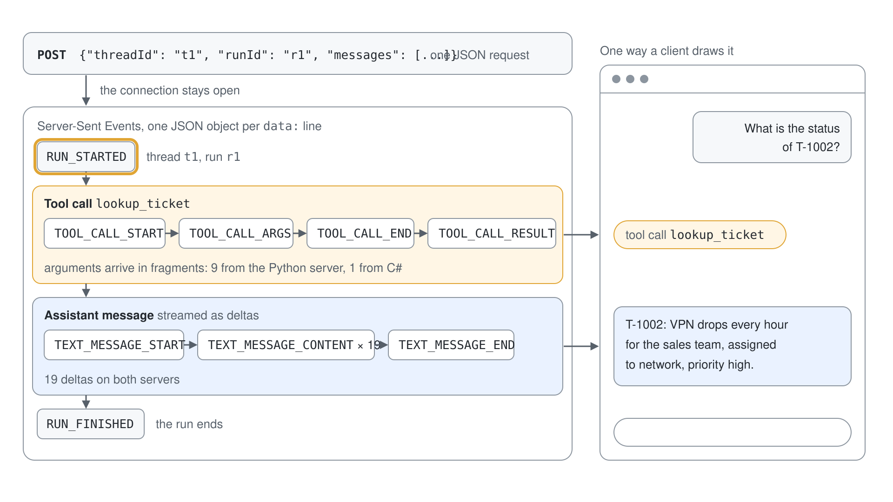
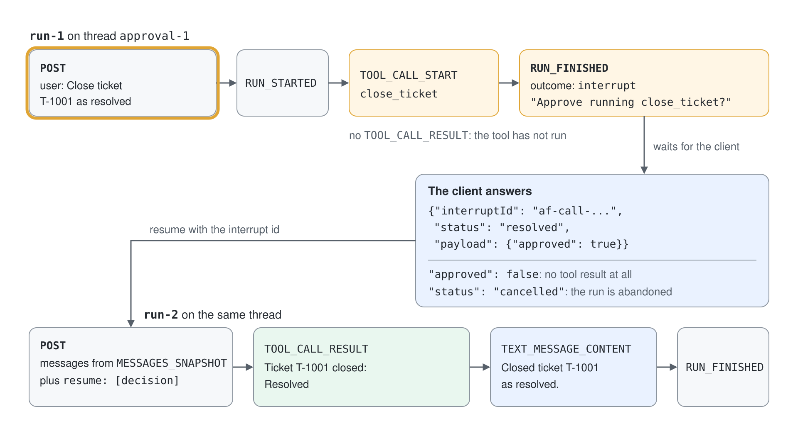
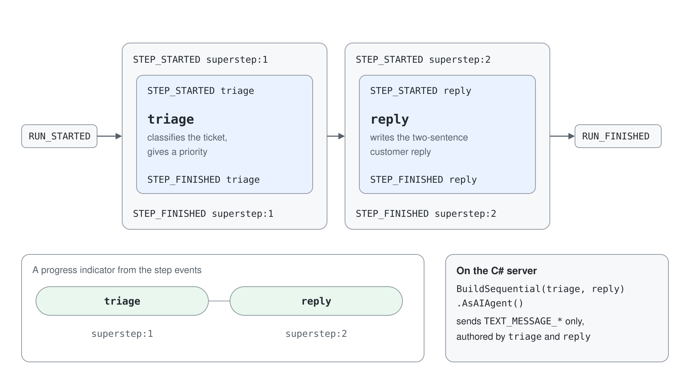

# Stream an Agent to a Web Front End

A support agent that lives in a script can only be used by the person who runs the script. You publish it as an AG-UI endpoint, watch every event it streams, make it stop for an approval before it closes a ticket, expose a two-step workflow, and connect a CopilotKit runtime that a browser can talk to.

What you practice here: reading the event stream of an agent endpoint to see exactly what a front end receives.

Duration: about 40 minutes.

## Prerequisites

- Python 3.12 or later, the .NET 10 SDK and a current Node.js LTS.
- `az login` as a user with access to the Foundry project, and a chat model deployment (`gpt-5.4` in the class project).
- Concepts: [AG-UI & CopilotKit: Web Front Ends](readme.md).

## Run it

Work in `ag-ui-py/` for the Python server and `ag-ui-cs/` for the C# server. The two listen on the same port, so run one at a time.

```bash
cd ag-ui-py
python -m venv .venv
.venv/Scripts/python -m pip install -r requirements.txt
cp .env.example .env
.venv/Scripts/python server.py
```

Set `PROJECT_ENDPOINT` and `MODEL_DEPLOYMENT_NAME` in `.env` first. The server listens on `http://127.0.0.1:8888`; keep it running and use a second terminal for the clients. On Linux and macOS the interpreter is `.venv/bin/python`.

The C# server reads the same two settings from environment variables.

```bash
cd ag-ui-cs
export PROJECT_ENDPOINT="https://<resource>.services.ai.azure.com/api/projects/<project>"
export MODEL_DEPLOYMENT_NAME="gpt-5.4"
dotnet run --urls http://127.0.0.1:8888
```

```powershell
cd ag-ui-cs
$env:PROJECT_ENDPOINT = "https://<resource>.services.ai.azure.com/api/projects/<project>"
$env:MODEL_DEPLOYMENT_NAME = "gpt-5.4"
dotnet run --urls http://127.0.0.1:8888
```

## Step 1: Publish the agent as an AG-UI endpoint

The agent is an ordinary Agent Framework agent with two tools: one reads a ticket, one closes it. One call turns it into an HTTP endpoint that streams AG-UI events.

```python
desk_agent = Agent(
    client=create_client(),
    name="support-desk",
    instructions="You are the Contoso support desk agent. Use lookup_ticket to read tickets and close_ticket to close them.",
    tools=[lookup_ticket, close_ticket],
)

add_agent_framework_fastapi_endpoint(app, desk_agent, "/")
```

The C# server does the same with `MapAGUIServer`, and wraps the closing tool so it needs approval.

```csharp
AIAgent deskAgent = chatClient.AsAIAgent(
    instructions: "You are the Contoso support desk agent. Use lookup_ticket to read tickets and close_ticket to close them.",
    name: "support-desk-cs",
    tools: [lookupTicket, new ApprovalRequiredAIFunction(closeTicket)]);

app.MapAGUIServer("/", deskAgent);
```

A remote client talks to it like to any agent. `client.py` wraps the endpoint in `AGUIChatClient` and asks two questions on one session.

```python
agent = Agent(name="remote-desk", client=AGUIChatClient(endpoint="http://127.0.0.1:8888/"))
session = agent.create_session()
```

```bash
.venv/Scripts/python client.py
```

Expected output:

```text
user: What is the status of T-1002?
agent: T-1002: VPN drops every hour for the sales team, assigned to network, priority high.
user: Which team owns it?
agent: The network team owns it.
```

The second question only makes sense with the first answer, which the session carries. Run `client.py` against the Python server: against the C# server the second turn came back empty in testing, so use Step 2 to check the C# endpoint.

## Step 2: Read the raw event stream

A browser sees the same stream that `events.py` prints. It posts one request and groups the `data:` lines by event type.



```python
body = {"threadId": "t1", "runId": "r1", "messages": [{"id": "1", "role": "user", "content": sys.argv[2]}]}
```

```bash
.venv/Scripts/python events.py chat "What is the status of T-1002?"
```

Expected output (Python server):

```text
RUN_STARTED 
TOOL_CALL_START lookup_ticket
RUN_FINISHED 
outcome: None
text: T-1002: VPN drops every hour for the sales team, assigned to network, priority high.
{'RUN_STARTED': 1, 'TEXT_MESSAGE_START': 2, 'TOOL_CALL_START': 1, 'TOOL_CALL_ARGS': 9, 'CUSTOM': 2, 'TOOL_CALL_END': 1, 'TOOL_CALL_RESULT': 1, 'TEXT_MESSAGE_END': 2, 'TEXT_MESSAGE_CONTENT': 19, 'MESSAGES_SNAPSHOT': 1, 'RUN_FINISHED': 1}
```

The tool call is one `TOOL_CALL_START`, nine `TOOL_CALL_ARGS` fragments of the JSON arguments and one `TOOL_CALL_RESULT`; the answer is nineteen `TEXT_MESSAGE_CONTENT` deltas. Stop the Python server, start the C# one, and run the same command.

Expected output (C# server):

```text
RUN_STARTED 
TOOL_CALL_START lookup_ticket
RUN_FINISHED 
outcome: {'type': 'success', 'pendingToolCallIds': None}
text: T-1002: VPN drops every hour for the sales team, assigned to network, priority high.
{'RUN_STARTED': 1, 'TOOL_CALL_START': 1, 'TOOL_CALL_ARGS': 1, 'TOOL_CALL_END': 1, 'TOOL_CALL_RESULT': 1, 'TEXT_MESSAGE_START': 1, 'TEXT_MESSAGE_CONTENT': 19, 'TEXT_MESSAGE_END': 1, 'RUN_FINISHED': 1}
```

Both servers answer the same question with the same vocabulary. The Python server also sends `CUSTOM` and `MESSAGES_SNAPSHOT` events and splits the arguments into fragments; a client must not depend on those counts.

## Step 3: Pause for an approval and resume

`close_ticket` is marked as needing approval, so the run does not close anything. It finishes with an interrupt that carries the tool call, and nothing happens until the client answers.



```bash
.venv/Scripts/python events.py chat "Close ticket T-1001 as resolved"
```

Expected output (Python server, trimmed):

```text
RUN_STARTED 
TOOL_CALL_START close_ticket
TOOL_CALL_START confirm_changes
RUN_FINISHED 
outcome: {'type': 'interrupt', 'interrupts': [{'id': 'af-call-d8c355ef...', 'reason': 'tool_call', 'message': 'Approve running close_ticket?', ...}]}
text: 
```

The tool never ran: there is no `TOOL_CALL_RESULT`. `approve.py` reads the interrupt id, sends the decision back in a `resume` entry together with the transcript from `MESSAGES_SNAPSHOT`, and prints what happens next.

```python
decision = {"interruptId": interrupt["id"], "status": "resolved", "payload": {"approved": sys.argv[2] == "approve"}}
second = run({"threadId": "approval-1", "runId": "run-2", "messages": snapshot, "resume": [decision]})
```

```bash
.venv/Scripts/python approve.py "Close ticket T-1001 as resolved" approve
.venv/Scripts/python approve.py "Close ticket T-1002 as resolved" reject
```

Expected output:

```text
paused: Approve running close_ticket?
tool result: Ticket T-1001 closed: Resolved
agent: Closed ticket T-1001 as resolved.
paused: Approve running close_ticket?
agent: I couldn’t close T-1002 because the close action was rejected.
```

On approval the tool result appears and the agent reports it. On rejection there is no tool result at all. The wording of the agent's sentence changes on every run.

The C# server pauses the same way: `events.py chat "Close ticket T-1001 as resolved"` ends with `outcome: {'type': 'interrupt', ...}` and `message: 'Approval required for tool call: close_ticket'`. Resuming it needs the .NET `AGUIChatClient` or CopilotKit; `approve.py` does not, because the C# server sends no `MESSAGES_SNAPSHOT`.

## Step 4: Expose a workflow and watch its steps

A workflow of two executors, triage and reply, is registered on a second path. The client now receives step events, which is what a progress indicator needs.



```python
add_agent_framework_fastapi_endpoint(
    app,
    AgentFrameworkWorkflow(workflow_factory=lambda thread_id: build_workflow(), name="ticket-workflow"),
    "/workflow",
)
```

```bash
.venv/Scripts/python events.py workflow "VPN drops every hour for the sales team"
```

Expected output (Python server):

```text
RUN_STARTED 
STEP_STARTED superstep:1
STEP_STARTED triage
STEP_FINISHED triage
STEP_FINISHED superstep:1
STEP_STARTED superstep:2
STEP_STARTED reply
STEP_FINISHED reply
STEP_FINISHED superstep:2
RUN_FINISHED 
outcome: None
text: Hi, Network Team is actively working on your request and it has been assigned a High priority. We’ll keep you updated on progress and let you know as soon as there’s an update.
{'RUN_STARTED': 1, 'CUSTOM': 1, 'STEP_STARTED': 4, 'ACTIVITY_SNAPSHOT': 4, 'STEP_FINISHED': 4, 'TEXT_MESSAGE_START': 1, 'TEXT_MESSAGE_CONTENT': 1, 'TEXT_MESSAGE_END': 1, 'RUN_FINISHED': 1}
```

The C# server registers the same pipeline as `AgentWorkflowBuilder.BuildSequential(triage, reply).AsAIAgent()` on `/workflow`. It has no equivalent of this step's output: the run contains `TEXT_MESSAGE_*` events only, with `triage` and `reply` as the author of each message, and no `STEP_*` events.

```csharp
AIAgent workflowAgent = AgentWorkflowBuilder.BuildSequential(triage, reply).AsAIAgent();
app.MapAGUIServer("/workflow", workflowAgent);
```

```bash
.venv/Scripts/python events.py workflow "VPN drops every hour for the sales team"
```

Expected output (C# server):

```text
RUN_STARTED 
RUN_FINISHED 
outcome: {'type': 'success', 'pendingToolCallIds': None}
text: network - highThe Network team is assigned to investigate the VPN drops affecting the sales team. Priority is set to High, and we’ll work to resolve this as quickly as possible.
{'RUN_STARTED': 1, 'TEXT_MESSAGE_START': 2, 'TEXT_MESSAGE_CONTENT': 27, 'TEXT_MESSAGE_END': 2, 'RUN_FINISHED': 1}
```

## Step 5: Connect a CopilotKit runtime

The browser never talks to the AG-UI endpoint directly. A Next.js route hosts the CopilotKit runtime and forwards to your endpoint through an `HttpAgent`, and the page names the agent by the key it was registered under.

```ts
const runtime = new CopilotRuntime({
  agents: {
    support_desk: new HttpAgent({ url: process.env.AGENT_URL! }),
  },
});
```

```tsx
<CopilotSidebar agentId="support_desk" defaultOpen />
```

Start the Python server from Step 1, then in a second terminal start the front end.

```bash
cd ag-ui-web
cp .env.example .env.local
npm install
npm run dev
```

`AGENT_URL` in `.env.local` defaults to `http://127.0.0.1:8888/`. Open `http://localhost:3000` for the page with the CopilotKit sidebar. To check the runtime without a browser, post the same request a browser would send.

```bash
curl -N -X POST http://localhost:3000/api/copilotkit/agent/support_desk/run -H "Content-Type: application/json" -H "Accept: text/event-stream" -d '{"threadId":"w1","runId":"r1","messages":[{"id":"1","role":"user","content":"What is the status of T-1002?"}],"state":{},"tools":[],"context":[],"forwardedProps":{}}'
```

Expected output (first lines, trimmed):

```text
data: {"type":"RUN_STARTED","threadId":"w1","runId":"r1","input":{...}}
data: {"type":"TEXT_MESSAGE_START","messageId":"37716a0c-...","role":"assistant"}
data: {"type":"TOOL_CALL_START","toolCallId":"call_KOMDJoYj...","toolCallName":"lookup_ticket","parentMessageId":"37716a0c-..."}
data: {"type":"TOOL_CALL_ARGS","toolCallId":"call_KOMDJoYj...","delta":"{\""}
```

The runtime has forwarded the request to the Python endpoint and relayed its events unchanged. Stop the Python server, start the C# one on the same port, and repeat the `curl`: the front end works against both without a code change.

## Verify

- Step 1 prints two answers; the second needs no new lookup.
- Step 3 shows no `TOOL_CALL_RESULT` before the decision and a result after `approve`.
- Step 4 prints `STEP_STARTED triage` and `STEP_STARTED reply` on the Python server and no `STEP_*` line on the C# server.
- Step 5 returns `data:` lines from `localhost:3000` while the agent server is running, and the Next.js log shows `POST /api/copilotkit/agent/support_desk/run 200`.

## Cleanup

The demo creates no Azure resources. Stop the servers with `Ctrl+C` in each terminal, then remove the local environments.

```bash
cd ag-ui-py
rm -rf .venv
cd ../ag-ui-web
rm -rf node_modules .next
```
