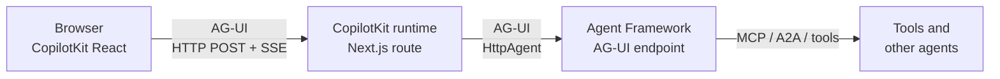

# AG-UI & CopilotKit: Web Front Ends

An agent that only answers in a terminal is a prototype. A support desk needs a browser window where the answer streams in as it is written, where a tool call shows up as it happens, and where the agent stops and asks before it closes a ticket.

AG-UI is the protocol for that conversation between an agent and a user interface. Agent Framework turns any agent or workflow into an AG-UI endpoint, and CopilotKit supplies the React components on the other side.

## Where AG-UI sits

Three protocols meet in an agent system, and they do not compete. MCP connects an agent to tools, A2A connects an agent to another agent, and AG-UI connects an agent to a person at a screen.



A client posts one JSON request and keeps the connection open. The server answers with Server-Sent Events, one JSON object per `data:` line, until the run ends. The thread id in the request is what ties several runs into one conversation.

## The event stream

Every run is a sequence of typed events between `RUN_STARTED` and `RUN_FINISHED`. The client decides how to draw each type; the protocol only fixes the vocabulary.

| Event | Meaning |
|-------|---------|
| `RUN_STARTED`, `RUN_FINISHED`, `RUN_ERROR` | Lifecycle of one run |
| `TEXT_MESSAGE_START`, `TEXT_MESSAGE_CONTENT`, `TEXT_MESSAGE_END` | One assistant message, streamed as deltas |
| `TOOL_CALL_START`, `TOOL_CALL_ARGS`, `TOOL_CALL_END`, `TOOL_CALL_RESULT` | A tool the agent called, its arguments and its result |
| `STEP_STARTED`, `STEP_FINISHED` | A workflow step beginning or ending |
| `MESSAGES_SNAPSHOT`, `STATE_SNAPSHOT`, `STATE_DELTA` | Full transcript and shared state |
| `CUSTOM` | Anything the protocol does not name |

A text delta, as it arrives on the wire:

```text
data: {"type":"TEXT_MESSAGE_CONTENT","messageId":"37716a0c","delta":"T-1002"}
```

## Serving an agent

The Python package `agent-framework-ag-ui` registers an agent on a FastAPI app. The path decides the URL clients call.

```python
from agent_framework.ag_ui import add_agent_framework_fastapi_endpoint
from fastapi import FastAPI

app = FastAPI()
add_agent_framework_fastapi_endpoint(app, desk_agent, "/")
```

In .NET the same job is `MapAGUIServer`, from the prerelease package `Microsoft.Agents.AI.Hosting.AGUI.AspNetCore`.

```csharp
builder.Services.AddAGUIServer();
var app = builder.Build();
app.MapAGUIServer("/", agent);
```

Function tools are backend tools: they run on the server, and the client sees `TOOL_CALL_*` events and the result. Nothing in the agent changes for AG-UI; the endpoint is a wrapper around an ordinary agent.

## Approval as a protocol feature

A tool marked `approval_mode="always_require"` does not run when the model calls it. The run ends instead with an interrupt, and the client has to answer before anything happens.

```python
@tool(approval_mode="always_require")
def close_ticket(ticket_id: str, resolution: str) -> str:
    """Close a support ticket with a resolution note."""
    return f"Ticket {ticket_id.upper()} closed: {resolution}"
```

The interrupt arrives in the outcome of `RUN_FINISHED`. The client resumes the thread by sending the interrupt id back with a decision.

```json
{
  "threadId": "approval-1",
  "messages": [],
  "resume": [{"interruptId": "af-call-9c19", "status": "resolved", "payload": {"approved": true}}]
}
```

Setting `status` to `cancelled` abandons the interrupted run. In .NET the tool is wrapped in `ApprovalRequiredAIFunction` and the server finishes the run with the same kind of tool-call interrupt.

## Workflows as endpoints

A workflow can be served the same way. In Python, `AgentFrameworkWorkflow` adapts it to AG-UI, and a factory gives each thread its own workflow instance.

```python
add_agent_framework_fastapi_endpoint(
    app,
    AgentFrameworkWorkflow(workflow_factory=lambda thread_id: build_workflow(), name="ticket-workflow"),
    "/workflow",
)
```

The client then receives `STEP_STARTED` and `STEP_FINISHED` for every executor, which is enough to draw a progress bar of which agent is working. The .NET integration converts a workflow to an agent with `AsAIAgent()` and streams the text and tool calls, but it does not currently emit step events, activity snapshots or workflow interrupts.

## CopilotKit as the client

CopilotKit supplies chat components and a runtime that speaks AG-UI. The browser talks to the runtime, which is a Next.js route, and the runtime forwards to your endpoint through an `HttpAgent`.

```ts
const runtime = new CopilotRuntime({
  agents: {
    support_desk: new HttpAgent({ url: process.env.AGENT_URL! }),
  },
});
```

On the page, a provider points at the runtime route and a component names the agent it talks to.

```tsx
<CopilotKitProvider runtimeUrl="/api/copilotkit">
  <CopilotSidebar agentId="support_desk" defaultOpen />
</CopilotKitProvider>
```

The agent key in the runtime and the `agentId` on the component must match. Because CopilotKit speaks only AG-UI, the same front end works against the Python server and the .NET server without a change.

## Hands-On Demo

| Demo | What you run |
|------|--------------|
| [Stream an Agent to a Web Front End](demo-ag-ui.md) | An AG-UI support desk agent in Python and C#, the raw event stream, an approval round trip, workflow step events and a CopilotKit runtime |

## Key Topics

- [AG-UI integration with Agent Framework](https://learn.microsoft.com/agent-framework/integrations/by-component/ui/ag-ui/)
- [Getting started with AG-UI](https://learn.microsoft.com/agent-framework/integrations/by-component/ui/ag-ui/getting-started)
- [Human-in-the-loop with AG-UI](https://learn.microsoft.com/agent-framework/integrations/by-component/ui/ag-ui/human-in-the-loop)
- [Workflows with AG-UI](https://learn.microsoft.com/agent-framework/integrations/by-component/ui/ag-ui/workflows)
- [Using function tools with human-in-the-loop approvals](https://learn.microsoft.com/agent-framework/agents/tools/tool-approval)
- [Microsoft Agent Framework integration for CopilotKit](https://docs.copilotkit.ai/microsoft-agent-framework)
- [AG-UI protocol documentation](https://docs.ag-ui.com/introduction)
