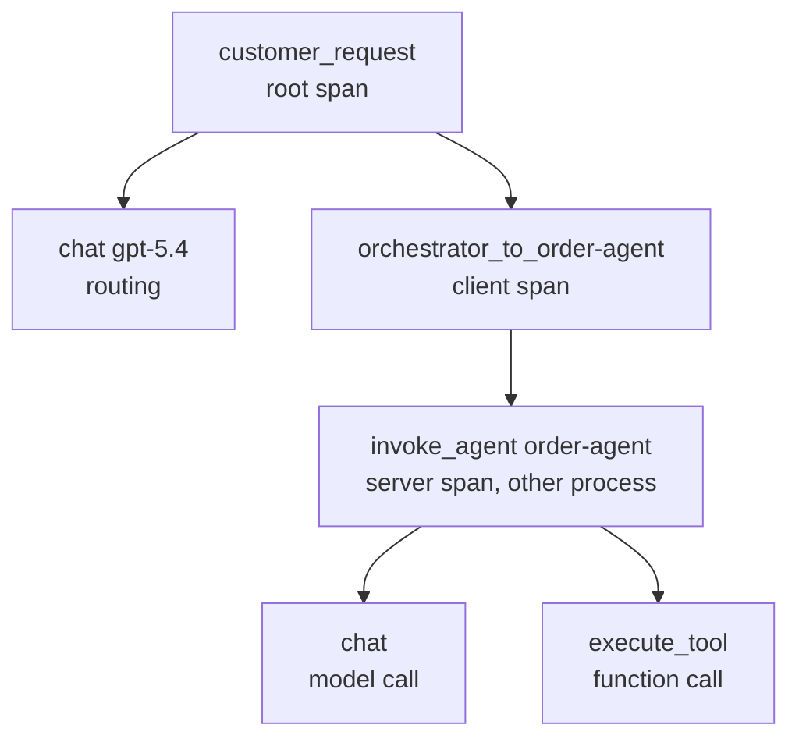

# Tracing: OpenTelemetry & Application Insights

An agent run is a tree of decisions: a model call picks a tool, the tool returns data, a second model call writes the answer, and in a multi-agent system another service repeats the pattern. A log line per step cannot show that tree, and a latency number cannot tell you which branch caused it. Traces can: each step is a span, spans nest under their parent, and one trace ID ties every span of a request together, across processes.

## How Spans Describe an Agent Run

OpenTelemetry defines the vocabulary: a trace is the journey of one request, a span is one operation in it with a start, an end, attributes and a parent. The OpenTelemetry GenAI semantic conventions fix the names and attributes for AI work so that every tool reads the same data. The conventions are in Development status and can still change.

Agent Framework and the Foundry service both emit these spans.

| Span | What it records |
| --- | --- |
| `invoke_agent <name>` | One agent invocation; the parent of everything the agent does |
| `chat <model>` | One model call, with token usage in `gen_ai.usage.input_tokens` and `gen_ai.usage.output_tokens` |
| `execute_tool <function>` | One tool call; arguments and result only when sensitive data capture is on |
| `invoke_workflow` | A coordinated workflow of agents |
| `plan` | A planning or task decomposition phase |

Identity attributes such as `gen_ai.agent.name` and `gen_ai.operation.name` are what let you group spans per agent later. Foundry adds multi-agent conventions, built with Cisco Outshift, on top of the W3C Trace Context standard.



## Turning Instrumentation On in Agent Framework

Agent Framework instruments agents, chat clients and tools itself. `ENABLE_INSTRUMENTATION` defaults to true, so the only missing piece is a provider and an exporter. `configure_otel_providers` creates them from standard OpenTelemetry environment variables or from exporters you pass in.

```python
from agent_framework.observability import configure_otel_providers, get_tracer

configure_otel_providers(exporters=[my_exporter])

with get_tracer().start_as_current_span("customer_request"):
    result = await agent.run("Where is my order 12345?")
```

Prompts, responses, tool arguments and tool results stay out of the spans until you set `ENABLE_SENSITIVE_DATA=true`. Enable it only where the exporter, the access controls and the retention policy are fit for that data. Other switches are `ENABLE_CONSOLE_EXPORTERS` for a console dump and `OTEL_SERVICE_NAME` for the service name that shows up as the cloud role in Application Insights.

## Sending Spans to Application Insights

Foundry stores traces in the Application Insights resource connected to the project. Connect it once, in the portal under Agents and Traces, and every prompt agent and hosted agent is traced on the server side without code changes. Tracing is generally available for prompt and hosted agents; workflow and external agents are in preview.

Client-side spans for your own code come from the `azure-monitor-opentelemetry` distro. Version 1.8.10 or later instruments the HTTPX transport that the OpenAI SDK uses, so your client span and the Foundry service span share one distributed trace.

```python
from azure.monitor.opentelemetry import configure_azure_monitor

connection_string = project_client.telemetry.get_application_insights_connection_string()
configure_azure_monitor(connection_string=connection_string, sampling_ratio=1.0)
```

With an Agent Framework client, `await client.configure_azure_monitor()` reads the same connection string from the project for you and forwards its keyword arguments. The distro samples by rate limit unless you pass `sampling_ratio`, which hides most spans of a short test run. To add spans from the `azure-ai-projects` SDK itself, opt in with `AZURE_EXPERIMENTAL_ENABLE_GENAI_TRACING=true` and call `AIProjectInstrumentor().instrument()`; this client-side tracing is in preview.

## Carrying the Trace Across a Service Boundary

A new HTTP request starts a new trace unless the caller sends the W3C `traceparent` header and the callee continues from it. The caller injects the active context into the headers; the callee extracts it and passes it as the parent of its first span.

```python
from opentelemetry.trace.propagation.tracecontext import TraceContextTextMapPropagator

propagator = TraceContextTextMapPropagator()

headers = {}
propagator.inject(headers)

parent_context = propagator.extract(request_headers)
with tracer.start_as_current_span("invoke_agent order-agent", context=parent_context, kind=SpanKind.SERVER):
    ...
```

Agent Framework does the same for MCP: when a span is active it adds `traceparent` and `tracestate` to the `_meta` field of `tools/call` requests that its own MCP tool classes send. Hosted MCP tools run in the provider service, so the framework cannot inject there.

## Logs That Join Spans

A structured log line that carries `trace_id` and `span_id` joins the spans of the same request on one key. Keep the line small and safe to retain: agent id and version, operation type, status, token counts, latency and a hashed session id, never the prompt. The Azure Monitor distro exports Python logging records to the `traces` table with the active trace as `operation_Id`.

## Querying Traces

Application Insights maps client and internal spans to the `dependencies` table and server spans to `requests`. The `customDimensions` bag holds the GenAI attributes, so per agent latency, error rate and token cost are summaries over the same data.

```kusto
dependencies
| where timestamp > ago(1h) and name startswith "invoke_agent"
| extend agent = tostring(customDimensions["gen_ai.agent.name"])
| summarize p95_ms = percentile(duration, 95), calls = count() by agent
```

Reading traces needs the Log Analytics Reader role on the connected resources, plus Privileged Monitoring Data Reader if the tables are protected. Retention and cost follow your Application Insights and Log Analytics configuration; the portal view covers the last 90 days.

## Local and Open Backends

The same instrumentation exports anywhere OpenTelemetry does. `ENABLE_CONSOLE_EXPORTERS=true` prints spans, and an OTLP endpoint such as the Aspire Dashboard in Docker gives a local waterfall view with `OTEL_EXPORTER_OTLP_ENDPOINT=http://localhost:4317`. The Foundry Toolkit for Visual Studio Code runs a local OTLP collector for the same purpose.

## Hands-On Demo

[Trace a Multi-Agent Request Across Services](demo-tracing.md) traces a Foundry agent and a two-service orchestration, exports both to the project's Application Insights, follows one trace into the Foundry service spans and queries it with KQL. The finished projects are `tracing-py/` (Python) and `tracing-cs/` (C#, `dotnet run -- agent | distributed | anomaly`).

## Key Topics

- [Agent tracing overview](https://learn.microsoft.com/en-us/azure/foundry/observability/concepts/trace-agent-concept)
- [Set up tracing in Microsoft Foundry](https://learn.microsoft.com/en-us/azure/foundry/observability/how-to/trace-agent-setup)
- [Add client-side tracing to Foundry agents](https://learn.microsoft.com/en-us/azure/foundry/observability/how-to/trace-agent-client-side)
- [Agent Framework observability](https://learn.microsoft.com/en-us/agent-framework/agents/observability)
- [OpenTelemetry GenAI semantic conventions](https://opentelemetry.io/docs/specs/semconv/gen-ai/)
- [Application Insights overview](https://learn.microsoft.com/en-us/azure/azure-monitor/app/app-insights-overview)
