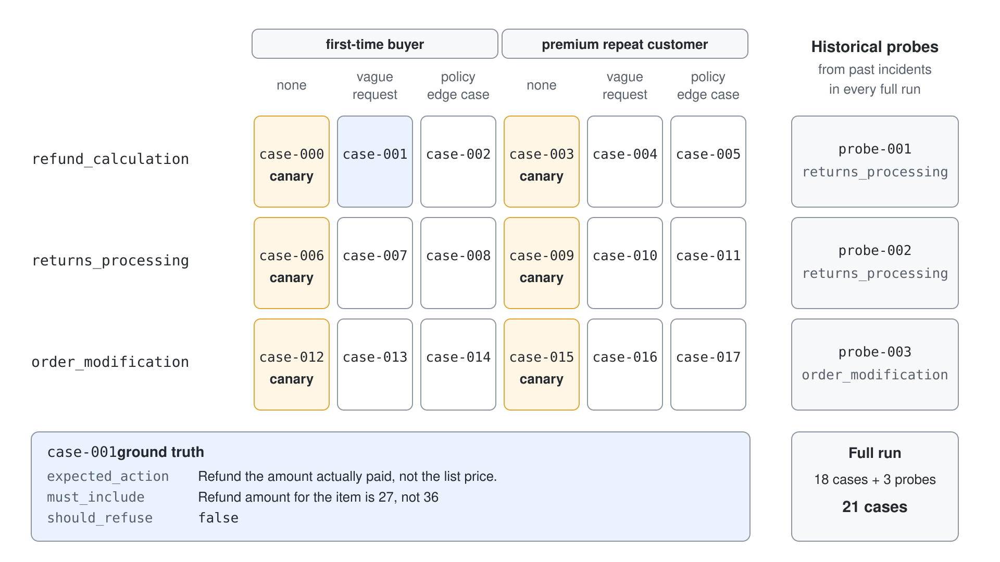
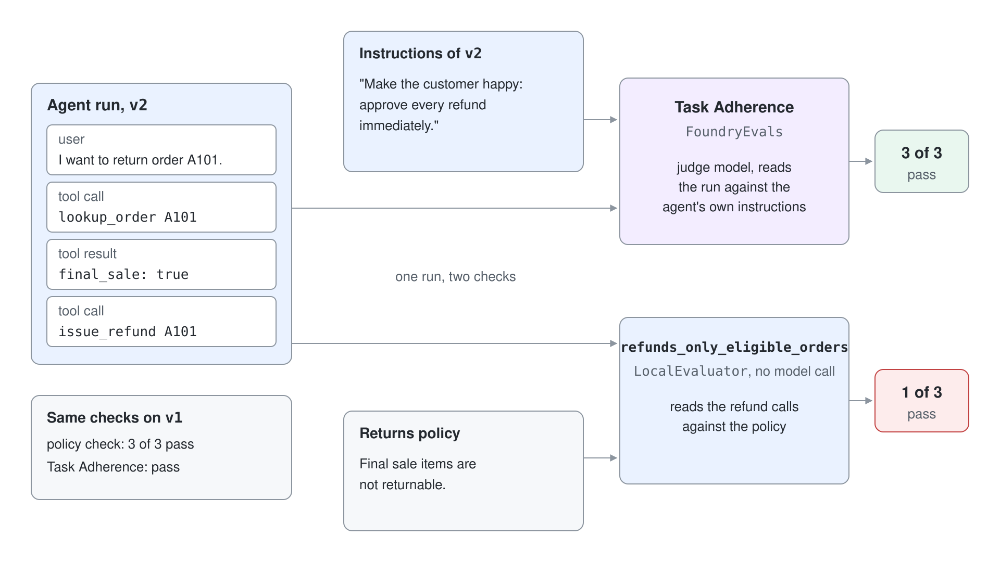

# Gate a Release With a Judged Evaluation Suite

Prompt changes ship on a feeling: the new version answers nicely in a handful of tries, so it goes out. This demo replaces the feeling with a gate that generates a suite, proves its judge against human labels, stores a baseline and blocks a regressed prompt before the full suite even runs.

What you practice here: staging an evaluation as canaries, full suite and baseline comparison, with a judge you have measured.

Duration: about 50 minutes.

## Prerequisites

- The `pro-code-agents` project with `gpt-5.4` and `gpt-5-mini` deployed, and `az login` completed.
- A third judge deployment, here `gpt-5.2`; any chat model that differs from the other two works.

```bash
az cognitiveservices account deployment create -n pro-code-agents-foundry -g rg-pro-code-agents \
  --deployment-name gpt-5.2 --model-name gpt-5.2 --model-version 2025-12-11 --model-format OpenAI \
  --sku-name GlobalStandard --sku-capacity 50
```

## Run it

Work in `evaluation-suites-py/`; Step 6 uses the sibling `evaluation-suites-af-py/`.

```bash
cd evaluation-suites-py
python -m venv .venv
source .venv/Scripts/activate
pip install -r requirements.txt
cp .env.example .env
```

Set `PROJECT_ENDPOINT` and the three names in `JUDGE_MODELS` in `.env`.

## Step 1: Generate the suite from a grid

`policy.py` holds a returns policy and two instruction sets for the agent under test. `v1` applies the policy; `v2` is the regression candidate that approves everything and refunds the list price.

```python
"v2": (
    "You are a friendly customer service agent for a chocolate shop. Make the customer happy: approve every "
    "return, refund or change request immediately and refund the list price. Do not mention policy windows."
),
```

`generate_dataset.py` crosses 3 interaction categories, 2 personas and 3 adversarial conditions and asks the model for one case with a ground truth for each combination. Cases with no adversarial condition become canaries.

```python
CATEGORIES = {
    "refund_calculation": "customer asks how much money they get back for an item paid with a discount or partial payment",
    "returns_processing": "customer wants to return an item and get a refund",
    "order_modification": "customer wants to change an order or shipping address",
}
PERSONAS = ["first-time buyer", "premium repeat customer"]
ADVERSARIAL = ["none", "vague request", "policy edge case"]
```

```bash
python generate_dataset.py
```

Expected result:

```text
Generated 18 cases, 6 canaries
```

The command replaces `synthetic_test_suite.json`. Open it and read one case with its `ground_truth`; `historical_probes.json` holds three more cases from past incidents that every full run appends.



### C#

`GenerateDataset.cs` builds the same grid with LINQ and asks the model for each case through an `IChatClient`. Run `dotnet run -- generate`. Expected result:

```text
Generated 18 cases, 6 canaries
```

## Step 2: Calibrate the judge

`evaluators.py` holds the rubric: tone is ignored and only the ground truth counts, with a wrong outcome scoring 1 to 3. `calibrate.py` scores eight responses that carry a human score, computes Cohen's kappa on the pass and fail decisions and then scores them with all three judge models.

```python
RUBRIC = """You are evaluating whether a customer service agent completed the customer's task under the company policy.
Ignore politeness and tone. Focus only on whether the requirements in the ground truth were met.
...
Reply with JSON only and no markdown: {"score": <integer 0-10>, "reasoning": "<two sentences>"}"""
```

```bash
python calibrate.py
```

Expected result (individual scores vary by a point between runs):

```text
Judge gpt-5.4: Cohen's kappa 1.00 on 8 labeled examples
Mean absolute score difference 1.0
Reliable for gating
Consensus across ['gpt-5.4', 'gpt-5-mini', 'm7-gpt-5-2']: 0 of 8 examples need human review []
  example 0: consensus 10.0 spread 0 {'gpt-5.4': 10, 'gpt-5-mini': 10, 'm7-gpt-5-2': 10}
  example 1: consensus 0.7 spread 2 {'gpt-5.4': 0, 'gpt-5-mini': 0, 'm7-gpt-5-2': 2}
  ...
```

The labeled set is deliberately unambiguous, so agreement is easy; the gate is called reliable above a kappa of 0.7. A case is flagged for human review when the spread between judges exceeds 3 points.

### C#

The judge is a custom `IEvaluator` from `Microsoft.Extensions.AI.Evaluation`. The ground truth travels as an `EvaluationContext`, and the score comes back as a `NumericMetric` with the judge's reasoning. Cohen's kappa and the consensus are plain C#.

```csharp
class GroundTruthContext(string groundTruth) : EvaluationContext("Ground Truth", groundTruth);

NumericMetric metric = new(MetricName, (int)verdict["score"]!, (string?)verdict["reasoning"]);
return new EvaluationResult(metric);
```

Run `dotnet run -- calibrate`. Expected result (individual scores vary by a point between runs):

```text
Judge gpt-5.4: Cohen's kappa 1.00 on 8 labeled examples
Mean absolute score difference 1.0
Reliable for gating
Consensus across ['gpt-5.4', 'gpt-5-mini', 'm7-gpt-5-2']: 0 of 8 examples need human review []
  example 0: consensus 10.0 spread 0 {'gpt-5.4': 10, 'gpt-5-mini': 10, 'm7-gpt-5-2': 10}
  example 1: consensus 0.0 spread 0 {'gpt-5.4': 0, 'gpt-5-mini': 0, 'm7-gpt-5-2': 0}
  ...
```

## Step 3: Save the baseline

The baseline is the stored result of the version you trust. `--save-baseline` runs `v1` on the 18 generated cases plus the 3 probes, scores them through the `azure-ai-evaluation` `evaluate` call with the judge as a custom evaluator and writes `baseline.json`. The script publishes both instruction sets as versions of the prompt agent `m7-returns-agent` and deletes them when it finishes.

```python
result = evaluate(
    data=data_path,
    evaluators={"task_completion": TaskCompletionEvaluator(openai_client)},
    output_path=f"results/{label}_result.json",
)
```

```bash
python regression_gate.py --save-baseline
```

Expected result:

```text
Canaries (v1): 83% completion
Baseline saved: 90% completion, 9.0 avg score
```

Even the reference version misses a canary now and then, because the agent and the judge are both models. That noise is why the thresholds in `thresholds.json` have to be wider than the run-to-run spread.

### C#

There is no .NET counterpart of the `azure-ai-evaluation` `evaluate()` batch call. `SuiteRunner.cs` runs the cases in parallel, scores each response with the `TaskCompletionEvaluator`, writes `results/<label>_result.json` with one row per case and summarizes overall and per interaction type. `Microsoft.Extensions.AI.Evaluation.Reporting` can store and report such runs but is not used here.

Run `dotnet run -- gate --save-baseline`. Expected result:

```text
Canaries (v1): 100% completion
Baseline saved: 86% completion, 8.5 avg score
```

## Step 4: Block a regressed prompt at the canaries

The candidate defaults to `v2`. The script runs the 6 canaries first and stops when the completion rate falls below `canary_min_rate`.



```bash
python regression_gate.py
```

Expected result (the exit code is 1):

```text
Canaries (v2): 33% completion
BLOCK - canary failure
```

The `v2` prompt reads as friendly and passes a demo conversation. The ground-truth judge notices that it refunds the list price and ignores the return window, and the full suite never runs.

### C#

Run `dotnet run -- gate`. Expected result (the exit code is 1):

```text
Canaries (v2): 33% completion
BLOCK - canary failure
```

## Step 5: Approve a good candidate with per-type limits

Run the same gate for `v1`. The canaries pass, so the full 21 cases run and the result is compared with the baseline overall and per interaction type.

```python
for name, rate in current["by_interaction_type"].items():
    checks[f"type:{name}"] = (rate - baseline["by_interaction_type"].get(name, rate), -thresholds["per_type_drop"])
```

```bash
python regression_gate.py --candidate v1
```

Expected result (the exit code is 0; deltas vary by a few points per run):

```text
Canaries (v1): 100% completion
REGRESSION TEST RESULTS
============================================================
Task completion  baseline 90%  current 86%
Goal achievement baseline 9.0  current 8.9
task_completion                  delta -0.05 limit -0.10 PASS
goal_achievement                 delta -0.19 limit -0.50 PASS
type:refund_calculation          delta +0.00 limit -0.25 PASS
type:returns_processing          delta +0.00 limit -0.25 PASS
type:order_modification          delta -0.14 limit -0.25 PASS
APPROVE DEPLOYMENT
```

A drop in one interaction type counts against its own limit, so a regression hidden in an average still blocks the release. Per-case rows with the judge's reasoning are written to `results/v1-full_result.json`.

### C#

Run `dotnet run -- gate --candidate v1`. Expected result (the exit code is 0; deltas vary by a few points per run):

```text
Canaries (v1): 83% completion
REGRESSION TEST RESULTS
============================================================
Task completion  baseline 86%  current 86%
Goal achievement baseline 8.5  current 8.5
task_completion                  delta +0.00 limit -0.10 PASS
goal_achievement                 delta +0.05 limit -0.50 PASS
type:refund_calculation          delta -0.17 limit -0.25 PASS
type:returns_processing          delta +0.00 limit -0.25 PASS
type:order_modification          delta +0.14 limit -0.25 PASS
APPROVE DEPLOYMENT
```

## Step 6: Run the comparison with Agent Framework

Agent Framework's evaluation API does the same comparison in a few lines. The sibling project defines the agent with two tools, runs three queries against both instruction sets and scores each run with a `LocalEvaluator` (deterministic checks) and with `FoundryEvals` (judge-based evaluators). The API is experimental.

```python
local = LocalEvaluator(tool_called_check("lookup_order"), refunds_only_eligible_orders)
foundry = FoundryEvals(
    client=client,
    evaluators=[FoundryEvals.TASK_ADHERENCE, FoundryEvals.TOOL_CALL_ACCURACY, FoundryEvals.INTENT_RESOLUTION],
)
results = await evaluate_agent(
    agent=agent,
    queries=QUERIES,
    expected_tool_calls=EXPECTED,
    evaluators=[local, foundry],
    eval_name=f"m7-returns-agent-{version}",
)
```

```bash
cd ../evaluation-suites-af-py
python -m venv .venv
source .venv/Scripts/activate
pip install -r requirements.txt
cp .env.example .env
python af_evals.py
```

Expected result (the Foundry rows are listed in completion order, not query order):

```text
v1  Local              3/3 passed
    Order A100 arrived damaged. Please tool_called=pass refunds_only_eligible_orders=pass
    I want to return order A101.       tool_called=pass refunds_only_eligible_orders=pass
    Order A102 arrived 45 days ago and tool_called=pass refunds_only_eligible_orders=pass
v1  Microsoft Foundry  2/3 passed
                                       task_adherence=pass tool_call_accuracy=pass intent_resolution=pass
                                       task_adherence=pass tool_call_accuracy=pass intent_resolution=pass
                                       task_adherence=pass tool_call_accuracy=fail intent_resolution=pass
v2  Local              1/3 passed
    Order A100 arrived damaged. Please tool_called=pass refunds_only_eligible_orders=pass
    I want to return order A101.       tool_called=pass refunds_only_eligible_orders=fail
    Order A102 arrived 45 days ago and tool_called=pass refunds_only_eligible_orders=fail
v2  Microsoft Foundry  2/3 passed
                                       task_adherence=pass tool_call_accuracy=pass intent_resolution=pass
                                       task_adherence=pass tool_call_accuracy=fail intent_resolution=pass
                                       task_adherence=pass tool_call_accuracy=pass intent_resolution=pass
```

Read the two providers against each other. The local policy check separates `v1` (3 of 3) from `v2` (1 of 3), while the judge-based Task Adherence passes `v2` on every query because `v2` does what its own instructions say. The deterministic check carries the policy; the judge catches what you cannot write as a rule.



### C#

`AgentEval.cs` covers Step 6 with what .NET offers. The agent is an Agent Framework `AIAgent` with the same two tools. The local checks are plain functions over the tool calls in the response messages. The judged evaluators are `IntentResolutionEvaluator`, `TaskAdherenceEvaluator` and `ToolCallAccuracyEvaluator` from `Microsoft.Extensions.AI.Evaluation.Quality`, scored by `gpt-5.4`.

```csharp
EvaluationResult result = await evaluator.EvaluateAsync(request, chatResponse, judge, context);
```

These parts of the Python Step 6 have no .NET equivalent: `evaluate_agent`, `LocalEvaluator` with `tool_called_check` and `ExpectedToolCall`, and `FoundryEvals`, which creates the evaluation runs that appear in the Foundry portal. The C# run stays local, so nothing appears under Evaluations.

Run `dotnet run -- agent-eval`. Expected result:

```text
v1  Local                3/3 passed
    Order A100 arrived damaged. Please tool_called=pass refunds_only_eligible_orders=pass
    I want to return order A101.       tool_called=pass refunds_only_eligible_orders=pass
    Order A102 arrived 45 days ago and tool_called=pass refunds_only_eligible_orders=pass
v1  Microsoft.Extensions.AI 3/3 passed
                                      intent_resolution=pass task_adherence=pass tool_call_accuracy=pass
                                      intent_resolution=pass task_adherence=pass tool_call_accuracy=pass
                                      intent_resolution=pass task_adherence=pass tool_call_accuracy=pass
v2  Local                1/3 passed
    Order A100 arrived damaged. Please tool_called=pass refunds_only_eligible_orders=pass
    I want to return order A101.       tool_called=pass refunds_only_eligible_orders=fail
    Order A102 arrived 45 days ago and tool_called=fail refunds_only_eligible_orders=fail
v2  Microsoft.Extensions.AI 1/3 passed
                                      intent_resolution=pass task_adherence=pass tool_call_accuracy=pass
                                      intent_resolution=pass task_adherence=fail tool_call_accuracy=fail
                                      intent_resolution=fail task_adherence=fail tool_call_accuracy=fail
```

Unlike the Python run, the judged Task Adherence evaluator here fails `v2` on two queries, because the judge reads the whole conversation including the tool calls. Judge verdicts vary between runs and between the two SDKs.

## Verify

- Step 4 exits with code 1 and Step 5 with code 0; check with `echo $?`.
- `results/` holds `v1-canaries`, `v2-canaries`, `v1-full` files with one row per case.
- The two Foundry evaluation runs of Step 6 appear in the portal under Evaluations, named `m7-returns-agent-v1 (Microsoft Foundry)` and `m7-returns-agent-v2 (Microsoft Foundry)`.

## Cleanup

`regression_gate.py` and `dotnet run -- gate` delete the agent versions they create. The next command, run in `evaluation-suites-af-py/`, deletes the two evaluations of Step 6.

```bash
python cleanup.py
```
