# Cut Agent Cost With Routing, Caching and Token Budgets

A support agent that sends every message to the same model, repeats the same lookups and resends the whole conversation costs more than it needs to, and nobody can say by how much. This demo measures a six-request workload against a tier-2-only baseline, then adds one lever at a time and prints what each one saves.

What you practice here: measuring a cost lever against a baseline before you trust it.

Duration: about 40 minutes.

## Prerequisites

- The `pro-code-agents` project with `gpt-5-mini`, `gpt-5.4`, a stronger third chat model for tier 3 (here `gpt-5.2`) and `text-embedding-3-small`.
- `az login` completed, Python 3.12 or later and the .NET 10 SDK.

## Run it

Work in `performance-cost-py/` for Python or `performance-cost-cs/` for C#. Each step runs one section; with no argument both programs run all five.

```bash
cd performance-cost-py
python -m venv .venv
source .venv/Scripts/activate
pip install -r requirements.txt
cp .env.example .env
```

Set `PROJECT_ENDPOINT` and the three tier models in `.env`. Leave `REDIS_HOST` empty to use an in-memory `fakeredis`; set `REDIS_HOST`, `REDIS_PORT` and `REDIS_KEY` to use Azure Cache for Redis instead.

The C# project loads the same `.env` values with DotNetEnv. Its caches live in an in-memory `HashStore` class; the Azure Cache for Redis option exists in Python only.

```bash
cd performance-cost-cs
cp .env.example .env
dotnet run -- routing
```

Pass a section name (`routing`, `prefix`, `context`, `tradeoffs`, `parallel`) after `--`, or nothing to run all five.

## Step 1: Route requests and cache the answers

`router.py` assigns a tier and retries one tier up when the answer scores below the tier's quality floor. Prices per million tokens are illustrative so you can see the shape of the saving, not your invoice.

```python
ILLUSTRATIVE_PRICE_PER_MILLION_TOKENS = {1: (0.25, 2.0), 2: (2.5, 15.0), 3: (1.25, 10.0)}
ESCALATION_KEYWORDS = ["exception", "legal", "complaint", "lawsuit", "refund policy"]
```

The section first runs all six requests on tier 2 without caches as the baseline. It then runs them through the result cache, the semantic cache and the router, in that order.



```python
cached = result_cache.get(AGENT_ID, {"q": question})
if cached:
    ...
semantic = semantic_cache.check_cache(question, AGENT_ID)
if semantic["hit"]:
    ...
outcome = router.route_with_quality_floor(question)
```

```bash
python main.py routing
```

Expected result (costs and times vary):

```text
== Routing with multi-level cache ==
baseline, every request on tier 2 without caches: $0.00544 in 10.5s
model call tier 1->1 quality 100 cost $0.00081 3.4s | What is the status of order #12345?
model call tier 1->1 quality 100 cost $0.00092 4.5s | Where is order 12345 right now?
model call tier 2->2 quality 100 cost $0.00103 1.6s | Which gift box suits a vegan friend best: the truffle box, t
model call tier 3->3 quality 100 cost $0.00101 2.7s | I want an exception to your return policy for damaged goods 
result-cache hit | What is the status of order #12345?
semantic hit 0.86 | what's the status of my order 12345
Result cache hits 1, semantic cache hits 1, model calls 4
routed with caches: $0.00377 in 12.2s
Invalidated 8 entries after order-database change
```

Four model calls instead of six, and about 30% less spend.

The C# router has the same tiers, floors and keywords, and calls each tier deployment with a model-scoped Responses client.

```csharp
ResponseResult response = await Foundry.Respond(tierDeployments[tier], request, "You are a concise customer service assistant for a chocolate shop. Answer in at most three sentences.");
totalCost += EstimateCost(tier, response);
int quality = EvaluateQuality(response.GetOutputText(), tier);
```

```bash
dotnet run -- routing
```

Expected result (C#; costs and times vary):

```text
== Routing with multi-level cache ==
baseline, every request on tier 2 without caches: $0.00553 in 13.1s
model call tier 1->1 quality 100 cost $0.00077 4.2s | What is the status of order #12345?
model call tier 1->1 quality 100 cost $0.00057 4.8s | Where is order 12345 right now?
model call tier 2->2 quality 100 cost $0.00093 2.0s | Which gift box suits a vegan friend best: the truffle box, t
model call tier 3->3 quality 100 cost $0.00107 3.5s | I want an exception to your return policy for damaged goods
result-cache hit | What is the status of order #12345?
semantic hit 0.86 | what's the status of my order 12345
Result cache hits 1, semantic cache hits 1, model calls 4
routed with caches: $0.00334 in 14.4s
Invalidated 8 entries after order-database change
```

The exact repeat is a result cache hit; the reworded question is a semantic hit at similarity 0.86 against a threshold of 0.85. Wall time did not drop in this run (12.2 s against 10.5 s); the saving is cost, and only the two cache hits cost no time. The last line shows the dependency tag at work: one call to `invalidate_by_dependency("order-database")` removed 8 entries.

## Step 2: See the service's prompt cache

The service caches an identical prefix of at least 1,024 tokens on its own. The section sends two calls with the same 2,000-token instruction prefix and prints `cached_tokens`.

```python
response = openai_client.responses.create(
    model=os.environ["TIER2_MODEL"],
    instructions=stable_prefix,
    input=f"Question {attempt}: how long do refunds take? Answer in one sentence.",
)
print(f"call {attempt}: input tokens {response.usage.input_tokens}, cached {response.usage.input_tokens_details.cached_tokens}")
```

```bash
python main.py prefix
```

Expected result on a cold cache:

```text
== Prompt prefix caching ==
call 1: input tokens 2069, cached 0
call 2: input tokens 2069, cached 1920
```

The second call reads 1,920 of its 2,069 input tokens from the cache, in 128-token steps, and those tokens are billed at the cached rate. Run it again within a few minutes and both calls start warm (`cached 1920` twice).

The C# section sends the same prefix through `Foundry.Respond` and reads the count from `response.Usage.InputTokenDetails.CachedTokenCount`.

```bash
dotnet run -- prefix
```

Expected result (C#, warm cache; a cold start prints `cached 0` for the first call, and sometimes for both):

```text
== Prompt prefix caching ==
call 1: input tokens 2069, cached 1920
call 2: input tokens 2069, cached 1920
``` Move the variable part of your prompt to the end; one changed character inside the first 1,024 tokens and `cached_tokens` is 0.

## Step 3: Hold each agent to a token budget

`context_assembler.py` builds a digest of facts, keeps the last three exchanges, keeps older turns that carry preferences or commitments, and compresses tool results to the fields the agent needs. It prunes in a fixed order only when the result is still over budget.



```python
AGENT_BUDGETS = {"lookup": 2000, "reasoning": 4000, "policy": 8000}
```

```bash
python main.py context
```

Expected result:

```text
== Token budgets and context assembly ==
lookup: naive 1706 tokens -> assembled 94 tokens (budget 120) pruned ['window summarized', 'important turns dropped', 'tool results dropped']
reasoning: naive 1706 tokens -> assembled 185 tokens (budget 4000) pruned []
```

The naive prompt is 1,706 tokens. The reasoning agent's assembled context is 185 tokens with nothing pruned, and the lookup agent, squeezed to a budget of 120, drops all three optional layers.

The C# `ContextAssembler` counts tokens with `Microsoft.ML.Tokenizers` and the `o200k_base` encoding, the same encoding as `tiktoken`. It serialises the naive prompt and the tool digest as plain text instead of Python's `str()` of a dict, so the totals differ from the Python run while the pruning order is identical.

```csharp
Tokenizer tokenizer = TiktokenTokenizer.CreateForEncoding("o200k_base");
int CountTokens(string text) => tokenizer.CountTokens(text);
```

```bash
dotnet run -- context
```

Expected result (C#):

```text
== Token budgets and context assembly ==
lookup: naive 1328 tokens -> assembled 99 tokens (budget 120) pruned ['window summarized', 'important turns dropped', 'tool results dropped']
reasoning: naive 1328 tokens -> assembled 175 tokens (budget 4000) pruned []
```

## Step 4: Check segment targets and trip the quality breaker

`tradeoffs.py` holds a profile per segment and a circuit breaker on user ratings. The section checks a measured p95 of 2.5 seconds and an average cost of $0.004 against every profile, then feeds falling ratings to the breaker.

```python
SEGMENT_PROFILES = {
    "gold": {"default_tiers": [2, 3], "history_turns": 5, "cache_threshold": 0.93, "p95_latency_s": 3, "cost_limit": 0.015},
    "standard": {"default_tiers": [1, 2], "history_turns": 3, "cache_threshold": 0.90, "p95_latency_s": 6, "cost_limit": 0.005},
    "bulk_api": {"default_tiers": [1], "history_turns": 0, "cache_threshold": 0.85, "p95_latency_s": 12, "cost_limit": 0.001},
}
```

```bash
python main.py tradeoffs
```

Expected result:

```text
== Quality, cost and latency trade-offs ==
gold: tiers [2, 3] history 5 turns cache 0.93 SLO {'latency_ok': True, 'cost_ok': True}
standard: tiers [1, 2] history 3 turns cache 0.9 SLO {'latency_ok': True, 'cost_ok': True}
bulk_api: tiers [1] history 0 turns cache 0.85 SLO {'latency_ok': True, 'cost_ok': False}
Circuit breaker open: True settings {'model_tier': 3, 'cache_enabled': False, 'history_turns': 5}
```

The same measurement passes for `gold` and `standard` and fails the cost limit of `bulk_api`. Once the average rating over the recent window drops below 3.8, the breaker opens and the settings fall back to tier 3 with no cache, whatever the optimized profile says.

The C# profiles are a `record SegmentProfile(int[] DefaultTiers, int HistoryTurns, double CacheThreshold, double P95LatencyS, double CostLimit)` in a dictionary, and `QualityCircuitBreaker` keeps the same window logic.

```bash
dotnet run -- tradeoffs
```

Expected result (C#):

```text
== Quality, cost and latency trade-offs ==
gold: tiers [2, 3] history 5 turns cache 0.93 SLO latency_ok=True cost_ok=True
standard: tiers [1, 2] history 3 turns cache 0.9 SLO latency_ok=True cost_ok=True
bulk_api: tiers [1] history 0 turns cache 0.85 SLO latency_ok=True cost_ok=False
Circuit breaker open: True settings {model_tier: 3, cache_enabled: False, history_turns: 5}
```

## Step 5: Run independent calls in parallel

Three prompts that do not depend on each other are timed one after another and then in a thread pool.

```python
with ThreadPoolExecutor(len(prompts)) as pool:
    results = list(pool.map(call, prompts))
```

```bash
python main.py parallel
```

Expected result:

```text
== Parallel agent calls ==
3 independent agent calls: sequential 7.1s, parallel 3.3s
```

Both orders use the same tokens. Parallel latency is that of the slowest call instead of the sum.

In C# the thread pool becomes `Task.WhenAll`, because the calls are already asynchronous.

```csharp
await Task.WhenAll(prompts.Select(prompt => Foundry.Respond(model, prompt)));
```

```bash
dotnet run -- parallel
```

Expected result (C#):

```text
== Parallel agent calls ==
3 independent agent calls: sequential 7.7s, parallel 3.3s
```

## Verify

- Step 1 printed a baseline cost and a lower `routed with caches` cost, with one result cache hit and one semantic hit.
- Step 2 printed a non-zero `cached` value for at least the second call.
- Step 5 printed a parallel time well below the sequential time.

## Cleanup

Nothing was created in Azure: the script only reads and calls models. The in-memory cache disappears with the process.
