# Incident Response: Replay & Postmortem

A prompt change goes out on Tuesday and by Wednesday the checkout error rate is 50%. Nothing was deployed except one agent's instructions, nothing crashed, and every trace looks successful. Incident response for agents is the discipline of finding such a change fast, reproducing the failure without touching production, limiting the damage and making sure it cannot happen again.

## Classify First

The first decision is how loud to be. Severity comes from a rule you wrote before the incident, so nobody argues about it during one. A checkout error rate above 5% is P1, above 1% (or more than 10% of agent answers judged incorrect) is P2, a small slice of traffic is P3 and everything else is P4.

```python
def classify_severity(checkout_error_rate, agents_incorrect_rate=0.0, affected_traffic=1.0):
    if checkout_error_rate > 0.05:
        return "P1"
    if checkout_error_rate > 0.01 or agents_incorrect_rate > 0.10:
        return "P2"
    if affected_traffic < 0.05 or agents_incorrect_rate > 0:
        return "P3"
    return "P4"
```

The inputs come from the data the earlier demos produce: error rates from traces, answer quality from continuous evaluation. A rule only fires when someone reads the number, so connect it to an alert on the Application Insights data rather than to a person.

## Find the Cause With a Change Log

Most agent incidents follow a change. Keep a change log with every prompt version, model deployment, routing rule and configuration edit, each with a timestamp, and test hypotheses against it in order of cost. The first confirmed hypothesis ends the search.

| Hypothesis | Evidence that confirms it |
| --- | --- |
| Model deployment change | A `model_deployment` entry before the first failure |
| Prompt regression | The failure rate after a `prompt_deployment` is more than 20 points above the rate before it |
| Tool failure | Average tool latency above three times its baseline |
| Orchestration logic regression | A `routing_change` entry |
| Configuration change | A `config_change` entry |

A differential between failed and successful requests supplies the pattern. In the incident of the demo, latency is the same in both groups, but every failed price contains a currency symbol and no successful one does.



## Replay a Failure Without Production

A failed trace is only useful later if it was captured with everything needed to run it again. A replay snapshot holds the input, the model deployment, the full prompt with its SHA-256 hash, the tool responses and the trace timeline, with identifiers in tool data masked.

```json
{
  "trace_id": "d3660c82...",
  "input_data": {"order_id": "A100"},
  "model_deployments": {"pricing-agent": {"deployment_name": "gpt-5.4"}},
  "system_prompts": {"pricing-agent": {"content": "...", "hash": "8497d566...", "version": "v2"}},
  "tool_responses": {"order_lookup": {"mock_response": {"order_id": "MOCK-A100", "total": 120.0}}},
  "production_output": "$108.00 ..."
}
```

Replay feeds the mocked tool response and the captured prompt to the same model deployment. The hash check tells you whether the prompt you hold today is the one that failed. Prompt agent versions in Foundry give you the version history for free: each `create_version` keeps the instructions, and `get_version` reads them back, so the prompts to compare come from the agent itself.

Bisection then turns "something changed" into "this version broke it": replay the snapshot against each prompt version in order and report the first one that fails the output contract.



```python
def bisect_prompt_versions(self, snapshot, prompt_versions):
    results = {label: self.replay_pricing_step(snapshot, prompt_override=prompt)["valid"] for label, prompt in prompt_versions.items()}
    first_bad = next((label for label, valid in results.items() if not valid), None)
    return {"results": results, "first_failing_version": first_bad}
```

## Limit the Damage

Remediation has to be bounded, or it becomes the second incident. A circuit breaker watches a dependency, opens when more than 40% of at least ten recent calls fail and routes to a fallback; after a probe interval it lets one call through and closes again when it succeeds.



A runbook is the same idea for a multi-step action such as switching payment gateways. Make it idempotent so a second run changes nothing, rate limited so a flapping alert cannot trigger it more than three times an hour, verified by a test transaction after the switch and escalating to a person when both gateways are unhealthy or the deadline passes.

## Write the Blameless Postmortem

The postmortem records what happened and what changes, not who erred. It has a fixed shape: summary, timeline, root cause, contributing factors, what went well, what did not go well and action items with an owner and a due date. Fill the numbers from the incident data itself so the document cannot drift from the facts.

The real fix is upstream of the incident. Here that means validating the output between the pricing agent and the payment step, rolling every prompt change out as a canary on a small share of traffic and adding a price format probe to the regression suite so the next change fails there first.

## Hands-On Demo

[Replay and Resolve a Production Incident](demo-incident-response.md) runs a checkout pipeline through a bad prompt release, classifies and diagnoses it, replays and bisects a captured failure against two Foundry prompt agent versions, exercises the circuit breaker and runbook and writes the postmortem. It ships as `incident-response-py/` for Python and `incident-response-cs/` for C#.

## Key Topics

- [Debug and respond to production multi-agent incidents](https://learn.microsoft.com/en-us/training/modules/aaai-debug-production-multi-agent-incidents-azure/)
- [Monitor agents with the Agent Monitoring Dashboard](https://learn.microsoft.com/en-us/azure/foundry/observability/how-to/how-to-monitor-agents-dashboard)
- [Agent tracing overview](https://learn.microsoft.com/en-us/azure/foundry/observability/concepts/trace-agent-concept)
- [Create a prompt agent](https://learn.microsoft.com/en-us/azure/foundry/agents/quickstarts/prompt-agent)
- [Azure Monitor alerts overview](https://learn.microsoft.com/en-us/azure/azure-monitor/alerts/alerts-overview)
