# Module 7: Evaluation, Observability & Optimization

An agent that works in a demo can still fail in production in ways no one sees: a slower hop, a wrong tool argument, a prompt change that breaks the next service, an attacker's disguised request. This module covers the loop that closes the gap: trace what the agent does, score it with evaluators, gate releases on a baseline, keep scoring live traffic, let Foundry propose better instructions and respond to the incident when something still breaks.

The stack is OpenTelemetry with Application Insights for traces, the Foundry evaluation service through `azure-ai-projects` 2.x and `azure-ai-evaluation` for scoring, Agent Framework 1.x for its evaluation API and the Foundry agent optimizer for tuning. Every topic has a runnable project and a demo guide with real captured output. Several of these features are in preview, which each topic readme states.

Each project has its own `.env.example`, a pinned `requirements.txt` or `.csproj` and a `.gitignore`. Copy `.env.example` to `.env`, set your project endpoint and run.

Demos that need Azure resources ship a `provision.azcli` and, where useful, a `deprovision.azcli` beside the guide. The demos that read traces use the Application Insights resource that the tracing demo connects to the project.

| Topic | Description |
| --- | --- |
| [01 Tracing: OpenTelemetry & Application Insights](01-tracing/readme.md) | GenAI span conventions, Agent Framework instrumentation, Azure Monitor export, trace propagation across services and KQL over Foundry traces |
| [02 Agent Evaluators: Task Adherence & Tools](02-agent-evaluators/readme.md) | System and process evaluators for task completion, adherence, intent and tool use, locally in Python and C# and in the cloud |
| [03 Evaluation Suites: Judges & Baselines](03-evaluation-suites/readme.md) | Grid-generated suites, a calibrated multi-judge, canaries, baseline regression gates and the Agent Framework evaluation API |
| [04 Continuous Evaluation & AI Red Teaming](04-continuous-evaluation/readme.md) | Rules that score live responses, evaluation of stored responses and traces, and cloud red teaming with attack strategies |
| [05 Agent Optimizer: Instructions & Tool Tuning](05-agent-optimizer/readme.md) | The agent optimizer driven by an evaluation dataset, candidate scoring and promotion, and the portal Prompt Optimizer |
| [06 Performance & Cost: Routing & Caching](06-performance-cost/readme.md) | Tier routing with a quality floor, result, semantic and prompt caches, token budgets, segment targets and parallel calls |
| [07 Incident Response: Replay & Postmortem](07-incident-response/readme.md) | Severity, hypothesis testing against a change log, snapshot replay and bisection, circuit breakers and a blameless postmortem |

| Topic | Description |
| --- | --- |
| [Trace a Multi-Agent Request Across Services](01-tracing/demo-tracing.md) | Trace an agent locally, export to Application Insights, propagate `traceparent` over HTTP and query one distributed trace with KQL |
| [Score Agent Runs With Task and Tool Evaluators](02-agent-evaluators/demo-agent-evaluators.md) | Seven recorded runs with known defects scored by eight evaluators in a matrix (Python, C# and cloud) |
| [Gate a Release With a Judged Evaluation Suite](03-evaluation-suites/demo-evaluation-suites.md) | Calibrate a judge, save a baseline, block a regressed prompt at the canaries and compare versions with `evaluate_agent` |
| [Monitor a Live Agent With Continuous Evaluation and Red Teaming](04-continuous-evaluation/demo-continuous-evaluation.md) | A continuous evaluation rule, response and trace evaluation and a cloud red team with a reviewed result |
| [Let the Optimizer Rewrite an Agent's Instructions](05-agent-optimizer/demo-agent-optimizer.md) | Score a baseline, run an optimization job on a dataset, compare candidates and promote the best one |
| [Cut Agent Cost With Routing, Caching and Token Budgets](06-performance-cost/demo-performance-cost.md) | Measure each cost lever against a tier-2-only baseline |
| [Replay and Resolve a Production Incident](07-incident-response/demo-incident-response.md) | Diagnose a bad prompt release, replay a captured failure, bisect prompt versions and write the postmortem |

## Helpful Claude Slash Commands

| Command | Usage |
| --- | --- |
| `/plan` | Plan the evaluation design (suite, judge, thresholds) before writing code |
| `/mcp` | Manage the Microsoft Learn MCP server that you use to check current evaluator names and preview status |
| `/model` | Switch the model that writes and reviews evaluation code |
| `/cost` | See what a long evaluation session costs in tokens |
| `/review` | Review evaluator, gate and replay code on a branch before you merge it |
| `/security-review` | Audit an agent for the exposure a red team run flagged |

## Key Topics covered in this module

- [Agent tracing overview](https://learn.microsoft.com/azure/foundry/observability/concepts/trace-agent-concept)
- [Set up tracing in Microsoft Foundry](https://learn.microsoft.com/azure/foundry/observability/how-to/trace-agent-setup)
- [Agent Framework observability](https://learn.microsoft.com/agent-framework/agents/observability)
- [Agent evaluators](https://learn.microsoft.com/azure/foundry/concepts/evaluation-evaluators/agent-evaluators)
- [Run evaluations from the SDK](https://learn.microsoft.com/azure/foundry/observability/how-to/cloud-evaluation)
- [Agent Framework evaluation](https://learn.microsoft.com/agent-framework/agents/evaluation)
- [Monitor agents with the Agent Monitoring Dashboard](https://learn.microsoft.com/azure/foundry/observability/how-to/how-to-monitor-agents-dashboard)
- [AI Red Teaming Agent](https://learn.microsoft.com/azure/foundry/concepts/ai-red-teaming-agent)
- [What is the agent optimizer?](https://learn.microsoft.com/azure/foundry/agents/concepts/agent-optimizer-overview)
- [Optimize agent prompts by using Prompt Optimizer](https://learn.microsoft.com/azure/foundry/observability/how-to/prompt-optimizer)
- [Model router for Microsoft Foundry](https://learn.microsoft.com/azure/foundry/openai/concepts/model-router)
- [Prompt caching](https://learn.microsoft.com/azure/foundry/openai/how-to/prompt-caching)
