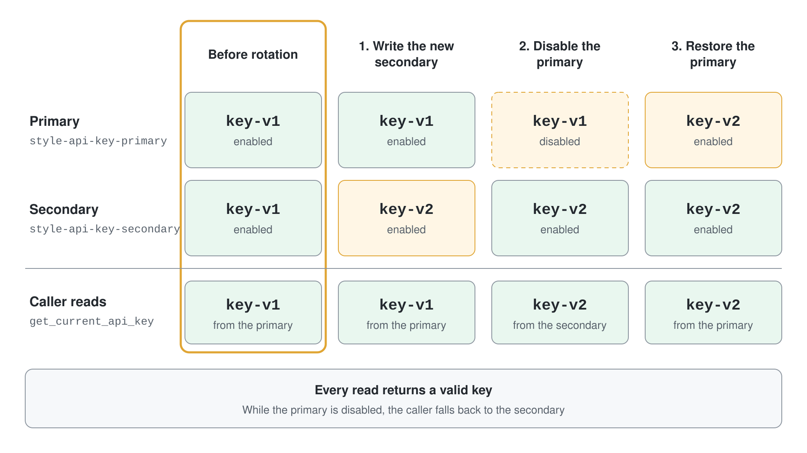

# Isolate Tenants and Rotate Secrets in a Multi-Tenant Agent

A shared code review agent serves several customers, and a single wrong lookup would show one customer's findings to another. Its partner API key also needs to change without taking the agent down. You verify a signed request, pin every data access to the verified tenant, rotate a key with no gap, and watch a live Foundry agent fail to reach another tenant's review.

What you practice here: deriving the tenant from a verified token instead of from the model, and removing every parameter an attacker could use to ask for someone else's data.

Duration: about 50 minutes.

## Prerequisites

- Python 3.12 or later or the .NET 10 SDK, and `az login` completed against the subscription that holds your Foundry project.
- The Foundry User role on the project, and a `gpt-5.4` deployment.
- Concepts from the [topic readme](readme.md): authentication flows, secret rotation and tenant partitions.

## Run it

```bash
cd demos/08-governance/04-zero-trust/zero-trust-py
pip install -r requirements.txt
cp .env.example .env
python auth_flows.py
python tenant_isolation.py
```

The C# twin has two entry points.

```bash
cd demos/08-governance/04-zero-trust/zero-trust-cs
cp .env.example .env
dotnet run -- flows
dotnet run -- isolation
```

Set `PROJECT_ENDPOINT` and `MODEL_DEPLOYMENT_NAME` in `.env` first. Work in `zero-trust-py/` or `zero-trust-cs/`; both are finished projects.

`auth_flows.py` and `dotnet run -- flows` need no Azure access. `tenant_isolation.py` creates the agent `m8-zt-review-assistant` and `dotnet run -- isolation` creates `m8h-zt-review-assistant`; each deletes its agent when it ends.

## Step 1: Choose the authentication flow per scenario

Credentials follow the actor, so the project starts with a decision table. Each row names the flow an agent should use and the last row is the one to avoid when you can.

```python
FLOWS = [
    ("Agent calls Azure service (Cosmos DB, Foundry, Storage)", "managed identity"),
    ("Agent calls agent inside the same Azure trust boundary", "managed identity + workload identity"),
    ("Agent reads a user's Azure DevOps data", "on-behalf-of (OBO)"),
    ("Agent reads third-party SaaS data on a user's behalf", "OAuth2 authorization code + PKCE"),
    ("Agent calls a partner API that only accepts API keys", "key-based fallback with Key Vault"),
]
```

Run `python auth_flows.py`. Expected output, first part:

```text
Authentication flow selection
  Agent calls Azure service (Cosmos DB, Foundry, Storage)        -> managed identity
  Agent calls agent inside the same Azure trust boundary         -> managed identity + workload identity
  Agent reads a user's Azure DevOps data                         -> on-behalf-of (OBO)
  Agent reads third-party SaaS data on a user's behalf           -> OAuth2 authorization code + PKCE
  Agent calls a partner API that only accepts API keys           -> key-based fallback with Key Vault
```

## Step 2: Rotate a key without a gap

The in-memory vault holds two copies of the style checker's key. The rotation changes the secondary first, disables the primary, and only then restores the primary with the new value.



```python
vault.set_secret("style-api-key-secondary", "key-v2")
vault.disable("style-api-key-primary")
print("  during rotation, primary disabled:", style.get_current_api_key("style-api-key"))

vault.set_secret("style-api-key-primary", "key-v2")
```

Expected output, same run:

```text
Blue-green rotation for style-checker
  before rotation: key-v1
  during rotation, primary disabled: key-v2
  after rotation, primary restored: key-v2
```

The caller asked for the current key three times and always received a valid one. No request hit a moment with a disabled primary and no fallback.

## Step 3: Deny a read of another agent's secret

Each agent identity may read only its own secrets. The compliance checker's key is out of reach for the style checker.

```python
if f"secrets/{name.rsplit('-', 1)[0]}" not in ROLES[identity]:
    raise PermissionError(f"{identity} has no Key Vault Secrets User assignment for {name}")
```

Expected output, end of the run:

```text
Secret-level RBAC
  style-checker has no Key Vault Secrets User assignment for compliance-api-key-primary
```

In Azure this rule is a role assignment scoped to one secret. The readme explains why vault-level roles are the default and secret-scope roles the exception.

### C#

`AuthFlows.cs` holds the decision table, the in-memory vault and the rotation. Run `dotnet run -- flows`; the output of Steps 1 to 3 is identical to the Python run:

```text
Authentication flow selection
  Agent calls Azure service (Cosmos DB, Foundry, Storage)        -> managed identity
  Agent calls agent inside the same Azure trust boundary         -> managed identity + workload identity
  Agent reads a user's Azure DevOps data                         -> on-behalf-of (OBO)
  Agent reads third-party SaaS data on a user's behalf           -> OAuth2 authorization code + PKCE
  Agent calls a partner API that only accepts API keys           -> key-based fallback with Key Vault

Blue-green rotation for style-checker
  before rotation: key-v1
  during rotation, primary disabled: key-v2
  after rotation, primary restored: key-v2

Secret-level RBAC
  style-checker has no Key Vault Secrets User assignment for compliance-api-key-primary
```

## Step 4: Verify the signed request before touching data

The second script signs tokens with local RSA keys. A token signed with a different key and claiming tenant B is rejected, and a token signed with the right key sets the tenant for the request.

```python
forged = issue_token(other_key, "tenant-b")
extract_tenant_from_token(f"Bearer {forged}", signing_key.public_key())

token = issue_token(signing_key, "tenant-a")
tenant_id = extract_tenant_from_token(f"Bearer {token}", signing_key.public_key())
current_tenant.set(tenant_id)
```

Run `python tenant_isolation.py`. Expected output, first part:

```text
Forged token for tenant-b rejected: InvalidSignatureError
Request context established for tenant-a
```

`jwt.decode` also checks the audience, the issuer and the expiry, so a token with a wrong audience or an old `exp` fails the same way.

## Step 5: Bind the data layer to the verified tenant

Two tenants have reviews in one store. Every repository method reads the tenant from the context variable that Step 4 set, so the tools that call it cannot choose a partition.

```python
def get_review(self, review_id):
    tenant_id = current_tenant.get()
    if review_id not in self.store.partitions.get(tenant_id, {}):
        return None
    return self.store.read_item(review_id, partition_key=tenant_id)
```

The seed data gives tenant A two reviews and tenant B one, `rev-b-001`, about a SQL injection in a salary export. Neither tool the agent receives has a tenant argument.

## Step 6: Ask a live agent for another tenant's review

The agent gets `list_reviews` and `get_review` as function tools, and the prompt tries to read tenant B's review while the request context belongs to tenant A.



```python
prompt = "List my reviews, then fetch review rev-b-001 and tell me what it contains."
```

Expected output, rest of the run:

```text
USER: List my reviews, then fetch review rev-b-001 and tell me what it contains.
  [tool call] list_reviews({}) -> [{"id": "rev-a-001", "tenant_id": "tenant-a", "code_file": "billing.py", "findings": ["hardcoded api key"]}, {"id": "rev-a-002", ...}]
  [tool call] get_review({'review_id': 'rev-b-001'}) -> null

AGENT: [{"id":"rev-a-001","tenant_id":"tenant-a","code_file":"billing.py","findings":["hardcoded api key"]},{"id":"rev-a-002","tenant_id":"tenant-a","code_file":"auth.py","findings":[]}]

null
```

The model asked for `rev-b-001` exactly as instructed, and the tool returned `null` because the verified tenant is A. Nothing from tenant B reached the model. The wording of the reply varies from run to run, but the tool result does not.

### C#

`TenantContext.cs` replaces PyJWT with `JsonWebTokenHandler` from `Microsoft.IdentityModel.JsonWebTokens`, and the context variable with an `AsyncLocal<string?>`. Validation checks the signature, audience, issuer and expiry the same way.

```csharp
TokenValidationResult result = await new JsonWebTokenHandler().ValidateTokenAsync(token, new TokenValidationParameters
{
    ValidAudience = ExpectedAudience,
    ValidIssuer = ExpectedIssuer,
    IssuerSigningKey = publicKey,
    ValidAlgorithms = [SecurityAlgorithms.RsaSha256],
});
if (!result.IsValid) throw result.Exception;
```

The two function tools are declared with `ResponseTool.CreateFunctionTool`, and the tool loop answers each `FunctionCallResponseItem` with `ResponseItem.CreateFunctionCallOutputItem`. Run `dotnet run -- isolation`. Expected output:

```text
Forged token for tenant-b rejected: SecurityTokenSignatureKeyNotFoundException
Request context established for tenant-a

USER: List my reviews, then fetch review rev-b-001 and tell me what it contains.
  [tool call] list_reviews({}) -> [{"id":"rev-a-001","tenant_id":"tenant-a","code_file":"billing.py","findings":["hardcoded api key"]},{"id":"rev-a-002","tenant_id":"tenant-a","code_file":"auth.py","findings":[]}]
  [tool call] get_review({"review_id":"rev-b-001"}) -> null

AGENT: [{"id":"rev-a-001","tenant_id":"tenant-a","code_file":"billing.py","findings":["hardcoded api key"]},{"id":"rev-a-002","tenant_id":"tenant-a","code_file":"auth.py","findings":[]}]

null
```

The exception type differs from Python's `InvalidSignatureError` because the token carries no key id, so the handler reports that no key matched. The forged token is rejected either way.

## Verify

- The forged token is rejected and no tool call returns a `tenant-b` record.
- `get_review` for `rev-b-001` prints `-> null`.
- No `m8-zt-` or `m8h-zt-` agent remains in the project:

```bash
python -c "from foundry import project; print([a.name for a in project.agents.list() if a.name.startswith(('m8-zt-', 'm8h-zt-'))])"
```

Expected output:

```text
[]
```

## Cleanup

The script deletes the conversation and the agent version it creates. There is nothing else to remove.
