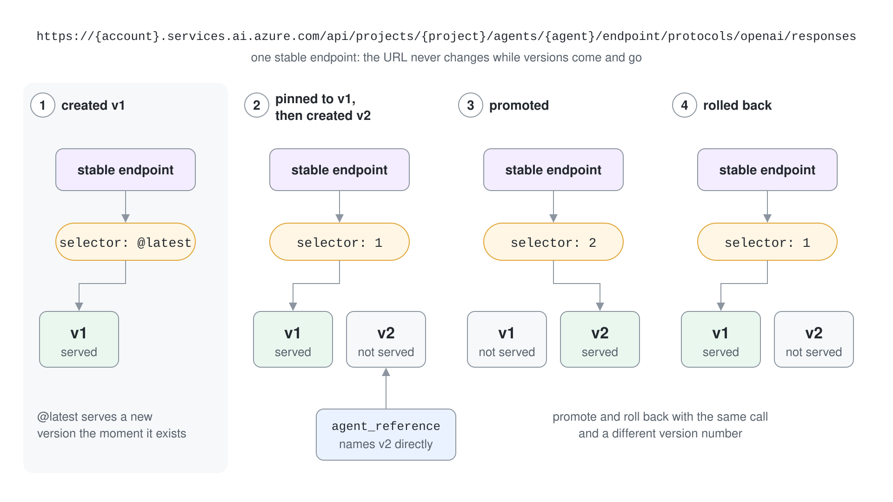
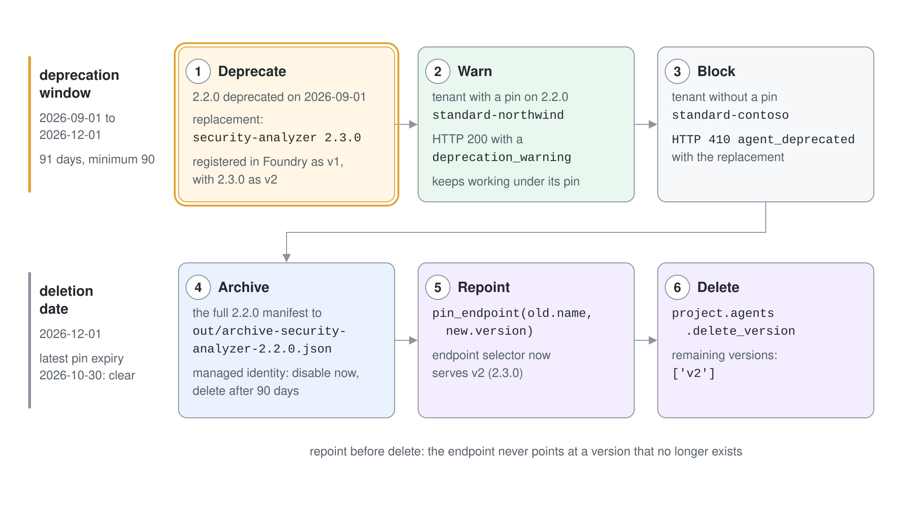

# Release, Pin, Meter and Retire an Agent Version

A multi-tenant agent changes every few weeks, and nobody can say which version a customer is on, who approved it, or how to take it away again. You build a governed release path for a security analyzer agent: a manifest gate, staged rollout, a pinned stable endpoint, per-tenant token limits and a notice-based retirement.

What you practice here: treating every agent change as a versioned release with an approval record, a controlled route to traffic and a planned end of life.

Duration: about 50 minutes.

## Prerequisites

- Python 3.12 or later or the .NET 10 SDK, and `az login` completed against the subscription that holds your Foundry project.
- The Foundry User role on the project, and a `gpt-5.4` deployment.
- Concepts from the [topic readme](readme.md): the manifest, the version selector and the retirement sequence.

## Run it

```bash
cd demos/08-governance/06-agent-lifecycle/agent-lifecycle-py
pip install -r requirements.txt
cp .env.example .env
python version_governance.py
python version_selector.py
python quota_chargeback.py
python retirement.py
```

The C# twin has four commands that match the four scripts.

```bash
cd demos/08-governance/06-agent-lifecycle/agent-lifecycle-cs
cp .env.example .env
dotnet run -- governance
dotnet run -- selector
dotnet run -- quota
dotnet run -- retirement
```

Set `PROJECT_ENDPOINT` and `MODEL_DEPLOYMENT_NAME` in `.env` first. Work in `agent-lifecycle-py/` or `agent-lifecycle-cs/`; both are finished projects. Every script creates its own agent under an `m8-life-` name (C#: `m8h-life-`) and deletes it before it exits.

## Step 1: Gate a change with its manifest

Two manifests describe version 2.2.0 and version 2.3.0 of the analyzer. The script first proves each prompt file still matches the hash in its manifest, then classifies the change.

```python
actual = hashlib.sha256(prompt_text(m)).hexdigest()
print(f"  {m['version']}: {'match' if actual == m['system_prompt']['hash'] else 'DRIFT'}")

verdict, reasons = classify(old, new)
```

Run `python version_governance.py`. Expected output:

```text
Manifest integrity (prompt file hash must match manifest)
  2.2.0: match
  2.3.0: match

Approval gate
  2.2.0 -> 2.3.0: MANUAL approval (system prompt rewritten (57% of text modified))
  2.2.0 -> temperature 0.28: AUTOMATED approval (tuning only)

Compliance fields in the 2.3.0 manifest
  eu_ai_act_risk_classification: limited
  material_change_assessment: True
  technical_file_reference: techfile/security-analyzer-2.3.0.pdf
```

The rewrite touches 57 percent of the prompt, which is over the 20 percent limit, so a human must approve. A temperature change of 0.02 passes automatically.

## Step 2: Roll out in waves and honor pins

The approval date plus each tenant's rollout tier decides when the tenant may take 2.3.0. A tenant with an unexpired pin stays where it is.

```python
def eligible(tenant, approved_on, today):
    if tenant["pin"] and tenant["pin"]["expires"] > today:
        return f"held on {tenant['pin']['agent_version']} (pin until {tenant['pin']['expires']})"
    wait = VALIDATION_DAYS[tenant["rollout_tier"]]
    if today >= approved_on + timedelta(days=wait):
        return "deploy 2.3.0"
    return f"wait until {approved_on + timedelta(days=wait)}"
```

The same script prints the schedule on day 0, day 8 and day 31. Expected output, day 8 only:

```text
  day 8 (2026-09-02)
    premium-fabrikam-internal  tier 1: deploy 2.3.0
    standard-contoso           tier 2: deploy 2.3.0
    premium-regulated-bank     tier 3: wait until 2026-09-24
    standard-northwind         tier 2: held on 2.2.0 (pin until 2026-10-30)
    developer-startup          tier 1: deploy 2.3.0
```

Tier 1 and 2 tenants are on 2.3.0 by day 8, the regulated bank waits until day 30, and Northwind is held on 2.2.0 by its pin.

## Step 3: Publish approved versions to Foundry

Each manifest becomes an agent version. The manifest's approval facts travel as version metadata, so the portal and the API show who approved what.

```python
agent = create_agent(
    "m8-life-governed",
    prompt_text(m).decode(),
    metadata={
        "manifest_version": m["version"],
        "prompt_version": m["system_prompt"]["version"],
        "prompt_hash": m["system_prompt"]["hash"][:16],
        "approver": m["approval"]["approver"],
    },
)
```

Expected output, the end of the same run:

```text
Publish approved manifests as Foundry agent versions
  m8-life-governed v2 metadata={'manifest_version': '2.3.0', 'prompt_version': 'security-prompt-v5.2', 'prompt_hash': '86c1dac928c61c2f', 'approver': 'security-lead@fabrikam.com'}
  m8-life-governed v1 metadata={'manifest_version': '2.2.0', 'prompt_version': 'security-prompt-v5.1', 'prompt_hash': '176f4ed8e52c2f45', 'approver': 'security-lead@fabrikam.com'}
```

Foundry numbered the versions 1 and 2 in creation order. The metadata is the link back to your manifests.

### C#

`VersionGovernance.cs` covers Steps 1 to 3. Manifests and tenants load with YamlDotNet into typed classes, the hash uses `SHA256.HashData`, and the version metadata goes into `ProjectsAgentVersionCreationOptions.Metadata`. .NET has no `difflib`, so `SequenceMatcher.cs` is a port of its matching-blocks ratio, including the heuristic for frequent characters; it reports the same 57 percent.

```csharp
double ratio = SequenceMatcher.Ratio(old.PromptText(), updated.PromptText());
if (1 - ratio > 0.20) reasons.Add($"system prompt rewritten ({(1 - ratio) * 100:0}% of text modified)");
```

Run `dotnet run -- governance`. Expected output, trimmed to the parts that carry the logic:

```text
Manifest integrity (prompt file hash must match manifest)
  2.2.0: match
  2.3.0: match

Approval gate
  2.2.0 -> 2.3.0: MANUAL approval (system prompt rewritten (57% of text modified))
  2.2.0 -> temperature 0.28: AUTOMATED approval (tuning only)

  day 8 (2026-09-02)
    premium-fabrikam-internal  tier 1: deploy 2.3.0
    standard-contoso           tier 2: deploy 2.3.0
    premium-regulated-bank     tier 3: wait until 2026-09-24
    standard-northwind         tier 2: held on 2.2.0 (pin until 2026-10-30)
    developer-startup          tier 1: deploy 2.3.0

Publish approved manifests as Foundry agent versions
  m8h-life-governed v2 metadata={'manifest_version': '2.3.0', 'prompt_version': 'security-prompt-v5.2', 'prompt_hash': '86c1dac928c61c2f', 'approver': 'security-lead@fabrikam.com'}
  m8h-life-governed v1 metadata={'manifest_version': '2.2.0', 'prompt_version': 'security-prompt-v5.1', 'prompt_hash': '176f4ed8e52c2f45', 'approver': 'security-lead@fabrikam.com'}
```

## Step 4: Route the stable endpoint with the version selector

Publishing a version does not have to change what customers get. The selector decides, and it can be moved forward or back without touching the versions.

```python
pin_endpoint(NAME, stable.version)
candidate = create_agent(NAME, open("prompts/security-analyzer-v5.2.txt").read(), metadata={"prompt_version": "security-prompt-v5.2"})
ask_endpoint(NAME, QUESTION)
ask(candidate, QUESTION)
```

Run `python version_selector.py`. Expected output:

```text
created v1, endpoint selector: @latest
  endpoint answers: high: `eval(user_input)` is a code injection vulnerability if `user_input` can be influenced by an attacker, a

pinned to v1, then created v2, endpoint selector: 1
  endpoint answers:  high: Using `eval(user_input)` is a code injection vulnerability if `user_input` can be influenced by an attac
  candidate v2 tested by reference: high | CWE-95 | `eval(user_input)` executes untrusted input as code, enabling arbitrary code execution if `use

promoted, endpoint selector: 2
  endpoint answers: high | CWE-95 | `eval(user_input)` is a confirmed code injection vulnerability because untrusted input is exec

rolled back, endpoint selector: 1
  endpoint answers: high: Using `eval(user_input)` is a code injection vulnerability if `user_input` can be influenced by an attac
```

Read the second block. The endpoint still answers in the version 1 style after version 2 exists, while a call that names version 2 directly already uses the `severity | CWE id | explanation` format. Promoting and rolling back are the same call with a different version number.



### C#

The version selector has no typed API in `Azure.AI.Projects.Agents` 2.0.0. `Foundry.cs` pins the endpoint with a merge-patch `PATCH /agents/{name}` and calls the stable endpoint at `/agents/{name}/endpoint/protocols/openai/responses`, both with `HttpClient` and a token for `https://ai.azure.com/.default`. Calls by version reference use the typed `GetProjectResponsesClientForAgent`.

```csharp
HttpResponseMessage reply = await http.PostAsJsonAsync($"{Endpoint}/agents/{name}/endpoint/protocols/openai/responses?api-version=v1", new { input = text });
```

Run `dotnet run -- selector`. Expected output:

```text
created v1, endpoint selector: @latest
  endpoint answers: high - Using `eval(user_input)` is a code injection vulnerability if `user_input` can be influenced by an atta

pinned to v1, then created v2, endpoint selector: 1
  endpoint answers:  high: `eval(user_input)` is a code injection vulnerability if `user_input` can be influenced by an attacker, a
  candidate v2 tested by reference: high | CWE-95 | `eval(user_input)` evaluates attacker-controlled input as code, enabling arbitrary code execut

promoted, endpoint selector: 2
  endpoint answers: high | CWE-95 | `eval(user_input)` is a confirmed code injection vulnerability if `user_input` can be influenc

rolled back, endpoint selector: 1
  endpoint answers: high: Using `eval(user_input)` is a code injection vulnerability if `user_input` can be influenced by an attac
```

## Step 5: Meter tenants at a token gateway

Three tenants share one model deployment. The gateway class gives each tier a token budget per window and a monthly quota, and the client retries 429 answers with backoff.



```python
TIERS = {
    "premium": {"tokens_per_minute": 60000, "monthly_quota": 2000000},
    "standard": {"tokens_per_minute": 25000, "monthly_quota": 750000},
    "developer": {"tokens_per_minute": 150, "monthly_quota": 100000},
}
```

Run `python quota_chargeback.py`. Expected output:

```text
Invocations through the token-limit gateway
  premium-fabrikam-internal (premium): What is SQL injection?
    -> SQL injection is a vulnerability where an attacker inserts malicious SQL into application 
  premium-fabrikam-internal (premium): What is cross-site scripting?
    -> Cross-site scripting (XSS) is a web security vulnerability where an attacker injects malic
  standard-contoso (standard): What is a hardcoded credential?
    -> A hardcoded credential is a secret value like a password, API key, token, or private key e
  developer-startup (developer): What is insecure deserialization?
    -> Insecure deserialization happens when an application accepts untrusted serialized data and
  developer-startup (developer): What is path traversal?
    -> Path traversal is a vulnerability where an attacker uses inputs like `../` or encoded equi
  developer-startup (developer): What is server-side request forgery?
    429 for developer-startup, attempt 1, retrying in 4.2s
    -> Server-side request forgery (SSRF) is a vulnerability where an attacker tricks a server in

Chargeback (model cost from metered tokens, shared compute split evenly across active tenants)
  developer-startup          in=   82 out=  207 model=$0.0023 shared=$4.00 total=$4.0023
  premium-fabrikam-internal  in=   53 out=  110 model=$0.0012 shared=$4.00 total=$4.0012
  standard-contoso           in=   28 out=   72 model=$0.0008 shared=$4.00 total=$4.0008
  total allocated: $12.0043
```

On this run the developer tenant exhausted its 150-token window on the third request, waited, and then succeeded. Chargeback prices each tenant from metered tokens and splits the shared compute cost equally.

### C#

`QuotaChargeback.cs` holds the same gateway, retry loop and chargeback; token counts come from `response.Usage`. Run `dotnet run -- quota`. Expected output, trimmed:

```text
  developer-startup (developer): What is server-side request forgery?
    429 for developer-startup, attempt 1, retrying in 3.7s
    -> Server-side request forgery (SSRF) is a vulnerability where an attacker tricks a server in

Chargeback (model cost from metered tokens, shared compute split evenly across active tenants)
  developer-startup          in=   82 out=  208 model=$0.0023 shared=$4.00 total=$4.0023
  premium-fabrikam-internal  in=   53 out=  143 model=$0.0016 shared=$4.00 total=$4.0016
  standard-contoso           in=   28 out=   59 model=$0.0007 shared=$4.00 total=$4.0007
  total allocated: $12.0045
```

## Step 6: Retire version 2.2.0 with notice

Version 2.2.0 is deprecated and its deletion is scheduled. The script plays one deletion day on a fixed date, 2026-10-18, so the output is reproducible.



```python
pin_endpoint(old.name, new.version)
project.agents.delete_version(agent_name=old.name, agent_version=old.version)
```

Run `python retirement.py`. Expected output, trimmed:

```text
Registered m8-life-retiring v1 (2.2.0, deprecated) and v2 (2.3.0, active)

Governance: 91 days between deprecation and deletion, minimum is 90: ok

Graceful deprecation
  standard-contoso: HTTP 410 {"error": "agent_deprecated", "message": "Security Analyzer 2.2.0 was deprecated on 2026-09-01 and will be deleted on 2026-12-01.", "migra...
  standard-northwind: HTTP 200 {"result": "high: `eval(user_input)` can lead to arbitrary code execution if `user_input` is", "deprecation_warning": {"message": "This ...

Retirement checklist
  tenant version pins on 2.2.0: ['standard-northwind'] (latest expiry 2026-10-30)
  replacement 2.3.0 status: approved
  agent data archived to out/archive-security-analyzer-2.2.0.json
  managed identity: disable now, delete after 90 days of audit retention

Deletion date 2026-12-01 vs pins: clear

Deletion day (simulated): repoint the stable endpoint, then delete retired version 2.2.0 from Foundry
  endpoint selector now serves v2 (2.3.0)
  remaining versions: ['v2']
```

Contoso has no pin and receives HTTP 410 with the replacement. Northwind keeps working under its pin and sees a deprecation warning. The stable endpoint moves to version 2 before version 1 is deleted.

### C#

Run `dotnet run -- retirement`. Expected output, trimmed:

```text
Registered m8h-life-retiring v1 (2.2.0, deprecated) and v2 (2.3.0, active)

Governance: 91 days between deprecation and deletion, minimum is 90: ok

Graceful deprecation
  standard-contoso: HTTP 410 {"error":"agent_deprecated","message":"Security Analyzer 2.2.0 was deprecated on 2026-09-01 and will be deleted on 2026-12-01.","migration":{"replacement":"security-analyzer 2.3.0"},"deprecation_timel
  standard-northwind: HTTP 200 {"result":"high: `eval(user_input)` is a code injection vulnerability if `user_input` can b","deprecation_warning":{"message":"This agent version is deprecated and will be deleted on 2026-12-01.","mig

Deletion date 2026-12-01 vs pins: clear

Deletion day (simulated): repoint the stable endpoint, then delete retired version 2.2.0 from Foundry
  endpoint selector now serves v2 (2.3.0)
  remaining versions: ['v2']
```

## Verify

- Step 4 shows the selector value change from `@latest` to `1`, `2` and back to `1`.
- `out/archive-security-analyzer-2.2.0.json` contains the full 2.2.0 manifest.
- No `m8-life-` or `m8h-life-` agent remains in the project:

```bash
python -c "from foundry import project; print([a.name for a in project.agents.list() if a.name.startswith(('m8-life-', 'm8h-life-'))])"
```

Expected output:

```text
[]
```

## Cleanup

Each script deletes the agent versions it created. Remove the archive.

```bash
rm -r out
```
